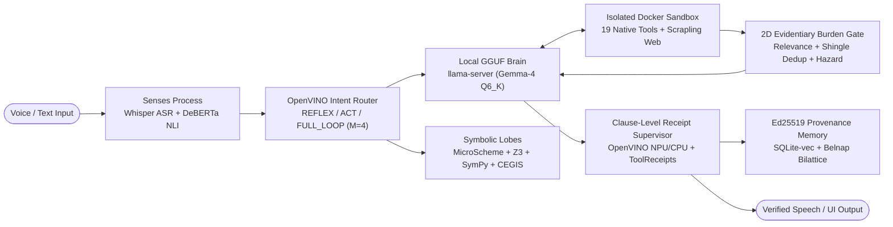

# Project Lucca

**Autonomous, local-first neurosymbolic desktop companion with Ed25519 provenance memory, clause-level receipt supervision, and hazard-scaled evidentiary gating.**

Project Lucca runs locally on workstation hardware, combining real-time voice interaction (Push-to-Talk and energy VAD), a four-process fault-isolated runtime (`UI`, `Core Orchestrator`, `Voice Senses`, and an isolated `Docker Sandbox` exposing 19 native tools), compiled symbolic reasoning (MicroScheme LISP, Z3 SMT, SymPy CAS, and CEGIS), and OpenVINO CPU/NPU epistemic guardrails (`0 MB` dGPU VRAM overhead).

For cross-platform Python agents that do not need the Windows voice UI or Docker runtime, the core verification gates are packaged as a standalone library in [`packages/lucca-epistemic`](./packages/lucca-epistemic/README.md) (`v0.2.0`).

---

## Two Ways to Use Project Lucca

### 1. Standalone Verification Library (`lucca-epistemic` `v0.2.0`)

Runs on Linux, macOS, and Windows (CPU or Intel NPU, `14.08 ms` mean CPU gate latency) with zero UI, audio, WSL2, or Docker dependencies:

```bash
pip install ./packages/lucca-epistemic
```

```python
import os
from lucca_epistemic import (
    Provenance,
    ProvenanceGate,
    ReceiptSupervisor,
    SignerFactory,
    ToolReceipt,
    evaluate_web_evidence_burden,
)

# 1. RFC 8032 Ed25519 domain-separated provenance signing & public-key verification
factory = SignerFactory.from_master_key(os.urandom(32))
gate = ProvenanceGate(factory.public_keys())

signed_record = factory.for_domain(Provenance.TOOL_VERIFIED).sign(
    "Backup archive sha256 verified.", trace_id="tr-01"
)
assert gate.verify(signed_record, expected_provenance=Provenance.TOOL_VERIFIED) is True

# 2. 2D hazard-scaled open-web corroboration, syndication dedup, & conflict detection
burden = evaluate_web_evidence_burden(
    "Why should honey never be fed to infants younger than twelve months?",
    [
        {
            "url": "https://www.cdc.gov/botulism/infant-honey.html",
            "title": "Infant Botulism Prevention",
            "content_preview": "Honey should never be fed to infants younger than 12 months because Clostridium botulinum spores cause infant botulism.",
        },
        {
            "url": "https://www.nhs.uk/baby/weaning/foods-to-avoid/",
            "title": "Foods to Avoid Giving Babies",
            "content_preview": "Babies under 1 year old must not eat honey due to the risk of infant botulism toxin.",
        },
        {
            "url": "https://www.mayoclinic.org/infant-health/honey",
            "title": "Infant Honey Safety",
            "content_preview": "Avoid giving honey to infants under twelve months; Clostridium spores can cause infant botulism.",
        },
    ],
    device="CPU",
)
assert burden.meets_casual_burden is True

# 3. Clause-level action-claim supervision against deterministic ToolReceipts
supervisor = ReceiptSupervisor(device="CPU")
verdict = supervisor.verify_narration(
    "I saved your summary to notes.txt; I also deleted backup.sql.",
    receipts=[ToolReceipt(tool="write_file", ok=True, args={"path": "notes.txt"}, output="ok")],
)
assert verdict.is_valid is False  # catches unexecuted backup.sql deletion clause
```

### 2. Full Local-First Desktop Companion (`src/lucca/`)

```powershell
# 1. Verify environment, GPU/OpenVINO devices, and model SHA-256 manifest pins
uv run python -m lucca.core.env_check

# 2. Run static architecture gates (40/40) and unit test suite
uv run pytest tests/test_static_gates.py
uv run pytest

# 3. Launch multi-process companion supervisor (UI + Core + Senses + Sandbox)
uv run python -m lucca.main
```

---

## System Architecture



### Four Core Engineering Pillars

1. **Cryptographic Provenance Memory (`src/lucca/memory/`):** Long-term memory writes require domain-separated RFC 8032 Ed25519 signatures verified by a public-key-only `ProvenanceGate`. Unverified assistant prose cannot self-certify into durable factual memory, while `BelnapLatentInvestigator` tracks 4-valued paraconsistent truth states (`TRUE`, `FALSE`, `BOTH`, `NEITHER`) and fails closed on `UNCERTAIN` NLI verdicts.
2. **Clause-Level Receipt Supervision (`src/lucca/sandbox/`):** Assistant responses are split into syntactic clauses and scored by an OpenVINO classifier (`models/action_claim_verifier_ov`, `0 MB` GPU VRAM) paired with deterministic `ToolReceipt` set verification and `[ACTION: ...]` Structured Output Action Contracts (`SOAC`), blocking unexecuted tool fabrications before speech synthesis or memory commit.
3. **2D Hazard-Scaled Open-Web Evidentiary Burden (`src/lucca/core/proof_policy.py`, `walton_schemes/`):** Open-web `ResearchTool` dossiers pass through OpenVINO passage-relevance filtering (`web_relevance.py`), shingle/SimHash + bidirectional NLI syndication deduplication (`dedup.py`), and multi-clause hazard lattice pooling (`proof_policy_hazard_v3_ov` + `ConformalGuard`). Required independent corroboration scales with query hazard (`LOW -> 1`, `MEDIUM -> 2`, `HIGH -> 3` independent eTLD+1 publishers), and cross-source contradictions inject structured conflict disclosure metadata (`Arm D`).
4. **Bicameral Symbolic & Sandboxed Execution (`src/lucca/reasoning/`, `src/lucca/core/`):** Procedural rules induced during offline consolidation (`ConsolidationEngine`) are quarantined behind Z3 SMT safety checks, require an Ed25519-signed `OperatorApprovalToken` to promote to `ACTIVE`, and demote on a 1-strike user correction. File, shell, math, and web tools execute inside a memory-clamped WSL2 Docker container.

See [Unified System Architecture Specification](./luccadocs/ARCHITECTURE.md) for the full 4-process IPC contract (`199` reachable modules in `src/lucca/`, `8/8` Import-Linter boundary contracts).

---

## Hardware Tiers (Full Desktop Companion)

VRAM scales with the selected GGUF model at `ctx=32768` ([`q1_vram_nvidia_smi_evidence.json`](./logs/test_reports/wo45/q1_vram_nvidia_smi_evidence.json)). An **Intel AI Boost NPU is optional**; OpenVINO automatically uses the NPU when present (`6.58 ms` mean web-burden gate latency) and falls back to OpenVINO CPU when absent (`16.92 ms` mean on Core Ultra 9 275HX, [`r06_gate_latency_npu_vs_cpu.json`](./logs/test_reports/wo45/r06_gate_latency_npu_vs_cpu.json)).

| Model Tier (`Q6_K` GGUF) | Recommended dGPU VRAM | Resident VRAM (`ctx=32768`) | Recommended System RAM | Notes |
| :--- | :---: | :---: | :---: | :--- |
| **`Gemma-4-E2B`** | 4–6 GB+ | `~2.7 GiB` | 16 GB | Compact low-latency local companion |
| **`Gemma-4-E4B`** | 6–8 GB+ | `~4.8–5.0 GiB` | 16 GB | Balanced everyday voice & tool tier |
| **`Gemma-4-12B`** | 12 GB+ | `~10.9 GiB` | 16–24 GB | Primary dense reasoning & coding tier |
| **`Gemma-4-26B-A4B MoE`** | 12–16 GB | `~11.5 GiB` | 32 GB+ | `--cpu-moe --moe-cache-mib 7680` expert offload |

- **OS (Full Companion):** Windows 11 64-bit with WSL2 (`4.5 GB` `.wslconfig` cap) and Docker CE, Python 3.12+ via `uv`.
- **Cross-Platform (`lucca-epistemic`):** Linux, macOS, or Windows (Python 3.11+, CPU/NPU only).

---

## Empirical Evaluation Summary

All active benchmarks below were executed against live `llama-server` GGUF models, isolated SQLite stores, or archived live-web HTML corpora on local workstation silicon (`RTX 5080 Laptop GPU`, `Core Ultra 9 275HX`). Pre-registered holdouts (`G4 v3`, `G5`, `G6`, and `WO-46 real_web_v2`) enforce a strict `lock -> corpus -> results` OpenTimestamps + `origin/main` commit chain.

| Evaluation Suite | Experimental Setup | Key Result (Author-Measured, `[95% Wilson CI]`) | Evidence Artifacts |
| :--- | :--- | :--- | :--- |
| **Multi-Session Memory Poisoning Resistance (`N=300`)** | 5-arm ablation (`100` natural confabulations, `100` benign reasoning, `100` adversarial user falsehoods; `1,500` live `E4B` turns; blinded IRR $\kappa = 0.9206$) | **`0/100 (0.0% [0.0%, 4.6%])` poisoning** on both natural confabulations & user falsehoods vs `100/100 (100.0%)` Naive RAG ($p = 4.16 \times 10^{-23}$) and `11/100 (11.0%)` Passive Soft Tagging ($p = 9.77 \times 10^{-4}$); **`100/100 (100.0% [95.4%, 100.0%])` factual continuity** (`0/40` poisoned across 4 model scales in multi-scale rebench) | [`memory_poisoning_v3_300_results.json`](./logs/test_reports/memory_poisoning_v3_300_results.json), [`wo39_live_4models_rebench.json`](./logs/test_reports/wo39_live_4models_rebench.json) |
| **Contrastive Companion Recall, Receipt Introspection & Abstention (`N=300`)** | `300` items (`100` seeded recall, `100` receipt introspection, `100` abstention) $\times$ 3 arms (`900` live `E4B` turns; IRR $\kappa = 1.0000$) | **Recall: `100/100 (100.0% [95.4%, 100.0%])`** vs `2/100 (2.0%)` Bare LLM and `85/100 (85.0%)` Hybrid RAG ($p_{\text{HB}} = 3.05 \times 10^{-4}$); **Receipt Introspection: `100/100 (100.0%)`**; **Abstention: `100/100 (100.0%)`** | [`contrastive_v2_300_results.json`](./logs/test_reports/contrastive_v2_300_results.json), [`contrastive_v2_300_results_REPORT.md`](./logs/test_reports/contrastive_v2_300_results_REPORT.md) |
| **Clause-Level Action-Claim Supervision & Intent Routing (`N=2,022` + `N=540` Holdouts + `100` Live E2E)** | 3 zero-VRAM OpenVINO classifiers (`action_claim_verifier_ov`, `proof_policy_hazard_ov`, `router_intent_ov`) across pooled supervision corpus, `Blind-390`, SHA-256 locked `Holdout-150`, and 4-model live orchestrator | • **Pooled Supervision (`N=2,022`):** **`465/471 (98.7% [97.3%, 99.4%])` recall**, **`9/1,551 (0.6% [0.3%, 1.1%])` FPR**, **`2,007/2,022 (99.3%)` accuracy** (vs `58.5%` legacy stem regex)<br>• **Locked Holdout (`N=150`):** **`145/150 (96.7% [92.4%, 98.6%])`** single-pass (`50/50` coherence, `50/50` hazard, `45/50 -> 50/50` router post-fix)<br>• **Live 4-Model E2E (`N=100`):** **`100/100 (100.0%)`** grounding, **`98/100 (98.0%)`** task completion | [`wo42_large_sample_2020_report.json`](./logs/test_reports/wo42_large_sample_2020_report.json), [`wo42_locked_holdout_150_report.json`](./logs/test_reports/wo42_locked_holdout_150_report.json), [`wo42_live_4model_summary.json`](./logs/test_reports/wo42_live_4model_summary.json) |
| **Structured Output Action Contract (`SOAC`, `720` Live Turns)** | `120` held-out prompts on `26B-A4B` across Natural, `SOAC`, and `SOAC+GBNF` (`6.82 µs` parser; dual-rater $\kappa = 1.0000$) | **`0/120 (0.0% [0.0%, 3.9%])` unframed prose action leakage** across `v1 SOAC`, `v2 SOAC`, and `v2 SOAC+GBNF` (`100%` `[ACTION: ...]` frame coupling) | [`paper2_v1_v2_semantic_audit_720.json`](./logs/test_reports/paper2_v1_v2_semantic_audit_720.json) |
| **4-Arm Web Evidentiary Burden & Conflict Disclosure (`N=132` Items, `2,640` Live Turns)** | `132` disjoint items $\times$ 4 arms (`A` bare, `B` full policy, `C` generic tip, `D` structured contract without legal phrasing) $\times$ 5 Gemma-4 models at `ctx=32768`; 3 non-Google judge families (`Qwen3.8-27B`, `Phi-4-14B`, `Nemotron-3.5-30B-A3B`) | **Disputed Conflict Disclosure (`660` turns, $\min\kappa = 0.6983$):** **`164/165 (99.4% [98.2%, 100.0%])` `Arm D`** vs `85/165 (51.5%)` `Arm C` (`+47.9 pp`, $p = 0.0001$, `79:0` discordant) and `61/165 (37.0%)` `Arm A`; **Faithful Substantive Answering:** **`648/660 (98.2%)` `Arm D`** vs `612/660 (92.7%)` `Arm C` ($p = 0.0001$); **Nominal-Met Over-Hedging (`D3` $\min\kappa = 0.8811$):** **`18/330 (5.5%)` `Arm D`** vs `24/330 (7.3%)` `Arm C` and `47/330 (14.2%)` `Arm A` | [`GATE_G4v3.md`](./logs/test_reports/wo45/GATE_G4v3.md), [`g4_live_v3_report.json`](./logs/test_reports/wo45/g4_live_v3_report.json) |
| **Multi-Clause Hazard (`N=130`), Sybil Dedup (`N=45`), & Out-of-Sample Live Open-Web Scrapling (`N=64` `v2`)** | Causal OpenTimestamps holdouts: disjoint `proof_policy_hazard_v3_ov` (`N=130`); fresh Domain Set B wire/sybil dedup (`N=45`); single-shot live `ResearchTool`/Scrapling `real_web_v2` (`N=64` fresh queries, `246` `.html.gz` pages, dual-rater $\kappa = 0.9107$–$1.0000$) | • **Multi-Clause Hazard (`N=130`):** **`126/130 (96.9% [92.4%, 98.8%])` conservative safe** (`119/130 [91.5%]` strict 3-class, `0/45` benign false escalations to `HIGH`)<br>• **Sybil / Wire Dedup (`N=45`):** False corroboration cut **`38/45 (84.4%) -> 3/45 (6.7% [2.3%, 17.9%])`**<br>• **Live Open-Web `real_web_v2` (`N=64`, `WO-46`):** **`46/64 (71.9% [59.9%, 81.4%])` burden decision accuracy** (up from `39/64 [60.9%]` on historical `v1`), **`56/64 (87.5% [77.2%, 93.5%])` dispute accuracy** (`3.6% [2/55]` FPR vs `24.0%` in `v1`), **`32/39 (82.1%)` sufficient-evidence utility pass** (`12.5% [2/16]` low-hazard over-hedge), **`56/64 (87.5%)` within-1 source count** (`29/64 [45.3%]` exact, `MAE = 0.72`), **`55/64 (85.9%)` safe hazard** | [`real_web_v2_report.json`](./logs/test_reports/wo46/real_web_v2_report.json), [`r21_hazard_holdout_report.json`](./logs/test_reports/wo45/r21_hazard_holdout_report.json), [`r33_sybil_dedup_report.json`](./logs/test_reports/wo45/r33_sybil_dedup_report.json), [`r32_real_web_v1_report.json`](./logs/test_reports/wo45/r32_real_web_v1_report.json) |
| **OpenVINO CPU NLI Cross-Encoder (`N=120` Hard Paraphrase Holdout & `N=100` `pairs_v1`)** | `DeBERTa-v3-xsmall` vs `MiniLM-L6` (`0 MB` VRAM, `20.47 ms` p50 / `26.70 ms` p95) | **Out-of-sample `nli_holdout_v2_120`:** **`82/120 (68.3% [59.6%, 76.0%])`** vs `67/120 (55.8%)` `MiniLM-L6` ($p = 0.0107$; `40.0% [16/40]` entailment recall at `100.0%` precision); **`pairs_v1`:** **`91/100 (91.0% [83.8%, 95.2%])`** | [`nli_verifier_v2_report.json`](./logs/test_reports/nli_verifier_v2_report.json) |
| **LongMemEval Temporal Memory (`N=30`), Live Rule Induction (`52` Turns), & Symbolic/Coding Suites** | `LongMemEval` (`12B`), organic `IN-D` Z3 rule induction (`12B`), Sealed Parametric Neurosymbolic Suite (`v139`), Docker `HumanEval`/`HumanEval+` (`N=164`), `GSM-Symbolic` (`N=100`), `MATH-500` (`N=500`) | • **`LongMemEval`:** **`21/30 (70.0% [52.1%, 83.3%])`** vs `7/30 (23.3%)` context truncation ($p = 0.000122$, `8.1 ms` retrieval)<br>• **Z3 Rule Induction:** **`8/8` held-out recall (`0.14 ms`)**, **`0/8` misfires**<br>• **Sealed Neurosymbolic (`v139`):** **`15/15 (100.0%)`** on `26B`/`12B`/`E4B` (`14/15` on `E2B`)<br>• **Coding & Math (`12B`):** **`155/164 (94.5%)` HumanEval**, **`150/164 (91.5%)` HumanEval+**, **`94/100 (94.0%)` GSM-Symbolic**, **`429/500 (85.8%)` strict / `451/500 (90.2%)` lenient MATH-500 Fresh** | [`longmemeval_pipeline_12B_1791794644.json`](./logs/test_reports/longmemeval_pipeline_12B_1791794644.json), [`in_d_live_baseline_wo39.json`](./logs/test_reports/in_d_live_baseline_wo39.json), [`RESULTS.md`](./RESULTS.md) |
| **Static Architecture & Hygiene Gates** | Zero-`Any` in public APIs, LOC ceilings, NLI fail-closed enforcement, 100% module reachability, anti-contamination, zero `ruff`/`mypy` errors | **`40/40` static gates passed**, **`8/8` Import-Linter contracts kept** | [`tests/test_static_gates.py`](./tests/test_static_gates.py), [`.importlinter`](./.importlinter) |

---

## Research Preprints & Technical Documentation

- **Foundational Preprint:** [*Provenance-Gated Memory and Deontic Output Supervision for Epistemically Grounded Autonomous Agents*](./docs/paper.pdf) — Zenodo DOI: [`10.5281/zenodo.23649049`](https://doi.org/10.5281/zenodo.23649049)
- **Paper 1 (Memory Poisoning Ablation):** [*Cryptographic Provenance Gates Mitigate Multi-Session Memory Poisoning in Autonomous Agents*](./docs/papers/01_memory_poisoning_ablation.pdf) ([LaTeX](./papers/01_memory_poisoning_ablation/main.tex)) — Zenodo DOI: [`10.5281/zenodo.23901452`](https://doi.org/10.5281/zenodo.23901452)
- **Paper 2 (Action Supervision & SOAC):** [*Why Speech-Regex Action Supervisors Miss Live Output: An Empirical Evasion Taxonomy and Held-Out Structured Action Contract Evaluation*](./docs/papers/02_deontic_supervision_evasion.pdf) ([LaTeX](./papers/02_deontic_supervision_evasion/main.tex)) — Zenodo DOI: [`10.5281/zenodo.23901605`](https://doi.org/10.5281/zenodo.23901605)
- **Paper 3 (Five-Layer Epistemic & Procedural Memory):** [*Closing the Epistemic Loop Across the Five Layers of Agent Memory: Cryptographic Provenance, Paraconsistent Bilattices, and Z3-Quarantined Procedural Induction*](./docs/papers/03_provenance_gated_five_layer_memory.pdf) ([LaTeX](./papers/03_provenance_gated_five_layer_memory/main.tex)) — Zenodo DOI: [`10.5281/zenodo.23901683`](https://doi.org/10.5281/zenodo.23901683)
- **Paper 4 (Clause-Level NPU Supervision & 2D Evidentiary Burden):** [*Breaking the Lexical Supervision Ceiling: Clause-Level MiniLM-L6 Verification and Task-Priority Intent Routing on a Zero-VRAM Edge NPU*](./docs/papers/04_clause_level_npu_supervision.pdf) ([LaTeX](./papers/04_clause_level_npu_supervision/main.tex))
- **Engineering Guides & Provenance Ledger:**
  - [`REPRODUCING.md`](./REPRODUCING.md) — Dataset SHA-256 pins, OpenTimestamps verification, and one-command benchmark runners.
  - [`RESULTS.md`](./RESULTS.md) — Full chronological experimental ledger across all work orders.
  - [`logs/test_reports/wo45/AUDIT_AND_RETRACTION_HISTORY.md`](./logs/test_reports/wo45/AUDIT_AND_RETRACTION_HISTORY.md) — Complete scientific audit disclosures, superseded `WO-44` / `G4 v2` baselines, and historical corrections.
  - [`SECURITY.md`](./SECURITY.md) & [`luccadocs/security/THREAT_MODEL.md`](./luccadocs/security/THREAT_MODEL.md) — Threat model, sandbox boundaries, and vulnerability reporting.
  - [`luccadocs/GLOSSARY.md`](./luccadocs/GLOSSARY.md), [`CONTRIBUTING.md`](./CONTRIBUTING.md), & [`THIRD_PARTY_NOTICES.md`](./THIRD_PARTY_NOTICES.md).

---

## Scope & Residual Engineering Boundaries

- **Single-workstation empirical baselines:** All latency, VRAM, and accuracy metrics in this repository are author-measured on a single local workstation (`RTX 5080 Laptop GPU`, `Core Ultra 9 275HX`, Windows 11). Full harness scripts, frozen `.html.gz` corpora, and detached `.ots` proofs are provided in [`REPRODUCING.md`](./REPRODUCING.md) for external replication.
- **Empirical guardrail error bounds:** Neural supervision and open-web corroboration reduce hallucinated tool claims and uncorroborated web assertions substantially, while remaining empirical runtime classifiers rather than formal completeness proofs:
  - *Action-claim supervision (`wo42_large_sample_2020_report.json`):* `6/471 (1.3%)` false negatives on zero-verb indirect state-consequence phrasing and `9/1,551 (0.6%)` false positives on un-fenced first-person walkthrough prose.
  - *Fail-closed NLI clustering (`nli_verifier_v2_report.json`):* All NLI consumers fail closed on `UNCERTAIN`/`NEUTRAL` verdicts (`100%` entailment precision, `40.0% [16/40]` recall on low-lexical-overlap paraphrases), conservatively withholding ambiguous paraphrases rather than merging unverified claims.
  - *Unfiltered open-web retrieval (`real_web_v2_report.json`):* Upgrading query simplification, eTLD+1 candidate diversity, OpenVINO passage-relevance filtering, and prohibitive consensus normalization raised single-shot live Scrapling burden accuracy from `39/64 (60.9%)` (`v1`) to `46/64 (71.9%)` (`v2`), dispute accuracy from `42/64 (65.6%)` to `56/64 (87.5%)`, and within-1 source count from `45/64 (70.3%)` to `56/64 (87.5%)`. Residual errors (`18/64`: `11` false burden passes and `7` conservative over-hedges) arise primarily when a scientific debate is summarized implicitly without explicit controversy markers (`3/9` live dispute recall) or when a borderline technical query classifies 1 tier below `HIGH` (`46/64` strict 3-class vs `55/64` conservative safe hazard).
- **Platform footprint:** The 4-process voice/UI/Docker desktop stack requires Windows 11 + WSL2, whereas [`lucca-epistemic`](./packages/lucca-epistemic/README.md) provides the standalone verification gates on Linux, macOS, and Windows CPU/NPU.

---

## License

GNU Affero General Public License v3.0 or later (`AGPL-3.0-or-later`). See [LICENSE](./LICENSE). Upstream runtimes, libraries, and foundation models retain their original licenses as documented in [THIRD_PARTY_NOTICES.md](./THIRD_PARTY_NOTICES.md).
