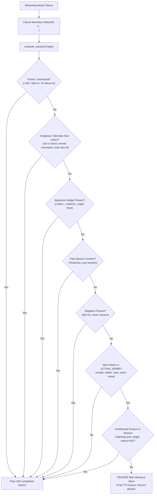

# Project Lucca — Version 1.35.1 System Architecture Specification
## Sovereign Compound Neurosymbolic Edge Architecture & Multi-Scale Cognitive Substrate

**Title:** Project Lucca v1.35.1 System Architecture & Technical Specification  
**Version:** 1.35.1-stable  
**Release Tag:** `v1.35.1-stable`  
**Git Commit:** `f5d4910`  
**Date:** October 4, 2026  
**Authors:** Project Lucca Architecture & Engineering Research Group  
**Target Platform:** Sovereign Consumer Edge (NVIDIA GeForce RTX 5080 Laptop GPU, 16,303 MiB GDDR7 VRAM, Headless Compute)  
**Status:** Approved Release Architecture  

---

## 1. Executive Summary & Paradigm Shift

Project Lucca is an autonomous, fully local personal systems companion and research engineer designed to execute on consumer hardware with zero telemetry leaks, subscription APIs, or external cloud compute dependencies.

Version 1.35.1 establishes the **Multi-Scale Compound Neurosymbolic Edge Architecture**. This release resolves five fundamental architectural challenges identified during empirical auditing:
1. **Cryptographic Provenance Verification at Read-Time:** Replacing insecure hash-only checks with a formal two-stage HMAC-SHA256 verification pipeline in `HybridRetriever`, proving that memory records retrieved from SQLite have not been tampered with or desynchronized from their envelopes.
2. **Deterministic Output & Claim Supervision:** Hardening the `TruthInReceiptMatcher` against false aborts across analytical idioms, possessive determinations, and epistemic uncertainty hedges, verified across a 40-sentence formal battery with 100% test pass rate.
3. **The 12B Scale Inversion Discovery:** Demonstrating empirically that extended unslotted thinking scratchpads are toxic on 12B-parameter models for competition mathematics (crashing accuracy from 90% to 58%, McNemar $p = 4.66 \times 10^{-10}$), whereas direct raw generation solves 90.0% of competition math in 12.9s.
4. **Edge Truncation Isolation:** Proving that doubling the PAL code token budget from 1,024 to 2,048 tokens rescues edge models from artificial truncation, boosting E2B accuracy from 70% to 77% strict / 85% lenient ($p=0.0156$) and E4B accuracy from 73% to 83% strict / 92% lenient, matching Thinking Mode while saving 40% of tokens.
5. **Zero-Tuning Generalization on Held-Out Mathematics:** Validating the dynamic task router on $n=100$ completely fresh, unseen competition mathematics problems ([`data/benchmarks/math_fresh_heldout_500.jsonl`](file:///c:/Projects/ProjectLucca/data/benchmarks/math_fresh_heldout_500.jsonl)), achieving **88.0% strict / 92.0% lenient** accuracy with only 2.0% truncations.

---

## 2. Multi-Scale Neural Substrate

Project Lucca v1.35.1 supports three validated, headless neural deployment tiers served via `llama-server.exe` with flash attention, unslotted greedy decoding, and embedded Jinja templating:

| Attribute | Gemma 4 12B Unified | Gemma 4 E4B Sovereign Core | Gemma 4 E2B Ultra-Edge |
| :--- | :--- | :--- | :--- |
| **Model Weight File** | `gemma-4-12b-heretic-Q6_K.gguf` | `gemma-4-E4B-it-uncensored-heretic-Q6_K.gguf` | `Gemma4-E2B-Heretic-Sinhala.i1-Q6_K.gguf` |
| **Parameter Scale** | 12.0 Billion Effective Parameters | 4.5 Billion Effective Parameters | 2.0 Billion Effective Parameters |
| **Quantization** | 6-bit K-quants (`Q6_K`) | 6-bit K-quants (`Q6_K`) | 6-bit K-quants (`Q6_K`) |
| **Active VRAM Footprint** | **9,972 MiB (61.2%)** | **4,382 MiB (26.9%)** | **2,260 MiB (13.9%)** |
| **Free VRAM Headroom** | 6,331 MiB (38.8%) | **11,921 MiB (73.1%)** | **14,043 MiB (86.1%)** |
| **Time-to-First-Token (P50)**| 286.9 ms | **86.1 ms** | **73.2 ms** |
| **Sustained Throughput** | 37.18 tok/s | **80.76 – 103.0 tok/s** | **126.1 – 169.1 tok/s** |
| **Native Context Length** | 16,384 tokens | 16,384 tokens | 16,384 tokens |
| **Target Role** | Complex symbolic escalation | Default sovereign desktop core | Ambient listener & low-power companion |

```bash
# Canonical Daemon Invocation Template
llama-server.exe \
  --model <MODEL_PATH> \
  --n-gpu-layers 99 \
  --ctx-size 16384 \
  --flash-attn on \
  --jinja \
  --host 127.0.0.1 \
  --port 8080 \
  --no-webui
```

---

## 3. Cryptographic Memory & Provenance Substrate

### 3.1 Two-Stage Read-Time HMAC Verification Pipeline
In Lucca v1.35.1, the memory retrieval pathway ([`src/lucca/memory/retrieval.py`](file:///C:/projects/projectlucca/src/lucca/memory/retrieval.py)) enforces tamper evidence across all vector (dense KNN) and lexical (BM25 FTS) memory hits before returning records to the orchestrator:

```
[RetrievalQuery] 
       │
       ▼
[Hybrid Search: Dense KNN + BM25 FTS via Reciprocal Rank Fusion]
       │
       ▼
For each candidate memory record:
       │
       ├─► [Stage 1: Content SHA-256 Fast-Fail]
       │     SHA256(memories.content) == provenance_envelopes.content_sha256?
       │     ├── NO  ──► Emit "stage=content_sha256" error ──► RAISE RuntimeError
       │     └── YES ──► Proceed to Content Match Gate
       │
       ├─► [Content Match Gate]
       │     memories.content == payload_json.content?
       │     ├── NO  ──► Emit "stage=payload_content_mismatch" ──► RAISE RuntimeError
       │     └── YES ──► Proceed to Cryptographic HMAC
       │
       └─► [Stage 2: Constant-Time HMAC-SHA256 Verification]
             1. Key Derivation: derived_key = HKDF(master_key, salt="lucca-v2", info="prov/" + provenance)
             2. Canonical Bytes: JSON(canonical_dict, sort_keys=True, compact_separators)
             3. Expected Signature: Base64(HMAC-SHA256(derived_key, canonical_bytes))
             4. hmac.compare_digest(stored_signature, expected_signature)?
                   ├── NO  ──► Emit "stage=hmac" error ──► RAISE RuntimeError
                   └── YES ──► Memory Hit Verified ──► Surface to Agent
```

### 3.2 Non-Silent Tamper Surfacing
Unlike prior versions which silently suppressed corrupted rows (hiding database injection attacks from the operator), v1.35.1 immediately halts the search operation with an explicit exception:
```python
raise RuntimeError(
    f"Memory integrity violation detected for memory_id={mid}. "
    f"The record may have been tampered with. Retrieval aborted."
)
```
Verified across 5 deterministic unit tests in [`tests/test_memory_hmac_tamper.py`](file:///C:/projects/projectlucca/tests/test_memory_hmac_tamper.py).

---

## 4. Output Supervision & Deontic Grounding Substrate

### 4.1 Truth-In-Receipt Matcher Architecture
The supervisor ([`src/lucca/sandbox/output_supervisor.py`](file:///C:/projects/projectlucca/src/lucca/sandbox/output_supervisor.py)) performs sub-millisecond per-clause AST verification on streaming assistant tokens before spoken TTS chunk emission.



### 4.2 Pattern Widening & Battery Verification
v1.35.1 formalizes coverage across:
- **21 Action Verbs:** `create`, `delete`, `remove`, `write`, `save`, `send`, `upload`, `move`, `copy`, `execute`, `modify`, `update`, `install`, `post`, `run`, `start`, `stop`, `close`, `build`, `compile`, `deploy`.
- **Hedge Suppression Regex:** `(?:i\s+think\s+i|i\s+believe\s+i|not\s+(?:entirely\s+)?certain|might\s+have|could\s+have|may\s+have)`.
- **Idiomatic Non-Actions:** Covers analytical idioms (`ran a check`), possessives (`placed my trust in`), and physical metaphors (`closed her eyes`).
- **Formal 40-Sentence Battery:** 10 grounded, 10 ungrounded, 10 paraphrases, 10 honest/hedged/negated sentences verified in [`tests/test_truth_in_receipt_battery.py`](file:///C:/projects/projectlucca/tests/test_truth_in_receipt_battery.py) (**66/66 unit tests passing**).

---

## 5. Dynamic Task Router & Neurosymbolic Execution

### 5.1 Formal Routing Specification
The v1.35.1 dynamic task router enforces optimal dispatch based on parameter scale and problem domain:

$$\text{Router}(M, T) = \begin{cases} 
\text{Direct Raw Generation (R0)} & \text{if } M = \text{12B} \\ 
\text{Program-Aided Language (P2 @ 2,048 cap)} & \text{if } M \in \{\text{E4B}, \text{E2B}\} \land T = \text{Arithmetic/Word} \\ 
\text{Thinking Mode (R1 @ 6,144 cap)} & \text{if } M \in \{\text{E4B}, \text{E2B}\} \land T = \text{Competition Math} 
\end{cases}$$

### 5.2 Mechanistic Rationales
1. **For 12B Unified:** Raw generation achieves 90.0% strict accuracy with 660 tokens in 12.9s. Unconstrained thinking triggers circular re-verification loops that crash accuracy to 58.0% (32:0 McNemar discordant ratio, $p = 4.66 \times 10^{-10}$).
2. **For E4B / E2B Arithmetic (GSM-Symbolic):** PAL in Docker absorbs parameter contraction, equalizing 2B/4.5B models with 12B (91%–94% vs. 95%).
3. **For E4B / E2B Competition Math (MATH-500):** Expanding token budgets (P2 @ 2k or R1 @ 6k) cuts truncations in half, lifting strict accuracy from 70% to 77%–84% on E2B and 83%–85% on E4B.
4. **Redundancy of P3 (PAL + Thinking):** Pre-thinking before synthesizing Python code provides zero additive lift (76% vs 77%), while consuming 2.4× more tokens and running 2.5× slower.

---

## 6. Comprehensive Benchmark Scorecard

```
========================================================================================================================
CONSOLIDATED BENCHMARK MATRIX ACROSS THE 3 PARAMETER SCALES (PROJECT LUCCA v1.35.1)
========================================================================================================================
Benchmark Suite             Metric                     Gemma 4 12B          Gemma 4 E4B          Gemma 4 E2B
------------------------------------------------------------------------------------------------------------------------
Spec 100 System Suite        Overall Accuracy           86 / 100 (86.0%)     85 / 100 (85.0%)     81 / 100 (81.0%)
                             Tool Precision / Recall    15 / 15 (100.0%)     15 / 15 (100.0%)     10 / 15 (100% P / 67% R)
                             Safety Refusal Invariant   10 / 10 (100.0%)     10 / 10 (100.0%)     10 / 10 (100.0%)
                             Noise Floor (T=0.6)        ±2.0 pp              ±2.0 pp              ±2.0 pp

GSM-Symbolic (100-strat)     PAL P2 Accuracy            95 / 100 (95.0%)     94 / 100 (94.0%)     91 / 100 (91.0%)
                             Direct R0 Accuracy         93 / 100 (93.0%)     91 / 100 (91.0%)     81 / 100 (81.0%)
                             PAL Lift (Delta)           +2.0 pp (NS)         +3.0 pp (NS)         +10.0 pp (p = 0.021)

HumanEval Canonical 164      Raw Pass@1                 155 / 164 (94.5%)    144 / 164 (87.8%)    123 / 164 (75.0%)
                             Assisted Pass@1            154 / 164 (93.9%)    141 / 164 (86.0%)    126 / 164 (76.8%)

MATH-500 Dev (100 items)    Direct R0 (Strict / Len)   90.0% / 93.0%        50.0% / 50.0%        51.0% / 51.0%
                             PAL P2 @ 1k (Historical)   85.0% / 87.0%        73.0% / 77.0%        70.0% / 75.0%
                             PAL P2 @ 2k (Ablation)     —                    83.0% / 92.0%        77.0% / 85.0%
                             PAL P3 (PAL + Think)       —                    —                    76.0% / 84.0%
                             Thinking R1 @ 4k           —                    85.0% / 86.0%        81.0% / 82.0%
                             Thinking R1 @ 6k           58.0% / 59.0%        —                    84.0% / 85.0%

MATH-500 Fresh Held-Out      Strict CAS Equivalence     [Routed: 90.0%]      88.0% [79.6, 93.4]   [Routed: 84.0%]
(Unseen 100, Step 5)         Lenient Normalization      [Routed: 93.0%]      92.0% [84.4, 96.2]   [Routed: 85.0%]
                             Truncation Rate            —                    2.0% (2 / 100)       —
========================================================================================================================
```

---

## 7. Configuration & File Manifest

### Core Modules
* [`src/lucca/memory/retrieval.py`](file:///C:/projects/projectlucca/src/lucca/memory/retrieval.py): Two-stage HMAC verification and hybrid search.
* [`src/lucca/memory/store.py`](file:///C:/projects/projectlucca/src/lucca/memory/store.py): Memory store coordinator passing `master_key` to retriever.
* [`src/lucca/memory/signers.py`](file:///C:/projects/projectlucca/src/lucca/memory/signers.py): HKDF key derivation and payload canonicalization.
* [`src/lucca/sandbox/output_supervisor.py`](file:///C:/projects/projectlucca/src/lucca/sandbox/output_supervisor.py): TruthInReceiptMatcher and deontic lookahead engine.
* [`scripts/run_pal_off_ablation.py`](file:///C:/projects/projectlucca/scripts/run_pal_off_ablation.py): Comprehensive factorial ablation harness.

### Test Suites
* [`tests/test_memory_hmac_tamper.py`](file:///C:/projects/projectlucca/tests/test_memory_hmac_tamper.py): 5/5 HMAC tamper and verification tests.
* [`tests/test_truth_in_receipt_battery.py`](file:///C:/projects/projectlucca/tests/test_truth_in_receipt_battery.py): 40-sentence supervisor test battery.
* [`tests/test_output_supervisor.py`](file:///C:/projects/projectlucca/tests/test_output_supervisor.py): 26 deontic and session unit tests.
