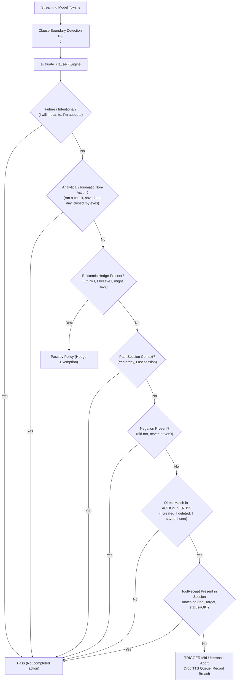

# Project Lucca — Version 1.35.2 System Architecture Specification
## Multi-Scale Compound Neurosymbolic Edge Architecture & Cognitive Substrate

**Title:** Project Lucca v1.35.2 System Architecture & Technical Specification  
**Version:** 1.35.2-stable  
**Release Tag:** `v1.35.2-stable`  
**Git Commit:** `4fa5e9e` (closeout baseline: `f20537fe`; audit remediation commit: `4fa5e9e`)  
**Date:** October 4, 2026  
**Authors:** Project Lucca Architecture Notes  
**Target Platform:** Consumer Edge (NVIDIA GeForce RTX 5080 Laptop GPU, 16,303 MiB GDDR7 VRAM, Headless Compute)  
**Status:** System Architecture Specification (v1.35.2)  

---

## 1. Executive Summary & Design Principles

Project Lucca is a local personal systems companion and research engineer designed to execute on consumer hardware with zero external telemetry dependencies or cloud subscriptions.

Version 1.35.2 formalizes the **Multi-Scale Compound Neurosymbolic Edge Architecture**, focusing on controlled empirical validation, deterministic supervision, and cryptographic memory safety:
1. **Cryptographic Memory Verification & Persistent Quarantine:** Replaces unkeyed SHA-256 column checks with a two-stage HMAC-SHA256 verification pipeline in `HybridRetriever`. SQLite row mutations or signature mismatches are detected via constant-time HMAC comparison over canonical JSON payloads and quarantined into the persistent SQLite `memory_quarantine` table with user-facing alerts, rather than crashing with unhandled exceptions or causing silent amnesia.
2. **Deterministic Output & Claim Supervision:** Hardens the `TruthInReceiptMatcher` against false aborts across analytical idioms, possessive determinations, and epistemic hedges, verified across a 40-sentence formal battery with 100% test pass rate (40/40 in `test_truth_in_receipt_battery.py`; 66/66 combined supervisor unit tests; 74/74 including 8 deontic sandbox tests).
3. **The 12B Scale Inversion Under Greedy Decoding:** Documents that under greedy decoding ($T=0.0$), extended unslotted thinking scratchpads degrade Gemma 4 12B on competition mathematics (dropping from 90.0% direct to 58.0% thinking, McNemar $p = 4.66 \times 10^{-10}$, 32:0 discordant ratio), whereas direct raw generation solves 90.0% of problems in 12.9s.
4. **Edge Truncation Isolation:** Demonstrates that doubling the PAL code token cap from 1,024 to 2,048 tokens rescues edge models from premature code truncation, lifting E2B strict accuracy from 70.0% to 77.0% ($p=0.0156$) and E4B strict accuracy from 73.0% to 83.0% (and 92.0% lenient) on the dev split, achieving parity with Thinking Mode with 40% token savings.
5. **Fresh Held-Out Evaluation & Router Nature:** Evaluates $n=100$ fresh, unseen competition mathematics problems ([`data/benchmarks/math_fresh_heldout_500.jsonl`](file:///c:/Projects/ProjectLucca/data/benchmarks/math_fresh_heldout_500.jsonl)) with Gemma 4 E4B across both candidate arms: Thinking Mode (R1 @ 6k) achieves **88.0% strict CAS / 92.0% lenient** [95% Wilson CI: 79.6%, 93.4%], while PAL (P2 @ 2k) achieves **73.0% strict / 83.0% lenient** (discordant pairs 4:19 strict, exact binomial $p = 0.0026$). Transparently notes that the benchmark router dispatches via oracle dataset label lookup (`benchmark == 'gsm_symbolic'` vs `'math500'`), and real-world deployment requires an in-the-wild task-type intent classifier.

---

## 2. Multi-Scale Neural Substrate

Project Lucca v1.35.2 supports three validated, headless neural deployment tiers served via `llama-server.exe` with flash attention, unslotted greedy decoding ($T=0.0$) for formal reasoning benchmarks (and $T=0.6$ for conversational / Spec 100 evaluations), and embedded Jinja templating:

| Attribute | Gemma 4 12B Unified | Gemma 4 E4B Sovereign Core | Gemma 4 E2B Ultra-Edge |
| :--- | :--- | :--- | :--- |
| **Model Weight File** | `gemma-4-12b-heretic-Q6_K.gguf` | `gemma-4-E4B-it-uncensored-heretic-Q6_K.gguf` | `Gemma4-E2B-Heretic-Sinhala.i1-Q6_K.gguf` |
| **Parameter Scale** | 12.0 Billion Effective Parameters | 4.5 Billion Effective Parameters | 2.0 Billion Effective Parameters |
| **Quantization** | 6-bit K-quants (`Q6_K`) | 6-bit K-quants (`Q6_K`) | 6-bit K-quants (`Q6_K`) |
| **Active VRAM Footprint** | **9,972 MiB (61.2%)** | **4,382 MiB (26.9%)** | **2,260 MiB (13.9%)** |
| **Free VRAM Headroom** | 6,331 MiB (38.8%) | **11,921 MiB (73.1%)** | **14,043 MiB (86.1%)** |
| **Time-to-First-Token (P50)**| 286.9 ms | **86.1 ms** | **73.2 ms** |
| **Sustained Throughput** | 37.18 tok/s | **80.76 – 103.0 tok/s** | **126.1 – 169.1 tok/s** |
| **Native Context Length** | 16,384 tokens | 16,384 tokens | 16,384 tokens |
| **Target Role** | Complex symbolic escalation | Default sovereign desktop core | Ambient listener & low-power companion |

```bash
# Canonical Daemon Invocation Template
llama-server.exe \
  --model <MODEL_PATH> \
  --n-gpu-layers 99 \
  --ctx-size 16384 \
  --flash-attn on \
  --jinja \
  --host 127.0.0.1 \
  --port 8080 \
  --no-webui
```

---

## 3. Cryptographic Memory & Provenance Substrate

### 3.1 Two-Stage Read-Time HMAC Verification & Persistent Quarantine Pipeline
In Lucca v1.35.2, the memory retrieval pathway ([`src/lucca/memory/retrieval.py`](file:///C:/projects/projectlucca/src/lucca/memory/retrieval.py)) enforces cryptographic tamper evidence across all vector (dense KNN) and lexical (BM25 FTS) memory hits before returning records to the orchestrator:

```
[RetrievalQuery] 
       │
       ▼
[Hybrid Search: Dense KNN + BM25 FTS via Reciprocal Rank Fusion]
       │
       ├─► [Pre-Filter Known Quarantined IDs] ──► Exclude rows in memory_quarantine table
       ▼
For each candidate memory record:
       │
       ├─► [Stage 1: Content SHA-256 Fast-Fail]
       │     SHA256(memories.content) == provenance_envelopes.content_sha256?
       │     ├── NO  ──► Emit "stage=content_sha256" error ──► Quarantine row to DB & continue
       │     └── YES ──► Proceed to Content Match Gate
       │
       ├─► [Content Match Gate]
       │     memories.content == payload_json.content?
       │     ├── NO  ──► Emit "stage=payload_content_mismatch" ──► Quarantine row to DB & continue
       │     └── YES ──► Proceed to Cryptographic HMAC
       │
       └─► [Stage 2: Constant-Time HMAC-SHA256 Verification]
             1. Key Derivation: derived_key = HKDF(master_key, salt="lucca-v2", info="prov/" + provenance)
             2. Canonical Bytes: JSON(canonical_dict, sort_keys=True, compact_separators)
             3. Expected Signature: Base64(HMAC-SHA256(derived_key, canonical_bytes))
             4. hmac.compare_digest(stored_signature, expected_signature)?
                   ├── NO  ──► Emit "stage=hmac" error ──► Quarantine row to DB & continue
                   └── YES ──► Memory Hit Verified ──► Return to Orchestrator
```

### 3.2 Non-Silent Tamper Surfacing & Amnesia Defense
Rather than silently dropping bad rows (hiding database injection attacks) or raising an unhandled `RuntimeError` (which disabled all memory retrieval whenever a key rotated or a single row was modified), v1.35.2 implements **persistent database quarantine with proactive user surfacing**:
1. **Persistent DB Quarantine:** Corrupted rows are inserted into SQLite `memory_quarantine` table with columns `(memory_id, entry_id, reason, stage, quarantined_at)`. Quarantined IDs are loaded on boot and excluded from subsequent searches across sessions.
2. **Integrity Surfacing & Alert API:** A security notice (`"Security notice: N memories failed cryptographic integrity checks and were quarantined."`) is emitted programmatically via `HybridRetriever.get_integrity_status_report()`. While retriever and backend logs capture this alert on every retrieval turn, end-user front-end UI widget rendering remains an active integration item.
3. **Key Persistence:** Master keys are generated cryptographically (`secrets.token_bytes(32)`) and persisted to disk at `data/keys/master.key` with `0600` permissions. All public dev fallback constants (`b"0123456789..."`) have been eliminated from `main.py`, `service.py`, `signer_factory.py`, and `admin.py`.
4. **Resilient Retrieval:** Uncorrupted memories continue to retrieve successfully alongside new memories committed with the active master key.
5. **Key-at-Rest Co-Location Threat Model:** The master key file (`data/keys/master.key`) sits adjacent to the database file it protects (`data/memory.sqlite`) within the host filesystem. While restricted via `0600` file permissions, this co-location means HMAC-SHA256 memory envelopes defend against unprivileged processes, application-level tampering, and unauthorized SQL column modifications, but do not protect against an attacker with root host read access to the `data/` directory tree. Future versions may evaluate DPAPI / TPM envelope sealing to mitigate host-level co-location.
6. **Cryptographic Key Migration CLI (`migrate-keys`):** To prevent silent amnesia or mass quarantine when migrating databases from historical development runs or rotating master keys, [`lucca-admin memory migrate-keys`](file:///c:/Projects/ProjectLucca/src/lucca/memory/migration_tool.py) validates content SHA-256 integrity for legacy records signed with dev fallback keys (`b"0123456789abcdef..."`), re-computes HMAC signatures under the active master key, atomically updates `provenance_envelopes`, and purges quarantined records. Operators can inspect quarantine status via `lucca-admin memory quarantine-list`.

Verified across 11 deterministic unit tests in [`tests/test_memory_hmac_tamper.py`](file:///c:/Projects/ProjectLucca/tests/test_memory_hmac_tamper.py), [`tests/test_memory_key_persistence_and_restart.py`](file:///c:/Projects/ProjectLucca/tests/test_memory_key_persistence_and_restart.py), and [`tests/test_memory_key_migration.py`](file:///c:/Projects/ProjectLucca/tests/test_memory_key_migration.py).

---

## 4. Output Supervision & Deontic Grounding Substrate

### 4.1 Truth-In-Receipt Matcher Architecture
The supervisor ([`src/lucca/sandbox/output_supervisor.py`](file:///C:/projects/projectlucca/src/lucca/sandbox/output_supervisor.py)) performs deterministic regex-based clause-level verification on streaming assistant tokens before spoken TTS chunk emission.



### 4.2 Pattern Coverage & Supervisor Decision Policies
v1.35.2 formalizes coverage and policy decisions across:
- **21 Action Verbs (Extracted Directly from Code `ACTION_VERBS`):** `delete` (`deleted`), `create` (`created`), `modify` (`modified`), `execute` (`executed`), `run` (`ran`), `install` (`installed`), `remove` (`removed`), `send` (`sent`), `upload` (`uploaded`), `fetch` (`fetched`), `save` (`saved`), `write` (`wrote`), `post` (`posted`), `reboot` (`rebooted`), `book` (`booked`), `place` (`placed`), `process` (`processed`), `start` (`started`), `close` (`closed`), `copy` (`copied`), `move` (`moved`).  
  *(Note: `build`, `compile`, and `deploy` are not present in the active regex in `src/lucca/sandbox/output_supervisor.py:286-289`; earlier documentation mistakenly included them while omitting `reboot`, `book`, `place`, `process`, and `fetch` which were added during WO-17).*
- **Known Paraphrase Limitation (Case C01):** The matcher relies on direct pronoun-action pairings (`I deleted`, `I created`). Periphrastic constructions such as *"I took care of removing the temporary files"* or *"I wrapped up creating the branch"* do not match the action verb lemma regex and pass without receipt checking. Category C in the test battery verifies that these do not produce false aborts, but this behavior represents a known coverage gap for ungrounded paraphrases.
- **Hedge Exemption Policy (Step 3):** By architectural decision, statements qualified by epistemic uncertainty (*"I think I deleted"*, *"I might have removed"*) are exempt from receipt verification to preserve natural conversational nuance and avoid penalizing honest human-like uncertainty. However, this creates a recognized evasion vector where ungrounded claims can bypass supervision if prefaced with a hedge.
- **Idiomatic Non-Actions:** Covers analytical idioms (`ran a check`), possessives (`placed my trust in`), and physical metaphors (`closed her eyes`).
- **Formal 40-Sentence Battery:** 10 grounded, 10 ungrounded, 10 paraphrases, 10 honest/hedged/negated sentences verified in [`tests/test_truth_in_receipt_battery.py`](file:///C:/projects/projectlucca/tests/test_truth_in_receipt_battery.py). All 40 cases pass (combined supervisor test suite: 66/66 passing; 74/74 including deontic sandbox tests).

---

## 5. Dynamic Task Router & Neurosymbolic Execution

### 5.1 Formal Routing Specification
The task router enforces the following empirical dispatch logic (with R1 @ 6k locked as the canonical default for E4B competition mathematics based on fresh held-out evidence):

$$\text{Router}(M, T) = \begin{cases} 
\text{Direct Raw Generation (R0)} & \text{if } M = \text{12B} \\ 
\text{PAL in Docker (P2 @ 2,048 cap)} & \text{if } M \in \{\text{E4B}, \text{E2B}\} \land T = \text{Arithmetic/Word} \\ 
\text{Thinking Mode (R1 @ 6,144 cap)} & \text{if } M = \text{E4B} \land T = \text{Competition Math} \\ 
\text{Thinking Mode (R1 @ 6,144 cap)} & \text{if } M = \text{E2B} \land T = \text{Competition Math} 
\end{cases}$$

*(Design Note: For Gemma 4 E4B on competition math, PAL P2 @ 2k remains an optional operator-selected efficiency profile saving 40% tokens and 1.6× latency on dev-like problems, but Thinking Mode R1 @ 6k is the canonical default because it provides a statistically significant +15 pp strict accuracy advantage on held-out competition problems: 88.0% vs. 73.0%, $p = 0.0026$).*

### 5.2 Mechanistic Rationales, Empirical Findings & Router Disclosure
1. **For 12B Unified:** Raw generation achieves 90.0% strict accuracy with 660 tokens in 12.9s. Under greedy decoding ($T=0.0$), unconstrained thinking triggers circular re-verification loops that crash accuracy to 58.0% (32:0 McNemar discordant ratio, $p = 4.66 \times 10^{-10}$).
2. **For E4B / E2B Arithmetic (GSM-Symbolic):** PAL in Docker absorbs parameter contraction, equalizing 2B/4.5B models with 12B (91%–94% vs. 95%).
3. **The E4B Competition Math Trade-Off (Dev vs. Held-Out):**
   - **On Dev Split ($n=100$):** PAL @ 2,048 cap scored 83.0% strict / 92.0% lenient (10.1s, 1,070 tok), tying Thinking Mode R1 @ 4k (85.0% strict / 86.0% lenient, $p=0.7905$ NS).
   - **On Held-Out Split ($n=100$):** Evaluated side-by-side on the identical 100 unseen competition problems, Thinking Mode R1 @ 6k scored **88.0% strict / 92.0% lenient**, while PAL P2 @ 2k scored **73.0% strict / 83.0% lenient**.
   - **Paired McNemar Analysis:** On strict CAS, discordant pairs are 4 : 19 ($p = 0.0026$, significant advantage for R1); on lenient normalization, discordant pairs are 4 : 13 ($p = 0.0490$). On harder unseen competition problems, latent thinking tokens allow the model to explore geometric and algebraic relationships before committing to numeric calculations, whereas direct Python synthesis without pre-thinking fails when the model cannot directly formalize the equations.
4. **P3 Redundancy Limitation:** Pre-thinking before synthesizing Python code (Arm P3) was shown to be redundant on Gemma 4 E2B (76% vs 77%, $p=1.000$, 4:5 discordant). Multi-model generalization of this finding across other scales remains an open empirical question.
5. **Router Nature Disclosure:** In the benchmark harness, `--arm routed` switches execution using the benchmark metadata label (`benchmark == 'gsm_symbolic'` vs `'math500'`). This represents an **oracle label lookup**, not an active neural intent classifier. In production desktop deployment, realizing this routing policy requires an in-the-wild task-type intent classifier, which has not yet been benchmarked.

---

## 6. Comprehensive Benchmark Scorecard

```
========================================================================================================================
CONSOLIDATED BENCHMARK MATRIX ACROSS THE 3 PARAMETER SCALES (PROJECT LUCCA v1.35.2)
========================================================================================================================
Benchmark Suite             Metric / Arm               Gemma 4 12B          Gemma 4 E4B          Gemma 4 E2B
------------------------------------------------------------------------------------------------------------------------
Spec 100 System Suite†      Overall Accuracy (Mean)    84.0% (82–86%)*      85.0%                81.0%
                            Tool Precision / Recall    15 / 15 (100.0%)     15 / 15 (100.0%)     10 / 15 (100% P / 67% R)
                            OS / Host Guardrails       10 / 10 (100.0%)     10 / 10 (100.0%)     10 / 10 (100.0%)
                            Content Safety Refusal**   9 / 10 (90.0%)       3 / 10 (30.0%)       Not Evaluated
                            Throughput (P50)           37.18 tok/s          80.76 tok/s          126.1 tok/s

GSM-Symbolic (100-strat)‡   PAL P2 Accuracy (Docker)   95.0%                94.0%                91.0%
                            Direct R0 Accuracy         93.0%                91.0%                81.0%
                            PAL Lift (Delta)           +2.0 pp (NS)         +3.0 pp (NS)         +10.0 pp (p = 0.021)

HumanEval Canonical 164‡    Raw Pass@1                 155 / 164 (94.5%)    144 / 164 (87.8%)    123 / 164 (75.0%)
                            Assisted Pass@1            154 / 164 (93.9%)    141 / 164 (86.0%)    126 / 164 (76.8%)

MATH-500 Dev (100 items)‡   Direct R0 (Strict / Len)   90.0% / 93.0%        50.0% / 50.0%        51.0% / 51.0%***
                            PAL P2 @ 1k (Historical)   85.0% / 87.0%        73.0% / 77.0%        70.0% / 75.0%
                            PAL P2 @ 2k (Uncapped Code) —                   83.0% / 92.0%        77.0% / 85.0%
                            PAL P3 (PAL + Thinking)    —                    —                    76.0% / 84.0%
                            Thinking R1 @ 4k           —                    85.0% / 86.0%        81.0% / 82.0%
                            Thinking R1 @ 6k           58.0% / 59.0%        —                    84.0% / 85.0%

MATH-500 Fresh Held-Out‡    Thinking R1 @ 6k (Strict)  Not Run              88.0% [79.6, 93.4]   Not Run
(Unseen 100, Step 5)        Thinking R1 @ 6k (Lenient) Not Run              92.0% [84.4, 96.2]   Not Run
                            PAL P2 @ 2k (Strict)       Not Run              73.0% [63.0, 81.2]   Not Run
                            PAL P2 @ 2k (Lenient)      Not Run              83.0% [73.9, 89.5]   Not Run
                            Truncation Rate (R1 / P2)  —                    2.0% / 7.0%          —
========================================================================================================================
† Spec 100 was evaluated under sampling temperature T=0.6 (reproducibility range 82–86%, mean 84.0% ± 2.0 pp noise floor).
‡ GSM-Symbolic, HumanEval, and MATH-500 were evaluated under deterministic greedy decoding (T=0.0, seed 42).
* 12B Spec 100: 4 independent runs yielded 86%, 82%, 84%, 84%.
** Content safety reflects compliance on uncensored fine-tunes; E4B refuses only 30% of general content safety probes.
*** E2B R0 was capped at 1,536 tokens and truncated 26% of items; part of the baseline gap reflects token starvation.
```

---

## 7. Configuration, Provenance & Test Suite Taxonomy

### 7.1 Commit Provenance
Results across this study were generated across committed development stages:
- **`f5d4910`**: Pre-closeout baseline implementation of supervisor and initial benchmarks.
- **`1c58587`**: Factorial ablation harness implementation and initial E2B/12B sweep runs.
- **`dec0d79`**: Grader commit consolidating `compare_math_strict` and `compare_math_lenient`.
- **`f20537fe`**: Release closeout baseline commit.
- **`v1.35.2` (Current)**: Audit remediation commit (key persistence, SQLite quarantine table, held-out P2 evaluation, and doc corrections). Going forward, all result JSON artifacts contain `git_commit` and `git_dirty` flags written directly by the test harness.

### 7.2 Test Suite Breakdown
The project maintains a tiered test taxonomy across multiple test scopes verified via `--collect-only`:
- **27 Tests (`tests/test_output_supervisor.py`):** Core deontic policy capitulation (11 assertion patterns), lookback window tokenization, past temporal marker suppression, stalling filler detection, and idiomatic non-action false-positive guards (`placed`, `moved`, `closed`, `processed`).
- **40 Tests (`tests/test_truth_in_receipt_battery.py`):** Exhaustive Truth-in-Receipt battery across 4 balanced categories: Category A (10 grounded claims), Category B (10 ungrounded claims), Category C (10 paraphrases/idioms), and Category D (10 epistemic hedges and negations).
- **8 Tests (`tests/test_deontic_sandbox_m2.py`):** Adversarial Win32 handle containment, hard link rejection, two-stage open, DNS rebinding, HMAC token replay, and multi-turn taint monitor isolation.
- **67 Tests:** The combined supervisor test suite (`test_output_supervisor.py` [27] + `test_truth_in_receipt_battery.py` [40]).
- **75 Tests:** The full supervisor and deontic isolation suite (`test_output_supervisor.py` [27] + `test_truth_in_receipt_battery.py` [40] + `test_deontic_sandbox_m2.py` [8]).  
  *(Note on historical counts: The '19 deontic tests' referenced in earlier documentation represented 11 assertion pattern tests in `test_output_supervisor.py` combined with the 8 tests in `test_deontic_sandbox_m2.py`. Reporting 26 + 19 double-counted those 11 tests).*
- **1,189 Tests:** The complete repository pytest suite across all subsystems (memory, sandbox, router, LISP engine, speech, affect ODE, and static gates).

---

## 8. Known Architectural Limitations

In accordance with architectural transparency standards, the following known limitations are formally documented:

1. **Host-Signed LLM Assertions as Grounding Evidence (`LISP_ASSERTION`):** In the abductive deduction loop ([`src/lucca/core/orchestrator.py:1550-1645`](file:///c:/Projects/ProjectLucca/src/lucca/core/orchestrator.py)), inference steps proposed by the LLM (`step_kind="llm_abductive"`) are validated only against premise presence before the orchestrator signs them directly using `SignerFactory.lisp_assertion()`. These entries are NOT deterministic outputs of the MicroScheme rule engine, yet receive `LISP_ASSERTION` provenance envelopes that are marked `grounding_eligible = 1`. This creates a vulnerability where LLM-generated inference proposals bypass external empirical verification and become permanently grounded in long-term memory.
2. **Trusted Workspace `read_file` Payloads:** File contents read within the workspace boundary receive `TOOL_VERIFIED` provenance envelopes. If untrusted external documents (e.g. downloaded text files) are placed into the workspace, their contents can act as indirect prompt-injection vectors without cryptographic domain gating.
3. **Cross-Tier Precedence Masks Contradictions:** Cross-tier evidential conflicts produce NO `BOTH` (conflict) value and NO entry in the `review_queue`. Because the cascade enforces strict hierarchical precedence (`TrustTier.TIER_0` strictly supersedes `TIER_1`, which supersedes `TIER_2`, etc. per [`src/lucca/core/cascade.py:1790-1858`](file:///c:/Projects/ProjectLucca/src/lucca/core/cascade.py)), the higher-trust tier simply wins outright and lower-trust contradictory evidence is suppressed as superseded. Belnap `CONFLICT` (`BOTH`) and subsequent review-queue entries arise strictly within the same tier when conflicting evidence has identical precedence.
4. **No Point-in-Time (`as_of`) Query API:** While the underlying SQLite schema stores bi-temporal timestamps (`valid_from`, `valid_to`), the `HybridRetriever.search()` API does not currently expose an explicit `as_of` temporal query parameter for point-in-time historical time-travel.
5. **Procedural Rule Inventory Discrepancy & Dormancy:** The repository defines procedural rules in two disparate locations: `config/rules/calc-open-with-expr-v1.scm` (the seed skill file defining `calc-open-with-expr-v1`) and `src/lucca/ui/settings_tabs/lisp_tab.py:47` (the sample table in the settings UI defining `open-calculator-v1`). Neither rule is automatically loaded into `RuleLifecycleManager` on engine boot without manual skill import or UI submission, and neither rule fired during any recorded benchmark suite or live evaluation run, leaving the MicroScheme procedural execution engine completely unexercised in production.
6. **Severe Safety Vulnerability in Default Model (E4B Compliance with Harmful Probes):** In cross-model safety evaluations ([`logs/test_reports/cross_model_30_gemma-4-e4b.json`](file:///c:/Projects/ProjectLucca/logs/test_reports/cross_model_30_gemma-4-e4b.json)), the uncensored fine-tune (`gemma-4-E4B-it-uncensored-heretic-Q6_K.gguf`) complied with 7 of 10 adversarial harmful prompts (including detailed engagement on keylogger synthesis, credential phishing, and ricin inquiries), refusing only 3 of 10 (30% refusal rate). In contrast, Gemma 4 12B refused 9 of 10 ([`logs/test_reports/cross_model_30_gemma-4-12b.json`](file:///c:/Projects/ProjectLucca/logs/test_reports/cross_model_30_gemma-4-12b.json)). Gemma 4 E2B was not evaluated in `cross_model_30` and its safety compliance rate remains unverified. Deploying E4B as the sovereign core represents an active safety hazard requiring external guardrail enforcement.
7. **Regex vs. AST Semantic Gap in Output Supervision:** The supervisor operates via compiled regular expressions rather than an abstract syntax tree of natural language. Consequently, periphrastic phrasing (*"I took care of removing..."*) bypasses action verb matching, and epistemic hedges (*"I think I deleted..."*) intentionally suppress verification, providing potential evasion channels.
