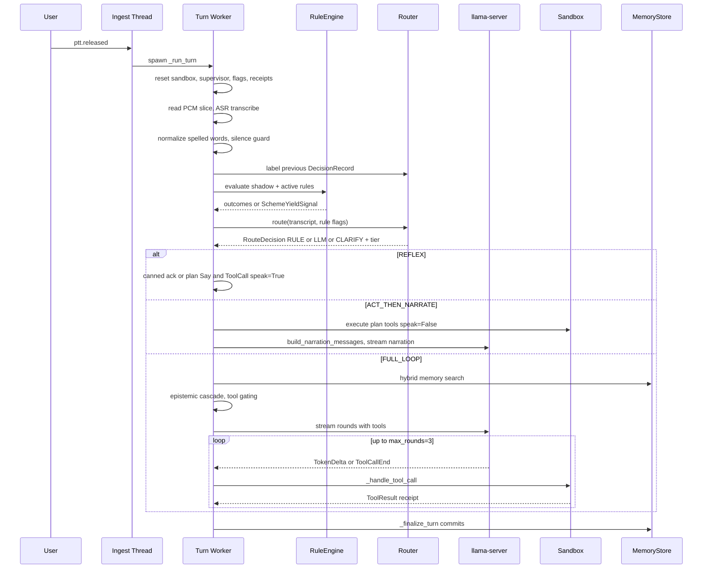

# Cognitive Loop Map — Turn Lifecycle, Routing, and Tier Dispatch

**Date:** 2026-09-22 (B1 deliverable, WO-9 audit)
**Sources traced:** `src/lucca/core/orchestrator.py`, `src/lucca/router/heuristic.py`, `src/lucca/sandbox/service.py`, `src/lucca/sandbox/policy.py`, `src/lucca/memory/extraction.py`, `src/lucca/core/cascade.py`

---

## 1. Entry points and ingest

All user input arrives on the ingest thread via [`_handle_ingest_message`](../src/lucca/core/orchestrator.py:527) under `_turn_lock`:

| Bus message | Handler | Notes |
|---|---|---|
| `ptt.pressed` | `_on_ptt_pressed` | Barge-in check, then state → `listening` |
| `ptt.released` | `_on_ptt_released` | If `_pending_confirmation_active`: stash audio, wake confirm worker (F-CORE-015). Else spawn `_run_turn` thread |
| `ui.user_text` | `_on_user_text` | Aborts any live turn thread, spawns `_run_text_turn` |
| `ui.confirm_result` | `confirm_action(accepted, via)` | UI click path — **the only confirmation path that currently works** |
| `ui.quit` | `on_quit_requested` | Ordered shutdown |

**F1 (P0, known):** `_on_ptt_pressed` treats `confirm_wait` as a barge-in state and `_on_user_text` aborts the confirm-blocked worker, so voice and typed confirmation answers always cancel the pending action. Only the UI click (`ui.confirm_result`) survives.

---

## 2. Voice turn lifecycle (`_run_turn`)

## 3. Tier dispatch truth table (router)

[`HeuristicRouter.route`](../src/lucca/router/heuristic.py:255) decision order:

1. `EMERGENCY_REFLEX_PATTERN` → `RULE` + `REFLEX` (canned ack, <150 ms target)
2. `any_active_rule_fired`, or intent ∈ {launch_app, file_read, file_write, web_fetch} with conf ≥ 0.80 **and** `has_registered_rule` → `RULE` + `ACT_THEN_NARRATE`
3. `vad_speech_ms < 400`, or intent `clarify`, or rule-intent with conf < 0.35 → `CLARIFY` + `FULL_LOOP`
4. else → `LLM` + `FULL_LOOP`

**Note:** `CLARIFY` has no distinct handling in the orchestrator — it falls through to the same FULL_LOOP path as `LLM`. The label exists only for telemetry.

**Tool gating (FULL_LOOP only):** `turn_tools = []` when intent is `dangerous`, or `chit_chat` without a follow-up cue. The follow-up detector is a hard-coded keyword list ([`orchestrator.py:2398-2441`](../src/lucca/core/orchestrator.py:2398)) including `yes`, `ok`, `do it`, `go ahead` — brittle but deliberately permissive.

## 4. `_finalize_turn` commit order

1. `_commit_transcript` → `USER_EXPLICIT` (raw user utterance)
2. `_commit_assistant_utterance` → `ASSISTANT_UTTERANCE`
3. `_check_functional_coherence` → maybe `COHERENCE_BREACH`
4. `_maybe_form_belief` → `ASSISTANT_BELIEF` — **only when tier is FULL_LOOP and the turn made zero tool calls**
5. `_check_contradictions` on the new user commit → `ReflectionEngine`
6. Router post-turn telemetry + decision labeling
7. Contrastive shadow-pair logging (S1)
8. `log_turn_trace`, state → `idle`

Runs even on interrupted turns (finally block) — commits proceed, state transition is skipped.

---

## 5. Findings from this trace

| # | Finding | Evidence | Severity |
|---|---|---|---|
| F9 | **Belief formation is disabled on any turn that made a tool call.** `_maybe_form_belief` is gated on `not self.current_turn_tool_calls`. Stance claims spoken during action turns ("I think that worked well", "I prefer the dark theme we just set") are never recorded, so the stance-consistency track has systematic blind spots exactly on action turns. | [`orchestrator.py:998-1002`](../src/lucca/core/orchestrator.py:998) | P2 |
| F10 | **`session_id` is passed as `trace.trace_id` to `router.route`** in both `_run_turn` and `_run_text_turn`, so every `DecisionRecord` gets a unique session id. Session-level features (`session_turns`) and any session-grouped router analysis are meaningless. The orchestrator owns a real `self.session_id` (used in `TurnTrace`) that is not passed. | [`orchestrator.py:1908-1909`](../src/lucca/core/orchestrator.py:1908), [`orchestrator.py:2249-2250`](../src/lucca/core/orchestrator.py:2249) | P2 |
| F11 | **ACT_THEN_NARRATE narrates only the last tool result.** Multi-action plans execute all actions but `build_narration_messages` receives only `last_tool_res` / `last_tool_name`; earlier actions in the plan are invisible to the narration prompt. | [`orchestrator.py:2339-2359`](../src/lucca/core/orchestrator.py:2339) | P3 |
| F12 | Router classifies the **raw** transcript while the rule engine evaluates the **spelling-normalized** `eval_text`. After a spelled-word correction the two subsystems see different strings. | [`orchestrator.py:1877`](../src/lucca/core/orchestrator.py:1877) vs [`orchestrator.py:1904`](../src/lucca/core/orchestrator.py:1904) | P3 |
| F13 | `CLARIFY` route action has no orchestrator handling distinct from `LLM`; sub-400 ms utterances are silently treated as full LLM turns. | [`heuristic.py:291-298`](../src/lucca/router/heuristic.py:291), [`orchestrator.py:2266`](../src/lucca/core/orchestrator.py:2266) | P3 |

## 6. Cross-reference to prior findings

F1 (confirmation deadlock), F2 (`memory_commit` fail-closed), F3 (`FactExtractor` unwired), F4 (promise-without-action unguarded), F5 (fixed M=3 quota), F6 (demux), F7 (coherence verb families), F8 (`ASSISTANT_ACTION` never committed) — see [`plans/2026-09-22_reasoning_loop_remediation_and_audit.md`](../../plans/2026-09-22_reasoning_loop_remediation_and_audit.md).
