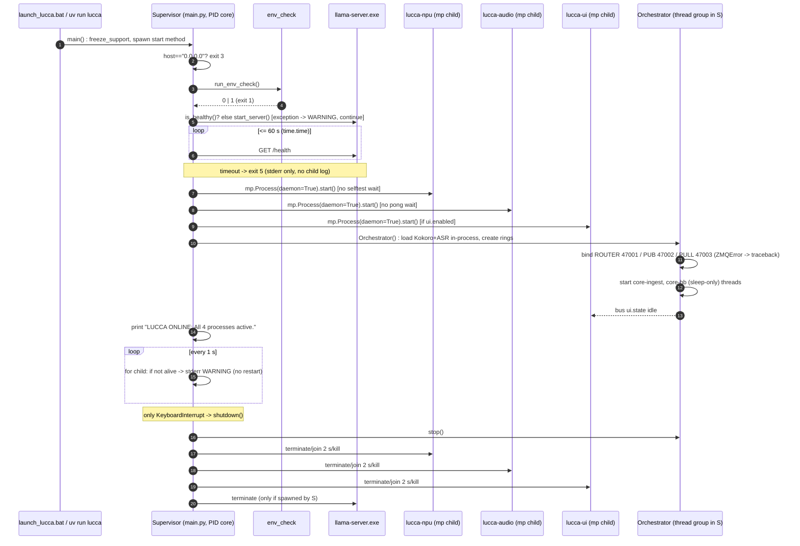
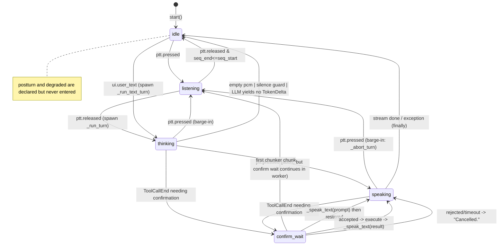

# Findings — CORE (`src/lucca/core/**`, `main.py`, `admin.py`, `ports.py`)

**Subtask:** S2a · **Method:** static line-by-line + S1 dynamic evidence · **Baseline:** HEAD `ed14f6b` + working tree per `03_BASELINE.md` · **Written:** 2026-09-18 (UTC)
**Rules honoured:** findings-only; nothing outside `docs/audit/` touched; every finding cites `file:line` or an artefact under `docs/audit/evidence/`. Archived specs are cited as *claims*; code truth wins.

**Severity totals: S0 = 1 · S1 = 12 · S2 = 24 · S3 = 21 · S4 = 3 · total = 61.**

---

## 1. Module map

Coverage from `docs/audit/evidence/S1_14_coverage.txt` (T1, `-m "not hw and not soak"`).

| File | LOC | Public symbols | Responsibilities (as-built) | Inbound callers | Outbound dependencies | Cov % | Tests exercising it |
|---|---:|---|---|---|---|---:|---|
| `src/lucca/main.py` | 184 | `run_audio_process`, `run_npu_process`, `run_ui_process`, `Supervisor`, `main` | Boot, spawn 3 `mp.Process` children, run `Orchestrator` in-process, 1 Hz liveness print loop, shutdown | `pyproject.toml:47` (`lucca`), `launch_lucca.bat:4`, `python -m lucca.main` | `brain.server_ctl`, `core.config`, `core.env_check`, `core.orchestrator`, `senses.audio_proc`, `senses.npu_proc`, `ui.app` | **0 %** | none |
| `src/lucca/admin.py` | 30 | `main` | CLI: `help`, `env-check`; all else → "Unknown command" | `pyproject.toml:46` (`lucca-admin`) | `core.env_check` | **0 %** | none |
| `src/lucca/ports.py` | 128 | 10 `Protocol` classes | Hexagonal port declarations | `memory/store.py:36`, `memory/retrieval.py:16` (`EmbeddingPort` only) | `core.schemas` | 100 % | import-only |
| `src/lucca/__init__.py` | 4 | `__version__ = "0.1.0"` | package marker | — | — | 100 % | — |
| `src/lucca/core/__init__.py` | 0 | — | package marker | — | — | 100 % | — |
| `src/lucca/core/orchestrator.py` | 704 | `TurnState`, `Orchestrator` | ZMQ ROUTER/PUB/PULL binds, ingest loop, turn state machine, LLM streaming, **in-process ASR + TTS**, tool confirmation, trace logging | `main.py:98` | `brain.chunker`, `brain.llm_client`, `brain.prompt_builder`, `core.config`, `core.ipc_schemas`, `core.schemas`, `core.trace`, `sandbox.policy`, `sandbox.service`, `senses.asr`, `senses.ring_buffer`, `senses.tts`, `zmq`, `structlog`, `ulid` | 74 % | `tests/test_turn_loop.py` (4), `tests/test_confirmation.py` (3) |
| `src/lucca/core/schemas.py` | 424 | 40+ models/enums | Domain contracts | `ports.py`, `orchestrator.py:35`, memory/router/reasoning/sandbox, tests | `pydantic` | 100 % | indirect |
| `src/lucca/core/ipc_schemas.py` | 249 | `Envelope`, 30 payloads, `MAX_FRAME_SIZE`, `encode_envelope`, `decode_envelope` | Wire framing + payload catalogue | `orchestrator.py:21-34`, `senses/*`, `ui/*` | `core.exceptions`, `core.schemas` | 97 % | `tests/test_ipc_codec.py` (6) |
| `src/lucca/core/config.py` | 178 | 15 settings models, `LuccaConfig`, `get_config` | Env-var-only settings; `home_dir`; `resolve_path` | every subsystem | `pydantic_settings` | 98 % (L162,165 missed) | none dedicated |
| `src/lucca/core/events.py` | 78 | `EventName` | Event-name enum | **none in `src/`** | — | **0 %** | none |
| `src/lucca/core/exceptions.py` | 251 | `LuccaError` tree (38 classes) | Error taxonomy | `ipc_schemas.py:11`, memory/sandbox/reasoning/router | — | 100 % | indirect |
| `src/lucca/core/trace.py` | 76 | `TurnTrace`, `log_turn_trace` | Per-turn timestamps + JSONL append | `orchestrator.py:36` | `core.config` | 100 % | indirect via `test_turn_loop.py` (writes real `traces.jsonl` under `LUCCA_HOME`) |
| `src/lucca/core/env_check.py` | 194 | 6 `check_*`, `run_env_check` | Boot/CLI environment diagnostics | `main.py:69`, `admin.py:23` | `httpx`, `sqlite3`, `subprocess`, `core.config` | **0 %** | none |
| `src/lucca/core/affect.py` | 227 | `AffectSignal`, `AffectState`, 5 functions, `AffectTracker` | Valence/arousal state + prompt hint + TTS speed multiplier | **none in `src/`** (tests only) | `tomllib`, `pydantic` | 82 % | `tests/test_affect.py` (3) |

Doubles read: `tests/fakes/fake_llm.py` (sync generator `stream_turn`, `abort()`), `tests/fakes/fake_asr.py` (fixed transcript `"test input"`), `tests/fakes/fake_tts.py` (200 ms sine into play ring), `tests/conftest.py` (one `RuleState` fixture; no `LUCCA_HOME` isolation).

---

## 2. Process & lifecycle model as-built

### 2.1 Boot sequence vs. ADR-008 / Spec 01 §7

| # | Code | Behaviour | Archived claim | Match |
|---|---|---|---|---|
| 0 | `main.py:167-176` | `freeze_support()`; `SetCurrentProcessExplicitAppUserModelID` in bare `except: pass`; `set_start_method("spawn", force=True)` | — | n/a |
| 1 | `main.py:61-65` | `llm.host == "0.0.0.0"` → `sys.exit(3)` | T-BOOT-03 | yes |
| 2 | `main.py:69-71` | `run_env_check() != 0` → `sys.exit(1)` | §7.1 "fail-closed on default master key"; §7.2 env checks; §7.3 SQLite integrity | partial: no master-key check, no SQLite check, no exit-2 config validation |
| 3 | `main.py:107-127` | healthy → skip; else `start_server()`; **exception → WARNING and continue**; poll `/health` ≤ 60 s (`time.time`) → `sys.exit(5)` | §7.4 | partial |
| 4 | `main.py:79-81` | spawn `lucca-npu` (`daemon=True`), **no wait** | §7.5 wait `sys.selftest_result` ≤ 90 s | no |
| 5 | `main.py:85-87` | spawn `lucca-audio`, **no wait** | §7.6 wait `sys.pong`, open rings | no |
| 6 | `main.py:90-94` | spawn `lucca-ui` if `ui.enabled` | §7.7 | yes |
| 7 | `main.py:98-99` | `Orchestrator()` **in supervisor process**: loads Kokoro (`senses/tts.py:146`) + ASR (`orchestrator.py:97`) in-process, creates both rings (`:76-77`), binds 47001/2/3 (`:118-120`) | Spec 01 §1 `lucca.main → lucca.core.app`; ADR-008 `lucca-npu` owns Whisper/Kokoro | **drift** (F-CORE-002) |
| 8 | — | no egress apply, no image pull, no "ready" utterance | §7.8, §7.9 | missing |
| 9 | `main.py:103` | prints `LUCCA ONLINE: All 4 processes active.` regardless of child state / `ui.enabled` | — | misleading (F-CORE-033) |

### 2.2 Runtime supervision, heartbeat, restart

- `Supervisor.run_forever` (`main.py:129-140`): every 1 s, for each child `if not p.is_alive(): sys.stderr.write(...)`. **No restart, no backoff, no DEGRADED state, no exit.** Observed: `WARNING: Child process 'ui' exited with code 0.` ≥ 807 lines in `docs/audit/evidence/S1_24_lucca_main.stderr.log:2-808` (S1_SUMMARY §2.14 says 25×; the artefact contains far more — one line per second for the remaining ~13.5 min of the session).
- `Orchestrator._heartbeat_loop` (`orchestrator.py:687-689`): `while self.running: time.sleep(2.0)` — **no `sys.ping` is ever sent**; `SysPingPayload`/`SysPongPayload` (`ipc_schemas.py:195-201`) are dead types. ADR-008 "health-checks each every 2 s over ZMQ ping; restarts with exponential backoff" is not implemented.
- `ctl_sock` (ROUTER, `orchestrator.py:71,118`) is bound but **never read or written** anywhere in `orchestrator.py`.

### 2.3 Shutdown

- Only trigger: `KeyboardInterrupt` in `run_forever` (`main.py:139-140`). No `signal.signal(SIGTERM/SIGBREAK)`, no `SetConsoleCtrlHandler`, no reaction to `ui` child exit ("Quit Lucca"), no `WM_CLOSE`. Observed: graceful `taskkill` left supervisor + 2 children alive after 10 s (`docs/audit/evidence/S1_37_shutdown.txt`).
- Order (`main.py:142-162`): `orchestrator.stop()` → for each child `terminate()` (Windows `TerminateProcess`), `join(2.0)`, `kill()` → `llama_proc.terminate()` only if *we* spawned it. Spec 01 §7 order (`ui.state offline` → `play.abort` → stop turns → flush SQLite ≤ 5 s → `VACUUM INTO` → SIGTERM children 3 s → llama) is not implemented; no SQLite exists in core to flush.
- `Orchestrator.stop()` (`orchestrator.py:691-703`): sets `running=False`, releases confirm event, aborts + joins active turn ≤ 1 s, closes sockets `linger=0`, destroys context. Ingest thread blocked in `recv()` (`:178`) is only released by `ctx.destroy` raising `ZMQError` — relies on daemon thread teardown.

### 2.4 Exit codes as-built

| Code | Cause | Location |
|---:|---|---|
| 1 | env-check failed | `main.py:71` |
| 3 | `llm.host == "0.0.0.0"` | `main.py:65` |
| 5 | `/health` not OK within 60 s after spawn | `main.py:127` |
| 1 (traceback) | pydantic `ValidationError`/`SettingsError` in `get_config()`; `zmq.ZMQError` on bind (two instances / port busy) after 3 children were already spawned | `main.py:49`, `orchestrator.py:118-120` |
| 0 | unknown `lucca-admin` command | `admin.py:25` |

Spec 11 §1 "validation errors … exit code 2" and Spec 01 FM-07 "two instances → exit with message" are not met (F-CORE-028).

### 2.5 Process count vs ADR-008

As-built host processes: **supervisor+core (1) + npu (2) + audio (3) + ui (4)** plus external `llama-server` — the *count* matches ADR-008 (S1_25 shows PID 9120 + 3 children). The *role assignment* does not: ASR and TTS inference execute inside the core process (`orchestrator.py:87,97,355,555`), so the `npu` child is a parallel model loader that core never calls for the turn path. Core WS 870 MB vs ADR-008 cap ≤ 900 MB; child 40824 WS 865 MB (S1_25). Sum of Python WS ≈ 2.16 GB on a 16 GB host with ≈ 1.3–2.0 GB available at baseline (S1_02, S1_09).

### 2.6 Sequence diagram (as-built)



---

## 3. Turn loop as-built

### 3.1 States and transitions (`orchestrator.py`)

`TurnState = Literal["idle","listening","thinking","speaking","confirm_wait","postturn","degraded"]` (`:50-52`). **`postturn` and `degraded` are never assigned** (`_set_state` callers: `:130,249,292,304,326,349,366,428,471,516,549,572,608,627`). `_set_state` maps `confirm_wait→confirm`, `postturn→idle` for the UI (`:132-142`).

| From | Event | Guard | Action | To | Code |
|---|---|---|---|---|---|
| any | `ptt.pressed` | state ∈ {speaking, thinking, confirm_wait} | `_abort_turn()` (llm.abort, chunker.reset, `FLAG_ABORT`, bus `play.abort`, `trace.interrupted=True`) | listening | `:242-249, 251-268` |
| any | `ptt.pressed` | otherwise | print + caption | listening | `:247-249` |
| listening | `ptt.released` | `_pending_confirmation_active` | **sync ASR inside ingest lock**, `parse_confirmation_response`, set event | (unchanged) | `:271-282` |
| listening | `ptt.released` | `seq_end <= seq_start` | caption "didn't hear" | idle | `:285-293` |
| listening | `ptt.released` | else | new `TurnTrace(t_key_release=ts_ns)`, spawn `_run_turn` thread (**no check that a previous turn thread is alive**) | thinking | `:295-309` |
| any | `ui.user_text` | state ∈ {speaking, thinking, confirm_wait} → abort | new trace `mode="transcript"`, spawn `_run_text_turn` | thinking | `:311-330` |
| thinking (worker) | pcm empty / silence | `len(pcm)==0` or (`vad_speech_ms<100` or `len<1600`) and no transcript | caption | idle | `:342-350, 359-367` |
| thinking (worker) | first chunk from chunker | — | `t_first_chunk`, `_synthesize_chunk` (blocking) | speaking | `:426-431` |
| thinking/speaking (worker) | `ToolCallEnd` | `sandbox.check_confirmation_needed(name)` | `_request_confirmation` → `_speak_text` → `confirm_event.wait(15 s)` | confirm_wait → speaking → confirm_wait | `:433-435, 594-637` |
| confirm_wait | `ui.confirm_result` / voice / timeout | — | `confirm_action()` or timeout → False → speak "Cancelled." | (worker continues) | `:228-240, 630-637, 652-661` |
| speaking (worker) | stream exhausted | not interrupted | `chunker.flush()`, `FLAG_EOS`, history append, final caption | — | `:438-455` |
| any (worker) | exception | — | log + caption error text; `interrupted=True` | — | `:457-467` |
| any (worker) | finally | — | `t_postturn_done`, `log_turn_trace`, **`_set_state("idle")` unconditionally** | idle | `:468-471` |

No timeouts exist on: LLM first token / total (Spec 02: 10 s / 60 s), ASR (3 s), TTS per chunk (2 s). The only timeout is the 15 s confirmation wait (`:599`).

### 3.2 State diagram



### 3.3 Every place a turn can end with an empty reply and no user-visible error

| # | Location | Mechanism | Visible to user? | Logged? |
|---|---|---|---|---|
| 1 | `:403-409` | LLM stream yields no `TokenDelta` (e.g. only `Done`, only tool-call events, or content in a field the client does not map) → `tokens_out=0`, `[Lucca] ` printed empty, `FLAG_EOS` set, no history append (`:450`) | no (no caption, no speech) | trace only; **observed in `S1_30_T3_hw.txt:13-15`** |
| 2 | `:411` | every `event.delta == ""` is skipped | no | no |
| 3 | `:408-409, 424-425` | `trace.interrupted` set by barge-in → break; no partial-reply caption | expected | trace `interrupted=True` |
| 4 | `:457-467` | exception in stream → caption "Sorry, I had trouble…" **but state text already printed `[Lucca] `**; `_run_text_turn` variant (`:541-545`) prints `[Error]` only, **no caption** | audio turn: yes; text turn: **no** | `logger.error` |
| 5 | `:646-647` | `execute_tools=False` → `_handle_tool_call` returns `None`; no speech, no caption | no | no |
| 6 | `senses/tts.py:182-183` (called at `:555,574`) | `engine is None` (model files missing) → `samples=0` silently; text captions appear, no audio | partially | no |
| 7 | `:271-282` | PTT release while `_pending_confirmation_active` → utterance consumed as yes/no; if user issued a new command it is silently treated as "unknown → cancel" | "Cancelled." spoken, no transcript shown | `confirmation_action_received` not logged on this path |
| 8 | `:247, 302` | `UnicodeEncodeError` from emoji `print()` when stdout is not UTF-8 → handler aborts **before** the turn thread is started; state remains `listening`/previous | no | `ingest_loop_unexpected_error` warning — **observed at every PTT event in `S1_24_lucca_main.log:28-46`** |
| 9 | `:359-367` | silence guard when ASR returns empty and `vad_speech_ms < 100` | caption "I didn't hear anything" | no |
| 10 | `:450-455` | tool-only turns (no text) are never appended to `history`; next turn's LLM has no record the tool ran | indirectly | no |

---

## 4. Trace / latency model as-built

### 4.1 Fields, clock, units, setters

`core/trace.py:14-42` defines 16 `t_*` integer fields (default 0), documented as "Monotonic timestamps (ns)", plus `tokens_out`, `chunks`, `underruns`, `interrupted`, `mode`, `route`, `tts_device`, `asr_device`. A **second, incompatible** `TurnTrace` and a `TracePoint` enum live in `core/schemas.py:404-424` and are referenced only by `ports.py:126-127` (`TracePort`, which has no implementation).

| Field | Set where | Source | Ever set on a real turn? |
|---|---|---|---|
| `t_key_press` | nowhere | — | **never** |
| `t_key_release` | `orchestrator.py:299, 319` | `env.ts_ns` from audio/ui process (`time.monotonic_ns()` in the *sender* process) | yes |
| `t_vad_done` | nowhere | — | **never** |
| `t_asr_sent`, `t_asr_done` | nowhere (ASR runs at `:355` without marks) | — | **never** |
| `t_route_done` | nowhere (no router call) | — | **never** |
| `t_llm_sent` | `:333, 474` | `time.monotonic_ns()` **before** `reset_turn`, ring read, WAV encode and the synchronous ASR call | yes — but it is not "HTTP request sent" |
| `t_llm_first_token` | `:414, 502` | monotonic | yes |
| `t_first_chunk` | `:427, 515` | monotonic | yes |
| `t_tts_first_sent`, `t_tts_first_done` | `:553, 558` | monotonic | yes |
| `t_first_sample` | `:225` | `env.ts_ns` of `audio.first_sample_played` (audio process) | only if audio process emits it |
| `t_llm_done` | `:446, 532` | monotonic | yes unless exception |
| `t_tts_last_done`, `t_playback_done` | nowhere | — | **never** |
| `t_postturn_done` | `:469, 547` (finally) | monotonic | **always** |
| `route`, `tts_device`, `asr_device` | never overwritten | defaults `"llm"`, `"CPU"`, `"cpu"` | constant |
| `underruns` | nowhere | — | never |

Derived: `total_e2e_ms`, `ttft_ms`, `tts_first_ms` (`trace.py:44-60`) — appended to the JSONL by `log_turn_trace` (`:63-75`), which appends synchronously to `<LUCCA_HOME>/logs/traces.jsonl` from the turn thread with no rotation, no `turn_traces` SQLite table, no `latency.regression` computation (Spec 10 §1–2).

### 4.2 How `t_postturn_done=180044109000000` with zeros elsewhere arises

1. **Absolute, not relative.** Spec 10 §1 says points are "monotonic ns, converted to ms relative to `t_key_release`". Code stores raw `time.monotonic_ns()` values. On Windows/CPython 3.12 the monotonic clock counts from boot; `180 044 109 000 000 ns = 180 044.109 s ≈ 50.0 h` of host uptime — a plausible absolute value, not a duration.
2. **Millisecond granularity.** The value is an exact multiple of 1 000 000 ns. On CPython ≤ 3.12 for Windows, `time.monotonic()`/`monotonic_ns()` are backed by `GetTickCount64()` with ~15.6 ms resolution; the reading can only change in whole-millisecond ticks. Stage budgets of 15 ms (S1), 40 ms (S5) and the 50 ms barge-in gate cannot be measured with this clock (F-CORE-008).
3. **Zeros by construction.** The fields shown as 0 in the artefact tail (`t_tts_last_done`, `t_playback_done`) are never assigned anywhere in `src/` (grep: only `t_first_sample` is assigned outside `orchestrator._run_*`). `t_key_press`, `t_vad_done`, `t_asr_*`, `t_route_done` are likewise never assigned (F-CORE-009). The pytest repr in `S1_30_T3_hw.txt:13` elides the middle fields (`t_key_...ast_done=0`), so "other timestamps 0" is partly a display truncation; the fields that *are* legible as 0 are the ones that are structurally unset.
4. **`t_postturn_done` is set in `finally`** (`:469`) even when the turn produced nothing, so it is the one timestamp guaranteed non-zero on every trace, including the failed T3 turn.

---

## 5. Config & env-check as-built

### 5.1 Sources actually consulted

`LuccaConfig.model_config = SettingsConfigDict(env_prefix="LUCCA_", env_nested_delimiter="__", extra="ignore")` (`config.py:135-137`). **No `toml_file`, no `env_file`, no CLI source.** The docstring at `:132` ("CLI flags -> Env vars (LUCCA_*) -> lucca.toml -> .env -> defaults") and Spec 11 §1 describe five sources; two exist (env vars, built-in defaults). `home_dir` (`:157-166`) reads `os.getenv("LUCCA_HOME")` at each access, bypassing pydantic. `get_config` is `@lru_cache` (`:175-177`).

### 5.2 Key table

| Key | Default | Source | Validation | Spec 11 §1 default | Drift |
|---|---|---|---|---|---|
| `env.mode` | `"prod"` | env `LUCCA_ENV__MODE` | Literal | `"prod"`; spec says `LUCCA_ENV=dev` switches | `LUCCA_ENV=dev` does **not** map to this field (F-CORE-021) |
| `paths.*` | models/data/workspace/inbox/logs/cache/**tmp** | env | none (any string, incl. `..`) | no `tmp` | extra key |
| `llm.mode/host/port/ctx/kv_type/max_tokens/temperature/model/mmproj/text_model` | as spec | env | `mode` Literal; `host` not checked for `0.0.0.0` here (checked in `main.py:61`); `port`, `ctx`, `temperature` unbounded; `kv_type` free string | same | ok |
| `asr.model/device_ladder/lowconf_logprob` | as spec | env | Literal list | same | ok |
| `tts.voice` | `"genki_heroine"` | env | none | `"af_heart"` | drift; `TTSChunk.voice` default in `schemas.py:151` and `ipc_schemas.py:83` is still `"af_heart"` |
| `tts.speed` | `1.10` | env | none | not in spec | extra |
| `audio.*` | as spec | env | none | same | ok |
| `ptt.key` | `"alt-gr"` | env | none | `"right ctrl"` (D-10) | drift |
| `ptt.mode/max_seconds/swallow` | hold / 29.5 / False | env | Literal | same | ok |
| `memory.*`, `router.version`, `rules.*`, `reflection.*`, `sandbox.*`, `ipc.*`, `ui.*` | as spec | env | Literal on `router.version` | same | ok (none consumed by core turn loop) |
| `log.level` / `log.json` / `log.retention_days` | INFO / True / 30 | env | none | same | **no logging configuration consumes these** |
| `master_key` | `None` | env `LUCCA_MASTER_KEY` (alias) | **none** | `.env` only; "fail-closed on default master key unless dev" | F-CORE-013 |

### 5.3 Prod fail-closed behaviour

None. With `LUCCA_MASTER_KEY` unset and `env.mode == "prod"` (observed: `S1_06_lucca_home_tree.txt` `LUCCA_MASTER_KEY=UNSET`; `S1_15a_launch_cmd_from_code.txt` `env.mode=prod`) the app boots and both env checks report all-green (`S1_10_admin_env_check.txt:10-17`).

### 5.4 Env-check false-pass analysis (`env_check.py`)

| Check | Code | Can false-pass? | How |
|---|---|---|---|
| MSHybrid dGPU VRAM | `:18-60` | yes | idle threshold is **1500 MB** (`:52`) vs D-05/Spec 11 §4 **300 MB**; when `/health` answers, any value ≤ 9500 MB passes — the check cannot distinguish "display pinned to dGPU" once llama-server is up (observed PASS at 8100 MB, `S1_24_lucca_main.log`) |
| Intel NPU | `:63-76` | no (device present) | but does not attempt a compile; NPU produced a degenerate transcript in `S1_35_bench_asr.txt` while this check passed |
| SQLite + sqlite-vec | `:79-93` | no | fine; does **not** run `PRAGMA integrity_check` on the real DB (Spec 01 §7.3) |
| `.wslconfig` clamp | `:96-115` | **yes** | substring match on `memory=4608MB`, `swap=0`, `pageReporting=true`, `autoMemoryReclaim=gradual`; WSL rejects `pageReporting`/`autoMemoryReclaim`/`sparseVhd` on this host (`S1_05b`), so the "canonical" file is partly inert yet PASSes; a commented-out line `#memory=4608MB` would also pass |
| Docker CE in WSL2 | `:118-137` | partial | `docker info` rc==0 only; does not verify `lucca-net`, images, or that it is CE not Desktop (D-03) |
| `LUCCA_HOME` layout | `:140-157` | **yes, always** | creates any missing directory and returns True; never checks `models\MANIFEST.json`, model files, or `config\lucca.toml` — passes on an empty disk (observed PASS with `MANIFEST.json` absent, `S1_07c`) |

Missing entirely vs Spec 01 §7 / Spec 11 §7: master-key presence, SQLite integrity, `models verify` (sha256 vs manifest), llama-server binary presence, port availability.

---

## 6. Affect subsystem as-built

- **Computes:** `AffectState{valence, arousal ∈ [-1,1], updated_at (wall clock `time.time`), causes[≤4]}`; seven `AffectSignal`s with fixed deltas (`affect.py:26-35`); exponential decay toward 0 with `tau=600 s`, snap-to-zero below 0.02, cause pruning after 2·tau (`:49-76`); `get_tts_speed_multiplier` = `1 + arousal·max_delta` clamped ±10 % (`:112-119`); `format_prompt_hint` → a "System note: You are operating in a … state due to: …" string or `None` (`:122-141`); `handle_affect_query` → first-person status sentence (`:144-163`).
- **Inputs:** only explicit `record_signal()` calls. **There are none in `src/`** (search over `src/lucca` for `AffectTracker|record_signal|get_prompt_hint|answer_status_query` returns hits only inside `affect.py` itself). `AffectTracker` is never instantiated by `Orchestrator`, `prompt_builder`, or any process.
- **Config:** `AffectTracker._load_config` reads a **hard-coded** `C:\ProjectLucca\config\persona.toml` (`:182`) when no path is given, ignoring `LUCCA_HOME`/`env.mode`; all parse errors are swallowed (`:193-194`). `ui/settings_dialog.py:246-513, 2420-2437` and `brain/prompt_builder.py:417-484` read/write the `[affect]` table — the UI exposes sliders for a subsystem that has no runtime consumer.
- **Where the result flows:** nowhere at runtime. If it were wired as designed, `format_prompt_hint` would enter the LLM **system prompt** (prompt path) and `get_tts_speed_multiplier` the TTS call. Neither path writes to memory.
- **Provenance invariant (Charter §5.1):** no affect-derived text can reach memory today because (a) nothing calls the affect API and (b) the core turn loop contains **no memory commit path at all** (`orchestrator.py` imports no `lucca.memory` symbol; see F-CORE-003). The invariant is satisfied vacuously, not by a gate. Should affect be wired later, its output is LLM-prompt material and any resulting LLM text would be `LLM_NARRATION`; a finding is filed to require that wiring go through the prompt builder only (F-CORE-031, question Q-14).

---

## 7. Findings

Ordered by severity, then by ID. Every finding has been re-reviewed per Charter §3.5 (log in §11) and carries `Status: OPEN`.

### F-CORE-001 — `Any` used in public constructor and config-loading signatures of core modules

| Field | Value |
|---|---|
| **ID** | F-CORE-001 |
| **Title** | `Any` used in public constructor and config-loading signatures of core modules |
| **Severity** | S0 — Critical |
| **Category** | INVARIANT |
| **Location** | `src/lucca/core/orchestrator.py:11`; `src/lucca/core/orchestrator.py:56-63`; `src/lucca/core/affect.py:11`; `src/lucca/core/affect.py:188` |
| **Status** | OPEN |

**Evidence**

`src/lucca/core/orchestrator.py:56-63`
```python
    def __init__(
        self,
        llm: LLMClient | None = None,
        tts: Any | None = None,
        asr: Any | None = None,
        sandbox: SandboxService | None = None,
        execute_tools: bool = True,
    ) -> None:
```
`src/lucca/core/affect.py:188`
```python
                cfg: dict[str, Any] = tomllib.load(f)
```

**What is wrong / assumed / missing**

The public constructor of the central orchestrator types two injected collaborators as `Any`, and the affect config loader types the parsed TOML as `dict[str, Any]`. Downstream the code relies on duck typing (`hasattr(self.tts, "set_voice")`, `orchestrator.py:200-203`) and on `isinstance(tts, type)` to decide whether to instantiate (`:82-85`). Expected: `tts: TTSPort | type[TTSPort] | None`, `asr: STTPort | type[STTPort] | None` (or dedicated worker Protocols), and a typed TOML model for `[affect]`.

**Why it matters**

Charter §5 invariant 5: "zero `Any` in public interfaces" — any violation is S0/INVARIANT by Charter §4/§5. Practically, the orchestrator accepts objects that do not implement `synthesize`/`transcribe`; failures surface only at call time inside the turn thread (`:355`, `:555`) where they become a caption "Sorry, I had trouble…" instead of a construction-time error. Note the Charter itself lists "`Any` in public interfaces" under S3 in §4; §5.5 makes it a hard invariant. This finding follows §5 and flags the conflict (Q-01).

**Questions this raises**

1. Is `Any` in a *private* helper (`affect.py:188`) considered a public interface? The loader is `_load_config`, but its result shapes public attributes.
2. Why is `ANN401` explicitly ignored in `pyproject.toml:62` when Spec 11 §6 requires it enabled? (cross-area: TEST)

**Proposed remediation**

1. In `src/lucca/core/orchestrator.py`, `Orchestrator.__init__()`: change `tts: Any | None = None` to `tts: TTSPort | type[TTSPort] | None = None` and `asr: Any | None = None` to `asr: STTPort | type[STTPort] | None = None`, importing `TTSPort`, `STTPort` from `lucca.ports`. Before: any object accepted. After: mypy rejects non-conforming doubles.
2. In `src/lucca/ports.py`, class `TTSPort`: add `def set_voice(self, voice: str) -> None: ...` and `def set_speed(self, speed: float) -> None: ...` so the `hasattr` checks at `orchestrator.py:200-203` can be replaced by direct calls. Before: duck typing. After: protocol-checked calls.
3. In `src/lucca/core/affect.py`, `_load_config()`: replace `cfg: dict[str, Any] = tomllib.load(f)` with `cfg: dict[str, object] = tomllib.load(f)` and validate `cfg.get("affect", {})` through a new `class AffectConfig(BaseModel): enabled: bool = True; decay_tau_seconds: float = 600.0; max_speed_delta: float = 0.10`. Before: untyped dict. After: Pydantic-validated model.
4. Remove `from typing import Any` from both files once unused.
5. Add `tests/test_static_gates.py::test_no_any_in_core_public_api` that greps `src/lucca/core/*.py` and `src/lucca/ports.py` for the regex `\bAny\b` and asserts zero matches.

**Verification test**

- **Tier:** T0
- **Input:** `uv run ruff check src --select ANN401` with `ANN401` removed from the ignore list (TEST-area change), and `uv run mypy --strict src`
- **Expected output:** 0 ANN401 findings; mypy success
- **Threshold:** n/a — boolean
- **Command:** `uv run ruff check src --select ANN401 && uv run pytest tests/test_static_gates.py::test_no_any_in_core_public_api -q`

**Cross-references:** F-CORE-040, F-CORE-054

---

### F-CORE-002 — ASR and TTS inference execute inside the core process; the `lucca-npu` child is not on the turn path (ADR-008 role assignment not implemented)

| Field | Value |
|---|---|
| **ID** | F-CORE-002 |
| **Title** | ASR and TTS inference execute inside the core process; the `lucca-npu` child is not on the turn path (ADR-008 role assignment not implemented) |
| **Severity** | S1 — High |
| **Category** | SPEC-DRIFT |
| **Location** | `src/lucca/core/orchestrator.py:39-46`; `src/lucca/core/orchestrator.py:80-97`; `src/lucca/core/orchestrator.py:354-356`; `src/lucca/core/orchestrator.py:551-559`; `src/lucca/main.py:79-81`; `docs/audit/evidence/S1_25_process_table.txt` |
| **Status** | OPEN |

**Evidence**

`src/lucca/core/orchestrator.py:80-97`
```python
        self.llm = llm or LLMClient()
        if tts is not None:
            if isinstance(tts, type):
                self.tts = tts(self.play_ring)
            else:
                self.tts = tts
        else:
            self.tts = TTSWorker(self.play_ring)
        self.chunker = StreamingChunker()

        # ASR
        if asr is not None:
            if isinstance(asr, type):
                self.asr = asr()
            else:
                self.asr = asr
        else:
            self.asr = ASRWorker()
```
`src/lucca/core/orchestrator.py:354-356`
```python
        if self.asr and len(pcm_samples) > 0:
            asr_res = self.asr.transcribe(pcm_samples)
            transcribed_text = asr_res.text.strip()
```
Artefact: `docs/audit/evidence/S1_25_process_table.txt` (registered in 02_EVIDENCE_INDEX.md, row 51): supervisor PID 9120 WS **870.1 MB**, child 40824 WS **865.4 MB**, both "Not Responding".

**What is wrong / assumed / missing**

ADR-008 (`docs/archive/2026-09-17_pre_phase4_audit/08_adr/ADR-008_process_topology.md:15-16`) assigns Whisper/Kokoro/embeddings to `lucca-npu` and forbids `lucca-core` from doing inference; Spec 01 §4 routes `asr.transcribe`/`tts.synthesize` over `ctl`. The code constructs `TTSWorker` (loads Kokoro ONNX, `senses/tts.py:146`) and `ASRWorker` inside the supervisor/core process and calls them synchronously from the turn thread. `main.py:79-81` still spawns an `NPUProcess` child that subscribes to the bus, so model weights are loaded twice on a 16 GB host. Code truth: single-process inference. Which side is right: the ADR, because its rationale (GIL contention, crash isolation, RAM caps ≤ 900 MB core) still holds on the current hardware; the observed 870 MB core WS is at the cap before any memory subsystem exists.

**Why it matters**

Charter §3.3 hardware truth (16 GB RAM, ≈ 1.3–2.0 GB available at baseline per `S1_02`/`S1_09`): ≈ 2.16 GB of Python WS is consumed by duplicated loaders. ADR-008 crash isolation is void: an OpenVINO/ONNX fault kills the orchestrator and the ZMQ binds. Every blocking inference call (`S1_35`: 1.4–1.5 s per ASR on GPU/CPU; `S1_34`: 330 ms per TTS clause) runs on the same process that must service barge-in.

**Questions this raises**

1. Does `NPUProcess` (`senses/npu_proc.py`) actually load Whisper/Kokoro at start (explaining the 865 MB child), or is the 865 MB child the audio process? `S1_25` command lines do not name the target function. (SENS area; measurement)
2. Was the in-process design a deliberate Phase-1 shortcut recorded anywhere? No decision found in `13_decisions_log.md`.

**Proposed remediation**

1. In `src/lucca/core/orchestrator.py`, `Orchestrator.__init__()`: replace `self.tts = TTSWorker(self.play_ring)` and `self.asr = ASRWorker()` with IPC proxies `TTSProxy(self.ctl_sock)` / `ASRProxy(self.ctl_sock)` (new module `src/lucca/senses/npu_proxy.py`) that send `tts.synthesize` / `asr.transcribe` envelopes over `ctl` and await `tts.done` / `asr.result` with timeouts 2 s / 3 s (Spec 02). Before: in-process inference. After: inference only in `lucca-npu`.
2. In `src/lucca/senses/npu_proc.py`, `_handle_ctl_request()`: ensure both request types are served (SENS-area verification).
3. In `src/lucca/main.py`, `Supervisor.boot()`: after spawning `lucca-npu`, send `sys.selftest` over `ctl` and block ≤ 90 s for `sys.selftest_result`; on timeout write `FATAL [T-BOOT-05]` to stderr and `sys.exit(6)`. Before: no wait. After: gated boot.
4. Add `tests/test_topology.py::test_core_process_imports_no_inference_libs` asserting that importing `lucca.core.orchestrator` does not import `kokoro_onnx`, `openvino`, `faster_whisper`, `onnxruntime` (check `sys.modules` after import in a subprocess).

**Verification test**

- **Tier:** T2
- **Input:** `uv run python -c "import lucca.core.orchestrator, sys; print(sorted(m for m in sys.modules if m.split('.')[0] in {'kokoro_onnx','openvino','faster_whisper','onnxruntime'}))"`
- **Expected output:** `[]`
- **Threshold:** n/a — boolean; plus core process WS ≤ 900 MB measured with `Get-Process` 60 s after boot
- **Command:** `uv run pytest tests/test_topology.py -q`

**Cross-references:** F-CORE-003, F-CORE-010, F-CORE-017, F-ARCH (to be raised by orchestrator: single-process inference is structural)

---

### F-CORE-003 — Router, rule engine, memory retrieval/commit and POSTTURN are absent from the turn loop

| Field | Value |
|---|---|
| **ID** | F-CORE-003 |
| **Title** | Router, rule engine, memory retrieval/commit and POSTTURN are absent from the turn loop |
| **Severity** | S1 — High |
| **Category** | SPEC-DRIFT |
| **Location** | `src/lucca/core/orchestrator.py:17-46`; `src/lucca/core/orchestrator.py:50-52`; `src/lucca/core/orchestrator.py:403-407`; `src/lucca/core/orchestrator.py:468-471` |
| **Status** | OPEN |

**Evidence**

`src/lucca/core/orchestrator.py:17-20,35-46` (complete `lucca.*` import list)
```python
from lucca.brain.chunker import StreamingChunker
from lucca.brain.llm_client import LLMClient
from lucca.brain.prompt_builder import set_persona
from lucca.core.config import get_config
...
from lucca.core.schemas import TokenDelta, ToolCallEnd, ToolResult
from lucca.core.trace import TurnTrace, log_turn_trace
from lucca.sandbox.policy import parse_confirmation_response
from lucca.sandbox.service import SandboxService
from lucca.senses.asr import ASRWorker
from lucca.senses.ring_buffer import (
    FLAG_ABORT,
    FLAG_EOS,
    get_capture_ring,
    get_playback_ring,
)
from lucca.senses.tts import TTSWorker
```
`src/lucca/core/orchestrator.py:468-471`
```python
        finally:
            trace.t_postturn_done = time.monotonic_ns()
            log_turn_trace(trace)
            self._set_state("idle")
```

**What is wrong / assumed / missing**

Spec 01 §6 (`09_developer_spec/01_process_topology_and_ipc.md:110-118`) defines `DISPATCH → router → rule/plan → … → POSTTURN: memory commits, decision log, labels`. The orchestrator imports nothing from `lucca.memory`, `lucca.router`, or `lucca.reasoning`; `TurnState` declares `postturn` but no code path assigns it; the `finally` block only logs the trace. `FakeLLM.stream_turn` accepts `memories: list[MemoryHit] | None` (`tests/fakes/fake_llm.py:27`) — the orchestrator never passes it. Code truth: voice → LLM → TTS only. Which side is right: the spec — memory, router and rules are the product's differentiators (AGENTS.md §1) and Phases 3–4 claim them delivered.

**Why it matters**

Phase 3/4 sign-off (Charter §5.3) is claimed for subsystems that are not reachable from the shipped turn loop. Charter §5.1 (provenance) is satisfied only vacuously. `DecisionRecord` (`schemas.py:380-396`) is never produced, so the Phase 4 "≥ 100 real logged decisions" pipeline gate cannot be met by running the product.

**Questions this raises**

1. Does any other process or script drive `MemoryManager`/`HeuristicRouter` on live turns (e.g. the UI child or a script)? None found in `src/lucca/core`, `main.py`.
2. Is the transcript (`USER_EXPLICIT`) meant to be committed on every turn (Spec 03) — if so, where is the ASR-signed payload constructed?

**Proposed remediation**

1. In `src/lucca/core/orchestrator.py`, `Orchestrator.__init__()`: add injected `router: RouterPort`, `rules: RuleEnginePort`, `memory: MemoryStorePort` parameters (defaults from `lucca.router.heuristic.HeuristicRouter()`, `lucca.reasoning.lifecycle`, `lucca.memory.manager.MemoryManager()`).
2. In `_run_turn()` after line 356 (transcript available): build `RuleState`/`RouteFeatures` from the transcript, call `self.rules.evaluate(state, mode="active")` then `self.router.route(feats)`; set `trace.t_route_done = time.perf_counter_ns()`; if `RouteDecision.action == RouteAction.RULE` and a plan exists, execute the plan and skip the LLM call.
3. Before line 403: call `hits = self.memory.search(RetrievalQuery(query_text=transcribed_text, k=self.config.memory.k))` and pass `memories=hits` into `stream_turn`.
4. In the `finally` block (`:468-471`): call `self._set_state("postturn")`, commit the transcript as `USER_EXPLICIT` via the ASR signer, write a `DecisionRecord`, then `self._set_state("idle")`.
5. Add `tests/test_turn_loop.py::test_turn_reaches_postturn_and_commits_transcript` with a `FakeMemoryStore` recording `commit()` calls; assert exactly one `USER_EXPLICIT` commit whose `content == FakeASR.transcript`.

**Verification test**

- **Tier:** T1
- **Input:** `FakeASR(transcript="open calculator")`, `FakeLLM` default script, `FakeMemoryStore`
- **Expected output:** `fake_memory.commits == [SignedPayload(provenance=USER_EXPLICIT, content="open calculator", ...)]`; `orchestrator.last_decision.executed_path in {"RULE","LLM"}`
- **Threshold:** n/a — boolean
- **Command:** `uv run pytest tests/test_turn_loop.py::test_turn_reaches_postturn_and_commits_transcript -q`

**Cross-references:** F-CORE-002, F-CORE-009, F-CORE-031, F-CORE-047

---

### F-CORE-004 — Emoji `print()` in the PTT handlers raises `UnicodeEncodeError` on non-UTF-8 stdout and prevents the turn thread from starting

| Field | Value |
|---|---|
| **ID** | F-CORE-004 |
| **Title** | Emoji `print()` in the PTT handlers raises `UnicodeEncodeError` on non-UTF-8 stdout and prevents the turn thread from starting |
| **Severity** | S1 — High |
| **Category** | CORRECTNESS |
| **Location** | `src/lucca/core/orchestrator.py:247`; `src/lucca/core/orchestrator.py:302-309`; `src/lucca/core/orchestrator.py:185-186`; `docs/audit/evidence/S1_24_lucca_main.log:28-46` |
| **Status** | OPEN |

**Evidence**

`src/lucca/core/orchestrator.py:302-309`
```python
        print(f"[PTT] ⚙️ Processing speech ({p.duration_ms:.0f}ms captured)...", flush=True)
        self._publish_caption("Thinking... ⚙️", source="status", is_final=False)
        self._set_state("thinking")

        # Launch turn worker thread
        t = threading.Thread(target=self._run_turn, args=(trace, p), daemon=True)
        self.active_turn_thread = t
        t.start()
```
Artefact: `docs/audit/evidence/S1_24_lucca_main.log:28-31` (row 49)
```
2026-09-18 08:53:40 [warning  ] ingest_loop_unexpected_error   error="'charmap' codec can't encode characters in position 8-9: character maps to <undefined>"
[AUDIO] PTT Released (2094ms, speech: 1040ms)
2026-09-18 08:53:42 [warning  ] ingest_loop_unexpected_error   error="'charmap' codec can't encode characters in position 6-7: character maps to <undefined>"
```

**What is wrong / assumed / missing**

`"\n[PTT] 🎙️"` has the emoji at index 8–9 and `"[PTT] ⚙️"` at index 6–7 — the two warnings map exactly to `:247` (press) and `:302` (release). When stdout is a redirected file or a cp1252 pipe, `print()` raises; the exception propagates out of `_on_ptt_released` **before** `t.start()` at `:309`, is caught by the blanket handler at `:185-186`, and the turn never runs. On press, `_set_state("listening")` at `:249` is skipped. Every one of the three PTT cycles in the S1 session was lost this way. Expected: user-visible output must never be on the control path; handlers must not depend on console encoding.

**Why it matters**

Main-path failure of the shipped voice loop whenever the launcher's stdout is not UTF-8 (redirected logs, `launch_lucca.bat` under a non-UTF-8 code page with a pipe, PyInstaller `console=False` builds). The UI still showed "Listening…" captions because `_publish_caption` at `:248` ran first, so the user sees a responsive avatar and no reply.

**Questions this raises**

1. Does `Lucca.spec`/`packaging/build_exe.py` build a windowed exe (no console)? If so, `sys.stdout` may be `None` and `print` raises `AttributeError` on every turn (TEST/packaging area).
2. Are there other emoji prints on control paths in `senses/audio_proc.py` (`[AUDIO] PTT Pressed -> …` lines appear without error, suggesting no emoji there)?

**Proposed remediation**

1. In `src/lucca/core/orchestrator.py`: delete the `print(...)` calls at `:247`, `:286`, `:302`, `:323`, `:343`, `:360`, `:370`, `:402`, `:418`, `:447`, `:460`, `:494`, `:506`, `:533`, `:544`; replace each with `logger.info(<event_name>, ...)` using names from `lucca.core.events.EventName`. Before: control flow depends on stdout encoding. After: no stdout writes in the orchestrator.
2. In `src/lucca/main.py`, `main()`: as the first statement add `sys.stdout.reconfigure(encoding="utf-8", errors="replace")` and the same for `sys.stderr`, guarded by `if sys.stdout is not None`. Before: platform default. After: UTF-8 or replacement characters, never an exception.
3. In `_on_ptt_released()`: move `t.start()` (`:309`) to immediately after `self.active_trace = trace` (`:301`) so that any later UI/print failure cannot prevent the turn.
4. Add `tests/test_turn_loop.py::test_ptt_handlers_survive_ascii_stdout`: monkeypatch `sys.stdout` with `io.TextIOWrapper(io.BytesIO(), encoding="cp1252")`, run `_on_ptt_pressed` + `_on_ptt_released`, assert `active_turn_thread` is not `None` and `state == "thinking"`.

**Verification test**

- **Tier:** T1
- **Input:** stdout replaced by cp1252 wrapper; PTT press + release with 16 000 samples in ring
- **Expected output:** turn thread started; no `UnicodeEncodeError`; `tokens_out == 3` with default `FakeLLM`
- **Threshold:** n/a — boolean
- **Command:** `uv run pytest tests/test_turn_loop.py::test_ptt_handlers_survive_ascii_stdout -q`

**Cross-references:** F-CORE-037, F-CORE-044

---

### F-CORE-005 — Supervisor never restarts, degrades, or exits when a child process dies; heartbeat loop is a no-op

| Field | Value |
|---|---|
| **ID** | F-CORE-005 |
| **Title** | Supervisor never restarts, degrades, or exits when a child process dies; heartbeat loop is a no-op |
| **Severity** | S1 — High |
| **Category** | RELIABILITY |
| **Location** | `src/lucca/main.py:129-140`; `src/lucca/core/orchestrator.py:687-689`; `docs/audit/evidence/S1_24_lucca_main.stderr.log:2-808` |
| **Status** | OPEN |

**Evidence**

`src/lucca/main.py:129-138`
```python
    def run_forever(self) -> None:
        try:
            while self.running:
                # Supervise child processes
                for name, p in list(self.children.items()):
                    if not p.is_alive():
                        sys.stderr.write(
                            f"WARNING: Child process '{name}' exited with code {p.exitcode}.\n"
                        )
                time.sleep(1.0)
```
`src/lucca/core/orchestrator.py:687-689`
```python
    def _heartbeat_loop(self) -> None:
        while self.running:
            time.sleep(2.0)
```

**What is wrong / assumed / missing**

ADR-008 "Lifecycle" (`08_adr/ADR-008_process_topology.md:28`) and Spec 01 §3/§7 (`:56`, `:137`) require `sys.ping` every 2 s, 3 misses → dead, restart with backoff 1/2/4/8/16 s, DEGRADED after 5 failures, and `FM-06 UI crash → restart`. The code detects death only via `is_alive()` and merely writes a stderr line each second; no `sys.ping` is ever sent; `SysPingPayload`/`SysPongPayload` are unused. Observed: the UI child exited (user chose Quit) and the supervisor emitted ≥ 807 identical warnings until force-killed.

**Why it matters**

A dead audio child means PTT never arrives and the product is silently deaf; a dead npu child would be invisible. The user-visible "Quit Lucca" action leaves the core, audio and npu processes running headless with llama-server holding ≈ 8.1 GB VRAM.

**Questions this raises**

1. Should UI exit code 0 be treated as "user quit → shut everything down" rather than a crash? The spec lists tray Quit as a shutdown trigger (Spec 01 §7), implying yes.
2. Where would the restart hook re-open shared rings for a restarted audio child (`get_capture_ring(create=True)` is called once at `orchestrator.py:76-77`)?

**Proposed remediation**

1. In `src/lucca/main.py`, class `Supervisor`: add `self._restart_attempts: dict[str, list[float]] = {}` and a mapping `self._targets = {"npu": run_npu_process, "audio": run_audio_process, "ui": run_ui_process}`.
2. In `run_forever()`: when `not p.is_alive()`: if `name == "ui" and p.exitcode == 0` → call `self.shutdown()` and `return`. Otherwise compute `n = len([t for t in attempts if now - t < 600])`; if `n >= 5` → write `sys.stderr.write("DEGRADED: <name> failed 5x in 10 min\n")`, publish `ui.state degraded` via `self.orchestrator._set_state("degraded")`, and stop restarting that child; else sleep `min(16, 2**n)` s, re-spawn `mp.Process(target=self._targets[name], name=f"lucca-{name}", daemon=True)`, record the attempt. Before: log only. After: backoff restart and DEGRADED per ADR-008.
3. In `src/lucca/core/orchestrator.py`, `_heartbeat_loop()`: every 2 s send `Envelope(type="sys.ping", src="core", payload={})` on `bus_sock`; track last `sys.pong` per `src` received on `ingest_sock` (add a branch in `_handle_ingest_message` for `env.type == "sys.pong"` storing `time.monotonic()`); expose `def dead_peers(self, misses: int = 3) -> set[str]` returning peers whose last pong is older than `2.0 * misses` s. Wire `Supervisor.run_forever` to also consult `dead_peers()`.
4. Add `tests/test_lifecycle_supervisor.py::test_dead_child_is_restarted_with_backoff` using a child target that exits immediately; assert ≥ 2 spawns within 4 s and DEGRADED after 5.

**Verification test**

- **Tier:** T2
- **Input:** `Supervisor` with `_targets["audio"]` replaced by `lambda: None`
- **Expected output:** restart attempts at ≈ 1, 2, 4, 8, 16 s; after the 5th, stderr contains `DEGRADED: audio`; `ui.state degraded` seen on bus
- **Threshold:** 5 restarts within 31 s ± 2 s
- **Command:** `uv run pytest tests/test_lifecycle_supervisor.py -q`

**Cross-references:** F-CORE-006, F-CORE-033, F-CORE-038

---

### F-CORE-006 — Shutdown is triggered only by `KeyboardInterrupt`; `WM_CLOSE`/`taskkill`/UI Quit leave core and children running

| Field | Value |
|---|---|
| **ID** | F-CORE-006 |
| **Title** | Shutdown is triggered only by `KeyboardInterrupt`; `WM_CLOSE`/`taskkill`/UI Quit leave core and children running |
| **Severity** | S1 — High |
| **Category** | RELIABILITY |
| **Location** | `src/lucca/main.py:139-140`; `src/lucca/main.py:165-179`; `docs/audit/evidence/S1_37_shutdown.txt` |
| **Status** | OPEN |

**Evidence**

`src/lucca/main.py:139-140`
```python
        except KeyboardInterrupt:
            self.shutdown()
```
Artefact: `docs/audit/evidence/S1_37_shutdown.txt` (row 70): after graceful `taskkill /PID 9120`, supervisor 9120 and children 40824, 39664 all still alive at +10 s; `taskkill /F /T` required.

**What is wrong / assumed / missing**

No `signal.signal(signal.SIGTERM|SIGBREAK, …)`, no `win32api.SetConsoleCtrlHandler`, no reaction to the UI child exiting. Spec 01 §7 lists "Ctrl-C, tray Quit, `WM_CLOSE`" as shutdown triggers. Expected: any of these produces the ordered shutdown.

**Why it matters**

Operators (and the S1 harness) cannot stop the app gracefully; force-kill skips `Orchestrator.stop()` and the future SQLite flush; rings (`multiprocessing.shared_memory`) are never `unlink`ed and llama-server keeps ≈ 8.1 GB VRAM until separately killed.

**Questions this raises**

1. Does the UI child send any `ui.quit` envelope before exiting? No such type exists in `ipc_schemas.py`.
2. Is `python -m lucca.main` under `uv run` receiving console control events at all through the `uv`/venv-shim chain (`S1_25` shows two wrapper processes)?

**Proposed remediation**

1. In `src/lucca/main.py`, `main()`: before `supervisor.boot()`, register `signal.signal(signal.SIGINT, _on_signal)`, `signal.signal(signal.SIGTERM, _on_signal)` and, on Windows, `signal.signal(signal.SIGBREAK, _on_signal)`, where `_on_signal` sets `supervisor.running = False`. Before: only `KeyboardInterrupt`. After: any signal ends `run_forever`.
2. In `src/lucca/main.py`, `run_forever()`: after the `while` loop exits normally (running became False), call `self.shutdown()` (currently only in the `except`). Before: loop exit without shutdown. After: always shuts down.
3. In `src/lucca/core/ipc_schemas.py`: add `class UIQuitPayload(BaseModel): reason: Literal["user","error"] = "user"`; in `src/lucca/ui/app.py` (UI area) send `Envelope(type="ui.quit", src="ui", …)` on Quit; in `orchestrator._handle_ingest_message()` add `elif env.type == "ui.quit": self.on_quit_requested()` which sets a flag read by `Supervisor.run_forever`.
4. Add `tests/test_lifecycle_supervisor.py::test_sigterm_triggers_ordered_shutdown` spawning `python -m lucca.main` with fakes via env (`LUCCA_TEST_FAKES=1`), sending `CTRL_BREAK_EVENT`, asserting exit within 5 s and no orphan `lucca-*` processes.

**Verification test**

- **Tier:** T2
- **Input:** running supervisor; `os.kill(pid, signal.CTRL_BREAK_EVENT)`
- **Expected output:** process exits with code 0 within 5 s; `psutil` shows no child of the former PID
- **Threshold:** ≤ 5 000 ms
- **Command:** `uv run pytest tests/test_lifecycle_supervisor.py::test_sigterm_triggers_ordered_shutdown -q`

**Cross-references:** F-CORE-005, F-CORE-029

---

### F-CORE-007 — An LLM stream with zero `TokenDelta` events is accepted as a successful turn (empty reply, no notice, no log)

| Field | Value |
|---|---|
| **ID** | F-CORE-007 |
| **Title** | An LLM stream with zero `TokenDelta` events is accepted as a successful turn (empty reply, no notice, no log) |
| **Severity** | S1 — High |
| **Category** | CORRECTNESS |
| **Location** | `src/lucca/core/orchestrator.py:393-455`; `docs/audit/evidence/S1_30_T3_hw.txt:10-15` |
| **Status** | OPEN |

**Evidence**

`src/lucca/core/orchestrator.py:438-455`
```python
            if not trace.interrupted:
                for chunk in self.chunker.flush():
                    self._synthesize_chunk(trace, chunk.chunk_id, chunk.text)
                    chunk_index += 1

                # Signal End of Speech on playback ring
                self.play_ring.set_flag(FLAG_EOS)

            trace.t_llm_done = time.monotonic_ns()
            print("\n", flush=True)

            # Record turn in history
            if full_response_text and not trace.interrupted:
```
Artefact: `docs/audit/evidence/S1_30_T3_hw.txt:13-15` (row 56): `tokens_out=0, chunks=0 … interrupted=False`; captured stdout `[User] "Thank you."` / `[Lucca] ` (empty).

**What is wrong / assumed / missing**

If `stream_turn` yields no `TokenDelta` (and no exception), the code sets `FLAG_EOS`, records `t_llm_done`, skips history, logs a trace with `interrupted=False`, and returns to idle. The user hears nothing and sees a "Thinking…" caption that is never finalised. No `logger.warning`, no fallback utterance, no retry. Expected: `tokens_out == 0 and not interrupted` must be treated as a failed turn: log `llm.fail`, publish a final status caption, speak a short fallback, mark the trace.

**Why it matters**

Main-path defect observed live in T3 (`test_live_phase1_conversational_turn`). Whatever the upstream cause (BRAIN area: mapping of llama-server SSE fields), the orchestrator's job is to notice. Silent empty replies also corrupt `history` asymmetry: the user message is not appended either (`:450-454`), so the conversation state silently forgets the exchange.

**Questions this raises**

1. Did the llama-server log for that turn (`S1_15b_llama_server.stderr.log`) show `n_decoded > 0`? If yes the loss is in the client mapping; if `n_decoded == 0` the model returned an empty completion for an audio prompt. (BRAIN / measurement)

**Proposed remediation**

1. In `src/lucca/core/orchestrator.py`, `_run_turn()` and `_run_text_turn()`: after the `for event in …` loop and before `trace.t_llm_done = …`, insert: `if trace.tokens_out == 0 and not trace.interrupted and not self.executed_tools_this_turn: raise LLMProtocolError("empty completion")` where `executed_tools_this_turn` is a per-turn counter reset at turn start (so tool-only turns are not misreported). Before: silent success. After: routed to the existing `except` path.
2. In the same `except Exception` blocks (`:457-467`, `:541-545`): call `self._speak_text(trace, "Sorry, I didn't catch that. Could you say it again?")` in addition to the caption, and set a new `TurnTrace.error: str = ""` field (`core/trace.py`) to `type(exc).__name__`.
3. In `_run_text_turn()` `except` block (`:541-545`): add the `_publish_caption(...)` call present in `_run_turn()` so text turns also surface the error.
4. Add `tests/test_turn_loop.py::test_empty_llm_stream_is_reported`: `FakeLLM(script=[Done(...)])`; assert trace `error == "LLMProtocolError"`, a final status caption was published, and `FakeTTS.synthesized_chunks` is non-empty.

**Verification test**

- **Tier:** T1
- **Input:** `FakeLLM(script=[Done(usage=LLMUsage(prompt_tokens=1, completion_tokens=0))])`
- **Expected output:** `trace.tokens_out == 0`, `trace.error == "LLMProtocolError"`, ≥ 1 fake TTS chunk, ≥ 1 caption with `is_final=True` and `source="status"`
- **Threshold:** n/a — boolean
- **Command:** `uv run pytest tests/test_turn_loop.py::test_empty_llm_stream_is_reported -q`

**Cross-references:** F-CORE-009, F-CORE-035, BRAIN area (llm_client SSE mapping)

---

### F-CORE-008 — Trace timestamps use `time.monotonic_ns()` (≈ 15.6 ms granularity on Windows/CPython 3.12) and are stored as absolute values, invalidating sub-50 ms stage budgets

| Field | Value |
|---|---|
| **ID** | F-CORE-008 |
| **Title** | Trace timestamps use `time.monotonic_ns()` (≈ 15.6 ms granularity on Windows/CPython 3.12) and are stored as absolute values, invalidating sub-50 ms stage budgets |
| **Severity** | S1 — High |
| **Category** | CORRECTNESS |
| **Location** | `src/lucca/core/orchestrator.py:333,414,427,446,469,553,558`; `src/lucca/core/trace.py:21-37`; `docs/audit/evidence/S1_30_T3_hw.txt:13` |
| **Status** | OPEN |

**Evidence**

`src/lucca/core/orchestrator.py:333`
```python
        trace.t_llm_sent = time.monotonic_ns()
```
Artefact: `docs/audit/evidence/S1_30_T3_hw.txt:13` — `t_postturn_done=180044109000000` (exact multiple of 1 000 000 ns; ≈ 50.0 h since boot).

**What is wrong / assumed / missing**

CPython 3.12 on Windows implements `time.monotonic()` via `GetTickCount64()` (resolution ≈ 15.6 ms; ms-quantised). Every `t_*` in the trace is therefore quantised to whole milliseconds at best and jitters by up to a tick. Spec 10 §2 gates S1 at 15/30 ms, S5 at 40/80 ms, barge-in at ≤ 30 ms, audio callback < 2 ms — none measurable with this clock. Additionally the spec says values are "converted to ms relative to `t_key_release`"; the code persists raw absolute ns, so `traces.jsonl` values are host-uptime-dependent and non-comparable across sessions. Expected: `time.perf_counter_ns()` (QPC, ~100 ns) for intra-process points and relative ms in the persisted record.

**Why it matters**

Spec 10 §1: "no latency claim is valid unless it comes from this trace". Every latency number produced by the product (including `test_live_barge_in_abort` 30.07 ms, `S1_30`) carries ±15.6 ms uncertainty — larger than several budgets. Phase-1 sign-off artefacts derived from this clock are not trustworthy.

**Questions this raises**

1. Does `senses/audio_proc.py` use `monotonic_ns()` for `ptt.released.t_ns` as well (cross-process comparability requires the same clock source)? Assumption A-07.
2. Python 3.13 switched `monotonic()` to QPC — is a runtime upgrade planned? `requires-python = ">=3.12"` allows it but `uv.lock` pins 3.12.14 (`S1_08`).

**Proposed remediation**

1. In `src/lucca/core/trace.py`: add `def now_ns() -> int: return time.perf_counter_ns()` and document "QueryPerformanceCounter on Windows; process-independent since Windows 8". Before: `monotonic_ns`. After: `perf_counter_ns`.
2. In `src/lucca/core/orchestrator.py`: replace every `time.monotonic_ns()` (lines 147, 169, 261, 333, 387, 414, 427, 446, 469, 483, 502, 515, 532, 547, 553, 558, 567, 613) with `now_ns()` imported from `lucca.core.trace`. In `senses/audio_proc.py`, `senses/npu_proc.py`, `ui/*` (other areas) do the same for `ts_ns`.
3. In `src/lucca/core/trace.py`, `log_turn_trace()`: emit `stages_ms = {name: (getattr(trace, name) - trace.t_key_release) / 1e6 for name in <t_ fields> if getattr(trace, name) > 0}` alongside the raw fields. Before: absolute ns only. After: relative ms per Spec 10 §1.
4. Add `tests/test_trace.py::test_clock_resolution_below_1ms`: sample `now_ns()` 1 000 times back-to-back; assert the minimal non-zero delta < 1 000 000 ns.

**Verification test**

- **Tier:** T1
- **Input:** 1 000 consecutive `now_ns()` calls
- **Expected output:** `min(d for d in deltas if d > 0) < 1_000_000`
- **Threshold:** < 1 ms
- **Command:** `uv run pytest tests/test_trace.py::test_clock_resolution_below_1ms -q`

**Cross-references:** F-CORE-009, F-CORE-041

---

### F-CORE-009 — Seven spec'd trace points are never populated and `t_llm_sent` is stamped before ASR, WAV encoding and ring reads

| Field | Value |
|---|---|
| **ID** | F-CORE-009 |
| **Title** | Seven spec'd trace points are never populated and `t_llm_sent` is stamped before ASR, WAV encoding and ring reads |
| **Severity** | S1 — High |
| **Category** | CORRECTNESS |
| **Location** | `src/lucca/core/orchestrator.py:332-407`; `src/lucca/core/trace.py:22-37` |
| **Status** | OPEN |

**Evidence**

`src/lucca/core/orchestrator.py:332-339`
```python
    def _run_turn(self, trace: TurnTrace, p: PTTReleasedPayload) -> None:
        trace.t_llm_sent = time.monotonic_ns()
        self.sandbox.reset_turn()
        self.play_ring.clear_flag(FLAG_ABORT)
        self.play_ring.clear_flag(FLAG_EOS)

        # Read audio slice from capture ring
        pcm_samples = self.cap_ring.read_slice(p.capture_seq_start, p.capture_seq_end)
```
(Search over `src/lucca` for assignments to `t_key_press|t_vad_done|t_asr_sent|t_asr_done|t_route_done|t_tts_last_done|t_playback_done` returns **no results**.)

**What is wrong / assumed / missing**

`t_llm_sent` is set as the first statement, before the synchronous ASR call (`:355`, 1.4–1.5 s on this host per `S1_35`), so `ttft_ms` (`trace.py:50-54`) silently includes ASR time and the S2 "TTFT" budget (180/300 ms) is mis-measured by an order of magnitude. `t_asr_sent`/`t_asr_done`/`t_route_done`/`t_vad_done`/`t_key_press`/`t_tts_last_done`/`t_playback_done` are always 0, so `lucca-admin latency` (if it existed) could never report S1, S1b, or S5. Expected: each point set at the event described in Spec 10 §1.

**Why it matters**

Spec 10 §2 stage budgets and the Phase-1 latency gate are unmeasurable; the persisted `traces.jsonl` misleads any later analysis (e.g. TTFT appears as ≈ 1.5 s).

**Questions this raises**

1. Who is meant to emit `t_tts_last_done` and `t_playback_done` — the audio process (spec) — and does `audio_proc.py` send any envelope for them? (SENS area)

**Proposed remediation**

1. In `src/lucca/core/orchestrator.py`, `_run_turn()`: move `trace.t_llm_sent = now_ns()` to immediately before `for event in self.llm.stream_turn(...)` (`:403`). Insert `trace.t_asr_sent = now_ns()` before `asr_res = self.asr.transcribe(pcm_samples)` (`:355`) and `trace.t_asr_done = now_ns()` after it. Insert `trace.t_route_done = now_ns()` where the router is called (after F-CORE-003 step 2).
2. In `_handle_ingest_message()`: on `ptt.pressed` store `self._last_ptt_press_ns = env.ts_ns`; in `_on_ptt_released()` set `trace.t_key_press = self._last_ptt_press_ns`.
3. Add ingest branches: `elif env.type == "audio.playback_done": self.active_trace.t_playback_done = env.ts_ns` (payload `PlaybackDonePayload{trace_id, t_ns}` added to `ipc_schemas.py`); in `_synthesize_chunk()` set `trace.t_tts_last_done = now_ns()` after every synth (last write wins).
4. Add `tests/test_turn_loop.py::test_trace_points_populated`: run the default turn; assert `t_asr_sent < t_asr_done <= t_llm_sent < t_llm_first_token <= t_first_chunk <= t_tts_first_sent < t_tts_first_done <= t_llm_done <= t_postturn_done` and all are `> 0`.

**Verification test**

- **Tier:** T1
- **Input:** default `FakeLLM`/`FakeASR`/`FakeTTS` turn
- **Expected output:** all listed `t_*` fields `> 0` and monotonic in the stated order
- **Threshold:** n/a — boolean
- **Command:** `uv run pytest tests/test_turn_loop.py::test_trace_points_populated -q`

**Cross-references:** F-CORE-003, F-CORE-008, F-CORE-010

---

### F-CORE-010 — ASR runs sequentially before the LLM request in audio mode instead of in parallel (Spec 01 §6 DISPATCH)

| Field | Value |
|---|---|
| **ID** | F-CORE-010 |
| **Title** | ASR runs sequentially before the LLM request in audio mode instead of in parallel (Spec 01 §6 DISPATCH) |
| **Severity** | S1 — High |
| **Category** | PERFORMANCE |
| **Location** | `src/lucca/core/orchestrator.py:352-407`; `docs/audit/evidence/S1_35_bench_asr.txt` |
| **Status** | OPEN |

**Evidence**

`src/lucca/core/orchestrator.py:352-356,398-407`
```python
        # Transcribe audio with ASR
        transcribed_text = ""
        if self.asr and len(pcm_samples) > 0:
            asr_res = self.asr.transcribe(pcm_samples)
            transcribed_text = asr_res.text.strip()
...
            llm_audio = wav_b64 if self.config.llm.mode == "audio" else None
            is_trans_mode = self.config.llm.mode == "transcript"
            llm_text = transcribed_text if (is_trans_mode or not llm_audio) else None

            print("[Lucca] ", end="", flush=True)
            for event in self.llm.stream_turn(
```
Artefact: `docs/audit/evidence/S1_35_bench_asr.txt` (row 66): ASR p50 1443 ms (GPU.0) / 1522 ms (CPU) for a 1.32 s clip.

**What is wrong / assumed / missing**

Spec 01 §6 (`01_process_topology_and_ipc.md:112`): audio mode dispatches `asr.transcribe` and `llm.request(audio)` **in parallel**. The code awaits ASR, then builds the WAV, then starts the LLM. In audio mode the transcript is used only for the silence guard, captions and `history`, none of which need to precede the LLM call. Code truth: sequential. Which side is right: the spec — the ≤ 600 ms median gate (register A1) is arithmetically unreachable with ≈ 1.4 s of serial ASR.

**Why it matters**

Every audio turn pays the full ASR latency before TTFT; Spec 10 §2 total budget (475 ms median) cannot be met on this hardware regardless of LLM speed (TTFT itself measured 20–370 ms, `S1_18b`).

**Questions this raises**

1. Is the transcript required before the LLM call for the router (F-CORE-003)? If the router must gate the LLM, the spec's parallelism is itself inconsistent for RULE routes — a decision is needed (Q-05).

**Proposed remediation**

1. In `src/lucca/core/orchestrator.py`, `_run_turn()`: when `self.config.llm.mode == "audio"`, submit `self.asr.transcribe(pcm_samples)` to a `concurrent.futures.ThreadPoolExecutor(max_workers=1)` stored on `self`, start the LLM stream immediately with `current_audio_b64`, and call `asr_future.result(timeout=3.0)` only where the transcript is first needed (caption at `:370`, silence guard moved after first token, history at `:452`). Before: serial. After: parallel dispatch per Spec 01 §6.
2. Keep the serial path for `llm.mode == "transcript"`.
3. Add `tests/test_turn_loop.py::test_audio_mode_dispatches_asr_and_llm_in_parallel`: `FakeASR` with a 0.5 s sleep, `FakeLLM` recording `time.perf_counter()` at first yield; assert LLM first-yield time − turn start < 0.2 s.

**Verification test**

- **Tier:** T1
- **Input:** `FakeASR` delayed 500 ms; audio mode
- **Expected output:** `t_llm_sent - t_key_release < 200 ms` (using perf-counter stamps)
- **Threshold:** < 200 ms
- **Command:** `uv run pytest tests/test_turn_loop.py::test_audio_mode_dispatches_asr_and_llm_in_parallel -q`

**Cross-references:** F-CORE-002, F-CORE-009

---

### F-CORE-011 — Barge-in does not stop or join the running turn thread; a new turn may start while the previous worker is still executing

| Field | Value |
|---|---|
| **ID** | F-CORE-011 |
| **Title** | Barge-in does not stop or join the running turn thread; a new turn may start while the previous worker is still executing |
| **Severity** | S1 — High |
| **Category** | RELIABILITY |
| **Location** | `src/lucca/core/orchestrator.py:251-268`; `src/lucca/core/orchestrator.py:295-309`; `src/lucca/core/orchestrator.py:332-336` |
| **Status** | OPEN |

**Evidence**

`src/lucca/core/orchestrator.py:306-309`
```python
        # Launch turn worker thread
        t = threading.Thread(target=self._run_turn, args=(trace, p), daemon=True)
        self.active_turn_thread = t
        t.start()
```
`src/lucca/core/orchestrator.py:332-336`
```python
    def _run_turn(self, trace: TurnTrace, p: PTTReleasedPayload) -> None:
        trace.t_llm_sent = time.monotonic_ns()
        self.sandbox.reset_turn()
        self.play_ring.clear_flag(FLAG_ABORT)
        self.play_ring.clear_flag(FLAG_EOS)
```

**What is wrong / assumed / missing**

`_abort_turn()` sets flags and calls `llm.abort()` but never joins `active_turn_thread`. `_on_ptt_released()` spawns a new worker unconditionally. The old worker may be blocked inside `self.tts.synthesize()` (`:555`, 330 ms+) or inside `_confirm_event.wait()` (`:630`); when it resumes, it: (a) writes into `play_ring` after the new turn cleared `FLAG_ABORT` at `:335`, (b) appends to `self.history` (`:453`), (c) runs `finally: _set_state("idle")` (`:471`) clobbering the new turn's state, (d) calls `log_turn_trace` — all concurrently with the new worker. `self.chunker` (`:88`) is shared and reset by the abort while the old worker may still be iterating `self.chunker.feed()`.

**Why it matters**

Barge-in is the flagship real-time feature; the race yields audio from the aborted reply leaking into the new reply, interleaved history, and wrong UI state. `test_barge_in_mid_speech` (`tests/test_turn_loop.py:67-105`) only checks flags immediately after the press, then joins the *old* thread — it never starts a second turn, so the race is untested.

**Questions this raises**

1. Is `LLMClient.abort()` (BRAIN) synchronous, i.e. does the generator at `:403` stop within the 50 ms budget, or does it merely flag and rely on the next event?

**Proposed remediation**

1. In `src/lucca/core/orchestrator.py`, `_abort_turn()`: after setting flags, `if self.active_turn_thread and self.active_turn_thread is not threading.current_thread(): self.active_turn_thread.join(timeout=0.5)`; if still alive, `logger.warning("turn_thread_join_timeout")`. Before: no join. After: bounded join.
2. In `_on_ptt_released()` and `_on_user_text()`: before spawning, `if self.active_turn_thread and self.active_turn_thread.is_alive(): self._abort_turn()` (covers the case where state was already `listening`).
3. Give each turn its own `StreamingChunker()` instance created in `_run_turn()` instead of the shared `self.chunker` (`:88,253`).
4. In the `finally` blocks (`:468-471`, `:546-549`): replace `self._set_state("idle")` with `if self.active_trace is trace: self._set_state("idle")` so a superseded worker cannot change state.
5. Add `tests/test_turn_loop.py::test_barge_in_then_second_turn_is_clean`: first turn with `token_delay_s=0.05`, barge-in after 20 ms, immediately release with a second script; assert `history` contains only the second exchange and `FakeTTS.synthesized_chunks` texts come only from the second script.

**Verification test**

- **Tier:** T1
- **Input:** two consecutive turns with barge-in between them (scripts "AAA…" and "BBB…")
- **Expected output:** no chunk text containing "AAA" after the barge-in timestamp; `len(history) == 2`; final `state == "idle"` with `active_trace.trace_id == second trace`
- **Threshold:** n/a — boolean
- **Command:** `uv run pytest tests/test_turn_loop.py::test_barge_in_then_second_turn_is_clean -q`

**Cross-references:** F-CORE-014, F-CORE-016, F-CORE-017

---

### F-CORE-012 — llama-server spawn failure is downgraded to a warning, its stderr is discarded, and boot then dies after a blind 60 s wait with `exit 5`

| Field | Value |
|---|---|
| **ID** | F-CORE-012 |
| **Title** | llama-server spawn failure is downgraded to a warning, its stderr is discarded, and boot then dies after a blind 60 s wait with `exit 5` |
| **Severity** | S1 — High |
| **Category** | RELIABILITY |
| **Location** | `src/lucca/main.py:107-127`; `docs/audit/evidence/S1_15_llama_server.stderr.log`; `docs/audit/evidence/S1_15b_llm_start_health.txt` |
| **Status** | OPEN |

**Evidence**

`src/lucca/main.py:112-127`
```python
        try:
            self.llama_proc = start_server(self.config.llm, self.config.home_dir)
        except Exception as exc:  # noqa: BLE001
            sys.stderr.write(f"WARNING: Could not launch llama-server: {exc}\n")
            return

        # Poll /health up to 60s
        t0 = time.time()
        while time.time() - t0 < 60.0:
            if is_healthy(self.config.llm.host, self.config.llm.port, timeout=1.0):
                print(f"  llama-server ready in {time.time() - t0:.1f}s.")
                return
            time.sleep(0.5)

        sys.stderr.write("FATAL: llama-server failed to respond on /health within 60s.\n")
        sys.exit(5)
```
Artefact: `docs/audit/evidence/S1_15_llama_server.stderr.log` (row 30): `error: invalid argument: --log-format`; server exited code 1 after 2.63 s (`S1_15b_llm_start_health.txt`, row 29).

**What is wrong / assumed / missing**

Three defects on one path, filed as one because they share the fix site: (a) an exception from `start_server` (missing exe, bad path) is a WARNING and boot **continues without an LLM**, later failing on the first turn with "Sorry, I had trouble…"; (b) if the process starts and exits immediately (the case on this host with the code-computed command), the loop never checks `self.llama_proc.poll()` and waits the full 60 s; (c) `start_server` pipes stdout/stderr to `DEVNULL` (BRAIN area, `brain/server_ctl.py`), so the only diagnostic the user gets is the generic FATAL line. Expected: exit immediately with the child's exit code and last stderr lines; treat spawn exception as fatal.

**Why it matters**

Main-path boot on a clean machine (no pre-running server) fails after 60 s with no actionable message; the S1 session only booted because a server had been started manually with a corrected command. Spec 01 §7.4 and FM-03 require DEGRADED handling, not a blind wait.

**Questions this raises**

1. Should a missing LLM put the app into DEGRADED (memory/rules usable for READ plans per Spec 01 §7) rather than exit 5? The spec says DEGRADED for *death*, but for *boot* says "poll ≤ 60 s" without a failure branch.

**Proposed remediation**

1. In `src/lucca/main.py`, `_ensure_llama_server()`: replace the `except Exception` branch with `sys.stderr.write(f"FATAL [T-BOOT-04]: Could not launch llama-server: {exc}\n"); sys.exit(4)`. Before: warning and continue. After: fatal exit 4.
2. In the polling loop: add `if self.llama_proc.poll() is not None: sys.stderr.write(f"FATAL [T-BOOT-04]: llama-server exited with code {self.llama_proc.returncode} after {time.time()-t0:.1f}s. Last stderr:\n{tail}\n"); sys.exit(5)` where `tail` is read from the log file introduced in step 3. Before: blind 60 s wait. After: immediate fail with cause.
3. In `src/lucca/brain/server_ctl.py`, `start_server()` (BRAIN area, cross-filed): replace `stdout=DEVNULL, stderr=DEVNULL` with append handles on `<LUCCA_HOME>/logs/llama-server.log`.
4. Use `time.monotonic()` instead of `time.time()` for the 60 s window.
5. Add `tests/test_lifecycle_supervisor.py::test_llama_spawn_exit_is_reported_fast`: monkeypatch `start_server` to return a `subprocess.Popen(["python","-c","import sys;sys.exit(1)"])`; assert `SystemExit(5)` within 2 s and stderr contains `exited with code 1`.

**Verification test**

- **Tier:** T1
- **Input:** fake `start_server` whose process exits 1 immediately
- **Expected output:** `SystemExit.code == 5`; elapsed < 2 s; stderr contains `exited with code 1`
- **Threshold:** < 2 000 ms
- **Command:** `uv run pytest tests/test_lifecycle_supervisor.py::test_llama_spawn_exit_is_reported_fast -q`

**Cross-references:** F-CORE-005, F-CORE-055, BRAIN (`build_launch_command` `--log-format`)

---

### F-CORE-013 — Configuration does not fail closed in `prod` mode when `LUCCA_MASTER_KEY` is unset

| Field | Value |
|---|---|
| **ID** | F-CORE-013 |
| **Title** | Configuration does not fail closed in `prod` mode when `LUCCA_MASTER_KEY` is unset |
| **Severity** | S1 — High |
| **Category** | SECURITY |
| **Location** | `src/lucca/core/config.py:15-16`; `src/lucca/core/config.py:155`; `src/lucca/core/config.py:175-177`; `docs/audit/evidence/S1_06_lucca_home_tree.txt` |
| **Status** | OPEN |

**Evidence**

`src/lucca/core/config.py:155`
```python
    master_key: str | None = Field(default=None, alias="LUCCA_MASTER_KEY")
```
Artefact: `docs/audit/evidence/S1_06_lucca_home_tree.txt` (row 10): `LUCCA_MASTER_KEY=UNSET`; `docs/audit/evidence/S1_15a_launch_cmd_from_code.txt` (row 27): `env.mode=prod`; `docs/audit/evidence/S1_10_admin_env_check.txt:17`: `[SUCCESS] All Spike 0.1 environment criteria passed!`

**What is wrong / assumed / missing**

Spec 01 §7.1 (`01_process_topology_and_ipc.md:127`): "validate; fail-closed on default master key unless `LUCCA_ENV=dev`". `LuccaConfig` has no `model_validator` enforcing `master_key is not None` when `env.mode == "prod"`, `run_env_check` does not check it, and `main.py` boots. Whatever the memory signers do with a `None` key (MEM area: derive a default, or crash lazily at first commit) is outside the core's control; the core must refuse to start.

**Why it matters**

Charter §5.1/§6 SECURITY: provenance signatures are the mechanism that keeps `LLM_NARRATION` out of memory. A missing or default key makes every `SignedPayload.signature` forgeable or the first commit crash the turn. The default path (`launch_lucca.bat`, no `.env` loading — F-CORE-020) always runs in this state.

**Questions this raises**

1. What does `lucca.memory.signers` do when `get_config().master_key is None` — raise, or fall back to a constant? (MEM area; if constant → escalate this finding to S0.)

**Proposed remediation**

1. In `src/lucca/core/config.py`, class `LuccaConfig`: add
   ```python
   @model_validator(mode="after")
   def _fail_closed(self) -> "LuccaConfig":
       if self.env.mode == "prod" and not self.master_key:
           raise ConfigError("LUCCA_MASTER_KEY must be set when env.mode == 'prod'")
       return self
   ```
   importing `model_validator` from `pydantic` and `ConfigError` from `lucca.core.exceptions`. Before: boots with `None`. After: raises at `get_config()`.
2. In `src/lucca/main.py`, `Supervisor.__init__()`: wrap `get_config()` in `try/except (ConfigError, ValidationError) as exc: sys.stderr.write(f"FATAL [CONFIG]: {exc}\n"); sys.exit(2)`. Before: traceback exit 1. After: exit 2 per Spec 11 §1.
3. In `src/lucca/core/env_check.py`: add `check_master_key()` returning `(False, "LUCCA_MASTER_KEY unset in prod")` under the same condition and register it in `run_env_check` before `check_lucca_home`.
4. Add `tests/test_config.py::test_prod_without_master_key_fails_closed` (monkeypatch env: delete `LUCCA_MASTER_KEY`, set `LUCCA_ENV__MODE=prod`, `get_config.cache_clear()`), assert `ConfigError`.

**Verification test**

- **Tier:** T1
- **Input:** environment without `LUCCA_MASTER_KEY`, `LUCCA_ENV__MODE=prod`
- **Expected output:** `ConfigError` raised by `LuccaConfig()`; `lucca-admin env-check` prints `[FAIL] Master key` and exits 1
- **Threshold:** n/a — boolean
- **Command:** `uv run pytest tests/test_config.py::test_prod_without_master_key_fails_closed -q`

**Cross-references:** F-CORE-020, F-CORE-021, F-CORE-025, F-CORE-028

---

### F-CORE-014 — Turn worker's `finally` forces state to `idle` even after a barge-in has moved the machine to `listening`/`thinking`

| Field | Value |
|---|---|
| **ID** | F-CORE-014 |
| **Title** | Turn worker's `finally` forces state to `idle` even after a barge-in has moved the machine to `listening`/`thinking` |
| **Severity** | S2 — Medium |
| **Category** | CORRECTNESS |
| **Location** | `src/lucca/core/orchestrator.py:468-471`; `src/lucca/core/orchestrator.py:546-549`; `src/lucca/core/orchestrator.py:242-249` |
| **Status** | OPEN |

**Evidence**

`src/lucca/core/orchestrator.py:468-471`
```python
        finally:
            trace.t_postturn_done = time.monotonic_ns()
            log_turn_trace(trace)
            self._set_state("idle")
```

**What is wrong / assumed / missing**

After a barge-in the ingest thread sets `listening` (`:249`) and, on release, `thinking` (`:304`). The aborted worker later reaches its `finally` and publishes `ui.state idle`, so the avatar shows idle while the user is holding PTT or while the new turn is thinking. `_set_state` has no ownership check.

**Why it matters**

UI state honesty (Charter §6 UX) on the most common interactive path; the sprite/HUD misreport what the system is doing, and any consumer keyed on `ui.state` (e.g. audio process arming) receives a wrong transition.

**Questions this raises**

1. Does `audio_proc.py` change capture/playback behaviour on `ui.state idle`? If yes, the stray idle could stop capture mid-utterance (SENS area).

**Proposed remediation**

1. In `src/lucca/core/orchestrator.py`, `_run_turn()` and `_run_text_turn()` `finally` blocks: replace `self._set_state("idle")` with `if self.active_trace is trace and not trace.interrupted: self._set_state("idle")`. Before: unconditional. After: only the owning, non-interrupted worker resets state.
2. Add `tests/test_turn_loop.py::test_stale_worker_does_not_reset_state`: barge-in mid-speech, immediately set `orchestrator.state` expectation `listening`, join old thread, assert `state == "listening"`.

**Verification test**

- **Tier:** T1
- **Input:** `FakeLLM(token_delay_s=0.05)`, barge-in after 20 ms, no release
- **Expected output:** after joining the old worker, `orchestrator.state == "listening"`
- **Threshold:** n/a — boolean
- **Command:** `uv run pytest tests/test_turn_loop.py::test_stale_worker_does_not_reset_state -q`

**Cross-references:** F-CORE-011

---

### F-CORE-015 — Voice confirmation runs synchronous ASR inside the ingest thread while holding `_turn_lock`, freezing all IPC handling

| Field | Value |
|---|---|
| **ID** | F-CORE-015 |
| **Title** | Voice confirmation runs synchronous ASR inside the ingest thread while holding `_turn_lock`, freezing all IPC handling |
| **Severity** | S2 — Medium |
| **Category** | RELIABILITY |
| **Location** | `src/lucca/core/orchestrator.py:188-194`; `src/lucca/core/orchestrator.py:270-282` |
| **Status** | OPEN |

**Evidence**

`src/lucca/core/orchestrator.py:270-282`
```python
    def _on_ptt_released(self, ts_ns: int, p: PTTReleasedPayload) -> None:
        if self._pending_confirmation_active:
            # PTT response to confirmation prompt
            pcm_samples = self.cap_ring.read_slice(p.capture_seq_start, p.capture_seq_end)
            transcript_text = ""
            if self.asr and len(pcm_samples) > 0:
                asr_res = self.asr.transcribe(pcm_samples)
                transcript_text = asr_res.text
```

**What is wrong / assumed / missing**

`_handle_ingest_message` holds `self._turn_lock` (`:189`) for the whole dispatch, and the confirmation branch performs a blocking `transcribe()` (1.4–1.5 s on this host, `S1_35`) on the single ingest thread. During that time no `ptt.pressed`, `ui.confirm_result`, `audio.first_sample_played` or config message is processed; the ZMQ PULL queue grows unbounded (no HWM set on `ingest_sock`, `:73`). Expected: hand the PCM slice to the turn worker (which is already waiting on `_confirm_event`) and let it transcribe.

**Why it matters**

Barge-in and UI clicks are dead for the duration; if the user clicks "Cancel" in the UI while speaking, the click is processed only after ASR completes and after `_confirm_event` has already been set by the voice path — last writer wins (`:280-281` vs `:239-240`).

**Questions this raises**

1. Is there any HWM/`RCVHWM` configured on `ingest_sock` elsewhere? None in `orchestrator.py`.

**Proposed remediation**

1. In `src/lucca/core/orchestrator.py`: add `self._confirm_audio: PTTReleasedPayload | None = None`. In `_on_ptt_released()` confirmation branch, replace the ASR call with `self._confirm_audio = p; self._confirm_event.set(); return`. Before: ASR on ingest thread. After: hand-off only.
2. In `_request_confirmation()`: after `got_signal = self._confirm_event.wait(...)`, `if self._confirm_audio is not None: pcm = self.cap_ring.read_slice(...); text = self.asr.transcribe(pcm).text; self._confirm_result = parse_confirmation_response(text) == "confirm"; self._confirm_audio = None`. Before: result computed on ingest thread. After: computed on the waiting worker.
3. In `Orchestrator.__init__()`: `self.ingest_sock.setsockopt(zmq.RCVHWM, 1000)` and log a warning when `zmq.EAGAIN` occurs on senders (SENS/UI areas).
4. Add `tests/test_confirmation.py::test_voice_confirmation_does_not_block_ingest`: `FakeASR` with 0.5 s sleep; during confirm_wait send a release then immediately a `ui.confirm_result`; assert the second message is handled within 50 ms (record `time.perf_counter()` in a monkeypatched `confirm_action`).

**Verification test**

- **Tier:** T1
- **Input:** delayed `FakeASR` (500 ms), release + click within 10 ms
- **Expected output:** `confirm_action` invoked < 50 ms after the click envelope is handed to `_handle_ingest_message`
- **Threshold:** < 50 ms
- **Command:** `uv run pytest tests/test_confirmation.py::test_voice_confirmation_does_not_block_ingest -q`

**Cross-references:** F-CORE-011, F-CORE-016

---

### F-CORE-016 — Barge-in during `confirm_wait` does not cancel the pending action; the next utterance is still parsed as yes/no

| Field | Value |
|---|---|
| **ID** | F-CORE-016 |
| **Title** | Barge-in during `confirm_wait` does not cancel the pending action; the next utterance is still parsed as yes/no |
| **Severity** | S2 — Medium |
| **Category** | CORRECTNESS |
| **Location** | `src/lucca/core/orchestrator.py:242-249`; `src/lucca/core/orchestrator.py:251-268`; `src/lucca/core/orchestrator.py:271-282`; `tests/test_confirmation.py:173-226` |
| **Status** | OPEN |

**Evidence**

`src/lucca/core/orchestrator.py:242-245`
```python
    def _on_ptt_pressed(self, ts_ns: int) -> None:
        if self.state in ("speaking", "thinking", "confirm_wait"):
            # Instant barge-in: abort LLM and playback
            self._abort_turn()
```
`tests/test_confirmation.py:207-220` — the "barge-in" test's release payload has `vad_speech_ms=0.0`, `capture_seq_end=100`, and `FakeASR` returns `"test input"` → `parse_confirmation_response` → `"unknown"` → cancel.

**What is wrong / assumed / missing**

`_abort_turn()` does not clear `_pending_confirmation_active` nor set `_confirm_event`, so the worker keeps waiting; the following `ptt.released` is consumed by the confirmation branch. If the user barges in with a *new command* whose transcript happens to start with "yes/ok/sure…" (e.g. "OK, open the browser instead"), the pending WRITE/LAUNCH action **executes**. Test T-BRG-05 passes only because `FakeASR`'s fixed transcript is not a yes-word — it verifies parsing, not barge-in cancellation. Spec conflict: Spec 01 §6 says "Any state ─ptt.pressed→ BARGE_IN … → LISTENING" (cancel) *and* "next PTT utterance transcribed; regex yes → proceed" (continue). Decision taken here: **press cancels**, because the safety property (no unconfirmed WRITE/LAUNCH) must dominate.

**Why it matters**

A WRITE/LAUNCH tool can run on an utterance the user did not intend as consent — a SECURITY-adjacent correctness gap in the confirmation gate that Phase 2 hardening relies on.

**Questions this raises**

1. Which spec statement did the implementer follow? The test title (T-BRG-05 "barge-in cancels") indicates cancel was intended.

**Proposed remediation**

1. In `src/lucca/core/orchestrator.py`, `_abort_turn()`: add `if self._pending_confirmation_active: self._pending_confirmation_active = False; self._confirm_result = False; self._confirm_event.set(); logger.info("confirmation_cancelled_by_barge_in")`. Before: wait continues. After: pending action cancelled on press.
2. In `_request_confirmation()`: after `wait()`, `if not self._pending_confirmation_active and not got_signal_via_answer: return False` — i.e. treat abort-set events as cancel (track with `self._confirm_via: str | None`).
3. Rewrite `tests/test_confirmation.py::test_t_brg_05_barge_in_during_confirm_wait_cancels` so `FakeASR(transcript="yes do it")` is used for the *second* release and assert the file still does not exist and `executed_tools` has no execution beyond the recorded call.

**Verification test**

- **Tier:** T1
- **Input:** confirm_wait for `write_file`; `ptt.pressed`; `ptt.released` with `FakeASR(transcript="yes do it")`
- **Expected output:** target file absent; `sandbox.execute_tool` never called; log contains `confirmation_cancelled_by_barge_in`
- **Threshold:** n/a — boolean
- **Command:** `uv run pytest tests/test_confirmation.py::test_t_brg_05_barge_in_during_confirm_wait_cancels -q`

**Cross-references:** F-CORE-011, F-CORE-015, F-CORE-053

---

### F-CORE-017 — TTS synthesis blocks the LLM streaming thread with no queue or back-pressure

| Field | Value |
|---|---|
| **ID** | F-CORE-017 |
| **Title** | TTS synthesis blocks the LLM streaming thread with no queue or back-pressure |
| **Severity** | S2 — Medium |
| **Category** | PERFORMANCE |
| **Location** | `src/lucca/core/orchestrator.py:423-431`; `src/lucca/core/orchestrator.py:551-559`; `docs/audit/evidence/S1_34_bench_tts.txt` |
| **Status** | OPEN |

**Evidence**

`src/lucca/core/orchestrator.py:551-559`
```python
    def _synthesize_chunk(self, trace: TurnTrace, chunk_id: int, text: str) -> None:
        if chunk_id == 0:
            trace.t_tts_first_sent = time.monotonic_ns()

        _done = self.tts.synthesize(chunk_id=chunk_id, text=text, is_first=(chunk_id == 0))

        if chunk_id == 0:
            trace.t_tts_first_done = time.monotonic_ns()
        trace.chunks += 1
```
Artefact: `docs/audit/evidence/S1_34_bench_tts.txt` (row 65): Kokoro CPU p50 328.7 ms, p95 393.3 ms per clause.

**What is wrong / assumed / missing**

Each chunk is synthesised inline inside the `for event in stream_turn()` loop. While Kokoro runs (~330 ms), no tokens are consumed from the HTTP stream and no `trace.interrupted` check happens; llama-server keeps decoding into its socket buffer. Spec 01 §4/ADR-008 route `tts.synthesize` to another process, implicitly a queue. Expected: a bounded `queue.Queue(maxsize=N)` between the token loop and a TTS worker thread, with abort draining it.

**Why it matters**

Adds up to one TTS latency per clause to reply completion and delays barge-in detection inside the loop by up to ~400 ms (the 50 ms barge-in gate is checked only between events, `:408`). Also `play_ring` writes are serialised with token parsing on one thread.

**Questions this raises**

1. Does `play_ring.write()` block when the 30 s ring is full (long replies)? (SENS area)

**Proposed remediation**

1. In `src/lucca/core/orchestrator.py`: add `self._tts_queue: queue.Queue[tuple[TurnTrace,int,str] | None] = queue.Queue(maxsize=8)` and a daemon `core-tts` thread running `_tts_worker()` that pops items and calls the existing `_synthesize_chunk`. `None` is the sentinel.
2. In `_run_turn()`/`_run_text_turn()`: replace direct `self._synthesize_chunk(...)` calls (`:430,440,518,527`) with `self._tts_queue.put((trace, chunk.chunk_id, chunk.text), timeout=2.0)`; after the stream ends, `put(None)` and wait on a per-turn `threading.Event` set by the worker when it processes the sentinel, then set `FLAG_EOS`.
3. In `_abort_turn()`: drain the queue (`while not empty: get_nowait()`) before `set_flag(FLAG_ABORT)`.
4. Add `tests/test_turn_loop.py::test_tts_does_not_block_token_consumption`: `FakeTTS` with a 200 ms sleep, `FakeLLM` of 6 tokens each forming a chunk; assert the LLM generator is exhausted in < 300 ms while `synthesized_chunks` reaches 6 later.

**Verification test**

- **Tier:** T1
- **Input:** slow `FakeTTS` (200 ms), 6 chunk-forming tokens
- **Expected output:** `stream_turn` exhausted < 300 ms after start; eventually `len(synthesized_chunks) == 6`
- **Threshold:** < 300 ms
- **Command:** `uv run pytest tests/test_turn_loop.py::test_tts_does_not_block_token_consumption -q`

**Cross-references:** F-CORE-002, F-CORE-011

---

### F-CORE-018 — Conversation `history` grows without bound; no context-token budget is applied

| Field | Value |
|---|---|
| **ID** | F-CORE-018 |
| **Title** | Conversation `history` grows without bound; no context-token budget is applied |
| **Severity** | S2 — Medium |
| **Category** | PERFORMANCE |
| **Location** | `src/lucca/core/orchestrator.py:110`; `src/lucca/core/orchestrator.py:450-454`; `src/lucca/core/orchestrator.py:535-538` |
| **Status** | OPEN |

**Evidence**

`src/lucca/core/orchestrator.py:450-454`
```python
            if full_response_text and not trace.interrupted:
                reply_str = "".join(full_response_text)
                user_msg = transcribed_text or "[Voice audio]"
                self.history.append({"role": "user", "content": user_msg})
                self.history.append({"role": "assistant", "content": reply_str})
```

**What is wrong / assumed / missing**

Spec 10 §4 budgets history at 6 exchanges / ≤ 1 200 tokens within an 8 192 context (`llm.ctx`, `config.py:33`). Nothing truncates `self.history`; after enough turns the prompt exceeds `ctx` and llama-server truncates or rejects (behaviour depends on the BRAIN client). `history` is also `list[dict[str, str]]`, not `list[Msg]` (`schemas.py:88-91`).

**Why it matters**

Long sessions degrade silently: prefix cache misses, then context overflow; the failure surfaces as an LLM error caption unrelated to the cause.

**Questions this raises**

1. Does `LLMClient.stream_turn` (BRAIN) truncate history itself? Not visible from core.

**Proposed remediation**

1. In `src/lucca/core/config.py`, class `MemorySettings`: add `history_max_exchanges: int = 6`.
2. In `src/lucca/core/orchestrator.py`: after each pair of `history.append` calls, add `max_len = 2 * self.config.memory.history_max_exchanges; if len(self.history) > max_len: del self.history[: len(self.history) - max_len]`.
3. Change `self.history: list[dict[str, str]]` to `list[Msg]` and construct `Msg(role=..., content=...)`; adapt `FakeLLM.stream_turn` and `LLMClient.stream_turn` signatures.
4. Add `tests/test_turn_loop.py::test_history_is_bounded`: run 10 text turns; assert `len(history) == 12` and the first entry is from turn 5.

**Verification test**

- **Tier:** T1
- **Input:** 10 consecutive `_on_user_text` turns
- **Expected output:** `len(orchestrator.history) == 12`
- **Threshold:** n/a — boolean
- **Command:** `uv run pytest tests/test_turn_loop.py::test_history_is_bounded -q`

**Cross-references:** F-CORE-019

---

### F-CORE-019 — Tool results are discarded: never fed back to the LLM nor recorded in `history`

| Field | Value |
|---|---|
| **ID** | F-CORE-019 |
| **Title** | Tool results are discarded: never fed back to the LLM nor recorded in `history` |
| **Severity** | S2 — Medium |
| **Category** | INCOMPLETE |
| **Location** | `src/lucca/core/orchestrator.py:433-435`; `src/lucca/core/orchestrator.py:639-685` |
| **Status** | OPEN |

**Evidence**

`src/lucca/core/orchestrator.py:433-435`
```python
                elif isinstance(event, ToolCallEnd):
                    # Execute tool call via SandboxService with confirmation checks
                    self._handle_tool_call(trace, event.call.tool, dict(event.call.args))
```

**What is wrong / assumed / missing**

`_handle_tool_call` returns `ToolResult | None`; the caller ignores it. The LLM stream continues without ever seeing the result (no `Msg(role="tool", tool_call_id=…)` is appended; `Msg.tool_call_id` in `schemas.py:91` is unused), so `fetch_url`/`read_file` output can never reach the model and tool-only turns leave no trace in `history` (`:450` requires text). Spec 02 `ToolResult.structured` (TOOL_VERIFIED) and `.content` (TOOL_CONTENT_UNTRUSTED) exist precisely to be injected "mid-turn (each capped 1 500 tokens)" (Spec 10 §4).

**Why it matters**

The "read/fetch then answer" product loop is not implemented; only fire-and-forget actions (launch/write/delete) work, and those are narrated by hard-coded strings (`:672-684`) rather than by the model.

**Questions this raises**

1. Does `LLMClient` support a second request with tool messages (OpenAI-style) — i.e. is the gap in core or in brain?

**Proposed remediation**

1. In `src/lucca/core/orchestrator.py`, `_run_turn()`/`_run_text_turn()`: collect `res = self._handle_tool_call(...)`; if `res is not None`, append `Msg(role="assistant", content="", tool_call_id=event.call.call_id)` and `Msg(role="tool", content=res.structured_json_or_capped_content, tool_call_id=res.call_id)` to a per-turn `tool_msgs` list.
2. After the stream ends, if `tool_msgs` is non-empty and `res.content` or `res.structured` is present, issue a second `self.llm.stream_turn(current_text=None, history=self.history + turn_msgs + tool_msgs)` and stream its tokens through the same chunker path (one follow-up only; guard with `MAX_TOOL_ROUNDS = 1`).
3. Cap injected `content` at 1 500 tokens ≈ 6 000 chars (`content[:6000]`, set `content_truncated=True`).
4. Add `tests/test_turn_loop.py::test_tool_result_is_fed_back_to_llm` with a `FakeLLM` whose second call is scripted; assert `FakeLLM.calls[1].history[-1]["role"] == "tool"`.

**Verification test**

- **Tier:** T1
- **Input:** script `[ToolCallEnd(read_file), Done]` then `[TokenDelta("The file says…"), Done]`
- **Expected output:** two `stream_turn` invocations; second has a `role="tool"` message; reply text spoken
- **Threshold:** n/a — boolean
- **Command:** `uv run pytest tests/test_turn_loop.py::test_tool_result_is_fed_back_to_llm -q`

**Cross-references:** F-CORE-003, F-CORE-018

---

### F-CORE-020 — `lucca.toml` and `.env` are never loaded although the docstring and Spec 11 declare them as config sources

| Field | Value |
|---|---|
| **ID** | F-CORE-020 |
| **Title** | `lucca.toml` and `.env` are never loaded although the docstring and Spec 11 declare them as config sources |
| **Severity** | S2 — Medium |
| **Category** | INCOMPLETE |
| **Location** | `src/lucca/core/config.py:129-137` |
| **Status** | OPEN |

**Evidence**

`src/lucca/core/config.py:129-137`
```python
class LuccaConfig(BaseSettings):
    """
    Unified Application Configuration
    Precedence: CLI flags -> Env vars (LUCCA_*) -> lucca.toml -> .env -> defaults
    """

    model_config = SettingsConfigDict(
        env_prefix="LUCCA_", env_nested_delimiter="__", extra="ignore"
    )
```

**What is wrong / assumed / missing**

No `toml_file`, `env_file`, or `settings_customise_sources` is configured; pydantic-settings therefore reads only OS environment variables and defaults. `S1_06` shows `C:\ProjectLucca\config\` exists (with `persona.toml`) — a user-authored `lucca.toml` there would be ignored silently. Spec 11 §1 and D-08 name `%LUCCA_HOME%\config\lucca.toml` and `.env` as the primary sources.

**Why it matters**

Every "configurable" claim in the archived docs (ports, PTT key, voice, `llm.mode` cascade switch per D-01) is only reachable via `LUCCA_<SECTION>__<KEY>` environment variables, which no launcher sets.

**Questions this raises**

1. Is a `lucca.toml` present anywhere on the host? `S1_06` lists `config\persona.toml` only.

**Proposed remediation**

1. In `src/lucca/core/config.py`, class `LuccaConfig`: override `settings_customise_sources(cls, settings_cls, init_settings, env_settings, dotenv_settings, file_secret_settings)` to return `(init_settings, env_settings, TomlConfigSettingsSource(settings_cls, toml_file=_home()/"config"/"lucca.toml"), DotEnvSettingsSource(settings_cls, env_file=_home()/"config"/".env"), )` where `_home()` reproduces the `home_dir` logic as a module function. Before: env+defaults. After: env → toml → .env → defaults.
2. Correct the docstring to the implemented order and delete "CLI flags" unless implemented.
3. Add `tests/test_config.py::test_toml_source_is_loaded` using `tmp_path` as `LUCCA_HOME` with `config/lucca.toml` containing `[tts]\nvoice="af_heart"`; assert `get_config().tts.voice == "af_heart"` after `cache_clear()`.

**Verification test**

- **Tier:** T1
- **Input:** `LUCCA_HOME=<tmp>` with `config/lucca.toml` setting `tts.voice`
- **Expected output:** `LuccaConfig().tts.voice == "af_heart"`
- **Threshold:** n/a — boolean
- **Command:** `uv run pytest tests/test_config.py::test_toml_source_is_loaded -q`

**Cross-references:** F-CORE-013, F-CORE-021, F-CORE-048

---

### F-CORE-021 — `LUCCA_ENV=dev` (the spec'd switch) does not select dev mode and makes `LuccaConfig()` raise

| Field | Value |
|---|---|
| **ID** | F-CORE-021 |
| **Title** | `LUCCA_ENV=dev` (the spec'd switch) does not select dev mode and makes `LuccaConfig()` raise |
| **Severity** | S2 — Medium |
| **Category** | CORRECTNESS |
| **Location** | `src/lucca/core/config.py:15-16`; `src/lucca/core/config.py:135-139` |
| **Status** | OPEN |

**Evidence**

`src/lucca/core/config.py:135-139`
```python
    model_config = SettingsConfigDict(
        env_prefix="LUCCA_", env_nested_delimiter="__", extra="ignore"
    )

    env: EnvSettings = Field(default_factory=EnvSettings)
```

**What is wrong / assumed / missing**

With `env_prefix="LUCCA_"`, the variable `LUCCA_ENV` maps to the nested model field `env`; pydantic-settings parses a nested-model env value as JSON, so `LUCCA_ENV=dev` produces a `SettingsError: error parsing value for field "env"` at construction. The correct variable is `LUCCA_ENV__MODE=dev`, which no document mentions. Spec 01 §7.1 and Spec 11 §1 use `LUCCA_ENV=dev`. (Behaviour asserted from pydantic-settings semantics; verification test below makes it mechanical — Q-08.)

**Why it matters**

The documented developer path (repo-local `.lucca_home`, D-08) is unreachable, and following the docs crashes boot with a traceback instead of exit 2.

**Questions this raises**

1. Confirm the exact exception type with the pinned pydantic-settings version (`S1_08`: pydantic 2.13.5).

**Proposed remediation**

1. In `src/lucca/core/config.py`, class `LuccaConfig`: add `@model_validator(mode="before") @classmethod def _lift_lucca_env(cls, data): v = os.getenv("LUCCA_ENV"); if v in ("dev","prod"): data = {**data, "env": {"mode": v}}; return data` — or rename the field to `environment` with `alias="LUCCA_ENV"` and a validator mapping the string into `EnvSettings`. Before: crash. After: `LUCCA_ENV=dev` selects dev mode.
2. Add `tests/test_config.py::test_lucca_env_dev_selects_dev_mode` (monkeypatch `LUCCA_ENV=dev`; `cache_clear()`; assert `get_config().env.mode == "dev"` and `home_dir.name == ".lucca_home"`).

**Verification test**

- **Tier:** T1
- **Input:** `LUCCA_ENV=dev`
- **Expected output:** `env.mode == "dev"`; no exception
- **Threshold:** n/a — boolean
- **Command:** `uv run pytest tests/test_config.py::test_lucca_env_dev_selects_dev_mode -q`

**Cross-references:** F-CORE-013, F-CORE-020, F-CORE-028

---

### F-CORE-022 — `check_lucca_home` creates missing directories and always passes; it never verifies models or `MANIFEST.json`

| Field | Value |
|---|---|
| **ID** | F-CORE-022 |
| **Title** | `check_lucca_home` creates missing directories and always passes; it never verifies models or `MANIFEST.json` |
| **Severity** | S2 — Medium |
| **Category** | CORRECTNESS |
| **Location** | `src/lucca/core/env_check.py:140-157`; `docs/audit/evidence/S1_07c_models_manifest.txt` |
| **Status** | OPEN |

**Evidence**

`src/lucca/core/env_check.py:146-157`
```python
    for s in subdirs:
        p = home / s
        if not p.exists():
            try:
                p.mkdir(parents=True, exist_ok=True)
                created.append(s)
            except Exception as e:
                return False, f"Failed creating '{p}': {e}"
    msg = f"LUCCA_HOME verified at '{home}'"
    if created:
        msg += f" (initialized directories: {', '.join(created)})"
    return True, msg
```
Artefact: `docs/audit/evidence/S1_07c_models_manifest.txt` (row 13): `MANIFEST.json` → `File Not Found`; `S1_10_admin_env_check.txt:15`: `[PASS] LUCCA_HOME Layout`.

**What is wrong / assumed / missing**

The check can only fail if `mkdir` raises. Spec 11 §7 `models verify` ("sha256 of every model file against `models\MANIFEST.json`") and Spec 01 §7.2 "layout exists (create missing dirs)" are conflated into a side-effecting always-true check. A brand-new machine with no models passes and boot proceeds until `TTSWorker` silently falls back to `engine=None` (`senses/tts.py:142-144`) and llama-server fails to load its GGUF.

**Why it matters**

The single pre-flight gate cannot detect the most common install failure (missing/corrupt model files); `verify_environment.py` shows the same blind spot (`S1_09`).

**Questions this raises**

1. Who is supposed to generate `MANIFEST.json` — `scripts/download_llm_models.py`? It does not exist on this host after Phase 4.

**Proposed remediation**

1. In `src/lucca/core/env_check.py`: split into `check_lucca_home_layout()` (current behaviour, but report `created` as a **WARN** and return `True`) and a new `check_models_manifest()`: read `home/models/MANIFEST.json` (`{"files": {"llm/x.gguf": "<sha256>", ...}}`); if missing → `(False, "MANIFEST.json missing")`; for each entry compute sha256 (streamed, 1 MiB blocks) and compare; also require presence of `cfg.llm.model`, `cfg.llm.mmproj`, `tts/kokoro-v1.0.onnx`, `tts/voices-v1.0.bin`.
2. Register `check_models_manifest` in `run_env_check` and in `lucca-admin models verify` (F-CORE-027).
3. Add `tests/test_env_check.py::test_models_manifest_missing_fails` with `LUCCA_HOME=tmp_path`.

**Verification test**

- **Tier:** T1
- **Input:** empty `tmp_path` as `LUCCA_HOME`
- **Expected output:** `check_models_manifest()[0] is False`; `run_env_check() == 1`
- **Threshold:** n/a — boolean
- **Command:** `uv run pytest tests/test_env_check.py::test_models_manifest_missing_fails -q`

**Cross-references:** F-CORE-025, F-CORE-027, F-CORE-052

---

### F-CORE-023 — `.wslconfig` check is a substring match that accepts keys WSL rejects and commented-out lines

| Field | Value |
|---|---|
| **ID** | F-CORE-023 |
| **Title** | `.wslconfig` check is a substring match that accepts keys WSL rejects and commented-out lines |
| **Severity** | S2 — Medium |
| **Category** | CORRECTNESS |
| **Location** | `src/lucca/core/env_check.py:105-115`; `docs/audit/evidence/S1_05b_wsl_docker_state.txt` |
| **Status** | OPEN |

**Evidence**

`src/lucca/core/env_check.py:105-112`
```python
    content = cfg_path.read_text(encoding="utf-8")
    checks = [
        ("memory=4608MB", "4.5GB RAM clamp"),
        ("swap=0", "Zero swap"),
        ("pageReporting=true", "Page reporting enabled"),
        ("autoMemoryReclaim=gradual", "Gradual memory reclaim"),
    ]
    missing = [desc for target, desc in checks if target not in content]
```
Artefact: `docs/audit/evidence/S1_05b_wsl_docker_state.txt` (row 9): WSL prints `Unknown key 'wsl2.pageReporting'`, `Unknown key 'wsl2.autoMemoryReclaim'`, `Unknown key 'wsl2.sparseVhd'` on every invocation while the check reports PASS.

**What is wrong / assumed / missing**

Neither the INI section (`[wsl2]`), key case, whitespace (`memory = 4608MB` fails; `#memory=4608MB` passes), nor WSL's acceptance of the key is checked. The only authoritative test is `wsl -d Ubuntu -- free -m` total ≈ 4 414 MB, which the check does not run. The two rejected keys mean the memory-reclaim behaviour the Contradiction Register §C3 relies on is not active on this host, yet the gate is green.

**Why it matters**

Charter §3.3 hardware truth: the 4.5 GB clamp is a hard invariant; a false-green check hides misconfiguration. Also `swap=0` substring matches `swap=0MB`, `swapfile=0`, etc.

**Questions this raises**

1. Is the WSL build on this host too old/new for `pageReporting`/`autoMemoryReclaim` (they are documented keys in recent WSL)? Measurement needed (`wsl --version`).

**Proposed remediation**

1. In `src/lucca/core/env_check.py`, `check_wslconfig()`: parse with `configparser.ConfigParser(strict=False)`; require section `wsl2`; compare `cfg.get("wsl2","memory","").upper() == "4608MB"` and `cfg.get("wsl2","swap","") == "0"`; treat `pageReporting`/`autoMemoryReclaim` as WARN-only.
2. Add `check_wsl_effective_memory()`: run `wsl -d Ubuntu -- sh -c "grep MemTotal /proc/meminfo"`, parse kB, pass iff `4_300_000 <= kB <= 4_700_000`; run `wsl --status` and fail if stderr contains `Unknown key`.
3. Add `tests/test_env_check.py::test_wslconfig_parser_rejects_commented_memory` (write `#memory=4608MB` to a temp `.wslconfig`, monkeypatch `USERPROFILE`, assert `False`).

**Verification test**

- **Tier:** T1
- **Input:** temp `.wslconfig` with `[wsl2]\n#memory=4608MB\nswap=0`
- **Expected output:** `check_wslconfig()[0] is False`
- **Threshold:** n/a — boolean
- **Command:** `uv run pytest tests/test_env_check.py::test_wslconfig_parser_rejects_commented_memory -q`

**Cross-references:** F-CORE-025

---

### F-CORE-024 — dGPU idle-VRAM threshold is 1 500 MB in code versus the canonical 300 MB (D-05, Spec 11 §4)

| Field | Value |
|---|---|
| **ID** | F-CORE-024 |
| **Title** | dGPU idle-VRAM threshold is 1 500 MB in code versus the canonical 300 MB (D-05, Spec 11 §4) |
| **Severity** | S2 — Medium |
| **Category** | SPEC-DRIFT |
| **Location** | `src/lucca/core/env_check.py:19`; `src/lucca/core/env_check.py:52-58` |
| **Status** | OPEN |

**Evidence**

`src/lucca/core/env_check.py:52-58`
```python
        if used_mb > 1500:
            msg = (
                f"dGPU VRAM used is {used_mb:.1f} MB "
                "(High idle usage; check if display is pinned to dGPU)."
            )
            return False, msg
        return True, f"dGPU VRAM used: {used_mb:.1f} MB"
```

**What is wrong / assumed / missing**

`13_decisions_log.md:40` (D-05) and Spec 11 §4 (`:57`): "dGPU baseline < 300 MB in MSHybrid". The code allows 5× that, so a display pinned to the dGPU (0.6–0.9 GB per D-05) passes. Neither side has a recorded measurement justifying 1 500; the spec value is the canonical one (register B3), so the code is the drifting side. Per Charter §3.2 the threshold is recorded, not relaxed.

**Why it matters**

VRAM budget B1 (≤ 9.5 GB with llama-server) has ≈ 0.4–0.8 GB headroom; a 0.9 GB desktop composition load consumes it, and the check cannot warn.

**Questions this raises**

1. Was 1 500 chosen because Discrete mode measured ~1 GB idle on this laptop? No evidence file records an idle baseline other than `S1_01` (0 MiB).

**Proposed remediation**

1. In `src/lucca/core/env_check.py`, `check_mshybrid_vram()`: replace `1500` with a module constant `IDLE_VRAM_MAX_MB = 300` and update the docstring at `:19`. Before: 1 500. After: 300 per D-05.
2. When llama-server is healthy, also read `S1`-style `nvidia-smi --query-compute-apps` and subtract llama-server's usage if reported (WDDM reports N/A → skip) — otherwise keep the 9 500 total gate.
3. Add `tests/test_env_check.py::test_idle_vram_threshold_is_300` monkeypatching `subprocess.run` to return `"800"`; assert `False`.

**Verification test**

- **Tier:** T1
- **Input:** fake `nvidia-smi` output `800`, no llama-server
- **Expected output:** `(False, "dGPU VRAM used is 800.0 MB …")`
- **Threshold:** 300 MB
- **Command:** `uv run pytest tests/test_env_check.py::test_idle_vram_threshold_is_300 -q`

**Cross-references:** F-CORE-025

---

### F-CORE-025 — Env-check omits spec'd boot gates: master key, SQLite integrity, model manifest, llama-server binary, port availability

| Field | Value |
|---|---|
| **ID** | F-CORE-025 |
| **Title** | Env-check omits spec'd boot gates: master key, SQLite integrity, model manifest, llama-server binary, port availability |
| **Severity** | S2 — Medium |
| **Category** | INCOMPLETE |
| **Location** | `src/lucca/core/env_check.py:160-173`; `src/lucca/main.py:67-71` |
| **Status** | OPEN |

**Evidence**

`src/lucca/core/env_check.py:166-173`
```python
    checks = [
        ("MSHybrid dGPU VRAM", check_mshybrid_vram),
        ("Intel NPU (OpenVINO)", check_openvino_npu),
        ("SQLite + sqlite-vec", check_sqlite_vec),
        ("WSL2 .wslconfig Clamp", check_wslconfig),
        ("Docker CE in WSL2", check_docker_wsl),
        ("LUCCA_HOME Layout", check_lucca_home),
    ]
```

**What is wrong / assumed / missing**

Spec 01 §7 steps 1–4 and Spec 11 §7 require: master-key presence in prod, `PRAGMA integrity_check` on `data\memory.sqlite`, model sha256 vs manifest, and (FM-07) bind-ability of the three IPC ports; none is present. The module header still says "SPIKE 0.1" (`:3,163`) — it is the Phase-0 spike check being used as the production boot gate.

**Why it matters**

`main.py:69-71` treats this list as the boot gate; every omitted check is a class of failure that surfaces later as a confusing runtime error (or not at all — F-CORE-013).

**Questions this raises**

1. Where does `memory.sqlite` live and which module owns integrity checks today (MEM area)?

**Proposed remediation**

1. In `src/lucca/core/env_check.py`: add `check_master_key()` (F-CORE-013 step 3), `check_models_manifest()` (F-CORE-022 step 1), `check_sqlite_integrity()` (open `cfg.resolve_path("data")/"memory.sqlite"` read-only, run `PRAGMA quick_check`, pass iff `ok`; pass with WARN if file absent), `check_llama_binary()` (`home/app/llama-server/llama-server.exe` exists), `check_ipc_ports_free()` (bind/close `zmq.PULL` on each of `ipc.ctl_port/bus_port/ingest_port`; fail with "another Lucca instance is running?").
2. Register them in `run_env_check` in that order; rename the banner to "SYSTEM ENVIRONMENT CHECK".
3. Add one T1 test per check in `tests/test_env_check.py` using monkeypatched paths/ports.

**Verification test**

- **Tier:** T1
- **Input:** `LUCCA_HOME=tmp_path` with no models, no DB, port 47001 held by a test socket
- **Expected output:** `[FAIL] Master key`, `[FAIL] Models manifest`, `[FAIL] IPC ports`; `run_env_check() == 1`
- **Threshold:** n/a — boolean
- **Command:** `uv run pytest tests/test_env_check.py -q`

**Cross-references:** F-CORE-013, F-CORE-022, F-CORE-028

---

### F-CORE-026 — `lucca-admin` exits 0 on unknown commands and treats `--help` as an unknown command

| Field | Value |
|---|---|
| **ID** | F-CORE-026 |
| **Title** | `lucca-admin` exits 0 on unknown commands and treats `--help` as an unknown command |
| **Severity** | S2 — Medium |
| **Category** | CORRECTNESS |
| **Location** | `src/lucca/admin.py:11-25`; `docs/audit/evidence/S1_32b_admin_help_and_exitcodes.txt:7-20` |
| **Status** | OPEN |

**Evidence**

`src/lucca/admin.py:21-25`
```python
    cmd = args[0]
    if cmd == "env-check":
        sys.exit(run_env_check())
    else:
        print(f"Unknown command '{cmd}'. Use 'lucca-admin help'")
```
Artefact: `docs/audit/evidence/S1_32b_admin_help_and_exitcodes.txt:7-8,16-17` (row 63): `Unknown command '--help'` … `EXIT_CODE_--help=0`; `Unknown command 'definitely-not-a-command'` … `EXIT_CODE_bogus=0`.

**What is wrong / assumed / missing**

Unknown commands fall through `main()` and return `None` → exit 0; the message goes to stdout, not stderr. `--help`/`-h` are not recognised. Spec 11 §7: "exit code per failure". A CI script calling `lucca-admin sandbox verify` (Phase-2 sign-off) receives success.

**Why it matters**

Sign-off scripts and the SKILL.md pipeline treat exit codes as truth; `S1_20` shows `lucca-admin sandbox verify` returning 0 while doing nothing.

**Questions this raises**

None — behaviour fully determined by the code.

**Proposed remediation**

1. In `src/lucca/admin.py`, `main()`: replace the hand-rolled parser with `argparse.ArgumentParser(prog="lucca-admin")` + `add_subparsers(dest="cmd", required=True)`; register `env-check` (and stubs per F-CORE-027). `argparse` exits 2 on unknown commands and handles `-h/--help`. Before: exit 0. After: exit 2 with usage on stderr.
2. Add `tests/test_admin_cli.py::test_unknown_command_exits_2` running `python -m lucca.admin bogus` via `subprocess.run`; assert `returncode == 2` and `"usage:" in stderr`.

**Verification test**

- **Tier:** T1
- **Input:** `uv run lucca-admin definitely-not-a-command`
- **Expected output:** exit code 2; stderr starts with `usage: lucca-admin`
- **Threshold:** n/a — boolean
- **Command:** `uv run pytest tests/test_admin_cli.py::test_unknown_command_exits_2 -q`

**Cross-references:** F-CORE-027

---

### F-CORE-027 — `lucca-admin` advertises nine subcommands that do not exist

| Field | Value |
|---|---|
| **ID** | F-CORE-027 |
| **Title** | `lucca-admin` advertises nine subcommands that do not exist |
| **Severity** | S2 — Medium |
| **Category** | INCOMPLETE |
| **Location** | `src/lucca/admin.py:13-19`; `docs/audit/evidence/S1_32_admin_latency.txt`; `docs/audit/evidence/S1_20_sandbox_verify.txt` |
| **Status** | OPEN |

**Evidence**

`src/lucca/admin.py:14-17`
```python
        msg = (
            "lucca-admin commands: env-check, latency, metrics, "
            "memory, rules, router, sandbox, models, replay, logs"
        )
```

**What is wrong / assumed / missing**

Spec 11 §7 defines `latency`, `metrics`, `memory …`, `rules …`, `router report`, `sandbox verify|rebuild|reset-workspace`, `models verify`, `replay`, `logs tail`. Only `env-check` is implemented; the help text lists all ten as available. Phase sign-offs in the archived testing matrix depend on `latency --last 100`, `sandbox verify`, `models verify`, and `replay` (D-09 human gates).

**Why it matters**

Every §4 sign-off artefact that the matrix says is produced by `lucca-admin` (`sandbox_verify_*.md`, latency tables) is unproducible — consistent with `S1_SUMMARY` §3 showing them all MISSING.

**Questions this raises**

1. Does any script under `scripts/` implement the equivalents (e.g. `run_spike02_suite.py` for latency)? TEST area.

**Proposed remediation**

1. In `src/lucca/admin.py`: implement, in this order, (a) `latency --last N`: read `<LUCCA_HOME>/logs/traces.jsonl`, compute median/p95 per Spec 10 stage from `stages_ms` (F-CORE-008 step 3), print a table; (b) `models verify` → `check_models_manifest()` (F-CORE-022); (c) `sandbox verify` → call `lucca.sandbox.egress.verify()`/`container_spec` checks (SBX area API); (d) `logs tail <proc>` → tail `<LUCCA_HOME>/logs/<proc>-*.jsonl`. For `metrics`, `memory`, `rules`, `router`, `replay`: register subparsers that print `not implemented (tracked as F-CORE-027)` and **exit 3**.
2. Update the help text to mark unimplemented commands.
3. Add `tests/test_admin_cli.py::test_latency_reports_from_traces` with a synthetic 3-line `traces.jsonl`.

**Verification test**

- **Tier:** T1
- **Input:** `LUCCA_HOME=tmp_path` with `logs/traces.jsonl` (3 traces, known stage values)
- **Expected output:** table row `TTFT median=<x> p95=<y>` matching the fixture; exit 0
- **Threshold:** n/a — boolean
- **Command:** `uv run pytest tests/test_admin_cli.py::test_latency_reports_from_traces -q`

**Cross-references:** F-CORE-022, F-CORE-026, F-CORE-056

---

### F-CORE-028 — Config validation errors and IPC bind failures surface as Python tracebacks (exit 1) instead of the spec'd exit codes; bind happens after children are spawned

| Field | Value |
|---|---|
| **ID** | F-CORE-028 |
| **Title** | Config validation errors and IPC bind failures surface as Python tracebacks (exit 1) instead of the spec'd exit codes; bind happens after children are spawned |
| **Severity** | S2 — Medium |
| **Category** | RELIABILITY |
| **Location** | `src/lucca/main.py:48-49`; `src/lucca/main.py:79-99`; `src/lucca/core/orchestrator.py:114-120` |
| **Status** | OPEN |

**Evidence**

`src/lucca/core/orchestrator.py:117-120`
```python
        # Bind sockets
        self.ctl_sock.bind(f"tcp://127.0.0.1:{self.config.ipc.ctl_port}")
        self.bus_sock.bind(f"tcp://127.0.0.1:{self.config.ipc.bus_port}")
        self.ingest_sock.bind(f"tcp://127.0.0.1:{self.config.ipc.ingest_port}")
```

**What is wrong / assumed / missing**

Spec 11 §1: validation errors → exit 2. Spec 01 §3/FM-07: bind failure → "exit with message" (two instances). Code: `get_config()` exceptions propagate from `Supervisor.__init__` (`main.py:49`) as tracebacks; `zmq.ZMQError` from `bind` propagates from `Orchestrator.start()` (`main.py:99`) **after** llama-server may have been spawned and three children started (`:79-94`). Children are `daemon=True` so they die with the parent, but the spawned llama-server (if any) is orphaned because `shutdown()` never runs.

**Why it matters**

Second-instance launches (double-click the shortcut twice) leave an extra llama-server process competing for ≈ 8 GB VRAM; the user sees a stack trace.

**Questions this raises**

1. Does `start_server` refuse to start when port 8080 is busy (BRAIN)? If not, a second instance spawns a second llama-server that fails to bind and exits — then boot waits 60 s (F-CORE-012).

**Proposed remediation**

1. In `src/lucca/main.py`, `Supervisor.boot()`: move `self.orchestrator = Orchestrator(); self.orchestrator.start()` to **before** `_ensure_llama_server()` and the child spawns; wrap `.start()` in `try/except zmq.ZMQError as exc: sys.stderr.write(f"FATAL [T-BOOT-02]: IPC port busy ({exc}); is another Lucca running?\n"); sys.exit(7)`. Before: bind after spawns. After: bind first, exit 7.
2. In `Supervisor.__init__()`: wrap `get_config()` per F-CORE-013 step 2 (exit 2).
3. In `main()`: wrap `supervisor.boot()` in `try/except Exception: supervisor.shutdown(); raise` so any boot exception still tears down spawned processes.
4. Add `tests/test_lifecycle_supervisor.py::test_second_instance_exits_7`: hold `zmq.PULL` on 47003, run boot with fakes; assert `SystemExit(7)` and no child spawned (mock `mp.Process`).

**Verification test**

- **Tier:** T2
- **Input:** port 47003 pre-bound
- **Expected output:** `SystemExit.code == 7`; `mp.Process.start` never called; stderr contains `T-BOOT-02`
- **Threshold:** n/a — boolean
- **Command:** `uv run pytest tests/test_lifecycle_supervisor.py::test_second_instance_exits_7 -q`

**Cross-references:** F-CORE-012, F-CORE-013, F-CORE-029

---

### F-CORE-029 — Shutdown order and mechanism deviate from Spec 01 §7 (no `ui.state offline`, no `play.abort`, `TerminateProcess` instead of graceful stop, orchestrator stopped before children)

| Field | Value |
|---|---|
| **ID** | F-CORE-029 |
| **Title** | Shutdown order and mechanism deviate from Spec 01 §7 (no `ui.state offline`, no `play.abort`, `TerminateProcess` instead of graceful stop, orchestrator stopped before children) |
| **Severity** | S2 — Medium |
| **Category** | SPEC-DRIFT |
| **Location** | `src/lucca/main.py:142-162`; `src/lucca/core/orchestrator.py:691-703` |
| **Status** | OPEN |

**Evidence**

`src/lucca/main.py:145-153`
```python
        if self.orchestrator:
            self.orchestrator.stop()

        for _name, p in self.children.items():
            if p.is_alive():
                p.terminate()
                p.join(timeout=2.0)
                if p.is_alive():
                    p.kill()
```

**What is wrong / assumed / missing**

Spec 01 §7 (`:139`): `ui.state offline → play.abort → stop accepting turns → flush SQLite (≤ 5 s) → VACUUM INTO if due → terminate children (SIGTERM, 3 s, then kill) → terminate llama-server`. Code: stops the orchestrator first (so no `offline` state or `play.abort` can be published), then `terminate()` — on Windows `multiprocessing.Process.terminate()` is `TerminateProcess`, which gives children no chance to close `sounddevice` streams, `unlink` shared memory, or flush OpenVINO caches; there is no cooperative stop message. Which side is right: the spec — graceful audio-device release matters on WASAPI (exclusive-mode handles) and the shared-memory rings are otherwise leaked until reboot.

**Why it matters**

Leaked `multiprocessing.shared_memory` segments (`lucca_cap_ring`/`lucca_play_ring`) make the next `get_capture_ring(create=True)` fail or attach to stale data; audio device handles may remain busy.

**Questions this raises**

1. Does `Orchestrator.stop()` or anyone `unlink()` the rings in production? Only tests do (`tests/test_turn_loop.py:23-26`).

**Proposed remediation**

1. In `src/lucca/main.py`, `shutdown()`: reorder to (a) `self.orchestrator.publish_offline()` (new method: `_set_state("offline")` + `play.abort` + bus `sys.shutdown`), (b) `time.sleep(0.5)` for children to receive it, (c) for each child `join(timeout=3.0)`, then `terminate()`, then `kill()`, (d) `self.orchestrator.stop()`, (e) `self.orchestrator.cap_ring.unlink(); self.orchestrator.play_ring.unlink()`, (f) llama-server as today. Before: orchestrator first, hard kill. After: spec order.
2. In `src/lucca/core/orchestrator.py`, `_set_state()`: allow the literal `"offline"` in `TurnState` (extend the `Literal`).
3. In `senses/audio_proc.py`, `senses/npu_proc.py`, `ui/app.py` (other areas): handle bus `sys.shutdown` by stopping their loops.
4. Add `tests/test_lifecycle_supervisor.py::test_shutdown_publishes_offline_and_unlinks_rings`.

**Verification test**

- **Tier:** T2
- **Input:** booted supervisor with fake children; call `shutdown()`
- **Expected output:** bus receives `ui.state offline` then `sys.shutdown`; `multiprocessing.shared_memory.SharedMemory("lucca_cap_ring")` raises `FileNotFoundError` afterwards
- **Threshold:** n/a — boolean
- **Command:** `uv run pytest tests/test_lifecycle_supervisor.py::test_shutdown_publishes_offline_and_unlinks_rings -q`

**Cross-references:** F-CORE-006, F-CORE-028

---

### F-CORE-030 — Absolute `C:\ProjectLucca` paths hard-coded in `affect.py` and `config.py`, bypassing `LUCCA_HOME`/dev mode

| Field | Value |
|---|---|
| **ID** | F-CORE-030 |
| **Title** | Absolute `C:\ProjectLucca` paths hard-coded in `affect.py` and `config.py`, bypassing `LUCCA_HOME`/dev mode |
| **Severity** | S2 — Medium |
| **Category** | SPEC-DRIFT |
| **Location** | `src/lucca/core/affect.py:179-183`; `src/lucca/core/config.py:166` |
| **Status** | OPEN |

**Evidence**

`src/lucca/core/affect.py:179-183`
```python
        path = (
            Path(config_path)
            if config_path is not None
            else Path(r"C:\ProjectLucca\config\persona.toml")
        )
```
`src/lucca/core/config.py:166`
```python
        return Path("C:/ProjectLucca").resolve()
```

**What is wrong / assumed / missing**

Spec 11 §1: "**No absolute path may appear in source.**" D-08: "`LuccaConfig` must not hard-code any absolute path". `affect.py` ignores `get_config().home_dir` entirely, so in dev mode (`.lucca_home`) or with `LUCCA_HOME` set it still reads the production persona. `config.py:166` is the documented default and is the lesser drift, but it is still a literal absolute path in source (should be derived from a single constant `DEFAULT_HOME = Path(os.environ.get("SystemDrive","C:")) / "ProjectLucca"`). Same pattern exists in `senses/tts.py:135-136` (SENS area, cross-filed).

**Why it matters**

Test isolation is impossible (tests run against the real `C:\ProjectLucca` — `test_turn_loop.py` appends to the real `traces.jsonl` via `log_turn_trace`), and multi-install/dev setups silently read the wrong files.

**Questions this raises**

1. Are there other `C:\ProjectLucca` literals outside core? `sandbox/egress.py:46-47` hard-codes `C:\projects\ProjectLucca\scripts\...` (SBX area, per `S1_19b`).

**Proposed remediation**

1. In `src/lucca/core/affect.py`, `AffectTracker._load_config()`: replace the literal with `get_config().resolve_path("config") / "persona.toml"` (import `get_config` from `lucca.core.config`). Before: fixed path. After: `LUCCA_HOME`-relative.
2. In `src/lucca/core/config.py`: add module constant `DEFAULT_HOME_DIRNAME = "ProjectLucca"` and compute `Path(os.environ.get("SystemDrive", "C:") + "\\") / DEFAULT_HOME_DIRNAME` at `:166`.
3. Add `tests/test_static_gates.py::test_no_absolute_windows_paths_in_src`: regex `r"[A-Za-z]:[\\/]"` over `src/**/*.py` excluding the single constant site; assert zero matches.

**Verification test**

- **Tier:** T0
- **Input:** `src/lucca/**/*.py`
- **Expected output:** no line matches `[A-Za-z]:[\\/]` except `config.py` `DEFAULT_HOME` construction
- **Threshold:** n/a — boolean
- **Command:** `uv run pytest tests/test_static_gates.py::test_no_absolute_windows_paths_in_src -q`

**Cross-references:** F-CORE-031, F-CORE-048

---

### F-CORE-031 — `AffectTracker` is never instantiated or fed by any runtime component; the affect feature and its UI controls are inert

| Field | Value |
|---|---|
| **ID** | F-CORE-031 |
| **Title** | `AffectTracker` is never instantiated or fed by any runtime component; the affect feature and its UI controls are inert |
| **Severity** | S2 — Medium |
| **Category** | INCOMPLETE |
| **Location** | `src/lucca/core/affect.py:166-227`; `src/lucca/core/orchestrator.py:17-46`; `src/lucca/ui/settings_dialog.py:475-513` |
| **Status** | OPEN |

**Evidence**

`src/lucca/core/affect.py:166-176`
```python
class AffectTracker:
    """
    Thread-safe or in-memory tracker for lucca-core runtime affect.
    """

    def __init__(self, config_path: Path | str | None = None) -> None:
        self.state = AffectState()
        self.enabled = True
        self.decay_tau = 600.0
        self.max_speed_delta = 0.10
        self._load_config(config_path)
```
Search over `src/lucca` for `AffectTracker|record_signal|get_prompt_hint|answer_status_query`: hits only inside `affect.py`.

**What is wrong / assumed / missing**

Charter §2.1 declares the affect layer a shipped, first-class feature. The orchestrator never records `DOUBLE_INTERRUPT` (it has the barge-in event), `TOOL_FAILURE` (`:683-684`), `TASK_SUCCESS` (`:671`), `LATE_NIGHT`, or `LONG_GAP`; `prompt_builder` never calls `get_prompt_hint`; `TTSWorker.synthesize` never receives `get_tts_speed_multiplier`. The Settings dialog exposes enable/tau/delta sliders (`ui/settings_dialog.py:475-513`) that write `persona.toml` for a consumer that does not exist at runtime.

**Why it matters**

UX honesty (Charter §6 UX): the user is offered controls with no effect. Provenance: when wired, affect text must enter only the system prompt (LLM narration path) and never a memory payload — a constraint to be tested, not assumed.

**Questions this raises**

1. Was the affect layer intentionally left unwired pending ADR-009 acceptance (referenced at `affect.py:3` but absent from the archived ADR set — `08_adr/` has 001–008, 010)?

**Proposed remediation**

1. In `src/lucca/core/orchestrator.py`, `Orchestrator.__init__()`: add `self.affect = AffectTracker(get_config().resolve_path("config") / "persona.toml")`.
2. Record signals: in `_abort_turn()` — if a previous abort happened < 10 s ago, `self.affect.record_signal(AffectSignal.DOUBLE_INTERRUPT)`; in `_handle_tool_call()` `else` branch (`:683`) `TOOL_FAILURE` with `custom_cause=f"{name} failed"`; in the `res.ok` branch `TASK_SUCCESS`; at turn start, if `time.localtime().tm_hour in range(0, 6)` → `LATE_NIGHT`; if last turn > 3 600 s ago → `LONG_GAP`.
3. In `_run_turn()`/`_run_text_turn()`: pass `affect_hint=self.affect.get_prompt_hint()` into `stream_turn(...)` (BRAIN: `prompt_builder` appends it to the system prompt **only**); call `self.tts.set_speed(self.config.tts.speed * self.affect.get_tts_speed_multiplier())` before the first chunk.
4. Add `tests/test_affect.py::test_affect_hint_never_enters_memory_payload`: with a `FakeMemoryStore`, run a turn with non-neutral affect; assert no committed payload `content` contains `"System note:"`.
5. Add `tests/test_turn_loop.py::test_tool_failure_records_affect_signal`.

**Verification test**

- **Tier:** T1
- **Input:** `FakeLLM` scripted tool call whose sandbox execution returns `ok=False`
- **Expected output:** `orchestrator.affect.state.valence < 0` and `"failed" in causes[-1]`; no memory payload contains `System note:`
- **Threshold:** n/a — boolean
- **Command:** `uv run pytest tests/test_turn_loop.py::test_tool_failure_records_affect_signal tests/test_affect.py::test_affect_hint_never_enters_memory_payload -q`

**Cross-references:** F-CORE-003, F-CORE-030, F-CORE-052

---

### F-CORE-032 — `EventName` enum is unused; log events are free-form strings and no per-process JSON log files are written

| Field | Value |
|---|---|
| **ID** | F-CORE-032 |
| **Title** | `EventName` enum is unused; log events are free-form strings and no per-process JSON log files are written |
| **Severity** | S2 — Medium |
| **Category** | INCOMPLETE |
| **Location** | `src/lucca/core/events.py:9-77`; `src/lucca/core/orchestrator.py:48`; `src/lucca/core/orchestrator.py:186,216,238,459,634,653,670`; `src/lucca/core/config.py:123-126`; `docs/audit/evidence/S1_31_reports_harvest.txt` |
| **Status** | OPEN |

**Evidence**

`src/lucca/core/orchestrator.py:48`
```python
logger = structlog.get_logger(__name__)
```
`src/lucca/core/orchestrator.py:186`
```python
                logger.warning("ingest_loop_unexpected_error", error=str(exc))
```
Artefact: `docs/audit/evidence/S1_31_reports_harvest.txt` (row 57): `C:\ProjectLucca\logs` contains only `phase0_llm.json`, `traces.jsonl`, `resource_sessions\…` — no `core-YYYYMMDD.jsonl`.

**What is wrong / assumed / missing**

Spec 11 §2: structlog JSON lines to `logs\<proc>-YYYYMMDD.jsonl`; event names from the `EventName` enum enforced by a test. Code: `structlog` is never configured (default console renderer to stdout — hence the cp1252 interaction in F-CORE-004), `LogSettings` (`config.py:123-126`) is consumed by nobody, and every event string is ad hoc (`ingest_loop_unexpected_error`, `turn_execution_error`, `tool_executed`…) with none present in `EventName`.

**Why it matters**

Spec'd observability is absent; 0 % coverage of `events.py` is the symptom. Post-mortems of the S1 session had only stdout/stderr redirection to work with.

**Questions this raises**

1. Is there a logging bootstrap anywhere else (e.g. `senses/__init__.py`, `ui/app.py`)? None found in core; other areas to confirm.

**Proposed remediation**

1. Add `src/lucca/core/logging_setup.py` with `def configure_logging(proc: Literal["core","audio","npu","ui"]) -> None` that calls `structlog.configure(processors=[..., structlog.processors.JSONRenderer()], logger_factory=structlog.WriteLoggerFactory(file=open(cfg.resolve_path("logs")/f"{proc}-{date}.jsonl","a",encoding="utf-8")))`, level from `cfg.log.level`, JSON iff `cfg.log.json_format`.
2. Call it first in `main.py:main()` (`"core"`) and in `run_audio_process`/`run_npu_process`/`run_ui_process`.
3. In `src/lucca/core/events.py`: add the currently emitted names (`TURN_ERROR = "turn.error"`, `TOOL_EXECUTED = "sbx.exec_done"` …) and replace each string literal in `orchestrator.py` with the enum member's value.
4. Add `tests/test_static_gates.py::test_all_logger_events_are_enum_members`: AST-walk `src/lucca/**/*.py` for `logger.<level>("<literal>", …)` and assert each literal ∈ `{e.value for e in EventName}`.

**Verification test**

- **Tier:** T0
- **Input:** `src/lucca/**/*.py`
- **Expected output:** zero non-enum event literals; running a fake turn produces a `logs/core-*.jsonl` line with `"event":"turn.end"`
- **Threshold:** n/a — boolean
- **Command:** `uv run pytest tests/test_static_gates.py::test_all_logger_events_are_enum_members -q`

**Cross-references:** F-CORE-004, F-CORE-037, F-CORE-052

---

### F-CORE-033 — Boot banner claims "All 4 processes active" without any readiness or liveness check and regardless of `ui.enabled`

| Field | Value |
|---|---|
| **ID** | F-CORE-033 |
| **Title** | Boot banner claims "All 4 processes active" without any readiness or liveness check and regardless of `ui.enabled` |
| **Severity** | S2 — Medium |
| **Category** | UX |
| **Location** | `src/lucca/main.py:77-105` |
| **Status** | OPEN |

**Evidence**

`src/lucca/main.py:102-105`
```python
        print("=" * 65)
        print(f"  LUCCA ONLINE: All 4 processes active. (LLM Mode: {self.config.llm.mode.upper()})")
        print("  Press Right-Ctrl or Alt-Gr to talk to Lucca.")
        print("=" * 65)
```

**What is wrong / assumed / missing**

Between `start()` and the banner no `is_alive()`, `sys.pong`, or `sys.selftest_result` is awaited (Spec 01 §7.5–7.7). If `ui.enabled` is False only three processes exist. If a child crashes on import (e.g. missing `sounddevice` DLL) the banner still prints "ONLINE". The PTT key text is hard-coded although `ptt.key` is configurable (`config.py:74`).

**Why it matters**

Users and scripts (`scripts/test_s1_startup.py`) key off this line as the readiness signal; it is not one.

**Questions this raises**

None — fully determined by code.

**Proposed remediation**

1. In `src/lucca/main.py`, `boot()`: before the banner, `time.sleep(0.5)`; compute `alive = [n for n,p in self.children.items() if p.is_alive()]`; if `len(alive) != len(self.children)`: write `FATAL [T-BOOT-06]: children failed to start: {...}` and `sys.exit(8)`. After F-CORE-005 step 3 exists, additionally wait ≤ 10 s for a `sys.pong` from each expected `src`.
2. Change the banner to `f"LUCCA ONLINE: {len(alive)+1} processes active ({', '.join(['core', *alive])})."` and `f"Hold {self.config.ptt.key} to talk."`.
3. Add `tests/test_lifecycle_supervisor.py::test_banner_reflects_child_liveness` with one child target that exits immediately; assert `SystemExit(8)`.

**Verification test**

- **Tier:** T2
- **Input:** `_targets["ui"] = lambda: None`
- **Expected output:** `SystemExit.code == 8`; stderr contains `children failed to start: ui`
- **Threshold:** n/a — boolean
- **Command:** `uv run pytest tests/test_lifecycle_supervisor.py::test_banner_reflects_child_liveness -q`

**Cross-references:** F-CORE-005, F-CORE-012

---

### F-CORE-034 — Core imports concrete adapters directly; `lucca.ports` is unused by core and the import boundary is unenforced

| Field | Value |
|---|---|
| **ID** | F-CORE-034 |
| **Title** | Core imports concrete adapters directly; `lucca.ports` is unused by core and the import boundary is unenforced |
| **Severity** | S2 — Medium |
| **Category** | MAINTAINABILITY |
| **Location** | `src/lucca/core/orchestrator.py:17-46`; `src/lucca/ports.py:1-5`; `pyproject.toml:56-93`; `docs/audit/evidence/S1_11d_lint_imports.txt` |
| **Status** | OPEN |

**Evidence**

`src/lucca/ports.py:1-5`
```python
"""
Project Lucca — Hexagonal Architecture Ports
Spec 02 (`lucca.ports`)
All external boundaries are accessed strictly through these Protocols.
"""
```
Artefact: `docs/audit/evidence/S1_11d_lint_imports.txt` (row 21): `lint-imports` → `Could not read any configuration`.

**What is wrong / assumed / missing**

Spec 02 (`02_ports_and_interfaces.md:3`): "`lucca.core` and `lucca.brain` import ports only, never adapters. Enforced by import-linter." Code: `orchestrator.py` imports `LLMClient`, `SandboxService`, `ASRWorker`, `TTSWorker`, `StreamingChunker`, `set_persona` — six concrete adapters across four packages — and no `Protocol` from `lucca.ports`; `ports.py` is at `lucca/ports.py`, not `lucca/core/ports.py` as spec'd; no `[tool.importlinter]` exists. Consequently the spec'd contract tests (Fake vs Real against the same module) cannot exist (`tests/contract/` is absent).

**Why it matters**

Every remediation that swaps an adapter (F-CORE-002 proxies, F-CORE-003 memory/router injection) has no type boundary to program against; the "hexagonal" claim in module docstrings is documentation only.

**Questions this raises**

1. Is `import-linter` expected to run in the T0 gate (`SKILL.md`) — yes per Spec 11 §6; TEST area to file the config gap.

**Proposed remediation**

1. In `src/lucca/core/orchestrator.py`: type the injected collaborators as `SpeechLLMPort`, `TTSPort`, `STTPort`, `SandboxPort` (from `lucca.ports`) and move the default construction of concrete adapters into a factory `src/lucca/core/wiring.py::build_orchestrator()` called from `main.py`. Before: core imports adapters. After: core imports ports; `main.py` wires.
2. Add to `pyproject.toml` (TEST area): `[tool.importlinter] root_package = "lucca"` and contracts `layers: ui | senses | sandbox | brain | reasoning | router | memory → core` and `forbidden: lucca.core → lucca.senses, lucca.sandbox, lucca.brain` (allow `lucca.core.wiring` via `ignore_imports`).
3. Add `tests/test_static_gates.py::test_import_linter_passes` running `lint-imports` via `subprocess`.

**Verification test**

- **Tier:** T0
- **Input:** `uv run lint-imports`
- **Expected output:** `Contracts: N kept, 0 broken.`
- **Threshold:** n/a — boolean
- **Command:** `uv run lint-imports`

**Cross-references:** F-CORE-001, F-CORE-002, F-CORE-040

---

### F-CORE-035 — Turn-loop tests assert only end state and token count; TTS, captions, `play.begin`/EOS, trace fields and abort propagation are unverified; timing relies on `sleep`

| Field | Value |
|---|---|
| **ID** | F-CORE-035 |
| **Title** | Turn-loop tests assert only end state and token count; TTS, captions, `play.begin`/EOS, trace fields and abort propagation are unverified; timing relies on `sleep` |
| **Severity** | S2 — Medium |
| **Category** | TESTING |
| **Location** | `tests/test_turn_loop.py:29-64`; `tests/test_turn_loop.py:67-105`; `tests/test_turn_loop.py:129-146` |
| **Status** | OPEN |

**Evidence**

`tests/test_turn_loop.py:61-64`
```python
    assert orchestrator.state == "idle"
    assert orchestrator.active_trace is not None
    assert orchestrator.active_trace.tokens_out == 3
    assert not orchestrator.active_trace.interrupted
```
`tests/test_turn_loop.py:90-94`
```python
    # Wait until thinking/speaking
    time.sleep(0.02)

    # User presses PTT again mid-speech -> BARGE IN!
    orchestrator._on_ptt_pressed(ts_ns=3000)
```

**What is wrong / assumed / missing**

`test_full_turn_state_progression` never checks that `FakeTTS.synthesized_chunks` is non-empty, that `FLAG_EOS` was set, that a `play.begin` envelope was published, that `history` was appended, or that `t_first_chunk > 0`. `test_barge_in_mid_speech` sleeps 20 ms and asserts flags but not that `FakeLLM.aborted` became True, nor that no chunk was synthesised after the abort. `test_silence_discard` sets `orchestrator.asr = None` so the guard is exercised only with the ASR path disabled. No test exercises `_run_text_turn`'s error path, `ui.config_update`, `audio.first_sample_played`, or `_ingest_loop` (the ZMQ path is bypassed by calling handlers directly). Coverage `S1_14`: orchestrator lines 115-130, 176-230 (start + ingest loop), 286-293, 343-350, 457-467, 584-592, 675-684 untested.

**Why it matters**

Charter §4 S2: spec'd behaviours (Spec 01 §6 SPEAKING/EOS, Spec 10 trace points) have no mechanical test; the passing suite gave no signal for F-CORE-004/007/009/011.

**Questions this raises**

None — gap is in the tests as written.

**Proposed remediation**

1. In `tests/test_turn_loop.py::test_full_turn_state_progression`: add `assert len(orchestrator.tts.synthesized_chunks) >= 1`, `assert orchestrator.play_ring.has_flag(FLAG_EOS)`, `assert orchestrator.history[-1]["role"] == "assistant"`, `assert orchestrator.active_trace.t_first_chunk > 0`.
2. Add a `BusSpy` fixture: a `zmq.SUB` connected to `bus_port` collecting envelopes; assert the sequence `ui.state thinking → play.begin → ui.state speaking → ui.caption(is_final) → ui.state idle`.
3. In `test_barge_in_mid_speech`: replace `time.sleep(0.02)` with a wait on a `threading.Event` set by a wrapped `FakeTTS.synthesize`; after the barge-in assert `orchestrator.llm.aborted is True` and that `len(synthesized_chunks)` does not grow after the abort.
4. Add `test_ingest_loop_dispatches_over_zmq`: push a real `ptt.pressed` envelope through a `zmq.PUSH` to `ingest_port` and assert `state == "listening"` within 200 ms.
5. Add tests for `_run_text_turn` exception path and `ui.config_update` (voice/speed forwarded to `FakeTTS`).

**Verification test**

- **Tier:** T1
- **Input:** default fakes + `BusSpy`
- **Expected output:** bus sequence exactly `["ui.state:thinking","play.begin","ui.state:speaking","ui.caption:final","ui.state:idle"]` (ignoring streaming captions)
- **Threshold:** n/a — boolean
- **Command:** `uv run pytest tests/test_turn_loop.py -q`

**Cross-references:** F-CORE-004, F-CORE-007, F-CORE-009, F-CORE-011, F-CORE-053

---

### F-CORE-036 — `main.py`, `admin.py`, `core/env_check.py`, `core/events.py` have 0 % test coverage

| Field | Value |
|---|---|
| **ID** | F-CORE-036 |
| **Title** | `main.py`, `admin.py`, `core/env_check.py`, `core/events.py` have 0 % test coverage |
| **Severity** | S2 — Medium |
| **Category** | TESTING |
| **Location** | `docs/audit/evidence/S1_14_coverage.txt:15,24,25,31`; `src/lucca/main.py`; `src/lucca/admin.py`; `src/lucca/core/env_check.py`; `src/lucca/core/events.py` |
| **Status** | OPEN |

**Evidence**

Artefact: `docs/audit/evidence/S1_14_coverage.txt:15,24,25,31` (row 25)
```
src\lucca\admin.py                           14     14     0%   6-29
src\lucca\core\env_check.py                 121    121     0%   6-193
src\lucca\core\events.py                     49     49     0%   6-77
src\lucca\main.py                           129    129     0%   6-183
```

**What is wrong / assumed / missing**

Spec 11 §6 requires ≥ 85 % coverage on `core`; the supervisor (boot order, exit codes, restart), the admin CLI (exit codes) and every env-check predicate are untested. All S1-observed lifecycle defects (F-CORE-004/005/006/012/026) live in these files.

**Why it matters**

The T1 suite is green (131/131) while the process that users actually launch has never been executed by a test.

**Questions this raises**

None.

**Proposed remediation**

1. Create `tests/test_lifecycle_supervisor.py` with `Supervisor` tests using monkeypatched `mp.Process` (record targets), fake `start_server`/`is_healthy`, and a `FakeOrchestrator`; cover: exit 3 on `0.0.0.0`, exit 1 on env-check failure, exit 5 on health timeout, child death handling, `shutdown()` ordering.
2. Create `tests/test_env_check.py` with one test per `check_*` using monkeypatched `subprocess.run`, `shutil.which`, `httpx.get`, `Path.exists`, `USERPROFILE`.
3. Create `tests/test_admin_cli.py` (F-CORE-026/027).
4. Create `tests/test_events.py::test_event_names_are_dotted_and_unique`.
5. Set `--cov-fail-under=85` for `--cov=lucca.core` in `pyproject.toml` (TEST area).

**Verification test**

- **Tier:** T1
- **Input:** `uv run pytest --cov=lucca.core --cov=lucca.main --cov=lucca.admin --cov-report=term -q`
- **Expected output:** each of the four files ≥ 85 % statements
- **Threshold:** ≥ 85 %
- **Command:** `uv run pytest -m "not hw and not soak" --cov=lucca --cov-report=term-missing -q`

**Cross-references:** F-CORE-005, F-CORE-012, F-CORE-026, F-CORE-035

---

### F-CORE-037 — User-facing output and control messages are written with `print()` to stdout instead of the structured logger / UI bus

| Field | Value |
|---|---|
| **ID** | F-CORE-037 |
| **Title** | User-facing output and control messages are written with `print()` to stdout instead of the structured logger / UI bus |
| **Severity** | S2 — Medium |
| **Category** | MAINTAINABILITY |
| **Location** | `src/lucca/core/orchestrator.py:247,286,302,323,343,360,370,402,418,447,460,494,506,533,544`; `src/lucca/main.py:56-58,68,74,78,84,91,97,102-105,109,122,143,162`; `src/lucca/core/env_check.py:162-188` |
| **Status** | OPEN |

**Evidence**

`src/lucca/core/orchestrator.py:402,418`
```python
            print("[Lucca] ", end="", flush=True)
...
                    print(event.delta, end="", flush=True)
```

**What is wrong / assumed / missing**

Spec 11 §2 mandates structlog JSON per process and forbids logging transcripts at INFO; the orchestrator prints the full user transcript (`:370`) and every reply token (`:418`) to stdout unconditionally (privacy §8), and control-path code depends on `print` succeeding (F-CORE-004). `flush=True` on every token also forces a syscall per token on the streaming thread.

**Why it matters**

Privacy (transcripts on a redirectable stream), correctness (F-CORE-004), and observability (no machine-readable log) are all affected by the same pattern.

**Questions this raises**

None.

**Proposed remediation**

1. Remove all `print()` calls listed in Location from `orchestrator.py`; route user-visible text exclusively through `_publish_caption` (already present alongside most prints) and diagnostics through `logger.*` at DEBUG for transcripts/tokens.
2. In `main.py`/`env_check.py`: keep console output for the CLI, but write through a single helper `_console(msg: str)` that catches `UnicodeEncodeError` and falls back to `msg.encode("ascii","replace").decode()`.
3. Add `tests/test_static_gates.py::test_no_print_in_core_orchestrator` (AST: no `Call` to `print` in `src/lucca/core/orchestrator.py`).

**Verification test**

- **Tier:** T0
- **Input:** `src/lucca/core/orchestrator.py`
- **Expected output:** zero `print(` occurrences
- **Threshold:** n/a — boolean
- **Command:** `uv run pytest tests/test_static_gates.py::test_no_print_in_core_orchestrator -q`

**Cross-references:** F-CORE-004, F-CORE-032

---

### F-CORE-038 — Supervisor writes an identical stderr warning every second for a dead child (log flood)

| Field | Value |
|---|---|
| **ID** | F-CORE-038 |
| **Title** | Supervisor writes an identical stderr warning every second for a dead child (log flood) |
| **Severity** | S3 — Low |
| **Category** | MAINTAINABILITY |
| **Location** | `src/lucca/main.py:133-138`; `docs/audit/evidence/S1_24_lucca_main.stderr.log:2-808` |
| **Status** | OPEN |

**Evidence**

Artefact: `docs/audit/evidence/S1_24_lucca_main.stderr.log:2-4` (row 50)
```
WARNING: Child process 'ui' exited with code 0.
WARNING: Child process 'ui' exited with code 0.
WARNING: Child process 'ui' exited with code 0.
```
(≥ 807 identical lines.)

**What is wrong / assumed / missing**

The dead child stays in `self.children`, so the warning repeats each loop tick until shutdown. Expected: warn once, then act (F-CORE-005) or remove from the dict.

**Why it matters**

Fills the stderr log; hides any other diagnostic; S1_SUMMARY under-counted it as 25× because the tail was truncated.

**Questions this raises**

None.

**Proposed remediation**

1. In `src/lucca/main.py`, `run_forever()`: after writing the warning, `self.children.pop(name)` and hand `name` to the restart logic of F-CORE-005. Before: repeated. After: once.
2. Add assertion to `tests/test_lifecycle_supervisor.py::test_dead_child_is_restarted_with_backoff`: warning text appears exactly once per death.

**Verification test**

- **Tier:** T2
- **Input:** child that exits immediately; run loop for 3 s
- **Expected output:** exactly one `exited with code` line per spawn
- **Threshold:** n/a — boolean
- **Command:** `uv run pytest tests/test_lifecycle_supervisor.py::test_dead_child_is_restarted_with_backoff -q`

**Cross-references:** F-CORE-005

---

### F-CORE-039 — Children are spawned with `daemon=True` and `run_npu_process` assumes `NPUProcess.start()` blocks

| Field | Value |
|---|---|
| **ID** | F-CORE-039 |
| **Title** | Children are spawned with `daemon=True` and `run_npu_process` assumes `NPUProcess.start()` blocks |
| **Severity** | S3 — Low |
| **Category** | ASSUMPTION |
| **Location** | `src/lucca/main.py:31-36`; `src/lucca/main.py:79,85,92` |
| **Status** | OPEN |

**Evidence**

`src/lucca/main.py:31-36`
```python
def run_npu_process() -> None:
    proc = NPUProcess()
    try:
        proc.start()
    except KeyboardInterrupt:
        proc.stop()
```

**What is wrong / assumed / missing**

(a) `multiprocessing` daemonic processes may not create child processes; any future subprocess use inside `lucca-npu`/`lucca-ui` (e.g. OpenVINO tooling, `QProcess`) raises `AssertionError: daemonic processes are not allowed to have children`. Daemon children are also killed by `TerminateProcess` at parent exit without cleanup. (b) Unlike `run_audio_process`, `run_npu_process` has no keep-alive loop; correctness depends on `NPUProcess.start()` never returning (SENS area — `npu_proc.py:59-66` shows a poller loop, so the assumption currently holds, A-05).

**Why it matters**

Fragile coupling between supervisor and child implementations; a refactor of `NPUProcess.start()` to non-blocking would make the child exit immediately with code 0 — which the supervisor ignores (F-CORE-005).

**Questions this raises**

1. Is `daemon=True` intended as the shutdown mechanism (implicit kill)? If so it duplicates `shutdown()`.

**Proposed remediation**

1. In `src/lucca/main.py`: set `daemon=False` on the three `mp.Process` constructions and rely on `shutdown()` (F-CORE-029) plus an `atexit` hook calling `shutdown()`.
2. In `run_npu_process()`: mirror `run_audio_process`: `proc.start(); while proc.running: time.sleep(0.5)`.
3. Add `tests/test_lifecycle_supervisor.py::test_children_are_not_daemonic` (mock `mp.Process`, assert kwarg `daemon is False`).

**Verification test**

- **Tier:** T1
- **Input:** boot with mocked `mp.Process`
- **Expected output:** all three constructions have `daemon=False`
- **Threshold:** n/a — boolean
- **Command:** `uv run pytest tests/test_lifecycle_supervisor.py::test_children_are_not_daemonic -q`

**Cross-references:** F-CORE-005, F-CORE-029

---

### F-CORE-040 — `LLMClient`/fakes do not conform to `SpeechLLMPort` (`stream_turn` vs `stream`, `abort()` without `trace_id`, sync vs async)

| Field | Value |
|---|---|
| **ID** | F-CORE-040 |
| **Title** | `LLMClient`/fakes do not conform to `SpeechLLMPort` (`stream_turn` vs `stream`, `abort()` without `trace_id`, sync vs async) |
| **Severity** | S3 — Low |
| **Category** | SPEC-DRIFT |
| **Location** | `src/lucca/ports.py:40-45`; `src/lucca/core/orchestrator.py:252`; `src/lucca/core/orchestrator.py:403-407`; `tests/fakes/fake_llm.py:23-41` |
| **Status** | OPEN |

**Evidence**

`src/lucca/ports.py:40-45`
```python
class SpeechLLMPort(Protocol):
    """Interacts with llama-server on Windows (ADR-001)."""

    async def stream(self, req: LLMRequest) -> AsyncIterator[LLMEvent]: ...
    async def abort(self, trace_id: str) -> None: ...
    async def health(self) -> LLMHealth: ...
```
`src/lucca/core/orchestrator.py:252`
```python
        self.llm.abort()
```

**What is wrong / assumed / missing**

The port is `async` and takes an `LLMRequest`; the orchestrator calls a synchronous `stream_turn(current_audio_b64=, current_text=, history=)` and `abort()` with no argument. `async def stream(...) -> AsyncIterator[...]` is itself mistyped: an `async def` that *returns* an `AsyncIterator` must be awaited before iteration, whereas an async generator implementation would not match the declared coroutine type. The same sync/async mismatch applies to `STTPort.transcribe`, `TTSPort.synthesize`, `MemoryStorePort.*` versus the fully threaded, synchronous orchestrator. `LLMRequest` (`schemas.py:94-102`) is constructed nowhere in core.

**Why it matters**

The port module cannot be used for type checking or contract tests; the spec'd `Fake vs Real` contract suite is structurally impossible.

**Questions this raises**

1. Decision needed: make the orchestrator `asyncio`-based (spec) or make the ports synchronous (code truth)? Recommendation in remediation: synchronous ports, since the orchestrator is threaded and all adapters are blocking.

**Proposed remediation**

1. In `src/lucca/ports.py`: change `SpeechLLMPort` to `def stream_turn(self, *, current_audio_b64: str | None, current_text: str | None, history: list[Msg], memories: list[MemoryHit] | None = None, affect_hint: str | None = None) -> Iterator[LLMEvent]: ...`, `def abort(self, trace_id: str | None = None) -> None: ...`, `def health(self) -> LLMHealth: ...`; drop `async` from `STTPort`, `TTSPort`, `MemoryStorePort`, `EmbeddingPort`, `SandboxPort` (check `memory/*` call sites — MEM area).
2. In `src/lucca/core/orchestrator.py:252`: `self.llm.abort(self.active_trace.trace_id if self.active_trace else None)`.
3. Add `tests/contract/test_llm_port_contract.py` parametrised over `FakeLLM` and (marked `hw`) `LLMClient`, asserting `isinstance(obj, SpeechLLMPort)` under `@runtime_checkable`.

**Verification test**

- **Tier:** T1
- **Input:** `FakeLLM()`
- **Expected output:** `isinstance(FakeLLM(), SpeechLLMPort) is True` with `@runtime_checkable`
- **Threshold:** n/a — boolean
- **Command:** `uv run pytest tests/contract/test_llm_port_contract.py -q`

**Cross-references:** F-CORE-001, F-CORE-034

---

### F-CORE-041 — Two incompatible `TurnTrace` models exist; `TracePoint` and `TracePort` are dead

| Field | Value |
|---|---|
| **ID** | F-CORE-041 |
| **Title** | Two incompatible `TurnTrace` models exist; `TracePoint` and `TracePort` are dead |
| **Severity** | S3 — Low |
| **Category** | MAINTAINABILITY |
| **Location** | `src/lucca/core/schemas.py:404-424`; `src/lucca/core/trace.py:14-42`; `src/lucca/ports.py:123-127` |
| **Status** | OPEN |

**Evidence**

`src/lucca/core/schemas.py:419-424`
```python
class TurnTrace(BaseModel):
    trace_id: str
    points_ns: dict[str, int]
    e2e_latency_ms: float
    mode: Literal["audio", "transcript"]
```

**What is wrong / assumed / missing**

`schemas.TurnTrace` (dict of points) and `trace.TurnTrace` (flat fields) share a name; `ports.TracePort.mark/finish` refer to the former; the orchestrator uses the latter. `TracePoint` names (`ptt_press`, `asr_start`, `llm_first_chunk`…) do not match `trace.py` field names (`t_key_press`, `t_asr_sent`, `t_first_chunk`) nor Spec 10 names (`t_posturn_done` [sic] vs `t_postturn_done`).

**Why it matters**

Any tool reading `traces.jsonl` must guess which schema applies; a future `TracePort` implementation would emit a different shape than the current file.

**Questions this raises**

None.

**Proposed remediation**

1. Delete `TracePoint` and `TurnTrace` from `src/lucca/core/schemas.py:404-424`; re-export `lucca.core.trace.TurnTrace` there if needed for import stability.
2. In `src/lucca/ports.py`, `TracePort`: `def mark(self, trace: TurnTrace, field: str, t_ns: int | None = None) -> None` and `def finish(self, trace: TurnTrace) -> None` (persist).
3. Add `tests/test_trace.py::test_single_turntrace_definition` asserting `lucca.core.schemas` has no attribute `TurnTrace` defined in that module (`__module__` check).

**Verification test**

- **Tier:** T1
- **Input:** import both modules
- **Expected output:** `lucca.core.schemas.TurnTrace is lucca.core.trace.TurnTrace`
- **Threshold:** n/a — boolean
- **Command:** `uv run pytest tests/test_trace.py::test_single_turntrace_definition -q`

**Cross-references:** F-CORE-008, F-CORE-009

---

### F-CORE-042 — `decode_envelope` silently accepts bare JSON when the length prefix does not match, masking framing bugs

| Field | Value |
|---|---|
| **ID** | F-CORE-042 |
| **Title** | `decode_envelope` silently accepts bare JSON when the length prefix does not match, masking framing bugs |
| **Severity** | S3 — Low |
| **Category** | CORRECTNESS |
| **Location** | `src/lucca/core/ipc_schemas.py:224-248` |
| **Status** | OPEN |

**Evidence**

`src/lucca/core/ipc_schemas.py:234-243`
```python
    declared_len = struct.unpack(">I", data[:4])[0]
    if declared_len + 4 == len(data):
        if declared_len > MAX_FRAME_SIZE:
            raise IPCError(f"Declared frame size ({declared_len} bytes) exceeds 1 MiB limit")
        json_bytes = data[4:]
    else:
        # Fallback to bare data if no length prefix matches exactly
        if len(data) > MAX_FRAME_SIZE:
            raise IPCError(f"Frame size ({len(data)} bytes) exceeds 1 MiB limit")
        json_bytes = data
```

**What is wrong / assumed / missing**

Spec 01 §2: wire = length prefix + JSON, reject larger. The fallback means a truncated or concatenated frame whose prefix mismatches is parsed as raw JSON (and usually fails with a misleading "Envelope decoding failed" instead of "length mismatch"), and a peer that forgets the prefix works by accident. `MAX_FRAME_SIZE` on the declared length is checked only after equality, so a frame declaring 5 MB with 5 MB+4 payload is rejected, but one declaring 5 MB with a different actual size is parsed as bare JSON.

**Why it matters**

Framing errors become undiagnosable; ZMQ already delivers whole messages so the prefix is redundant but the leniency defeats its purpose as a validator.

**Questions this raises**

1. Do any senders omit the prefix today (all use `encode_envelope`)? None found in core; SENS/UI to confirm.

**Proposed remediation**

1. In `src/lucca/core/ipc_schemas.py`, `decode_envelope()`: replace the `else` branch with `raise IPCError(f"Length prefix mismatch: declared {declared_len}, actual {len(data)-4}")`; move the `MAX_FRAME_SIZE` check before the equality test.
2. Update `tests/test_ipc_codec.py`: add `test_length_mismatch_rejected` (`struct.pack(">I", 5) + b'{"v":1,...}'`) expecting `IPCError` matching `mismatch`.

**Verification test**

- **Tier:** T1
- **Input:** valid envelope bytes with the prefix altered to `len+1`
- **Expected output:** `IPCError("Length prefix mismatch…")`
- **Threshold:** n/a — boolean
- **Command:** `uv run pytest tests/test_ipc_codec.py::test_length_mismatch_rejected -q`

**Cross-references:** F-CORE-043, F-CORE-053

---

### F-CORE-043 — Unknown envelope types on `ingest` are silently dropped; no NACK, no log

| Field | Value |
|---|---|
| **ID** | F-CORE-043 |
| **Title** | Unknown envelope types on `ingest` are silently dropped; no NACK, no log |
| **Severity** | S3 — Low |
| **Category** | SPEC-DRIFT |
| **Location** | `src/lucca/core/orchestrator.py:188-230` |
| **Status** | OPEN |

**Evidence**

`src/lucca/core/orchestrator.py:228-230` (final branch; no `else`)
```python
            elif env.type == "ui.confirm_result":
                p_conf = UIConfirmResultPayload.model_validate(env.payload)
                self.confirm_action(p_conf.accepted, via=p_conf.via)
```

**What is wrong / assumed / missing**

Spec 01 §2: "Unknown `type` → NACK + log; never crash." The `if/elif` chain has no terminal `else`; e.g. `audio.underrun`, `audio.rms`, `sys.pong`, `tts.done` arriving on `ingest` vanish. `Envelope.type` is a free `str`, not an enum, so typos in senders are undetectable.

**Why it matters**

Diagnosing peer/core protocol mismatches (e.g. after F-CORE-002 proxies are added) has no signal.

**Questions this raises**

None.

**Proposed remediation**

1. In `src/lucca/core/orchestrator.py`, `_handle_ingest_message()`: append `else: logger.warning("ipc_unknown_type", type=env.type, src=env.src)` and increment `self.metrics["ipc_unknown"]`.
2. In `src/lucca/core/ipc_schemas.py`: define `MessageType = Literal["ptt.pressed", "ptt.released", …]` listing every catalogued type and set `Envelope.type: MessageType`.
3. Add `tests/test_turn_loop.py::test_unknown_ingest_type_is_logged` (capture structlog output).

**Verification test**

- **Tier:** T1
- **Input:** `Envelope(type="bogus.event", src="ui", …)` through `_handle_ingest_message`
- **Expected output:** a warning event `ipc_unknown_type` with `type="bogus.event"`
- **Threshold:** n/a — boolean
- **Command:** `uv run pytest tests/test_turn_loop.py::test_unknown_ingest_type_is_logged -q`

**Cross-references:** F-CORE-042, F-CORE-044

---

### F-CORE-044 — Blanket `except Exception` in the ingest loop reduces every failure to `str(exc)` without traceback or type

| Field | Value |
|---|---|
| **ID** | F-CORE-044 |
| **Title** | Blanket `except Exception` in the ingest loop reduces every failure to `str(exc)` without traceback or type |
| **Severity** | S3 — Low |
| **Category** | MAINTAINABILITY |
| **Location** | `src/lucca/core/orchestrator.py:175-186` |
| **Status** | OPEN |

**Evidence**

`src/lucca/core/orchestrator.py:185-186`
```python
            except Exception as exc:  # noqa: BLE001
                logger.warning("ingest_loop_unexpected_error", error=str(exc))
```

**What is wrong / assumed / missing**

Spec 11 §3: every `except Exception` must re-raise as a `LuccaError` or log with `exc_info`. Pydantic `ValidationError`s from `model_validate` (`:193,196,199,229`) and the `UnicodeEncodeError` of F-CORE-004 are flattened to a message; the S1 log shows the message but not the offending line, which cost investigation time.

**Why it matters**

Diagnosability; the loop keeps running (good) but the cause is unrecoverable from logs.

**Questions this raises**

None.

**Proposed remediation**

1. In `src/lucca/core/orchestrator.py:185-186`: `logger.warning("ingest_loop_unexpected_error", error=str(exc), error_type=type(exc).__name__, msg_type=getattr(env, "type", None), exc_info=True)`; ensure `env` is initialised to `None` before the `try`.
2. Catch `pydantic.ValidationError` separately at the same site and log `ipc_payload_invalid` with `type` and `errors()[:3]`.

**Verification test**

- **Tier:** T1
- **Input:** `ptt.released` envelope with payload `{}` through the real ingest socket
- **Expected output:** log event `ipc_payload_invalid` with `msg_type="ptt.released"`
- **Threshold:** n/a — boolean
- **Command:** `uv run pytest tests/test_turn_loop.py::test_invalid_payload_is_logged_with_type -q`

**Cross-references:** F-CORE-004, F-CORE-043

---

### F-CORE-045 — `executed_tools` list grows unbounded for the process lifetime

| Field | Value |
|---|---|
| **ID** | F-CORE-045 |
| **Title** | `executed_tools` list grows unbounded for the process lifetime |
| **Severity** | S3 — Low |
| **Category** | RELIABILITY |
| **Location** | `src/lucca/core/orchestrator.py:111`; `src/lucca/core/orchestrator.py:645` |
| **Status** | OPEN |

**Evidence**

`src/lucca/core/orchestrator.py:645`
```python
        self.executed_tools.append((name, args))
```

**What is wrong / assumed / missing**

Appended on every tool call (including `execute_tools=False` dry runs), never cleared; holds full `args` dicts (file contents for `write_file`). It is a test hook (`tests/test_confirmation.py:123`) leaking into production memory.

**Why it matters**

Slow leak over long sessions; retains user file contents in RAM contrary to Spec 11 §8 retention intent.

**Questions this raises**

None.

**Proposed remediation**

1. In `src/lucca/core/orchestrator.py`: change to `self.executed_tools: collections.deque[tuple[str, dict[str, object]]] = deque(maxlen=50)` and store `{k: (v if len(str(v)) < 200 else "<truncated>") for k, v in args.items()}`.
2. Update `tests/test_confirmation.py` assertions to index the deque.

**Verification test**

- **Tier:** T1
- **Input:** 60 fake tool calls
- **Expected output:** `len(orchestrator.executed_tools) == 50`
- **Threshold:** n/a — boolean
- **Command:** `uv run pytest tests/test_turn_loop.py::test_executed_tools_is_bounded -q`

**Cross-references:** F-CORE-018

---

### F-CORE-046 — Full accumulated reply is re-published on the bus for every token (quadratic caption traffic)

| Field | Value |
|---|---|
| **ID** | F-CORE-046 |
| **Title** | Full accumulated reply is re-published on the bus for every token (quadratic caption traffic) |
| **Severity** | S3 — Low |
| **Category** | PERFORMANCE |
| **Location** | `src/lucca/core/orchestrator.py:420-421`; `src/lucca/core/orchestrator.py:508-509` |
| **Status** | OPEN |

**Evidence**

`src/lucca/core/orchestrator.py:420-421`
```python
                    accumulated = "".join(full_response_text)
                    self._publish_caption(accumulated, source="assistant", is_final=False)
```

**What is wrong / assumed / missing**

For a 512-token reply (~2 000 chars) the bus carries ≈ 512 × 1 000 chars ≈ 0.5 MB of JSON, each frame Pydantic-serialised and `json`-encoded on the streaming thread; `str.join` is O(n) per token → O(n²) total.

**Why it matters**

CPU on the hot path shared with TTS (F-CORE-017); UI must re-layout the full bubble per token (`QWindowsWindow::setGeometry` warnings in `S1_24_lucca_main.stderr.log:1`).

**Questions this raises**

None.

**Proposed remediation**

1. In `src/lucca/core/orchestrator.py`: publish deltas — `self._publish_caption(event.delta, source="assistant", is_final=False)` with a new `UICaptionPayload.append: bool = True`; the UI concatenates. Publish the full text once with `is_final=True` (already done at `:455`).
2. Rate-limit streaming captions to ≥ 40 ms apart (coalesce deltas).

**Verification test**

- **Tier:** T1
- **Input:** 100-token `FakeLLM` script, `BusSpy`
- **Expected output:** total caption bytes < 2 × final reply length
- **Threshold:** < 2× reply size
- **Command:** `uv run pytest tests/test_turn_loop.py::test_caption_traffic_is_linear -q`

**Cross-references:** F-CORE-017

---

### F-CORE-047 — `resolve_path` falls back to the raw argument and performs no traversal check

| Field | Value |
|---|---|
| **ID** | F-CORE-047 |
| **Title** | `resolve_path` falls back to the raw argument and performs no traversal check |
| **Severity** | S3 — Low |
| **Category** | SECURITY |
| **Location** | `src/lucca/core/config.py:168-172` |
| **Status** | OPEN |

**Evidence**

`src/lucca/core/config.py:168-172`
```python
    def resolve_path(self, subpath_name: str) -> Path:
        """Resolves a directory path relative to LUCCA_HOME."""
        rel = getattr(self.paths, subpath_name, subpath_name)
        p = self.home_dir / rel
        return p
```

**What is wrong / assumed / missing**

A typo (`resolve_path("log")`) silently yields `<home>/log`; a configured `paths.data = "../../Users"` or a caller passing `"..\\x"` escapes `LUCCA_HOME` (D-08: everything under one root). No `resolve()`/`is_relative_to(home)` check.

**Why it matters**

D-08 containment is the basis for the sandbox mount and backup policies; a mis-set env var moves the workspace outside the root without warning.

**Questions this raises**

None.

**Proposed remediation**

1. In `src/lucca/core/config.py`, `resolve_path()`: `rel = getattr(self.paths, subpath_name)` (raise `AttributeError` for unknown names); `p = (self.home_dir / rel).resolve(); if not p.is_relative_to(self.home_dir): raise ConfigError(f"paths.{subpath_name} escapes LUCCA_HOME")`; return `p`.
2. Add `tests/test_config.py::test_resolve_path_rejects_escape` with `LUCCA_PATHS__DATA=../x`.

**Verification test**

- **Tier:** T1
- **Input:** `LUCCA_PATHS__DATA=..\\x`
- **Expected output:** `ConfigError` on `resolve_path("data")`; `AttributeError` on `resolve_path("log")`
- **Threshold:** n/a — boolean
- **Command:** `uv run pytest tests/test_config.py::test_resolve_path_rejects_escape -q`

**Cross-references:** F-CORE-030

---

### F-CORE-048 — `get_config()` is process-global via `lru_cache` while `home_dir` re-reads the environment on every access

| Field | Value |
|---|---|
| **ID** | F-CORE-048 |
| **Title** | `get_config()` is process-global via `lru_cache` while `home_dir` re-reads the environment on every access |
| **Severity** | S3 — Low |
| **Category** | MAINTAINABILITY |
| **Location** | `src/lucca/core/config.py:157-166`; `src/lucca/core/config.py:175-177` |
| **Status** | OPEN |

**Evidence**

`src/lucca/core/config.py:175-177`
```python
@lru_cache
def get_config() -> LuccaConfig:
    return LuccaConfig()
```

**What is wrong / assumed / missing**

Half the config is frozen at first call, half (`LUCCA_HOME`) is live; tests cannot inject a config without `get_config.cache_clear()` (no fixture does — `tests/conftest.py`), so `test_turn_loop.py` writes `traces.jsonl` into the real `C:\ProjectLucca\logs` (`S1_31` shows traces from the test session). Hidden global state also prevents per-process configs for children.

**Why it matters**

Test pollution of the production `LUCCA_HOME`; non-deterministic behaviour if `LUCCA_HOME` changes after import.

**Questions this raises**

None.

**Proposed remediation**

1. In `src/lucca/core/config.py`: make `home_dir` a real field `home: Path` populated in a `model_validator(mode="before")` from `LUCCA_HOME` / mode / default, so it is cached with the rest.
2. Add `tests/conftest.py` autouse fixture `isolated_lucca_home(tmp_path, monkeypatch)`: `monkeypatch.setenv("LUCCA_HOME", str(tmp_path)); get_config.cache_clear(); yield; get_config.cache_clear()`.
3. Add `tests/test_config.py::test_tests_never_touch_real_home` asserting `get_config().home_dir` is under `tmp_path`.

**Verification test**

- **Tier:** T1
- **Input:** run `tests/test_turn_loop.py`
- **Expected output:** no new lines appended to `C:\ProjectLucca\logs\traces.jsonl` (compare line count before/after)
- **Threshold:** Δ = 0 lines
- **Command:** `uv run pytest tests/test_turn_loop.py tests/test_config.py -q`

**Cross-references:** F-CORE-020, F-CORE-030

---

### F-CORE-049 — Config defaults drift from Spec 11 §1 / D-10 (`tts.voice`, `ptt.key`, extra `tts.speed`, `paths.tmp`; `TTSChunk.voice` default disagrees with config)

| Field | Value |
|---|---|
| **ID** | F-CORE-049 |
| **Title** | Config defaults drift from Spec 11 §1 / D-10 (`tts.voice`, `ptt.key`, extra `tts.speed`, `paths.tmp`; `TTSChunk.voice` default disagrees with config) |
| **Severity** | S3 — Low |
| **Category** | SPEC-DRIFT |
| **Location** | `src/lucca/core/config.py:26,57-58,74`; `src/lucca/core/schemas.py:151`; `src/lucca/core/ipc_schemas.py:83` |
| **Status** | OPEN |

**Evidence**

`src/lucca/core/config.py:57-58,74`
```python
    voice: str = "genki_heroine"
    speed: float = 1.10
...
    key: str = "alt-gr"
```
`src/lucca/core/schemas.py:151`
```python
    voice: str = "af_heart"
```

**What is wrong / assumed / missing**

Spec 11 §1: `voice = "af_heart"`, `ptt.key = "right ctrl"` (D-10 "right-Ctrl, hold-to-talk — DEFAULT"). Code: `genki_heroine` (a blend recipe resolved in `senses/tts.py`), `alt-gr`, an unspecified `speed`, and `paths.tmp`. The IPC/schema defaults still say `af_heart`, so a `TTSChunk` built without a voice uses a different voice than the config. No decision-log entry records the changes (D-10 status DEFAULT, not superseded). Code truth wins for runtime, but the register/decision log must be updated or the code reverted — decision deferred to the user (Q-11).

**Why it matters**

Documentation and runtime disagree on the two most user-visible settings (which key to hold, which voice speaks); help text in `main.py:104` says "Right-Ctrl or Alt-Gr".

**Questions this raises**

1. Which PTT key is the accepted default now? `senses/ptt.py` (SENS) may accept both.

**Proposed remediation**

1. Decision to record in the decisions log (new D-17): `ptt.key = "alt-gr"` with `right ctrl` as secondary, `tts.voice = "genki_heroine"`, `tts.speed = 1.10`. If accepted, update `schemas.TTSChunk.voice` and `ipc_schemas.TTSSynthesizePayload.voice` defaults to read from config (make the field required and have callers pass `cfg.tts.voice`). If rejected, revert `config.py` defaults to spec values.
2. Add `tests/test_config.py::test_defaults_match_decisions_log` pinning the accepted values.

**Verification test**

- **Tier:** T1
- **Input:** `LuccaConfig()` with empty env
- **Expected output:** `tts.voice`, `ptt.key`, `tts.speed` equal the D-17 values; `TTSChunk` requires `voice`
- **Threshold:** n/a — boolean
- **Command:** `uv run pytest tests/test_config.py::test_defaults_match_decisions_log -q`

**Cross-references:** F-CORE-020

---

### F-CORE-050 — `.env.example` documents a retired architecture (vLLM, `caps_lock`, HMAC secret) and no current key

| Field | Value |
|---|---|
| **ID** | F-CORE-050 |
| **Title** | `.env.example` documents a retired architecture (vLLM, `caps_lock`, HMAC secret) and no current key |
| **Severity** | S3 — Low |
| **Category** | DOCS |
| **Location** | `.env.example:1-21`; `src/lucca/core/config.py:135-155` |
| **Status** | OPEN |

**Evidence**

`.env.example:3-5,13,20`
```
# vLLM Server (WSL2)
LUCCA_VLLM_URL=http://localhost:8000/v1
LUCCA_VLLM_MODEL=fixie-ai/ultravox-v0_5-llama-3_1-8b
...
LUCCA_PTT_KEY=caps_lock
...
LUCCA_HMAC_SECRET_KEY=change_this_to_a_secure_random_key_in_production
```

**What is wrong / assumed / missing**

None of the listed variables is read by `LuccaConfig` (`extra="ignore"` swallows them silently). The only secret the code reads, `LUCCA_MASTER_KEY`, is absent. D-01 retired vLLM; D-10/E4 retired `caps_lock`; D-11 replaced HMAC with per-provenance signers.

**Why it matters**

A user following the example gets no error and no configuration; the one variable that matters for provenance is undocumented.

**Questions this raises**

None.

**Proposed remediation**

1. Rewrite `.env.example` to exactly: `LUCCA_MASTER_KEY=<base64 32 bytes — generate with: python -c "import os,base64;print(base64.b64encode(os.urandom(32)).decode())">`, `LUCCA_HOME=C:\ProjectLucca`, `LUCCA_ENV=prod`, and commented examples `LUCCA_LLM__MODE=audio`, `LUCCA_PTT__KEY=alt-gr`, `LUCCA_UI__ENABLED=true`.
2. Add `tests/test_config.py::test_env_example_keys_are_recognised`: parse `.env.example`, assert every key maps to a `LuccaConfig` field via the env-prefix/delimiter rules.

**Verification test**

- **Tier:** T1
- **Input:** `.env.example`
- **Expected output:** all keys recognised; none ignored
- **Threshold:** n/a — boolean
- **Command:** `uv run pytest tests/test_config.py::test_env_example_keys_are_recognised -q`

**Cross-references:** F-CORE-013, F-CORE-020

---

### F-CORE-051 — Package `__version__` (0.1.0) disagrees with `pyproject.toml` (0.2.0) and the AppUserModelID (0.2)

| Field | Value |
|---|---|
| **ID** | F-CORE-051 |
| **Title** | Package `__version__` (0.1.0) disagrees with `pyproject.toml` (0.2.0) and the AppUserModelID (0.2) |
| **Severity** | S3 — Low |
| **Category** | DOCS |
| **Location** | `src/lucca/__init__.py:3`; `pyproject.toml:3`; `src/lucca/main.py:169-171` |
| **Status** | OPEN |

**Evidence**

`src/lucca/__init__.py:3`
```python
__version__ = "0.1.0"
```

**What is wrong / assumed / missing**

Three version strings, two values. Traces and logs cannot be correlated to a build.

**Why it matters**

Sign-off artefacts (`traces.jsonl`, `phase0_llm.json`) carry no build identity; F-CORE-008 remediation adds `version` to the trace — it must be a single source.

**Questions this raises**

None.

**Proposed remediation**

1. In `src/lucca/__init__.py`: `from importlib.metadata import version as _v; __version__ = _v("project-lucca")` with a `PackageNotFoundError` fallback `"0.0.0+unknown"`.
2. In `src/lucca/main.py:170`: build the AppUserModelID from `__version__` major.minor.
3. Add `tests/test_static_gates.py::test_version_single_source`.

**Verification test**

- **Tier:** T1
- **Input:** import `lucca`
- **Expected output:** `lucca.__version__ == "0.2.0"` (matches `pyproject.toml`)
- **Threshold:** n/a — boolean
- **Command:** `uv run pytest tests/test_static_gates.py::test_version_single_source -q`

**Cross-references:** None

---

### F-CORE-052 — Affect module: config errors swallowed, "thread-safe" docstring is false, wall-clock `time.time` used for decay

| Field | Value |
|---|---|
| **ID** | F-CORE-052 |
| **Title** | Affect module: config errors swallowed, "thread-safe" docstring is false, wall-clock `time.time` used for decay |
| **Severity** | S3 — Low |
| **Category** | MAINTAINABILITY |
| **Location** | `src/lucca/core/affect.py:41`; `src/lucca/core/affect.py:166-169`; `src/lucca/core/affect.py:186-194` |
| **Status** | OPEN |

**Evidence**

`src/lucca/core/affect.py:186-194`
```python
        try:
            with open(path, "rb") as f:
                cfg: dict[str, Any] = tomllib.load(f)
            affect_cfg = cfg.get("affect", {})
            self.enabled = bool(affect_cfg.get("enabled", True))
            self.decay_tau = float(affect_cfg.get("decay_tau_seconds", 600.0))
            self.max_speed_delta = float(affect_cfg.get("max_speed_delta", 0.10))
        except (OSError, tomllib.TOMLDecodeError, ValueError, KeyError):
            return
```

**What is wrong / assumed / missing**

(a) A malformed `persona.toml` silently leaves defaults; the UI that wrote it gets no feedback. (b) Docstring "Thread-safe or in-memory tracker" — there is no lock; `record_signal` (turn thread) and `get_current_state` (future prompt path) would race on `self.state`. (c) `updated_at=time.time()` — decay uses wall clock; an NTP step or DST change produces a negative/huge `delta_t` (clamped at 0 at `:54`, so a backwards jump freezes decay). Coverage misses at lines 102, 128, 133, 138-141, 155, 160-163, 185, 189-192, 200, 207, 213-216, 220 (`S1_14`) show the tracker's disabled path and three of four hint branches are untested.

**Why it matters**

Low today because the module is unwired (F-CORE-031); becomes a live race once wired.

**Questions this raises**

None.

**Proposed remediation**

1. In `_load_config()`: replace the `except … return` with `logger.warning("affect_config_invalid", path=str(path), error=str(exc))` and validate through `AffectConfig` (F-CORE-001 step 3).
2. Add `self._lock = threading.Lock()` in `AffectTracker.__init__` and wrap the bodies of `record_signal`/`get_current_state` in `with self._lock:`; fix the docstring.
3. Replace `time.time` with `time.monotonic` for `updated_at`/`now` (relative decay only needs a monotonic clock).
4. Extend `tests/test_affect.py` to cover disabled tracker, all four hint branches, and invalid TOML logging.

**Verification test**

- **Tier:** T1
- **Input:** `persona.toml` with `[affect] decay_tau_seconds = "abc"`
- **Expected output:** warning `affect_config_invalid` logged; `tracker.decay_tau == 600.0`
- **Threshold:** n/a — boolean
- **Command:** `uv run pytest tests/test_affect.py -q`

**Cross-references:** F-CORE-001, F-CORE-031

---

### F-CORE-053 — Codec property test never covers nested payloads or the length-prefix fallback path

| Field | Value |
|---|---|
| **ID** | F-CORE-053 |
| **Title** | Codec property test never covers nested payloads or the length-prefix fallback path |
| **Severity** | S3 — Low |
| **Category** | TESTING |
| **Location** | `tests/test_ipc_codec.py:65-104`; `src/lucca/core/ipc_schemas.py:239-243` |
| **Status** | OPEN |

**Evidence**

`tests/test_ipc_codec.py:78-87`
```python
    payload=st.dictionaries(
        keys=st.text(min_size=1, max_size=20),
        values=st.one_of(
            st.integers(),
            st.floats(allow_nan=False, allow_infinity=False),
            st.text(),
            st.booleans(),
        ),
        max_size=10,
    ),
```
Coverage `S1_14`: `ipc_schemas.py` lines 237, 241-243 (fallback branch) uncovered.

**What is wrong / assumed / missing**

P-08 "arbitrary valid payloads" is restricted to flat dicts of scalars; real payloads carry lists (`segments: list[Segment]`, `vectors: list[list[float]]`) and nested models. The bare-JSON fallback and the `declared_len > MAX_FRAME_SIZE` branch have no test. `test_ui_schemas_codec_round_trip` asserts on raw dict keys rather than re-validating through the payload models.

**Why it matters**

The one module claimed as property-tested has its riskiest branches (framing decisions) untested.

**Questions this raises**

None.

**Proposed remediation**

1. In `tests/test_ipc_codec.py`: change the payload strategy to `st.recursive(scalars, lambda c: st.lists(c) | st.dictionaries(st.text(min_size=1), c), max_leaves=30)`; add `test_declared_length_over_limit_rejected` and (after F-CORE-042) `test_length_mismatch_rejected`; in `test_ui_schemas_codec_round_trip` assert `UICaptionPayload.model_validate(dec.payload) == cap`.

**Verification test**

- **Tier:** T1
- **Input:** Hypothesis with the recursive strategy, 200 examples
- **Expected output:** all pass; `ipc_schemas.py` coverage 100 %
- **Threshold:** 100 % statements
- **Command:** `uv run pytest tests/test_ipc_codec.py --cov=lucca.core.ipc_schemas --cov-report=term-missing -q`

**Cross-references:** F-CORE-042

---

### F-CORE-054 — Static gates that would have caught core typing defects are disabled (`ANN401` ignored; mypy not strict in `pyproject.toml`)

| Field | Value |
|---|---|
| **ID** | F-CORE-054 |
| **Title** | Static gates that would have caught core typing defects are disabled (`ANN401` ignored; mypy not strict in `pyproject.toml`) |
| **Severity** | S3 — Low |
| **Category** | TESTING |
| **Location** | `pyproject.toml:62`; `pyproject.toml:73-77` |
| **Status** | OPEN |

**Evidence**

`pyproject.toml:62`
```toml
ignore = ["PLR0913", "PLR2004", "S105", "PLR0911", "PLR0912", "PLR0915", "PLR0917", "S311", "S324", "ANN401"]
```
`pyproject.toml:73-77`
```toml
[tool.mypy]
python_version = "3.12"
warn_return_any = true
warn_unused_configs = true
disallow_untyped_defs = true
```

**What is wrong / assumed / missing**

Spec 11 §6: `ANN401` (no `Any`) enabled; `mypy --strict` with `disallow_any_explicit = true` for `src/lucca/core`, `ports`, `*_schemas.py`. The repo ignores `ANN401` and configures mypy non-strict (S1 ran `mypy --strict` from the command line, which does not enable `disallow_any_explicit`). This is how F-CORE-001 shipped. Filed here because it is the direct cause of a core invariant breach; TEST-area owner to adopt.

**Why it matters**

Charter §5.5 has no mechanical enforcement.

**Questions this raises**

None.

**Proposed remediation**

1. In `pyproject.toml` `[tool.ruff.lint]`: remove `"ANN401"` from `ignore`.
2. In `pyproject.toml`: add `strict = true` under `[tool.mypy]` and an override `[[tool.mypy.overrides]] module = ["lucca.core.*", "lucca.ports"] disallow_any_explicit = true`.
3. Run `uv run ruff check src` and `uv run mypy src`; fix resulting findings via F-CORE-001.

**Verification test**

- **Tier:** T0
- **Input:** `uv run ruff check src && uv run mypy src`
- **Expected output:** both exit 0
- **Threshold:** 0 findings
- **Command:** `uv run ruff check src && uv run mypy src`

**Cross-references:** F-CORE-001, F-CORE-034

---

### F-CORE-055 — Wall-clock `time.time()` for the boot health window and a bare `except: pass` around the AppUserModelID call

| Field | Value |
|---|---|
| **ID** | F-CORE-055 |
| **Title** | Wall-clock `time.time()` for the boot health window and a bare `except: pass` around the AppUserModelID call |
| **Severity** | S3 — Low |
| **Category** | MAINTAINABILITY |
| **Location** | `src/lucca/main.py:119-124`; `src/lucca/main.py:168-173` |
| **Status** | OPEN |

**Evidence**

`src/lucca/main.py:168-173`
```python
    try:
        ctypes.windll.shell32.SetCurrentProcessExplicitAppUserModelID(
            "ProjectLucca.DesktopCompanion.0.2"
        )
    except Exception:  # noqa: BLE001, S110
        pass
```

**What is wrong / assumed / missing**

`time.time()` can jump (NTP) and shorten/extend the 60 s window; Spec 11 §3 bans `except: pass` (`S110`) — the `noqa` suppresses the very rule the spec relies on. `ctypes.windll` is Windows-only; on other platforms `AttributeError` is silently eaten, which is the intended behaviour but should be explicit (`if sys.platform == "win32"`).

**Why it matters**

Minor; hygiene items that the spec's static gates were meant to prevent.

**Questions this raises**

None.

**Proposed remediation**

1. In `src/lucca/main.py:119-120`: use `time.monotonic()`.
2. In `main()`: `if sys.platform == "win32": try: … except OSError as exc: logger.debug("appusermodelid_failed", error=str(exc))`; remove the `noqa`.

**Verification test**

- **Tier:** T0
- **Input:** `uv run ruff check src/lucca/main.py --select S110,BLE001`
- **Expected output:** 0 findings with no `noqa` present in the file
- **Threshold:** n/a — boolean
- **Command:** `uv run ruff check src/lucca/main.py --select S110,BLE001`

**Cross-references:** F-CORE-012

---

### F-CORE-056 — `traces.jsonl` has no rotation/retention, no `turn_traces` SQLite table, and no error/version fields

| Field | Value |
|---|---|
| **ID** | F-CORE-056 |
| **Title** | `traces.jsonl` has no rotation/retention, no `turn_traces` SQLite table, and no error/version fields |
| **Severity** | S3 — Low |
| **Category** | INCOMPLETE |
| **Location** | `src/lucca/core/trace.py:63-75` |
| **Status** | OPEN |

**Evidence**

`src/lucca/core/trace.py:74-75`
```python
    with open(trace_file, "a", encoding="utf-8") as f:
        f.write(json.dumps(data) + "\n")
```

**What is wrong / assumed / missing**

Spec 10 §1: persisted to `traces.jsonl` **and** SQLite `turn_traces`; Spec 11 §8: traces retained 90 days. Code: append-only file, opened/closed per turn on the turn thread, no size/age policy (293 lines after one day, `S1_31`), no `error`, `version`, or `session_id` fields, so failed turns (F-CORE-007) are indistinguishable from successes except by `tokens_out == 0`.

**Why it matters**

`lucca-admin latency` (F-CORE-027) needs filterable, bounded data; the file grows forever under `C:\ProjectLucca\logs`.

**Questions this raises**

None.

**Proposed remediation**

1. In `src/lucca/core/trace.py`, `TurnTrace`: add `error: str = ""`, `session_id: str = ""`, `version: str = __version__`.
2. `log_turn_trace()`: write to `traces-YYYYMMDD.jsonl`; on module init delete files older than `cfg.log.retention_days`.
3. Persist to SQLite `turn_traces` through the memory DB owner (MEM area API) once F-CORE-003 lands.

**Verification test**

- **Tier:** T1
- **Input:** `LUCCA_HOME=tmp_path` with a 100-day-old `traces-20260101.jsonl`; log one trace
- **Expected output:** old file deleted; new dated file contains `"error"` and `"version"` keys
- **Threshold:** n/a — boolean
- **Command:** `uv run pytest tests/test_trace.py::test_trace_rotation_and_fields -q`

**Cross-references:** F-CORE-007, F-CORE-027

---

### F-CORE-057 — `UIConfigUpdatePayload.llm_model` is accepted and relayed but never applied

| Field | Value |
|---|---|
| **ID** | F-CORE-057 |
| **Title** | `UIConfigUpdatePayload.llm_model` is accepted and relayed but never applied |
| **Severity** | S3 — Low |
| **Category** | INCOMPLETE |
| **Location** | `src/lucca/core/ipc_schemas.py:175-182`; `src/lucca/core/orchestrator.py:198-222` |
| **Status** | OPEN |

**Evidence**

`src/lucca/core/ipc_schemas.py:182`
```python
    llm_model: str | None = None
```

**What is wrong / assumed / missing**

The handler applies `voice`, `speed`, persona fields and re-publishes the envelope; `llm_model` (and `ptt_key`, which is only forwarded) has no consumer in core. A UI model switch appears to succeed (`ui_config_updated` logged without the field).

**Why it matters**

UX honesty: a settings control with no effect.

**Questions this raises**

1. Is switching GGUF at runtime intended (requires llama-server restart via `server_ctl`)? If not, the field should be removed from the payload.

**Proposed remediation**

1. Decision: remove `llm_model` from `UIConfigUpdatePayload` until a restart path exists; UI to hide the control (UI area). Before: silent no-op. After: not offered.
2. Log every field of the payload in `ui_config_updated` so ignored fields are visible.

**Verification test**

- **Tier:** T1
- **Input:** `UIConfigUpdatePayload(llm_model="x")`
- **Expected output:** `ValidationError` (field removed)
- **Threshold:** n/a — boolean
- **Command:** `uv run pytest tests/test_ipc_codec.py::test_config_update_has_no_dead_fields -q`

**Cross-references:** F-CORE-031

---

### F-CORE-058 — `TurnTrace.mode` conflates LLM input mode with turn origin; text turns are logged as `transcript`

| Field | Value |
|---|---|
| **ID** | F-CORE-058 |
| **Title** | `TurnTrace.mode` conflates LLM input mode with turn origin; text turns are logged as `transcript` |
| **Severity** | S3 — Low |
| **Category** | CORRECTNESS |
| **Location** | `src/lucca/core/orchestrator.py:296-300`; `src/lucca/core/orchestrator.py:315-320` |
| **Status** | OPEN |

**Evidence**

`src/lucca/core/orchestrator.py:316-320`
```python
        trace = TurnTrace(
            trace_id=trace_id,
            mode="transcript",
            t_key_release=ts_ns,
        )
```

**What is wrong / assumed / missing**

Spec 10 §1 `mode` distinguishes audio vs transcript (cascade) *LLM* modes for latency reporting; typed turns are neither and would be aggregated with cascade voice turns in `lucca-admin latency --mode transcript`, while `t_key_release` for typed turns is the UI's send timestamp (no PTT).

**Why it matters**

Latency statistics for the Phase-1 transcript-mode gate would be polluted by typed input.

**Questions this raises**

None.

**Proposed remediation**

1. In `src/lucca/core/trace.py`, `TurnTrace`: add `origin: Literal["ptt", "text"] = "ptt"`; keep `mode` as the LLM mode from config.
2. In `_on_user_text()`: `TurnTrace(trace_id=…, mode=self.config.llm.mode, origin="text", …)`.
3. `lucca-admin latency` filters `origin == "ptt"` by default.

**Verification test**

- **Tier:** T1
- **Input:** one `_on_user_text` turn
- **Expected output:** trace `origin == "text"`, `mode == config.llm.mode`
- **Threshold:** n/a — boolean
- **Command:** `uv run pytest tests/test_turn_loop.py::test_text_turn_origin -q`

**Cross-references:** F-CORE-027

---

### F-CORE-059 — Assumption to confirm: `NPUProcess.start()` blocks for the process lifetime

| Field | Value |
|---|---|
| **ID** | F-CORE-059 |
| **Title** | Assumption to confirm: `NPUProcess.start()` blocks for the process lifetime |
| **Severity** | S4 — Info |
| **Category** | ASSUMPTION |
| **Location** | `src/lucca/main.py:31-36`; `src/lucca/senses/npu_proc.py:59-66` |
| **Status** | OPEN |

**Evidence**

`src/lucca/main.py:31-34`
```python
def run_npu_process() -> None:
    proc = NPUProcess()
    try:
        proc.start()
```

**What is wrong / assumed / missing**

Core relies on a SENS-area contract that is not stated in any Protocol: `start()` must not return while `running` is True. `npu_proc.py:64-66` shows a `zmq.Poller` loop, consistent with the assumption, but nothing pins it.

**Why it matters**

If violated the child exits with code 0 and the supervisor ignores it (F-CORE-005).

**Questions this raises**

1. Does `NPUProcess.start()` return on any error path other than `KeyboardInterrupt` (SENS)?

**Proposed remediation**

1. SENS owner to confirm; then apply F-CORE-039 step 2 regardless.

**Verification test**

- **Tier:** T2
- **Input:** start `run_npu_process` in a subprocess with fakes; wait 3 s
- **Expected output:** process still alive
- **Threshold:** alive at t = 3 s
- **Command:** `uv run pytest tests/test_lifecycle_supervisor.py::test_npu_child_stays_alive -q`

**Cross-references:** F-CORE-005, F-CORE-039

---

### F-CORE-060 — Question: behaviour of memory signers when `master_key is None` (potential escalation of F-CORE-013 to S0)

| Field | Value |
|---|---|
| **ID** | F-CORE-060 |
| **Title** | Question: behaviour of memory signers when `master_key is None` (potential escalation of F-CORE-013 to S0) |
| **Severity** | S4 — Info |
| **Category** | ASSUMPTION |
| **Location** | `src/lucca/core/config.py:155`; `src/lucca/memory/signers.py` (MEM area) |
| **Status** | OPEN |

**Evidence**

`src/lucca/core/config.py:155`
```python
    master_key: str | None = Field(default=None, alias="LUCCA_MASTER_KEY")
```

**What is wrong / assumed / missing**

Core exposes an optional key; whether MEM derives a deterministic default (forgeable signatures → Charter §5.1 breach) or raises lazily is not visible from core. `S1` T1 log line `sha256_audit_mismatch … expected=0000…0000` (S1_SUMMARY §2.5) suggests zero-valued defaults exist somewhere in the signing path.

**Why it matters**

Determines whether F-CORE-013 is S1 or S0.

**Questions this raises**

1. MEM auditor: what does `signers.py` do with `None`?

**Proposed remediation**

1. MEM auditor answers; if a constant/default key is used, re-grade F-CORE-013 to S0/INVARIANT and cross-link.

**Verification test**

- **Tier:** T1
- **Input:** `LUCCA_MASTER_KEY` unset; construct the ASR signer and sign a payload
- **Expected output:** `ConfigError`/`ProvenanceRejected` raised (no signature produced)
- **Threshold:** n/a — boolean
- **Command:** `uv run pytest tests/test_provenance.py -k master_key -q`

**Cross-references:** F-CORE-013

---

### F-CORE-061 — Assumption to confirm: `ts_ns` from audio/ui processes and core stamps share one clock domain

| Field | Value |
|---|---|
| **ID** | F-CORE-061 |
| **Title** | Assumption to confirm: `ts_ns` from audio/ui processes and core stamps share one clock domain |
| **Severity** | S4 — Info |
| **Category** | ASSUMPTION |
| **Location** | `src/lucca/core/orchestrator.py:299`; `src/lucca/core/orchestrator.py:225`; `src/lucca/core/trace.py:44-48` |
| **Status** | OPEN |

**Evidence**

`src/lucca/core/trace.py:46-47`
```python
        if self.t_key_release > 0 and self.t_first_sample > self.t_key_release:
            return (self.t_first_sample - self.t_key_release) / 1_000_000.0
```

**What is wrong / assumed / missing**

`total_e2e_ms` subtracts a core-side or audio-side stamp from an audio-side stamp. This is valid only if every process uses the same monotonic source (`GetTickCount64` today; QPC after F-CORE-008). Tests pass synthetic `ts_ns=2000` (`tests/test_turn_loop.py:55`), so the derived metric is never checked against reality.

**Why it matters**

Mixed clock sources would silently produce negative or huge e2e values (the property returns 0.0 for negative — hiding the error).

**Questions this raises**

1. Which function stamps `t_ns` in `senses/audio_proc.py` and `ui/*`? (SENS/UI)

**Proposed remediation**

1. After F-CORE-008, export `now_ns()` from `lucca.core.trace` and require all senders to use it (add to the `Envelope` docstring).
2. Add `tests/test_trace.py::test_e2e_negative_is_flagged`: `t_first_sample < t_key_release` → `error="clock_skew"` instead of silent 0.0.

**Verification test**

- **Tier:** T2
- **Input:** real `ptt.released` from the audio process and core `t_llm_sent`
- **Expected output:** `0 < t_llm_sent - t_key_release < 5e9` ns
- **Threshold:** < 5 s
- **Command:** `uv run pytest -m hw tests/test_phase1_live_hw.py::test_live_phase1_conversational_turn -q`

**Cross-references:** F-CORE-008, F-CORE-009

---

## 8. Assumptions register

| # | Location | Assumption embedded in code | Why unverified | Risk if false |
|---|---|---|---|---|
| A-01 | `main.py:98-99` | Loading Kokoro + Whisper in the supervisor process fits the 16 GB host alongside llama-server and three children | No RAM budget test; `S1_25` shows 870 MB core WS with ≈ 1.3–2.0 GB free at baseline | OOM/paging under load; latency spikes |
| A-02 | `main.py:108` | A healthy `/health` on `llm.host:port` is *our* llama-server with the right model/mmproj | No `/props` model-name check | App talks to a foreign/ text-only server; audio mode silently fails (cf. `tokens_out=0`) |
| A-03 | `main.py:79-94` | Children become ready within the time it takes to construct `Orchestrator` | No `pong`/selftest wait | "ONLINE" printed while PTT is dead |
| A-04 | `main.py:139` | The console delivers `KeyboardInterrupt` to the supervisor | Not true under `uv run` wrapper chain / `taskkill` (`S1_37`) | Unstoppable app |
| A-05 | `main.py:31-36` | `NPUProcess.start()` blocks | Not in any contract (F-CORE-059) | Child exits 0 unnoticed |
| A-06 | `orchestrator.py:76-77` | Shared rings `lucca_cap_ring`/`lucca_play_ring` do not already exist (`create=True`) | No stale-segment cleanup; no unlink in production | Second launch fails or attaches to stale data |
| A-07 | `orchestrator.py:299, 225`; `trace.py:46` | Peer `ts_ns` values are on the same clock as core stamps | Not documented, not tested (F-CORE-061) | Meaningless e2e numbers |
| A-08 | `orchestrator.py:333` | Everything between turn start and the LLM call is negligible for TTFT | ASR is 1.4–1.5 s (`S1_35`) | TTFT mis-measured 10× |
| A-09 | `orchestrator.py:359` | `vad_speech_ms < 100` or `< 1600` samples with no transcript means silence | Thresholds are magic numbers; no fixture-based test with real VAD output | Real short utterances ("yes") dropped |
| A-10 | `orchestrator.py:403-411` | The LLM client always yields at least one `TokenDelta` for a valid prompt | Observed false in T3 (`S1_30`) | Silent empty reply (F-CORE-007) |
| A-11 | `orchestrator.py:555` | `tts.synthesize` returns quickly enough not to starve the token loop | 330 ms/clause measured (`S1_34`) | Reply stalls; barge-in check delayed |
| A-12 | `orchestrator.py:599` | 15 s is the right confirmation timeout for every tool | Hard-coded; not in config; Spec 01 §6 says 15 s | Cannot tune without code change |
| A-13 | `orchestrator.py:271-282` | The next PTT after a confirmation prompt is always an answer, never a new command | Contradicted by T-BRG-05 intent (F-CORE-016) | Unintended WRITE/LAUNCH |
| A-14 | `orchestrator.py:200-203` | Any injected `tts` has `set_voice`/`set_speed` if it is "real" | `hasattr` duck typing | Config updates silently ignored for some adapters |
| A-15 | `config.py:166` | `C:\ProjectLucca` exists and is writable in prod | Only `check_lucca_home` creates dirs; no permission check | Boot fails late on locked-down machines |
| A-16 | `config.py:155` | A missing master key is acceptable at boot | Spec says fail-closed (F-CORE-013) | Forgeable provenance (pending F-CORE-060) |
| A-17 | `env_check.py:35` | A 0.5 s `/health` probe is enough to decide llama-server presence | Under load the probe may time out → check uses the 1 500 MB idle rule against 8 100 MB resident → FAIL at boot | Spurious boot failure (exit 1) |
| A-18 | `env_check.py:125` | The WSL distro is named exactly `Ubuntu` | `cfg.sandbox.wsl_distro` exists (`config.py:105`) but is not used here | Wrong distro checked |
| A-19 | `env_check.py:106-111` | Presence of substrings equals an effective WSL config | WSL rejects three keys (`S1_05b`) | False green (F-CORE-023) |
| A-20 | `affect.py:182` | `persona.toml` lives at the production path regardless of `LUCCA_HOME` | Hard-coded (F-CORE-030) | Dev/test read prod config |
| A-21 | `affect.py:41` | Wall clock is monotonic enough for decay | NTP/DST | Frozen or over-decayed affect |
| A-22 | `ipc_schemas.py:239-243` | A frame whose prefix mismatches is probably bare JSON from a legacy peer | No such peer exists in `src/` | Framing bugs masked |
| A-23 | `trace.py:74` | Appending to `traces.jsonl` on the turn thread is cheap and always succeeds | Disk-full/locked file raises inside `finally` → exception escapes `_run_turn` after the state reset | Turn thread dies with traceback; state already idle so invisible |
| A-24 | `admin.py:13` | `help` output is only for humans | `S1_20` shows scripts calling subcommands and trusting exit codes | CI false-green |
| A-25 | `ports.py:43` | Ports will be consumed by an `asyncio` core | Orchestrator is threaded/sync | Ports unusable as written (F-CORE-040) |

## 9. Questions register

| # | Question | Why it matters | Who can answer |
|---|---|---|---|
| Q-01 | Charter §4 lists "`Any` in public interfaces" under S3 while §5.5 makes zero-`Any` a hard invariant (S0). Which governs F-CORE-001? | Severity totals and remediation priority | user / audit owner |
| Q-02 | Is the in-process ASR/TTS design (F-CORE-002) a recorded Phase-1 shortcut or an unrecorded drift? | Determines whether ADR-008 or the code is "right" | user; `13_decisions_log.md` has no entry |
| Q-03 | Does `NPUProcess` load Whisper/Kokoro at start (explaining the 865 MB child in `S1_25`)? | RAM budget; whether models are loaded twice | SENS auditor / measurement (`Get-Process` per child with module list) |
| Q-04 | For the T3 empty reply, did llama-server report `n_decoded > 0`? | Locates F-CORE-007's upstream cause (BRAIN mapping vs model) | measurement: `S1_15b_llama_server.stderr.log` slot timings at 00:58:4x Z |
| Q-05 | If the router must gate the LLM on the transcript (Spec 01 §6 sequential for RULE), how can ASR and LLM run in parallel in audio mode? | F-CORE-003 and F-CORE-010 remediations interact | user / architect |
| Q-06 | Should UI exit code 0 mean "user quit → shut down everything"? | F-CORE-005/006 remediation shape | user |
| Q-07 | Is `python -m lucca.main` under `uv run` able to receive console control events at all? | F-CORE-006 verification path | measurement (`CTRL_BREAK_EVENT` to PID 9120-equivalent) |
| Q-08 | Exact exception raised by pydantic-settings 2.x for `LUCCA_ENV=dev` on a nested field | F-CORE-021 evidence hardening | code (T1 test) |
| Q-09 | Where is `memory.sqlite` opened and who runs integrity checks today? | F-CORE-025 remediation | MEM auditor |
| Q-10 | Does `LLMClient.abort()` stop the generator within 50 ms or only flag? | F-CORE-011 severity | BRAIN auditor / measurement (`test_live_barge_in_abort` reports 30 ms, but with the 15.6 ms clock) |
| Q-11 | Which PTT key and voice are the accepted defaults (alt-gr/genki_heroine vs right-ctrl/af_heart)? | F-CORE-049 | user |
| Q-12 | Is a `lucca.toml` present on the host or has configuration only ever been via defaults? | Impact of F-CORE-020 | measurement (`S1_06` shows none) |
| Q-13 | Does `Lucca.spec` build a windowed exe (`console=False`) making `sys.stdout is None`? | F-CORE-004 blast radius in packaged builds | TEST/packaging auditor |
| Q-14 | When affect is wired, is the prompt builder the *only* permitted sink, and is that enforced by a test? | Charter §5.1 (affect text is LLM narration material) | user (policy) + F-CORE-031 step 4 |
| Q-15 | What does `signers.py` do with `master_key is None`? | F-CORE-013 grade (S1 vs S0) | MEM auditor (F-CORE-060) |
| Q-16 | Do `audio_proc.py`/`ui/*` stamp `ts_ns` with `time.monotonic_ns()`? | F-CORE-008/061 | SENS/UI auditors |
| Q-17 | Does `play_ring.write()` block or drop when the 30 s ring is full? | F-CORE-017 back-pressure design | SENS auditor |
| Q-18 | Are there other emoji/Unicode prints on control paths in child processes? | F-CORE-004 sibling defects | SENS/UI auditors |
| Q-19 | Is the 1 500 MB idle-VRAM threshold backed by any measurement of Discrete mode on this laptop? | F-CORE-024 | user / measurement (`nvidia-smi` in Discrete mode) |
| Q-20 | Why does S1_SUMMARY report the UI-exit warning 25× when the artefact holds ≥ 807 lines? | Evidence hygiene | S1 producer (likely tail truncation in the summary script) |
| Q-21 | Is `import-linter` intended to run in T0 (SKILL.md) and who owns adding its config? | F-CORE-034 | TEST auditor |
| Q-22 | Does `start_server` refuse to start when :8080 is already bound? | F-CORE-028 second-instance behaviour | BRAIN auditor |

## 10. Coverage gaps

### 10.1 Spec'd behaviours with no mechanical test

| Spec'd behaviour | Source | Test status |
|---|---|---|
| Heartbeat `sys.ping`/`pong`, 3 misses → dead | Spec 01 §3 | none (feature absent) |
| Child restart with backoff; DEGRADED after 5 | ADR-008, Spec 01 §7 | none |
| Ordered shutdown (offline → abort → flush → terminate) | Spec 01 §7 | none |
| Two-instance detection (FM-07) | Spec 01 §8 | none |
| Boot exit codes (1/2/3/5) | Spec 11 §1, T-BOOT-* | none |
| Fail-closed on missing master key in prod | Spec 01 §7.1 | none |
| `lucca.toml`/`.env` precedence | Spec 11 §1 | none (feature absent) |
| Every env-check predicate | Spec 01 §7.2 | none (0 %) |
| Trace points populated; stage budgets computed | Spec 10 §1–2 | none (`tokens_out` only) |
| Parallel ASR+LLM dispatch | Spec 01 §6 | none |
| POSTTURN memory commit / decision record | Spec 01 §6 | none (feature absent) |
| Unknown IPC type → NACK + log | Spec 01 §2 | none |
| Event names from enum | Spec 11 §2 | none |
| Confirmation timeout (15 s) path | Spec 01 §6 | none (only accept/reject/barge) |
| Voice "yes" confirmation end-to-end (ASR → parse → execute) | Spec 01 §6, O-3 | none (`FakeASR` always "test input") |
| Text-turn error path caption | — | none |
| `ui.config_update` applied to TTS | — | none |
| `audio.first_sample_played` → `t_first_sample` | Spec 10 | none |
| `lucca-admin` exit codes and subcommands | Spec 11 §7 | none (0 %) |
| Affect signals recorded from real events | Charter §2.1 | none (unwired) |

### 10.2 Tests that pass without exercising the claimed mechanism

| Test | Claim | What it actually verifies |
|---|---|---|
| `tests/test_confirmation.py::test_t_brg_05_barge_in_during_confirm_wait_cancels` | barge-in cancels pending action | `FakeASR("test input")` parses to "unknown" → cancel; the press itself cancels nothing (F-CORE-016) |
| `tests/test_turn_loop.py::test_barge_in_mid_speech` | barge-in aborts speech | flags set immediately after press; never checks the LLM generator stopped or that no TTS chunk followed; 20 ms `sleep` timing |
| `tests/test_turn_loop.py::test_full_turn_state_progression` | "DISPATCH → SPEAKING → POSTTURN → IDLE" | `state == "idle"` and `tokens_out == 3`; SPEAKING/POSTTURN/TTS/EOS unobserved |
| `tests/test_turn_loop.py::test_silence_discard` | silence guard | runs with `asr = None`, so the guard's `and not transcribed_text` half is trivially true |
| `tests/test_ipc_codec.py::test_hypothesis_p08_codec_round_trip` | arbitrary payload round-trip | flat scalar dicts only; framing fallback untested |
| `tests/test_affect.py::test_affect_tracker_lifecycle` | tracker config lifecycle | constructs with the hard-coded prod path (`C:\ProjectLucca\config\persona.toml`); passes whether or not the file exists |

## 11. Recursive review log

Second pass applied Charter §3.5's five questions to every DRAFT finding before setting `Status: OPEN`. Changes made:

1. **Oversights → new findings.** Reviewing F-CORE-004 (emoji print) surfaced the systemic `print()` pattern → F-CORE-037; reviewing F-CORE-005 surfaced the log-flood sibling → F-CORE-038 and the artefact count discrepancy → Q-20. Reviewing F-CORE-011 (thread race) surfaced the `finally` state clobber as a distinct defect → F-CORE-014, and the shared `self.chunker` was added to F-CORE-011's remediation. Reviewing F-CORE-013 raised the signer-behaviour question → F-CORE-060 (S4) rather than asserting S0 without evidence. Reviewing F-CORE-022 split the env-check problems into four one-defect findings (022/023/024/025) instead of one aggregate.
2. **Unasked questions.** 22 questions registered (§9); each finding's `Questions this raises` was re-read and any question answerable from code was answered in the finding instead (e.g. F-CORE-033, F-CORE-043 now state "None").
3. **Unwarranted assumptions.** F-CORE-008 originally asserted the clock resolution as fact; it now cites the multiple-of-1e6 evidence and files the cross-process clock as A-07/F-CORE-061. F-CORE-021's pydantic-settings behaviour is flagged as inferred (Q-08) with a T1 test to make it mechanical. F-CORE-002's "865 MB child is the NPU process" was downgraded to Q-03 because `S1_25` command lines do not name the target. F-CORE-049 no longer asserts which default is correct; it records the drift and defers the decision (Q-11).
4. **Incomplete planning.** Every remediation was checked for file, function, before/after and a runnable command; where a decision was needed it was made in the finding (F-CORE-016: press cancels; F-CORE-040: synchronous ports; F-CORE-057: remove the field). Remediations that touch other areas (BRAIN `server_ctl` logging, SENS proxies, TEST `pyproject` gates) are labelled with the owning area.
5. **Architectural flaws → F-ARCH candidates for the orchestrator.** (a) Inference inside the supervisor/core process (F-CORE-002) is a structural deviation from ADR-008 affecting SENS/BRAIN/UI; (b) the absence of router/rules/memory from the turn loop (F-CORE-003) means Phases 3–4 deliverables are not integrated — a programme-level finding; (c) ports declared `async` for a synchronous, thread-based core (F-CORE-040) is a cross-cutting typing model mismatch; (d) no logging bootstrap in any process (F-CORE-032) is cross-area. These are recommended for `F-ARCH-NNN` cross-linking by the orchestrator.

Severity re-grades during the pass: F-CORE-010 S2→S1 (main-path latency gate unreachable); F-CORE-033 S1→S2 (misleading but not incorrect behaviour of a feature); F-CORE-012 kept S1 after confirming from `S1_15` that a clean boot on this host follows the failing branch.
