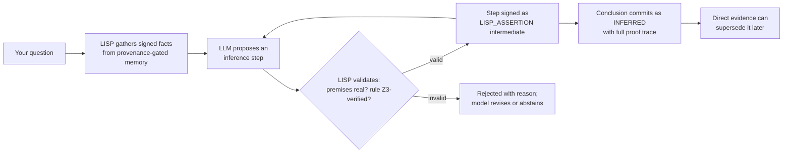

# Lucca's Reasoning Capability — What We're Building and Why It's Different

**Date:** 2026-09-30  
**Status:** WO-20 through WO-26 SHIPPED (Concert Layer, Walton Schemes, Practical Planning, Screen Vision Ingestion, Compound Reasoning 100 Benchmark, Cognitive Interiority)

---

## The one-paragraph version

Most AI reasons in one of two ways: a big language model that thinks fluently but can't prove anything, or a rigid rule engine that's verifiable but can't really think. Lucca is being built to do both *at once* — a small local language model that **proposes** reasoning steps, and a symbolic LISP engine that **validates and signs** every step, so that every conclusion she reaches comes with a **cryptographic proof of how she got there**. Not "trust me" — "here's the derivation, check it."

## How it functions (the concert loop)

1. **Evidence first.** Every chain starts from *signed* facts — your words, tool receipts, verified extractions. Never from the model's imagination.
2. **The LLM proposes.** It generates an inference step (premises → conclusion, with confidence) — the creative, abductive part.
3. **LISP disposes.** The symbolic layer checks the premises against the signed store and the rule against Z3. Valid → signed. Invalid → rejected with a machine-readable reason.
4. **Chain to a conclusion.** Steps accumulate as signed intermediates until the chain completes (bounded: depth 8, gas-limited).
5. **The conclusion carries its proof.** It commits to memory as `INFERRED` — marked as a deduction, with confidence, with the full trace — and *direct evidence can overrule it later*.

## How it compares

| Capability | Frontier LLMs (Claude/GPT) | Agent frameworks (LangGraph) | Companions (Replika/VTubers) | **Lucca (Live)** |
|---|---|---|---|---|
| Multi-step reasoning | Yes, unverified | Yes, unverified | No | **Yes, every step signed** |
| Can prove its reasoning | No | No | No | **Yes — proof traces** |
| Memory that separates fact from opinion | No | No | No | **Yes — provenance-gated** |
| Learns from you over time | No (resets) | Partial | Persona only | **Yes — quarantined, human-approved** |
| Runs locally, no cloud | No | Partial | Some | **Yes — fully local** |
| Abstains instead of guessing | Sometimes | No | No | **Yes — by construction** |
| Raw per-turn intelligence | **Highest** | Medium | Low | 12B (swappable) |

**The honest trade-off:** a frontier model out-reasons her per-turn on open-ended problems — permanently, at 12B. Her wins are depth-over-time, verifiability, and accountability: she *remembers*, *proves*, and *improves with you*, locally. The field optimizes for capability; Lucca optimizes for being *checkable*.

## The types of reasoning — what she can and can't do

| Form | What it is | Status | Notes |
|---|---|---|---|
| **Deduction** | General → specific; *certain* (A→B, A ⊢ B) | **Live (WO-20)** | Multi-step chains, every step Z3-verified and signed |
| **Abduction** | Best explanation from evidence (judge + UTC+8 → Philippines) | **Live (WO-20)** | Committable as `INFERRED` with proof trace; direct evidence can supersede |
| **Induction** | Specific → general; pattern learning (5 similar searches → a habit) | **Live (WO-21)** | Deterministic clustering & candidate rule generation |
| **Epistemic** | Reasoning about what's known/unknown (Belnap T/F/B/⊥) | **Live** | The 8-substrate epistemic cascade |
| **Defeasible** | Argument schemes & critical questions (Walton) | **Live (WO-21 / WO-23)** | Authority, sign, analogy, consequence, precedent schemes live |
| **Means-ends / planning** | Reasoning about action sequences to goals | **Live (WO-22)** | Bounded multi-step action planning with per-step receipts & aggregated narration |
| **Diagnostic** | Self-reasoning over decision history & system faults | **Live (WO-22)** | Fault-model diagnosis over DecisionRecord FTS5 index |
| **Counterfactual** | "What would have happened if…" | Partially | Shadow replay of rules |
| **Common-sense** | Tacit world knowledge | LLM parametric | Unverified steps marked as inferred |
| **Analogical** | Mapping structure across domains | **Live (WO-23)** | Analogy scheme critical questions |
| **Causal** | X *causes* Y (vs correlation) | Interventional receipts only | Reasoning over own tool receipts |

**The key distinction the concert layer draws:** deduction and abduction are both *enabled*, but they're treated differently by the honesty layer. Deductive conclusions (provable from verified rules) commit as facts. Abductive conclusions (best-guess explanations) commit as `INFERRED` — *marked* as deductions with confidence, never laundered into certainty, and always overruled by direct evidence later. She doesn't just reason; she *labels the kind of reasoning* every conclusion came from.

## The reasoning ladder (where this sits)

| Rung | What it is | Status |
|---|---|---|
| Verified memory | Signed, tiered facts; fact separated from opinion | **Live** |
| Epistemic cascade | Belnap four-valued evidence fusion; honest abstention | **Live** |
| Single-step rules | Verified condition→action reflexes | **Live** |
| **Concert layer** | Multi-step deduction + committable abduction, proof-traced | **Live (WO-20)** |
| **Defeasible rung** | Walton scheme corroboration & critical-question evaluation | **Live (WO-21 / WO-23)** |
| **Means-ends planner** | Bounded multi-step action planning with per-step receipts | **Live (WO-22)** |
| **Fault-model diagnosis** | Diagnostic self-reasoning over decision history & fault model | **Live (WO-22)** |

## The one-sentence version

Every other AI asks you to trust its reasoning; Lucca is being built to *show* it — every step signed, every premise checked, every conclusion replayable, and every deduction marked as a deduction until direct evidence confirms it.
