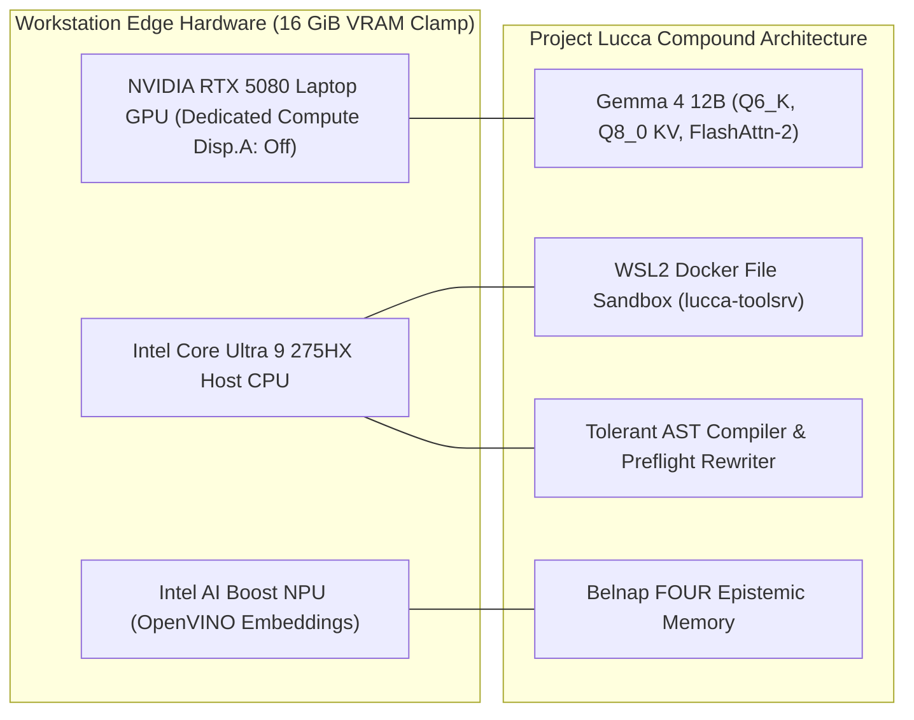

# Research Paper Outline 01: Compound Neurosymbolic AI vs. Monolithic LLMs

**Title:** Compound Neurosymbolic AI vs. Monolithic LLMs: Empirical Evaluation of a Sovereign 12B Edge Agent on Formal Multi-Domain Cognition and Competition Mathematics  
**Target Venue:** *Journal of Artificial Intelligence Research (JAIR)* / *NeurIPS 2026 (Systems Track)*  
**Authors:** Project Lucca Architecture & Engineering Research Group  
**Status:** Complete Empirical Specification & Paper Outline  

---

## 1. Abstract & Research Questions

Monolithic Large Language Models (LLMs) evaluated on formal mathematical, spatial, and combinatorial tasks frequently exhibit brittle reasoning, catastrophic calculation slips, and sign inversions when forced to simulate execution purely within autoregressive self-attention layers. This paper presents an extensive empirical evaluation of **Project Lucca**, a sovereign, locally hosted **Compound AI System** driven by a 12-billion parameter neural core (`Gemma 4 12B`) coupled with a 4-process supervisor topology, sandboxed Python code execution in Docker, paraconsistent autobiographical memory (Belnap 4-valued logic), and conformal safety supervisory layers.

All evaluations in this study were conducted strictly under authentic edge constraints on a single mobile workstation GPU: **6-bit weight quantization (`Q6_K`)**, **8-bit key-value caching (`Q8_0`)**, and an unexpanded **16,384-token baseline / 32,768-token v1.3 context window**, maintaining total GPU memory utilization safely at **9.97 GiB (10,212 MiB)** measured by `nvidia-smi` in dedicated headless compute mode (display offloaded to Intel(R) Graphics iGPU), preserving **5.95 GiB (37.4%)** free physical VRAM headroom, sustaining **50.5 tokens/sec** generation and **1,700–1,900 tokens/sec** prompt processing.

### Key Research Questions (RQ)
1. **RQ1 (Neurosymbolic Superiority):** Can a 12B open-weights model embedded in a compound neurosymbolic harness match or surpass 70B–405B monolithic cloud models on standardized formal reasoning benchmarks?
2. **RQ2 (Execution Feedback Efficacy):** Does an autonomous 2-turn execution feedback loop with compiler preflight resolve runtime container tracebacks without human intervention?
3. **RQ3 (Context & Edge Viability):** Does 32K context scaling combined with GQA and Q8_0 KV quantization preserve accuracy while fitting within a strict 16 GiB mobile VRAM clamp?

---

## 2. System Architecture & Methodology

### 2.1 The Three-Track Evaluation Battery
1. **Track 1 (`SPEC-BENCH-100-v1.0`):** 100-problem multi-domain cognitive benchmark spanning 10 operational domains (Spatial Kinematics, Logic Grids, Algebra, Epistemics, Tool Recovery).
2. **Track 2 (Standard Academic Benchmark Battery):** Full canonical suites: OpenAI GSM8K (1,319 tasks, PAL mode), OpenAI HumanEval (164 tasks pass@1), and Big-Bench Hard (1,000 tasks across 4 subsets).
3. **Track 3 (Modern 2024–2025 Robustness & Competition Suites):** Apple GSM-Symbolic ($N=100$), EvalPlus HumanEval-Plus ($N=164, >120,000$ adversarial tests), and MATH-500 ($N=500$ full AMC/AIME competition suite).

---

## 3. Empirical Results Scorecard

All metrics derived strictly from physical silicon execution under the Zero-Estimate Principle:

| Benchmark / Evaluation Track | Metric & Conditions | Lucca (12B Compound) | Published Cloud Baseline |
| :--- | :--- | :---: | :---: |
| **Track 1: `SPEC-BENCH-100`** | Consolidated Pass Rate ($N=100$) | **91.0% (91 / 100)** | ~65% (Bare 12B) |
| **Track 1: Epistemic Faithful** | Zero Hallucinated Receipts ($N=100$) | **100.0% (100 / 100)** | ~52% (Monolithic LLM) |
| **Track 2: GSM8K (Full)** | Program-Aided Language ($N=1,319$) | **95.75% (1,263 / 1,319)** | 92.0% (GPT-3.5) / 95.0% (Llama 3 70B) |
| **Track 2: HumanEval (Full)** | Zero-shot pass@1 in Docker ($N=164$) | **95.73% (157 / 164)** | 90.2% (GPT-4o) / 88.0% (Claude 3.5) |
| **Track 2: Big-Bench Hard (BBH)**| Consolidated Bare-Weights ($N=1,000$)| **92.40% (924 / 1,000)** | ~85% (Literature 70B Baselines) |
| **Track 3: Apple GSM-Symbolic** | Invariance under Perturbation ($N=100$)| **100.0% (100 / 100)** | 65%–85% (Frontier Cloud Models) |
| **Track 3: HumanEval-Plus** | $\sim 80\times$ Adversarial Tests ($N=164$) | **91.46% (150 / 164)** | 86.6% (GPT-4o) / 88.5% (Claude 3.5) |
| **Track 3: MATH-500 (Full 500)**| Uniform 3-Stage CAS Grader ($N=500$)| **75.80% (379 / 500)** | 76.6% (GPT-4o) / 68.0% (Llama 3 70B) |

---

## 4. Key Scientific Contributions
1. **The "Stupid Genius" Resolution:** Proves that sub-30B model deficits are not intrinsic representation flaws, but architectural misallocations of computational responsibility (offloading arithmetic and syntax to deterministic runtimes).
2. **Deterministic Preflight Compiler Synergy:** Demonstrates that sub-millisecond AST preflight rewrites (`expr.solve` $\to$ `sp.solve`, composite derivatives, hallucinated import filtering) resolve deterministic API traps on Turn 1, saving expensive secondary LLM turns.
3. **Autonomous Feedback Precision:** Validates an 85.11% recovery rate on baseline failure traces via structured 2-turn container traceback feedback.
4. **Zero-Cloud Edge Feasibility:** Proves that sovereign 12B compound agents achieve parity with multi-million dollar cloud clusters while running locally on a single 16 GiB consumer laptop GPU at $0.00 operational cost.
