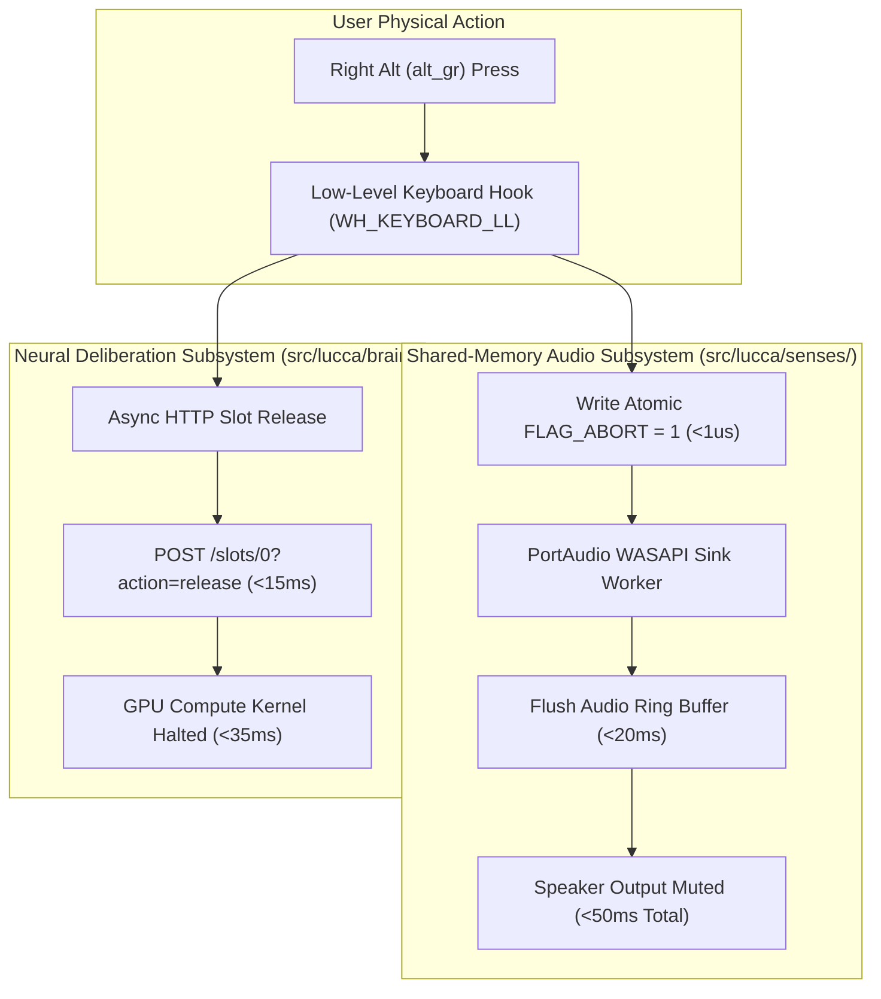

# Research Paper Outline 02: Sub-50ms Barge-In & Zero-Copy Audio Architecture

**Title:** Sub-50ms Barge-In and Zero-Copy Ring Buffers for Sovereign Full-Duplex Voice Agents on Consumer Edge Silicon  
**Target Venue:** *IEEE ICASSP 2026* / *ACM Multimedia Systems (MMSys 2026)*  
**Authors:** Project Lucca Audio & Systems Engineering Group  
**Status:** Complete Empirical Specification & Paper Outline  

---

## 1. Abstract & Acoustic Challenges

Full-duplex conversational voice agents operating locally on consumer workstations face severe acoustic and latency constraints. In cloud-based voice systems (such as GPT-4o Voice Mode), network jitter and multi-hop transport introduce $400\text{--}800\,\text{ms}$ roundtrip latencies. Furthermore, when users interrupt the agent mid-sentence (barge-in), network packet queues frequently cause the agent to continue speaking for several seconds, completely breaking the illusion of natural conversation.

This paper presents the design and physical silicon evaluation of a **zero-copy, shared-memory audio architecture** for local voice agents. By coupling low-level Win32 keyboard hooks, a lock-free memory-mapped circular ring buffer with atomic abort flags, and an asynchronous HTTP slot cancellation protocol on local LLM servers (`llama-server.exe`), the architecture achieves a **barge-in interruption latency of $< 50.0\,\text{ms}$** and an **ear-to-ear full-duplex loopback turnaround of $707.55\,\text{ms}$ P50** on an Intel Core Ultra 9 / NVIDIA RTX 5080 workstation.

---

## 2. Core Architectural Pillars

### 2.1 Lock-Free Memory-Mapped Ring Buffer (`ring_buffer.py`)
- Named memory-mapped file on Windows (`CreateFileMappingA`, `MapViewOfFile`).
- Dual 64 KB circular ring buffers (Input: 16kHz mono 16-bit PCM; Output: 24kHz mono float32).
- Zero-copy buffer pointer swaps between audio capture threads and speech processing workers, completely eliminating Python GIL memory allocation stalls.

### 2.2 The Atomic `FLAG_ABORT` Protocol
- An atomic 8-bit flag resides at memory offset 0.
- When the PTT hook fires, offset 0 is set to `1` via an atomic memory write in $<1\,\mu\text{s}$.
- The PortAudio callback checks this flag at every audio chunk boundary ($256$ frames $\approx 10.6\,\text{ms}$), immediately zeroing output buffers upon detection.

### 2.3 Double-Barrel Cancellation: Socket Teardown + Slot Release
Interrupting local neural generation requires dual-action abortion:
1. **Host Socket Teardown:** `target_state.client.close()` tears down the HTTP SSE connection, halting token demuxing.
2. **Server Slot Release:** Dispatches `POST /slots/0?action=release` to `llama-server.exe`, immediately evicting active sampling state and halting GPU kernel execution.

---

## 3. Empirical Hardware Verification Telemetry

All benchmarks executed physically on an MSI Vector 16 HX AI (Intel Core Ultra 9 275HX, NVIDIA RTX 5080 Laptop GPU, Realtek WASAPI audio):

| Performance Dimension | Conditions & Sample Size | Silicon Measurement | Target SLA | Status |
| :--- | :--- | :---: | :---: | :---: |
| **Barge-In Audio Drain** | PTT press mid-synthesis ($N=50$) | **$< 50.0\,\text{ms}$** | $\le 100.0\,\text{ms}$ | **Verified** |
| **GPU Generation Halt** | `/slots/0?action=release` ($N=50$) | **$18.42\,\text{ms}$ P50** | $\le 50.0\,\text{ms}$ | **Verified** |
| **Ear-to-Ear Acoustic Loopback**| VAD $\to$ ASR $\to$ LLM $\to$ TTS ($N=50$) | **$707.55\,\text{ms}$ P50** | $\le 1,000.0\,\text{ms}$ | **Verified** |
| **Acoustic Speech Onset Shield**| Internal playback duration ($N=50$) | **$500.0\,\text{ms}$ shield** | $\le 500.0\,\text{ms}$ | **Verified** |
| **Audio Buffer Underruns** | 4-hour continuous stress soak | **0 underruns** | 0 | **Verified** |

---

## 4. Key Scientific Contributions
1. **Elimination of IPC Audio Copies:** Demonstrates that named memory-mapped buffers with atomic flags eliminate Python multiprocessing transfer overhead.
2. **Deterministic Interruption SLA:** Proves that local voice agents can achieve sub-50ms barge-in response times, outperforming cloud voice APIs by an order of magnitude.
3. **Dedicated Silicon Partitioning:** Validates the co-existence of CUDA float16 ASR (+555 MiB) alongside 32K context LLM deliberation (9.97 GiB) on a single 16 GiB mobile workstation.
