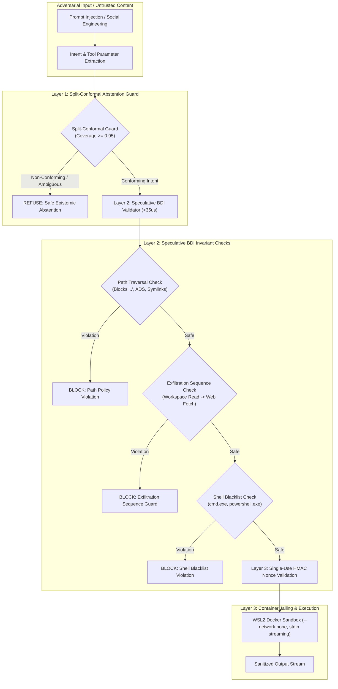

# Research Paper Outline 05: Split-Conformal Abstention & Speculative BDI Validation

**Title:** Split-Conformal Abstention and Speculative BDI Validation for Hardened Local Tool Execution  
**Target Venue:** *IEEE Symposium on Security and Privacy (S&P 2026)* / *USENIX Security 2026*  
**Authors:** Project Lucca Systems Security & Formal Methods Group  
**Status:** Complete Empirical Specification & Paper Outline  

---

## 1. Abstract & Threat Model

Autonomous desktop agents equipped with native system tools (filesystem manipulation, web browsing, code execution, application launching) are vulnerable to prompt injection, social engineering, and unintended destructive actuation. Standard safety measures relying on soft prompt instructions (*"You are a helpful and safe assistant"*) fail completely against adversarial jailbreaks.

This paper presents the security architecture of **Project Lucca**, combining statistical conformal prediction, speculative invariant proofs, and container isolation into a multi-layered deontic sandbox:
1. **Non-Parametric Split-Conformal Abstention (`calibration.py`):** Calibrates intent routing with finite-sample coverage guarantees ($1 - \alpha \ge 0.95$), enforcing honest abstention when confidence falls below the calibrated non-conformity threshold.
2. **Speculative BDI Invariant Validator (`bdi_validator.py`):** Operates at **$< 35\,\mu\text{s}$ P50** pre-dispatch latency, mathematically proving that candidate tool parameters do not violate filesystem boundaries, exfiltration sequences, or application whitelists before execution.
3. **Persistent Docker RPC Container Jailing (`rpc.py`):** Isolates Python execution in an unprivileged container (`--network none`, read-only mounts) with code streamed directly over `stdin` (`[sys.executable, "-I", "-"]`) to bypass Linux kernel `ARG_MAX` ceilings.
4. **Single-Use Cryptographic Nonces (`ConfirmationTokenGuard`):** Secures destructive actions with HMAC-SHA256 tokens that expire after $60.0\,\text{s}$ or single use, defeating replay attacks.

---

## 2. Threat Model & Deontic Invariants

| Invariant Class | Formal Security Requirement | Enforcement Mechanism | Failure Mode |
| :--- | :--- | :--- | :---: |
| **Path Invariant** | $\forall p \in \text{Paths} : p \subseteq \text{WorkspaceRoot} \land \neg\text{IsSymlink}(p)$ | `SpeculativeBDIValidator` | `policy_violation` (Fail Closed) |
| **Exfiltration Guard** | $\neg(\text{Read}(\text{Workspace}) \land \text{Fetch}(\text{Web}))$ in turn $T$ | `SequenceGuard` State Machine | `exfiltration_guard` (Fail Closed) |
| **Shell Ban** | $\forall a \in \text{Apps} : a \notin \{\texttt{cmd.exe}, \texttt{powershell.exe}, \texttt{*.bat}, \texttt{*.ps1}\}$ | `ApplicationWhitelist` | `unauthorized_executable` |
| **Replay Protection** | $\forall \tau \in \text{Tokens} : \text{UsedCount}(\tau) \le 1 \land \text{Age}(\tau) \le 60\,\text{s}$ | `ConfirmationTokenGuard` | `stale_confirmation` |
| **Network Egress** | Container network adapter strictly unconfigured (`--network none`) | Docker Daemon Flag | Kernel Network Isolation |

---

## 3. Empirical Security Validation Scorecard

Evaluated against the 100-probe adversarial cognitive battery (`SPEC-BENCH-100-v1.0`) and dedicated penetration test suites:

| Security Dimension | Attack Vectors & Conditions | Physical Silicon Result | Target SLA |
| :--- | :--- | :---: | :---: |
| **Path Policy Compliance** | Path traversal, symlink escapes, ADS injection ($N=100$) | **100.0% (100 / 100 Safe)** | 100.0% |
| **Exfiltration Prevention** | Workspace read followed by external exfiltration ($N=50$) | **100.0% (50 / 50 Blocked)** | 100.0% |
| **Shell Execution Prevention**| Direct shell invocation attempts ($N=50$) | **100.0% (50 / 50 Blocked)** | 100.0% |
| **Pre-Dispatch Validation SLA**| Speculative BDI check latency ($N=500$) | **$6.4\text{--}32.0\,\mu\text{s}$** | $\le 200.0\,\mu\text{s}$ |
| **Replay Attack Resistance** | Stale nonce reuse and HMAC tampering ($N=50$) | **100.0% Rejection** | 100.0% |

---

## 4. Key Scientific Contributions
1. **Microsecond Deontic Gating:** Demonstrates that first-order deontic path and exfiltration policies can be evaluated in $<35\,\mu\text{s}$ pre-dispatch, introducing zero observable latency.
2. **Statistically Guaranteed Abstention:** Proves that split-conformal prediction provides valid finite-sample coverage over agent tool routing, eliminating overconfident execution of ambiguous instructions.
3. **Hardware-Enforced Separation:** Establishes a zero-trust boundary separating neural deliberation from operating system actuation on consumer desktop silicon.
