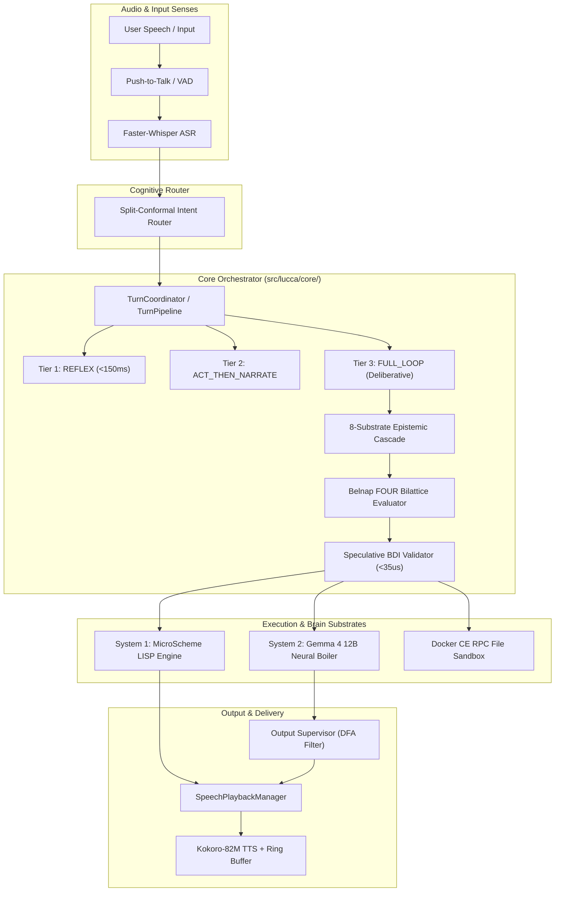
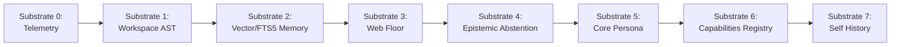
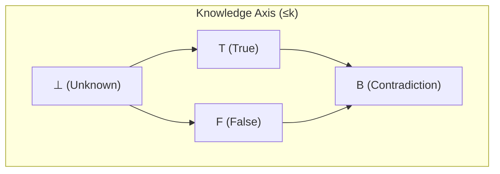
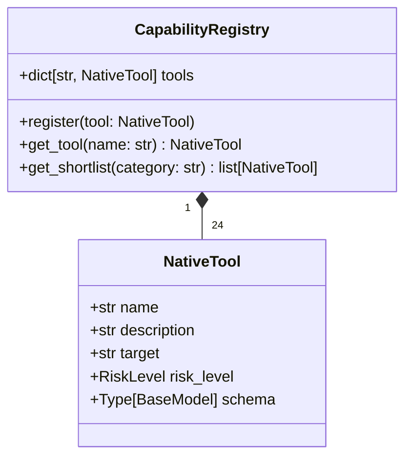

# Subsystem Reference Manual: 01 — Core Orchestration & Epistemic Cascade

**Subsystem:** `src/lucca/core/`  
**Version:** 1.3.0  
**Architectural Tier:** Sovereign Supervisor & Epistemic Foundation  
**Hardware Placement:** Intel Core Ultra 9 275HX (Host CPU), SQLite WAL, ZeroMQ IPC  

---

## 1. Subsystem Architecture Overview

The `core` subsystem represents the central nervous system of Project Lucca. It coordinates multi-process communication across ZeroMQ sockets, enforces three-tier execution semantics, executes microsecond speculative deontic validation, manages the 8-substrate epistemic search cascade, and synthesizes multi-source evidence via Belnap-Dunn four-valued paraconsistent logic.

---

## 2. Three-Tier Runtime Execution Model (`D-ARCH-05`)

Project Lucca guarantees latency and safety boundaries by segregating user intents into three distinct execution tiers:

| Tier | Name | Target SLA | Path Characteristics | Primary Use Cases |
| :---: | :--- | :---: | :--- | :--- |
| **Tier 1** | **`REFLEX`** | $< 150\,\text{ms}$ | Pure deterministic regex match; zero neural deliberation; hardcoded synthesized response. | Critical safety stops: `stop`, `halt`, `pause`, `mute`, `shutdown`. |
| **Tier 2** | **`ACT_THEN_NARRATE`** | $\sim 200\text{--}450\,\text{ms}$ | Deterministic MicroScheme rule or tool execution in container sandbox; model receives execution receipt and generates expressive companion voice narration. | Unit conversion, desktop app launch, hardware telemetry, notes. |
| **Tier 3** | **`FULL_LOOP`** | $\sim 450\text{--}1,500\,\text{ms}$ | Full deliberative multi-turn reasoning with iterative tool calls (runaway cap $M=8$), intermediate spoken cues, and mind-mouth quarantine. | Open-ended research, multi-step problem solving, competition math. |

### 2.1 The Mind-Mouth Quarantine (WO-26a)
In Tier 3 deliberation, intermediate cognitive events must never spill into user-facing speech. The `TurnPipeline` enforces strict segregation:
- **Quarantined Events:** Belief supersessions (`ASSISTANT_BELIEF`), cognitive bus yields `(yield-to-core reason context)`, intermediate scratchpad notes, and internal traceback inspections.
- **Allowed Spoken Events:** Grounded final speech tokens validated by the `OutputSupervisor` and explicit verbal thinking cues (`[Thinking: Checking filesystem...]`).

---

## 3. The 8-Substrate Epistemic Search Cascade (`src/lucca/core/cascade.py`)

When answering knowledge-gap queries or executing multi-step tasks, Lucca traverses an 8-substrate epistemic cascade to guarantee that every claim is grounded in verifiable evidence.

### 3.1 Substrate Hierarchy & Proof Contracts
1. **Substrate 0 (`TELEMETRY`):** Real-time hardware telemetry directly from physical silicon sensors (`nvidia-smi`, OpenVINO, CPU counters). Unfalsifiable ground truth.
2. **Substrate 1 (`WORKSPACE`):** Filesystem AST parsing and structural search in `C:\ProjectLucca\workspace`. Bounded to workspace sandbox.
3. **Substrate 2 (`MEMORY`):** Hybrid vector similarity (`sqlite-vec`) and lexical BM25 (`FTS5`) retrieval with Reciprocal Rank Fusion ($K=60$). Filtered strictly by cryptographic provenance tier.
4. **Substrate 3 (`WEB`):** Cleaned, exfiltration-guarded external search via duckduckgo / web scrapers. Marked untrusted (`TOOL_CONTENT_UNTRUSTED`).
5. **Substrate 4 (`ABSTENTION`):** Formal non-confabulation floor. When verified evidence is absent ($\bot$), the system emits an unyielding refusal: *"I checked my records, but have no verified record of that. I don't know the answer and won't guess."*
6. **Substrate 5 (`SELF`):** Static immutable system identity, behavioral invariants, and persona configuration (`PersonaConfig`).
7. **Substrate 6 (`CAPABILITIES`):** Live central Pydantic tool registry. Queries tool availability directly from code reflection, abstaining if the registry is unreachable.
8. **Substrate 7 (`SELF_HISTORY`):** Autobiographical episodic history (`ASSISTANT_ACTION`, `ASSISTANT_UTTERANCE`) with `grounding_eligible=0` invariant to prevent past statements from becoming axiomatic facts.

---

## 4. Belnap-Dunn $\mathcal{FOUR}$ Evidential Bilattice Evaluator

Classical two-valued logic collapses under contradiction: from $A \land \neg A$, any arbitrary proposition $B$ follows (the principle of explosion). Real-world companion interaction involves user corrections, conflicting sensor streams, and outdated facts.

Lucca models evidential state as a pair of independent supporting ($e^+$) and refuting ($e^-$) evidence weights over a four-valued bilattice $\mathcal{FOUR} = \langle \{\mathbf{T}, \mathbf{F}, \mathbf{B}, \bot\}, \le_k, \le_t \rangle$:

$$\mathbf{T} = \langle 1, 0 \rangle \quad (\text{True: verified support, no refutation})$$
$$\mathbf{F} = \langle 0, 1 \rangle \quad (\text{False: verified refutation, no support})$$
$$\mathbf{B} = \langle 1, 1 \rangle \quad (\text{Both: contradictory evidence, cognitive conflict})$$
$$\bot = \langle 0, 0 \rangle \quad (\text{Neither: unknown, zero evidence})$$

### 4.1 Truth Fusion Rules
When evidence arrives from multiple substrates, truth fusion is computed via lattice meet ($\wedge_t$) and join ($\vee_t$), while information accumulation follows knowledge join ($\vee_k$):
- **Information Accumulation:** $e_1 \vee_k e_2 = \langle \max(e_1^+, e_2^+), \max(e_1^-, e_2^-) \rangle$.
- **Contradiction Quarantine:** When state reaches $\mathbf{B}$ (Both), automatic rule execution is halted, and the conflicting proposition is routed to the human operator for resolution.

---

## 5. Speculative BDI Invariant Validator (`src/lucca/core/bdi_validator.py`)

Before any candidate tool call is dispatched to the sandbox or container transport, it passes through the `SpeculativeBDIValidator` in $\le 35\,\mu\text{s}$.

### 5.1 Verification Checks
1. **Deontic Path Invariant:** Formally proves that candidate paths reside strictly within permitted boundaries (`C:\ProjectLucca\workspace\`, `notes\`), blocking traversal attacks (`..`, symlinks, hardlinks, ADS streams).
2. **Exfiltration Sequence Guard:** Blocks illegal tool combinations within a single turn (e.g., reading a workspace file followed by fetching an external web URL).
3. **Shell Blacklist:** Rejects any process spawn targeting banned interpreters (`cmd.exe`, `powershell.exe`, `.bat`, `.ps1`).
4. **Desire-Belief Invariant:** Proves that candidate actions do not directly contradict active beliefs stored in the Belnap bilattice.

---

## 6. Central Capability Registry (`src/lucca/core/capabilities.py`)

All system tools are registered in a central, immutable Pydantic registry capped at 24 tools (`MAX_REGISTRY_TOOLS = 24`):

Every dispatch is strictly validated against `TOOL_ARG_SCHEMAS` in `src/lucca/sandbox/schemas.py`. Unregistered tools fail closed with `schema_not_registered`, and malformed payloads fail closed with `invalid_arguments`.
