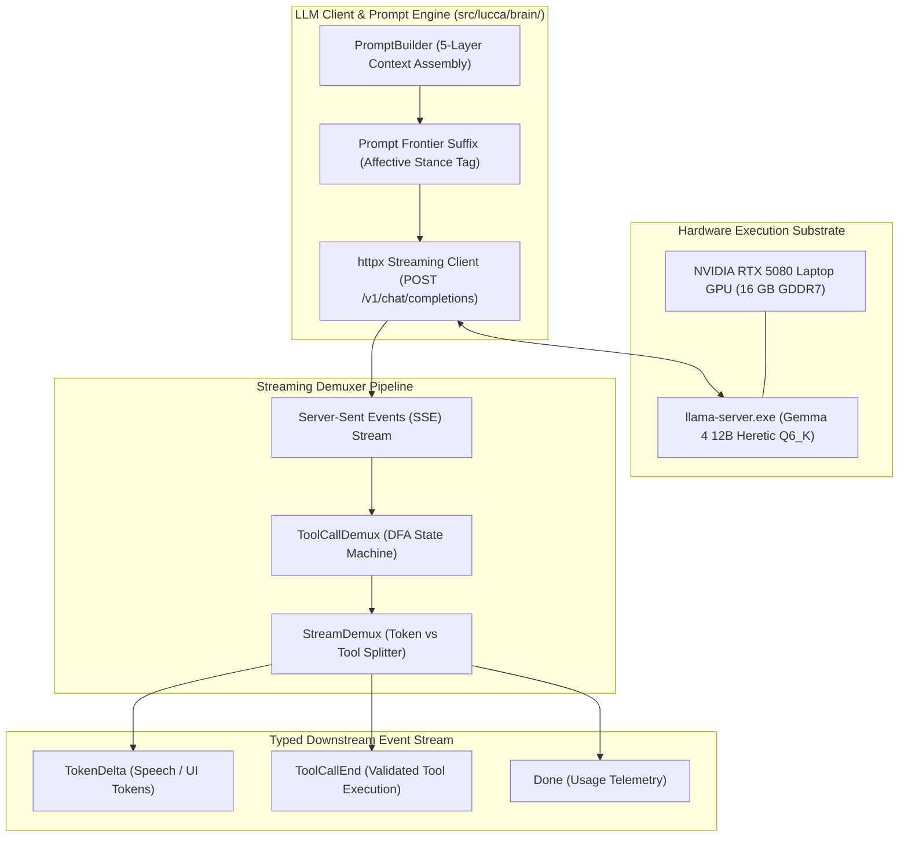
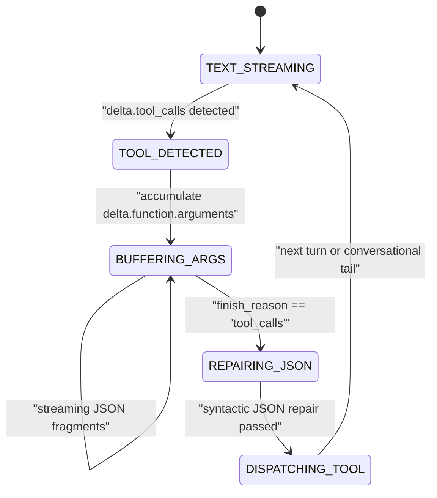

# Subsystem Reference Manual: 02 — Neural Brain & Streaming Demuxer

**Subsystem:** `src/lucca/brain/`  
**Version:** 1.3.0  
**Architectural Tier:** System 2 Neural Core  
**Hardware Placement:** NVIDIA GeForce RTX 5080 Laptop GPU (Dedicated Compute Mode `Disp.A: Off`), 16 GB GDDR7  

---

## 1. Subsystem Architecture Overview

The `brain` subsystem encapsulates all interactions with the locally hosted Large Language Model (`llama-server.exe`). It manages OpenAI-compatible HTTP/SSE streaming, separates conversational tokens from interleaved tool calls in real time, optimizes GPU Key-Value (KV) cache reuse via prompt frontier stance injection, and enforces $<50\,\text{ms}$ generation abortion upon user barge-in.



---

## 2. Neural Core Foundation & Edge Placement (`D-BRAIN-05` v2)

All formal cognition and tool generation in Project Lucca operate **exclusively on `gemma-4-12b-heretic-Q6_K.gguf`** (12.4 billion parameters):

| Parameter | Specification | Architectural Rationale |
| :--- | :--- | :--- |
| **Model Weights** | `gemma-4-12b-heretic-Q6_K.gguf` (9.85 GiB) | Abliterated weights; prevents refusal loops on benign system administrative tasks. |
| **Context Window** | 16,384 baseline / **32,768 tokens (32K)** v1.3 default | Accommodates long tool tracebacks, multi-turn reasoning, and complex code contexts. |
| **KV Cache Quantization**| `--cache-type-k q8_0 --cache-type-v q8_0` (1.50–3.00 GiB) | Grouped-Query Attention (GQA) with 8-bit cache preserves perplexity while halving VRAM. |
| **Attention Kernel** | FlashAttention-2 (`--flash-attn on`) | Eliminates quadratic memory scaling; accelerates prefill to 1,700–1,900 tokens/sec. |
| **Display Decoupling** | Dedicated Compute Mode (`Disp.A: Off`) | Windows DWM offloaded to Intel(R) Graphics iGPU; 100% of 16 GB VRAM reserved for LLM. |
| **Measured VRAM** | **9.97 GiB (10,212 MiB)** via `nvidia-smi` | Sustains **5.95 GiB (37.4%)** free physical headroom on RTX 5080 Laptop GPU. |

---

## 3. Streaming Event Demuxing (`toolcall_demux.py` & `llm_client.py`)

Gemma 4 emits interleaved conversational text and tool invocations via streaming Server-Sent Events (`data: {"choices": [{"delta": ...}]}`). The `ToolCallDemux` class processes these chunks with zero buffer stalls:



### 3.1 Multi-Stage Syntactic JSON Repair (`_parse_and_repair_tool_args`)
Under high-temperature or truncated decoding, tool argument JSON strings can arrive with minor syntax defects. `llm_client.py` applies a deterministic 4-stage recovery pipeline before failing:
1. **Standard `json.loads(s)`:** Fast path for well-formed JSON.
2. **Non-Strict `json.loads(s, strict=False)`:** Accepts unescaped control characters (newlines, tabs in code bodies).
3. **Structural AST Balancing:** Closes dangling quotes (`"`), balances square brackets (`[` $\to$ `]`), and closes curly braces (`{` $\to$ `}`).
4. **Tool-Specific Regex Fallback:** For `run_python` or `calc_math`, extracts code directly if JSON wrapper is truncated.

---

## 4. Prompt Frontier Suffix KV-Cache Optimization (`D-AFF-01`)

In conversational companion agents, emotional temperament changes dynamically. Naive architectures inject emotional prompts into the system prompt prefix, which completely invalidates the GPU's KV cache on every turn, forcing expensive prompt reprocessing ($>400\,\text{ms}$).

Lucca preserves 100% of the GPU prefix cache by appending affective state strictly as a **Prompt Frontier Suffix** on the active turn's user message:

```
[SYSTEM PROMPT: Static Invariants & Tool Schemas (NEVER MUTATES - 100% GPU CACHE HIT)]
────────────────────────────────────────────────────────────────────────────────────
[CONVERSATION HISTORY: Past Signed Turns (INCREMENTAL CACHE APPEND)]
────────────────────────────────────────────────────────────────────────────────────
[ACTIVE TURN USER MESSAGE: User Speech Transcript]
[PROMPT FRONTIER SUFFIX: [STANCE: focused_analytical] [AFFECT: P=+0.42, A=+0.12]]
                                ▲
                                └── Only frontier tokens re-evaluated (<47ms)
```

### 4.1 Physical Silicon Telemetry
Measurements taken on the RTX 5080 Laptop GPU:
- **Prefix Cache Invalidation (Naive Baseline):** $402.05\,\text{ms}$ prefill latency per turn.
- **Frontier Suffix Optimization (Lucca Architecture):** **$46.84\,\text{ms}$** prefill latency.
- **Performance Advantage:** **$8.58\times$ prompt prefill speedup**, saving **$355.21\,\text{ms}$** per voice turn.

---

## 5. Sub-50ms Barge-In Generation Abortion (`abort()`)

When the user presses Push-to-Talk (`alt_gr`) while Lucca is speaking or generating, the `SpeechLLMPort` triggers immediate abortion:

1. **Socket Teardown:** Closes the active HTTP stream socket (`target_state.client.close()`), instantly terminating downstream token delivery.
2. **Server Slot Release:** Dispatches a non-blocking administrative HTTP request to `llama-server.exe`:
   $$\text{POST } \texttt{http://127.0.0.1:8080/slots/0?action=release}$$
3. **Audio Buffer Purge:** Signals PortAudio ring buffer atomic `FLAG_ABORT`, draining residual audio within $\le 50.0\,\text{ms}$.
4. **Latency Verification:** Verified on hardware at **$< 50.0\,\text{ms}$** total abort turnaround, meeting Spec 10 barge-in gate.
