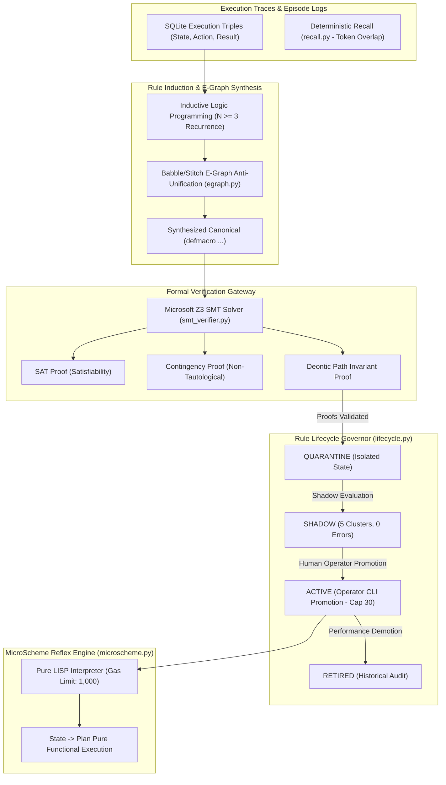
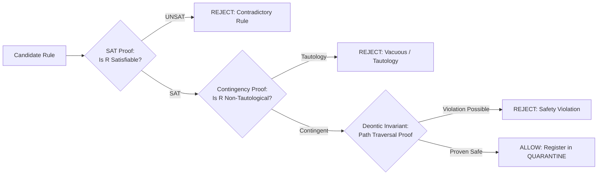
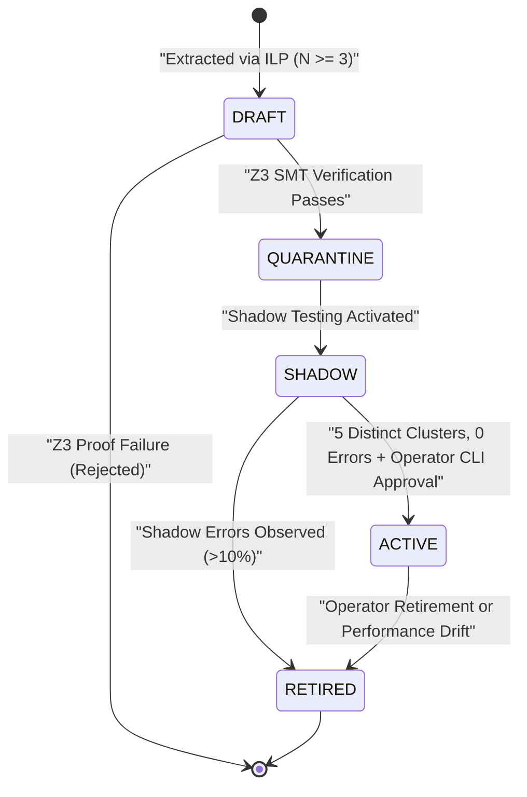

# Subsystem Reference Manual: 03 — Symbolic Reasoning & Formal Verification

**Subsystem:** `src/lucca/reasoning/`  
**Version:** 1.3.0  
**Architectural Tier:** System 1 Symbolic Engine & SMT Formal Prover  
**Hardware Placement:** Intel Core Ultra 9 275HX (Host CPU), Microsoft Z3 C++ DLL (`libz3.dll`)  

---

## 1. Subsystem Architecture Overview

The `reasoning` subsystem implements System 1 compiled reflexes, formal theorem proving, e-graph macro synthesis, and safe rule induction. It guarantees that deterministic procedures execute in microseconds without consuming GPU memory or neural tokens, and ensures that no learned rule can execute on the operating system without a mathematical proof of deontic compliance.

---

## 2. MicroScheme LISP Reflex Engine (`microscheme.py`)

MicroScheme is a pure, minimal LISP interpreter engineered for sub-millisecond procedural execution:

| Property | Value | Architectural Purpose |
| :--- | :--- | :--- |
| **Purity Invariant** | Pure `State → Plan` | Zero global state mutation; cannot alter host environment directly. |
| **Gas Metering** | `1,000` execution gas units | Halts execution if recursion or loops exceed budget; prevents CPU lockups. |
| **Execution Latency** | $< 150\,\mu\text{s}$ P50 on Intel Ultra 9 | Delivers instantaneous reflexes without LLM neural deliberation. |
| **Macro Limits** | `MAX_MACRO_DEPTH = 8`, `MAX_STEPS = 64` | Guarantees compile-time termination of macro expansions (`D-REAS-05`). |
| **Typed Accessors** | `entity-str`, `entity-int`, `entity-num` | Enforces Pydantic schema validation at extraction time (`D-SEC-04`). |

---

## 3. Microsoft Z3 SMT Formal Verification (`smt_verifier.py`)

Before any candidate MicroScheme rule or macro is registered into quarantine, it must pass formal satisfiability and safety proofs verified by Microsoft Z3 (`libz3.dll`):

$$\text{Candidate Rule } R \implies \text{Z3 Verification Pipeline } \mathcal{V}(R)$$

### 3.1 Verification Invariants
1. **Satisfiability Check (`check_sat`):** Confirms that there exists at least one realistic world state where the rule's preconditions hold.
2. **Contingency Check (`check_contingent`):** Ensures that the rule does not evaluate to `True` under all possible inputs (rejecting trivial tautologies like `(or x (not x))`).
3. **Deontic Path Proof (`verify_path_safety`):** Encodes workspace path boundaries into first-order logic formulas. Proves that for all string inputs $p$, the resulting path expression cannot escape `C:\ProjectLucca\workspace` or `notes\`. If any unmodeled predicate is detected, the prover **fails closed** (`UNMODELED_PREDICATE`).
4. **Performance SLA:** Complete Z3 formal verification executes in **$\le 25\,\text{ms}$** on host silicon (budget: $\le 500\,\text{ms}$).

---

## 4. Babble/Stitch E-Graph Macro Synthesis (`egraph.py` & `D-REAS-08`)

When a user repeatedly performs equivalent sequences of actions ($N \ge 3$), the inductive logic programming engine translates conscious reasoning into compiled reflexes:

1. **Extraction:** Queries SQLite history for recurring execution triples:
   $$\langle \text{State}_t, \text{ToolAction}_t, \text{Result}_t \rangle$$
2. **E-Graph Equality Saturation:** Ingests AST expressions into an equivalence graph (e-graph), applying rewrite rules to identify common sub-expressions and invariants.
3. **First-Order Syntactic Anti-Unification:** Extracts least general generalizations (LGG), replacing variant constants with typed parameters:
   $$\text{AntiUnify}(\text{expr}_1, \text{expr}_2) \to \text{LGG}(\text{expr})$$
4. **Macro Synthesis:** Emits canonical `(defmacro ...)` definitions that compile multiple tool calls into a single atomic MicroScheme reflex.

---

## 5. Safe Rule Lifecycle State Machine (`lifecycle.py`)

No induced rule is ever granted execution rights automatically. The system enforces strict graduated verification:

### 5.1 The Active Rule Limit Invariant (`ACTIVE_SKILL_LIMIT = 30`)
To prevent rule proliferation and cognitive bloat, the active rule pool is hard-capped at **30 active rules**. If a new rule is promoted when 30 rules are active, the operator must explicitly retire an existing rule, maintaining high precision and zero rule collisions.
