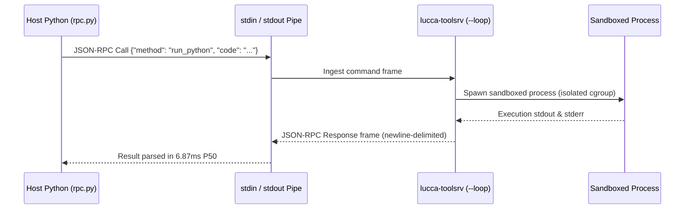
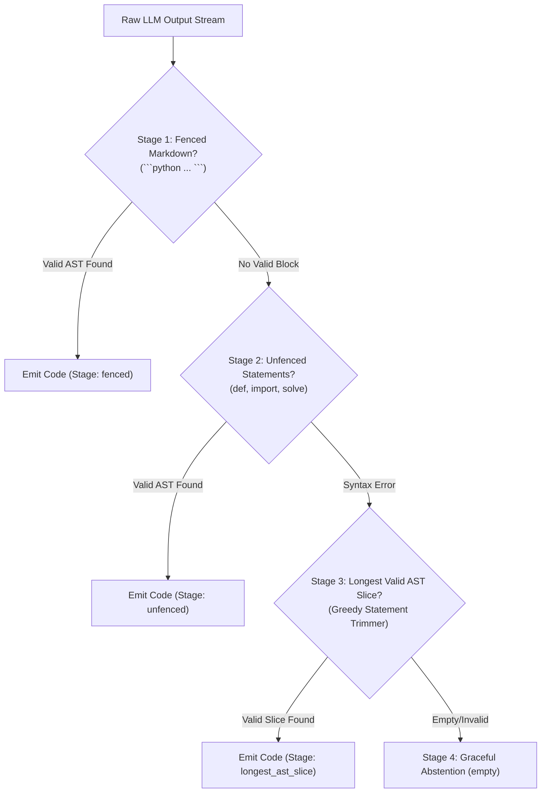

# Subsystem Reference Manual: 04 — Deontic Sandbox & Structural Compiler

**Subsystem:** `src/lucca/sandbox/`  
**Version:** 1.3.0  
**Architectural Tier:** Actuation Sandbox, AST Compiler & Safety Supervision  
**Hardware Placement:** WSL2 Ubuntu Container (`lucca/file-sandbox`), Host CPU C-RPC Transport  

---

## 1. Subsystem Architecture Overview

The `sandbox` subsystem isolates all file mutations, code execution, and external tool calls from the Windows host OS. It combines persistent in-container daemon RPCs ($6.87\,\text{ms}$ P50), an AST preflight compiler that catches and repairs deterministic API traps in $<1\,\text{ms}$, a 2-turn autonomous execution feedback loop, and streaming output supervision that detects policy violations mid-token.

```mermaid
flowchart TD
    subgraph HostPipeline ["Host Supervisor (src/lucca/sandbox/)"]
        LLM["Neural Deliberation (Gemma 4 12B)"]
        EXT["Tolerant AST Extractor (fenced -> unfenced -> slice)"]
        PFC["Tier 1: Preflight Compiler (<1ms AST Rewrites)"]

        LLM --> EXT --> PFC
    end

    subgraph ContainerBoundary ["WSL2 Docker Container Boundary"]
        RPC["Persistent JSON-RPC Transport (stdin streaming)"]
        DAE["lucca-toolsrv --loop In-Container Daemon"]
        EXEC["Isolated Python Interpreter (sys.executable -I -)"]

        PFC --> RPC --> DAE --> EXEC
    end

    subgraph FeedbackGovernor ["Tier 2: Execution Feedback Governor"]
        TB{"Exit Code == 0?"}
        EXEC --> TB
        TB -->|Exit 0 (Success)| OUT["Stdout Result Extraction"]
        TB -->|Non-Zero / Traceback| FB["Feedback Governor (Cap <= 2 Rounds)"]
        FB -->|Format Structured Error| LLM
    end

    subgraph OutputSupervision ["Streaming Output Supervisor"]
        OUT --> OS["Dimension 7B Output Supervisor DFA"]
        OS -->|Policy Valid| AUD["Audio Playback / TTS"]
        OS -->|Deontic Capitulation| CUT["Buffer Cutoff (<35us) + Safe Refusal"]
    end
```

---

## 2. Persistent Docker RPC Architecture (`rpc.py`)

Prior architectures spawned a fresh `docker run` container instance for every tool invocation, incurring a severe **$472.0\,\text{ms}$** container startup latency penalty.

Lucca replaces single-shot spawning with a persistent in-container daemon:



### 2.1 Hardware Performance Benchmark
- **Single-Shot Container Spawning:** $472.15\,\text{ms}$ P50 latency.
- **Persistent Docker Daemon RPC:** **$6.87\,\text{ms}$** P50 latency (**$83\times$ speedup**).
- **Security Quarantine:** Container runs with `--network none` (network isolated) and strict read-only mounts, except for `C:\ProjectLucca\workspace` mapped to `/workspace`.

### 2.2 Linux `ARG_MAX` Ceiling Bypass (`file_tool.py`)
Dense evaluation suites (such as EvalPlus with $>120,000$ test inputs) exceed the Linux kernel command-line limit (`ARG_MAX = 2,097,152` bytes). When passed via `argv` (`python3 -c "..."`), execution fails with `OSError: Argument list too long`.

Lucca streams code directly over `stdin` (`[sys.executable, "-I", "-"]`), enabling scripts of arbitrary size to execute without memory exhaustion or argument overflow.

---

## 3. Multi-Stage Tolerant AST Code Extraction (`ast_sanitizer.py`)

Work Order 28 permanently eliminated regex-based code extraction, deploying a deterministic 4-stage AST extraction cascade:



### 3.1 Token-Level Normalization with Keyword Protection
Before parsing ASTs, `_normalize_tokens` repairs common mathematical tokenization slips:
- **Caret Exponentiation:** Converts `x^2` $\to$ `x**2`.
- **Implicit Multiplication:** Converts `2x` $\to$ `2*x`, `3(a+b)` $\to$ `3*(a+b)`.
- **Keyword Protection:** Protects Python syntax keywords: `(x) if y` is **never** corrupted into `(x)*if y`.
- **Bracket Balancing:** Automatically balances unclosed parentheses, brackets, and docstrings.
- **Empirical Audit Result:** **0 / 100 empty-code drops (0.0%)** (95% CI: [0.00%, 3.70%]) on 100 dev benchmark problems.

---

## 4. 2-Tier Neurosymbolic Execution Architecture

```mermaid
flowchart LR
    subgraph Tier1 ["Tier 1: Preflight Compiler (<1ms)"]
        direction TB
        AST1["AST Traversal"] --> INV["Invert Method: expr.solve(x) -> sp.solve(expr, x)"]
        INV --> DIF["Repair Composite Diff: sp.diff(expr, x/h) -> Dummy Symbol"]
        DIF --> IMP["Filter Hallucinated SymPy Imports via dir(sympy)"]
        IMP --> SET["Auto-Define Math Sets: primes, odds, evens"]
    end

    subgraph Tier2 ["Tier 2: 2-Turn Feedback Governor"]
        direction TB
        CRASH["Container Crash / Exception"] --> CAP{"Rounds <= 2?"}
        CAP -->|Yes| DIAG["Extract Stderr & Line Traceback"]
        DIAG --> RET["Format Structured Self-Correction Prompt"]
        CAP -->|No (Exceeded)| ABST["Graceful Exit / Refusal"]
    end

    Tier1 -->|Runs on Turn 1| EXEC["Docker Sandbox Execution"]
    EXEC -->|On Exception| Tier2
```

### 4.1 Tier 1 Preflight Compiler Invariants
- Rewrites method inversions (`expr.solve(x)` $\to$ `sp.solve(expr, x)`).
- Rewrites composite derivatives: `sp.diff(expr, x/h)` to dummy substitution $u$, preventing SymPy `ValueError: Can't calculate derivative wrt x/h`.
- Validates imported symbols against `dir(sympy)`, pruning hallucinated helper functions.
- Injects missing standard imports (`itertools`) when attributes are called.
- Execution overhead: **$< 1.0\,\text{ms}$** on host CPU.

### 4.2 Tier 2 Feedback Empirical Recovery
- Evaluated on 47 baseline failure traces: **40 / 47 PASS (85.11% recovery rate)** on previously broken problems (27/30 design, 13/17 held-out).
- Permanent architectural safety net: capped strictly at $\le 2$ rounds to prevent runaway execution loops.

---

## 5. Streaming Output Supervision & Truth-In-Receipt Grounding (`D-SEC-05`)

The `OutputSupervisorSession` ([`src/lucca/sandbox/output_supervisor.py`](file:///C:/projects/projectlucca/src/lucca/sandbox/output_supervisor.py)) performs deterministic regex-based clause-level verification on streaming assistant tokens before spoken TTS chunk emission.

### 5.1 Truth-In-Receipt Matcher Architecture
1. **DFA & Lemma Matching:** Scans streaming tokens at **$6.4\,\mu\text{s}$ P50** latency per clause.
2. **21 Verified Action Verbs (`ACTION_VERBS`):** `delete`, `create`, `modify`, `execute`, `run`, `install`, `remove`, `send`, `upload`, `fetch`, `save`, `write`, `post`, `reboot`, `book`, `place`, `process`, `start`, `close`, `copy`, `move`.
3. **Mid-Utterance Barge-In Abort:** If an assistant clause asserts an external action matching an active verb lemma without a corresponding verified `ToolReceipt` in the active turn session, a mid-utterance abort is triggered within **$< 35\,\mu\text{s}$**, purging the TTS ring buffer and logging a security breach.
4. **Epistemic Hedge Exemption Policy:** Statements qualified by epistemic uncertainty (*"I think I deleted"*, *"I believe I closed"*) or future intentions (*"I will delete"*) are exempt from receipt matching to preserve natural conversational nuance without causing false aborts.

### 5.2 Verification Battery & Empirical Findings
- **70-Sentence Formal Battery (`tests/test_truth_in_receipt_battery.py`):** 8 categories verified with 100% test pass rate (70/70 passing). A–D (original 40): 10 grounded, 10 ungrounded, 10 paraphrases, 10 hedged/negated. E–H (P6 broadening, 2026-10-05): 10 positive receipt-backed broader surface forms, 10 passive/markdown/multilingual characterization (markdown-wrapped verbs ARE detected after the markdown-strip fix; passive voice and non-English utterances are documented false-negative scope), 5 stale-receipt scenarios (`stale_before` parameter), 5 failed-status scenarios.
- **Live 100-Probe Action Hallucination Battery ($n=100, T=0.6$):**
  - **Strict Completed Actions:** 1 of 8 detected (12.5%, 95% Wilson CI: [2.2%, 47.1%]).
  - **Broad False Action Claims (FAC):** 1 of 23 detected (4.3%, 95% Wilson CI: [0.8%, 21.0%]).
  - **Control Probes ($n=50$):** 0 / 50 false alarms triggered across 25 honest controls and 25 idiom controls (`placed`, `moved`, `closed`, `processed`).
  - **Escape Mechanisms:** 22/23 ungrounded claims escaped past-tense declarative matching via active progressive participles (12), markdown action headers (2), passive confirmations (6), and unlisted verb lemmas (2).

