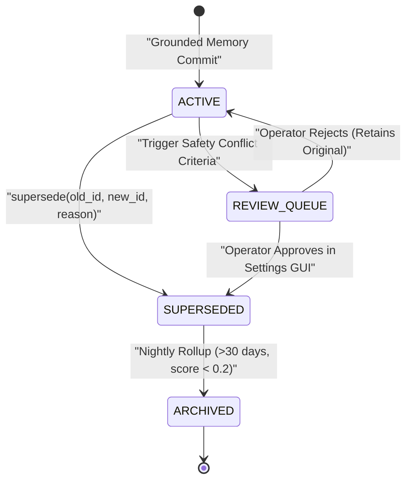

# Subsystem Reference Manual: 05 — Cryptographic Memory & Bi-Temporal Epistemology

**Subsystem:** `src/lucca/memory/`  
**Version:** 1.3.0  
**Architectural Tier:** Autobiographical Memory & Provenance Governance  
**Hardware Placement:** SQLite WAL (`data/memory.sqlite`), Intel AI Boost NPU (`sqlite-vec`), Host CPU  

---

## 1. Subsystem Architecture Overview

The `memory` subsystem provides Project Lucca with long-term autobiographical continuity while mathematically preventing hallucinated knowledge persistence. Every memory entry is cryptographically sealed with a domain-specific digital signature, indexed into a hybrid vector-lexical store, prioritized under a strict multi-factor hierarchy, and governed by bi-temporal supersession rules.

```mermaid
flowchart TD
    subgraph IngestionBoundary ["Memory Ingestion Boundary"]
        US["User Speech (USER_EXPLICIT)"] --> SG1["UserSpeechSigner"]
        FD["User Derived Fact (USER_DERIVED)"] --> SG2["DerivedFactSigner"]
        TR["Tool Action / Receipt (ASSISTANT_ACTION)"] --> SG3["ToolResultSigner"]
        LA["MicroScheme Assertion (LISP_ASSERTION)"] --> SG4["LispAssertionSigner"]
        AU["Assistant Speech (ASSISTANT_UTTERANCE)"] --> SG5["AssistantUtteranceSigner"]
        UN["Unverified LLM Narration (LLM_NARRATION)"] --> NO_SIG["NO SIGNER EXISTS"]
    end

    subgraph SecurityGate ["Provenance Gate (src/lucca/memory/gate.py)"]
        SG1 & SG2 & SG3 & SG4 & SG5 --> PG["ProvenanceGate Validator"]
        NO_SIG -->|REJECTED (ADR-006)| DROP["Dropped with ProvenanceViolation"]
        PG -->|Cryptographic Envelope Verified| SE["Segregate Grounding Eligibility"]
    end

    subgraph GroundingSegregation ["Grounding vs Continuity Segregation (D-MEM-04)"]
        SE -->|Actions / Facts / Receipts| GE1["grounding_eligible = 1<br>(Axiomatic Evidence)"]
        SE -->|Assistant Utterances| GE0["grounding_eligible = 0<br>(Continuity Only)"]
    end

    subgraph HybridStorage ["Hybrid SQLite Engine (data/memory.sqlite)"]
        GE1 & GE0 --> WAL["SQLite WAL Table: memories"]
        WAL --> VEC["sqlite-vec (384-D OpenVINO Embeddings on Intel NPU)"]
        WAL --> FTS["FTS5 BM25 Lexical Inverted Index"]
    end

    subgraph RetrievalLayer ["Retrieval & Fusion Layer (retrieval.py)"]
        VEC & FTS --> RRF["Reciprocal Rank Fusion (RRF K=60)"]
        RRF --> MF["Multi-Factor Prioritization (2,048-Token Quota)"]
        MF --> CONT["Frontier Context Injection"]
    end
```

---

## 2. Cryptographic Provenance Matrix (`ADR-006`)

Unverified language model generation is prohibited from creating persistent memories. The `ProvenanceGate` strictly enforces that every written entry carries an authentic digital signature:

| Provenance Tier | Authorized Domain Signer | Verification Requirement | `grounding_eligible` |
| :--- | :--- | :--- | :---: |
| **`USER_EXPLICIT`** | `UserSpeechSigner` | ASR transcript signed from physical microphone turn. | **1** |
| **`USER_DERIVED`** | `DerivedFactSigner` | Verbatim quote verified against signed user transcript. | **1** |
| **`TOOL_VERIFIED`** | `ToolResultSigner` | Signed container RPC output receipt. | **1** |
| **`LISP_ASSERTION`**| `LispAssertionSigner` | MicroScheme pure rule assertion `(assert ...)`. | **1** |
| **`ASSISTANT_ACTION`**| `ToolResultSigner` | Verifiable executed tool receipt. | **1** |
| **`ASSISTANT_UTTERANCE`**| `AssistantUtteranceSigner` | Lucca's own spoken words (Rung A1 autobiographical memory). | **0** |
| **`ASSISTANT_BELIEF`**| `AssistantUtteranceSigner` | Explicit belief statement; requires evidence pointer. | **0** |
| **`LLM_NARRATION`** | **None** | **Strictly rejected.** Freeform hallucinated facts cannot be committed. | **N/A** |

### 2.1 The Epistemic Grounding Invariant (`D-MEM-04`)
To prevent the model's past speech from becoming "ground truth" that corrupts future inferences:
- **`memory_eligible = 1`:** Allows Lucca to remember what she previously said for conversational retrospection (*"What did you tell me earlier about Python?"*).
- **`grounding_eligible = 0`:** Excludes past speech from Belnap evidential truth calculations. Her past words can never be used as evidence to prove a factual claim.

---

## 3. Hybrid Storage Topology: `sqlite-vec` + `FTS5` BM25

All memory records reside in `data/memory.sqlite` operated in Write-Ahead Logging (WAL) mode:

1. **Dense Vector Store (`sqlite-vec`):**
   - Embeddings: 384-dimensional dense vectors generated via `all-MiniLM-L6-v2`.
   - Hardware Offload: Vector embeddings execute natively on the **Intel(R) AI Boost NPU** via OpenVINO (`device="NPU"`), consuming zero GPU VRAM.
   - Distance Metric: Cosine similarity via `vec0` virtual table.
2. **Sparse Lexical Store (`FTS5`):**
   - Full-text search with Porter stemmer and BM25 relevance scoring.
   - Accurately captures exact keywords, IDs, filenames, and numerical constants.
3. **Reciprocal Rank Fusion (RRF $K=60$):**
   $$RRF\_Score(d) = \frac{1}{60 + \text{Rank}_{vec}(d)} + \frac{1}{60 + \text{Rank}_{fts}(d)}$$

---

## 4. Multi-Factor Prioritization & 2,048-Token Quota (`D-MEM-03`)

To guarantee prompt discipline and preserve GPU KV-cache headroom, retrieved memories are clamped to a strict **2,048-token quota**. Candidate memories are ranked by composite score:

$$\text{Priority} = w_1 \cdot \text{ProvenanceScore} + w_2 \cdot \text{ValidityScore} + w_3 \cdot \text{RRF\_Score} + w_4 \cdot \text{RecencyDecay}$$

- **Provenance Score:** `USER_EXPLICIT` ($1.0$) $>$ `TOOL_VERIFIED` ($0.9$) $>$ `USER_DERIVED` ($0.8$) $>$ `ASSISTANT_ACTION` ($0.7$).
- **Validity Window:** Time-decayed half-life discounting entries with expired validity windows.
- **Recency Decay:** Exponential half-life ($t_{1/2} = 14\,\text{days}$) favoring recent interactions while preserving high-importance anchors.

---

## 5. Bi-Temporal Supersession & Human Review Queue

Real-world facts mutate over time (e.g. user changes timezone, updates a project path). Memory updates execute via bi-temporal supersession:



### 5.1 Safety Criteria Triggering Review
Supersession requests automatically enter the Studio Review Queue if they:
1. Mutate core persona invariants or user safety preferences.
2. Overwrite an entry with high historical importance score ($\ge 0.85$).
3. Introduce an evidential contradiction ($\mathbf{B}$) in the Belnap bilattice.
