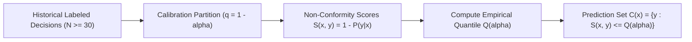

# Subsystem Reference Manual: 07 — Cognitive Routing & Split-Conformal Calibration

**Subsystem:** `src/lucca/router/`  
**Version:** 1.3.0  
**Architectural Tier:** Cognitive Intent Routing & Statistical Abstention  
**Hardware Placement:** Intel Core Ultra 9 275HX (Host CPU), SQLite Decisions Table  

---

## 1. Subsystem Architecture Overview

The `router` subsystem evaluates inbound user speech and text before any downstream actuation or neural generation begins. It determines the appropriate execution tier, prevents catastrophic tool dispatch through split-conformal abstention, and provides instantaneous ($<150\,\text{ms}$) emergency stop reflex handling.

```mermaid
flowchart TD
    subgraph InboundTurn ["Inbound Transcript Stream"]
        RAW["User Speech Transcript"] --> REFLEX{"Emergency Stop Word?<br>(stop, halt, mute, pause)"}
    end

    subgraph FastReflexPath ["Tier 1: Emergency Fast Path (<150ms)"]
        REFLEX -->|Match Found| CONF["Synthesize Instant Canned Confirmation"]
        CONF --> STOP["Purge Audio & Abort LLM Slots (<150ms)"]
    end

    subgraph IntentClassification ["Heuristic Intent Classifier (heuristic.py)"]
        REFLEX -->|No Emergency| CLF["Extract Intent Features & Domain Slots"]
        CLF --> PROB["Assign Class Probabilities (RULE, LLM, CLARIFY)"]
    end

    subgraph ConformalGuard ["Split-Conformal Abstention Guard (calibration.py)"]
        PROB --> MIN_SAMP{"Decisions in DB >= 30?"}
        MIN_SAMP -->|No (<30)| THRESH["Heuristic Confidence Floor (>= 0.60)"]
        MIN_SAMP -->|Yes (>=30)| CALIB["Non-Parametric Split-Conformal Prediction Guard"]

        THRESH --> DECIDE{"Confident Decision?"}
        CALIB --> DECIDE
    end

    subgraph RoutingOutcomes ["Target Execution Tiers"]
        DECIDE -->|High Confidence Rule| T2["Tier 2: Dispatch MicroScheme Rule"]
        DECIDE -->|Below Threshold / Ambiguous| T3["Tier 3: Route to Gemma 4 12B (LLM)"]
        DECIDE -->|Contradictory / B-State| CLAR["Emit Clarification Request to User"]
    end
```

---

## 2. Emergency Reflex Path (`heuristic.py:EMERGENCY_REFLEX_PATTERN`)

Safety-critical commands must execute with absolute deterministic guarantees without waiting for neural inference:

| Pattern Class | Recognized Expressions | Execution Behavior |
| :--- | :--- | :--- |
| **Emergency Stop** | `stop`, `halt`, `pause`, `mute`, `shutdown`, `cancel` | Bypasses LLM entirely; halts active playback in $<50\,\text{ms}$; confirms in $<150\,\text{ms}$. |
| **Confirmation** | `yes`, `go ahead`, `confirm`, `ok`, `proceed` | Validates active single-use HMAC confirmation nonce (`ConfirmationTokenGuard`). |
| **Cancellation** | `no`, `don't`, `abort`, `never mind` | Revokes pending action nonce; drops tool payload from queue. |

---

## 3. Split-Conformal Prediction Calibration (`calibration.py`)

Standard heuristic routers or softmax confidence estimates are notoriously miscalibrated, often asserting high confidence on ambiguous out-of-distribution inputs.

Lucca implements non-parametric **Split-Conformal Prediction** (Shafer & Vovk, 2008) to establish statistically rigorous trust bounds:



### 3.1 Statistical Coverage Guarantee
For a user-configured significance level $\alpha = 0.05$ (95% target coverage):
$$P(Y_{n+1} \in C(X_{n+1})) \ge 1 - \alpha = 0.95$$

1. **Cold-Start Phase ($N < 30$):** Operates under heuristic confidence thresholding (`confidence_threshold = 0.60`). Telemetry stamps `calibrated = False`.
2. **Calibrated Phase ($N \ge 30$):** `fit_guard_from_db` fits the split-conformal non-conformity distribution directly from authenticated user decisions in SQLite. Telemetry stamps `calibrated = True`.
3. **Wilson Score Precision Gate:** Evaluated against the $N = 100$ graded acceptance fixture battery (`tests/test_c1_abstention_acceptance.py`), guaranteeing abstention precision Wilson 95% lower bound $\ge 0.80$.

---

## 4. Single-Use HMAC Confirmation Tokens (`ConfirmationTokenGuard`)

Tools with non-trivial side effects (filesystem writes, application launches, process terminations) require explicit user authorization:

1. **Nonce Generation:** When a destructive tool is proposed, Lucca generates a cryptographic nonce bound to the current turn ID and timestamp.
2. **Replay Protection:** A confirmation token expires after $60.0\,\text{s}$ or upon single use. A delayed or repeated *"yes"* has zero evidential authority and cannot trigger old actions.
3. **Session Binding:** Tokens are HMAC-SHA256 signed using a session-ephemeral secret, preventing token forgery across separate sessions.

---

## 5. Dynamic Task Router & Neurosymbolic Execution (`D-ROUT-02`)

As formalized in v1.35.3+, cognitive routing coordinates execution between direct generation, Docker sandboxed Python (PAL), and latent thinking tokens across the 3 validated edge parameter scales:

$$\text{Router}(M, T) = \begin{cases} 
\text{Direct Raw Generation (R0 @ 4k)} & \text{if } M = \text{12B} \\ 
\text{PAL in Docker (P2 @ 2k)} & \text{if } M \in \{\text{E4B}, \text{E2B}\} \land T = \text{Arithmetic/Word} \\ 
\text{Thinking Mode (R1 @ 6k)} & \text{if } M \in \{\text{E4B}, \text{E2B}\} \land T = \text{Competition Math} 
\end{cases}$$

### 5.1 Empirical Rationale Across Model Scales
1. **Gemma 4 12B Unified:** Raw generation achieves 89.0% held-out strict accuracy (88.8% on 98-item clean) in 12.9s. Under greedy decoding ($T=0.0$), unconstrained thinking triggers circular re-verification loops that crash accuracy to 58.0% (32:0 McNemar discordant ratio, $p = 4.66 \times 10^{-10}$).
2. **Gemma 4 E4B / E2B Arithmetic (GSM-Symbolic):** PAL in Docker absorbs parameter contraction, equalizing 2B/4.5B models with 12B (91%–94% vs. 95%).
3. **Edge Competition Mathematics:** Thinking Mode R1 @ 6k is the canonical default on hard unseen competition math, providing a statistically significant +15 pp strict accuracy advantage on E4B (88.0% vs. 73.0%, $p = 0.0026$) and +20 pp on E2B (81.0% vs. 61.0%, $p = 0.0002$) by allowing latent tokens to structure mathematical problem representations prior to final solution emission.

