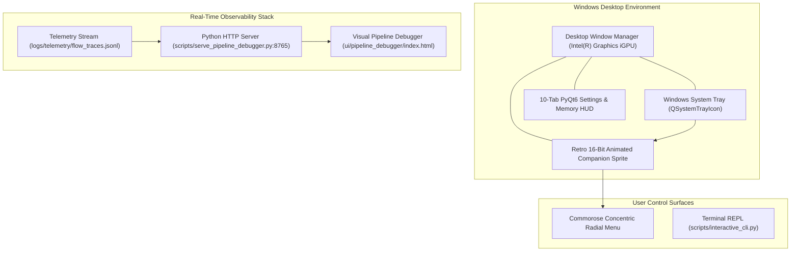
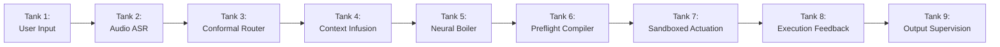

# Subsystem Reference Manual: 08 — Desktop UI, Diagnostics & Visual Pipeline Debugger

**Subsystem:** `src/lucca/ui/` & `ui/pipeline_debugger/`  
**Version:** 1.3.0  
**Architectural Tier:** User Presentation, Telemetry HUD & Visual Debugging  
**Hardware Placement:** Intel(R) Graphics iGPU (Windows DWM Compositor), Port 8765 Web Server  

---

## 1. Subsystem Architecture Overview

The `ui` subsystem provides both non-intrusive desktop interaction and deep engineering observability. It encompasses a transparent PyQt6 overlay sprite, a resident Windows System Tray companion with live cognitive state tooltips, a 10-tab administrative settings panel, a concentric Commorose radial menu, and a standalone real-time web debugger (`http://localhost:8765`) visualizing all 9 dataflow cascade tanks.

---

## 2. Desktop Companion & System Tray Lifecycle (`tray.py` & `main_window.py`)

The companion runs as a lightweight, resident Windows desktop service:

1. **Dual-Mode Windows Subsystem (`D-PKG-01`):**
   - Compiled with Windows GUI subsystem (`--noconsole`) to eliminate terminal flicker when launched from desktop shortcuts or File Explorer.
   - Dynamically calls Win32 `AttachConsole(-1)` at startup: when launched from PowerShell or Command Prompt, standard output and errors bind seamlessly to the parent terminal.
2. **System Tray Integration (`QSystemTrayIcon`):**
   - Closing the main window does not terminate the process; it minimizes cleanly to the system tray with a native notification bubble.
   - Left-click toggles companion visibility; right-click opens an administrative context menu (Open Settings, Run Env Check, Force Reload Skills, Quit).
   - Live Tooltip Tracking: Hovering over the tray icon displays current cognitive state (*"Lucca: Idle / Stance: Focused Analytical / VRAM: 9.97 GiB"*).
3. **10-Tab Administrative HUD:**
   - Provides full visibility and control over: Audio, Model & VRAM, Persona & Temperament, Memory & Rollup, Active Skills & Quarantine, History Explorer, System Diagnostics, Display & Overlay, Log Viewer, and About & Hardware Ground Truth.

---

## 3. Visual Pipeline Debugger (`ui/pipeline_debugger/`)

The Visual Pipeline Debugger provides an end-to-end, real-time web schematic of Project Lucca's cognitive architecture, hosted locally at `http://localhost:8765`:

### 3.1 The 9 Cascade Tanks
1. **Tank 1 (User Input):** Ingests raw voice audio or text prompts with millisecond timestamping.
2. **Tank 2 (Audio Transcription):** Displays Faster-Whisper ASR transcripts, acoustic hygiene filtering, and speech onset duration.
3. **Tank 3 (Conformal Router):** Visualizes split-conformal intent classification, softmax probabilities, and calibrated abstention boundaries.
4. **Tank 4 (Context Infusion):** Displays the 5-layer prompt assembly, RRF memory hits, and prompt frontier affective stance tags.
5. **Tank 5 (Neural Deliberation Boiler):** Tracks TTFT (Time to First Token), generation tokens/sec, and GPU memory telemetry.
6. **Tank 6 (Preflight Compiler):** Highlights sub-millisecond AST rewrites (`expr.solve`, `diff`, import filtering, math sets).
7. **Tank 7 (Sandboxed Actuation):** Shows persistent Docker RPC execution, exit codes, and stdout/stderr capture.
8. **Tank 8 (Execution Feedback):** Highlights Turn-1 exception captures and Turn-2 autonomous self-correction payloads.
9. **Tank 9 (Output Supervision):** Visualizes streaming DFA policy verification, citation checking, and WASAPI audio buffer delivery.

### 3.2 Dynamic Trace Horizon Ribbon (WO-28 Phase 3)
The top ribbon dynamically adapts to the active operational mode:
- **Batch Benchmark Matrices ($N=17, 30, 400, 500$):** Renders indexed problem tiles colored by execution status (Green: Pass, Red: Fail, Yellow: Turn-2 Feedback Rescue, Blue: Active).
- **Interactive Companion Sessions (`Turn #1`, `Turn #2`):** Renders sequential conversation turns without empty placeholder gaps, dynamically appending turns as new speech arrives.
- **REST Endpoints:** `/api/traces` (full index list), `/api/trace/<id>` (granular JSON state for any problem or turn), and `/api/live` (real-time active pipeline state).
