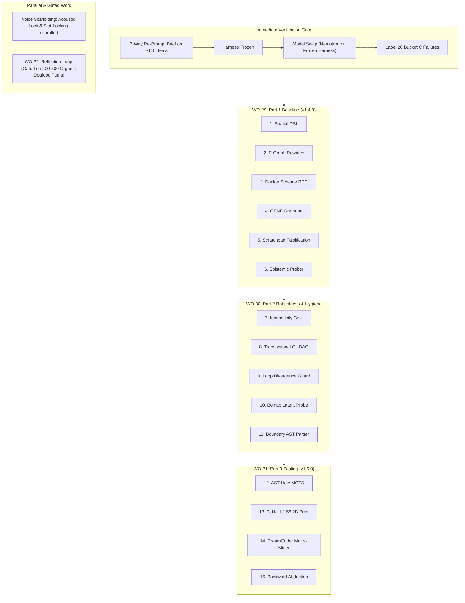

# Project Lucca: System Handover & v1.35 Evaluation Plan
**Target Audience**: Incoming AI Agent / Systems Engineer  
**Date**: October 3, 2026  
**Repository**: `C:\Projects\ProjectLucca`  
**Current Git Branch**: `v1.35`  
**Latest Commit**: `044c5cf` (Updating to current)  
**Frozen Evaluation Tag**: `v1.35-frozen`  
**Preserved Baseline Anchor**: `v1.3-frozen` (`55d1a1f`, strictly preserved / untouched)

---

## 1. What Project Lucca Actually Is

**Project Lucca** is a **standalone, local-first neuro-symbolic desktop companion and cognitive executive assistant** engineered for high-performance Windows workstations (specifically native workstation silicon: Intel Core Ultra 9 275HX, NVIDIA GeForce RTX 5080 Laptop GPU with 16 GB VRAM, 64 GB host RAM).

She operates 100% offline with zero cloud dependencies, zero external telemetry, and zero subscription costs.

### The Core Architecture:
```
                                 [ USER VOICE / TEXT / GUI ]
                                              │
                                              ▼
                     ┌─────────────────────────────────────────────────┐
                     │          SENSES & AUDIO SUBSYSTEM               │
                     │  • Intel NPU / OpenVINO Faster-Whisper ASR      │
                     │  • Push-to-Talk (Right Alt / alt_gr) & VAD      │
                     │  • Kokoro-82M TTS + Affect-driven prosody       │
                     └────────────────────────┬────────────────────────┘
                                              │
                                              ▼
                     ┌─────────────────────────────────────────────────┐
                     │          COGNITIVE ROUTER & EPISTEMICS          │
                     │  • Conformal Intent Classifier                  │
                     │  • 8-Substrate Epistemic Search Cascade         │
                     │  • Belnap FOUR Bilattice (Strict Abstention)    │
                     └────────┬───────────────────────────────┬────────┘
                              │                               │
             FAST PATH (<150ms)│                               │ DELIBERATIVE PATH (~450-700ms)
                              ▼                               ▼
  ┌───────────────────────────────────────────┐   ┌───────────────────────────────────────────┐
  │     SYSTEM 1: COMPILED SYMBOLIC CORE      │   │         SYSTEM 2: NEURAL CORE             │
  │  • MicroScheme (LISP) AST Interpreter     │   │  • Gemma-4 12B Heretic (Q6_K GGUF)        │
  │  • Babble/Stitch E-Graph Macro Synthesis  │◄─►│  • Continuous 3D PAD Affective ODE        │
  │  • Microsoft Z3 SMT Formal Verifier       │   │  • Dedicated RTX 5080 compute engine      │
  │  • Deontic Win32 Invariant Enforcer       │   │  • Prompt Frontier Suffix (8.58x KV hit)  │
  └─────────────────────┬─────────────────────┘   └─────────────────────┬─────────────────────┘
                        │                                               │
                        └───────────────────────┬───────────────────────┘
                                                │
                                                ▼
                     ┌─────────────────────────────────────────────────┐
                     │          ACTUATION & DISPLAY SANDBOX            │
                     │  • Persistent Docker RPC Worker (6.87ms P50)    │
                     │  • Win32 Handle Jailing & Taint Tracking        │
                     │  • Windows System Tray Companion & 10-Tab GUI   │
                     │  • Retro 16-bit Animated Sprite Avatar          │
                     └─────────────────────────────────────────────────┘
```

1. **Dual-System Brain**:
   - **System 1 (Symbolic Reflexes)**: MicroScheme LISP AST interpreter, Babble/Stitch E-graph macro synthesis (compiling recurring reasoning traces into deterministic macros), and Microsoft Z3 SMT theorem prover (mathematically proving safety constraints before any action touches the OS).
   - **System 2 (Neural Deliberation)**: `gemma-4-12b-heretic-Q6_K.gguf` running locally on the RTX 5080 Laptop GPU via `llama-server.exe` (16K context baseline / 32K context v1.3 default). Provides personality, planning, and code generation.
2. **Senses & Embodiment**:
   - Intel NPU OpenVINO Faster-Whisper ASR, Silero VAD, Push-to-Talk (Right Alt / `alt_gr`), barge-in audio interruption (<50ms).
   - Kokoro-82M neural TTS modulated in real time by a continuous 3D PAD (Pleasure-Arousal-Dominance) biological affect ODE.
   - Retro 16-bit animated companion avatar in the Windows System Tray and 10-tab control GUI.
3. **Hardened Actuation Sandbox**:
   - Isolated Docker container (`lucca-file-sandbox`) in WSL2 Ubuntu with `--network none` and read-only root.
   - Persistent stdio bridge to `lucca-toolsrv --loop`, eliminating container cold-start overhead down to `6.87ms` P50.
4. **Epistemic Honesty Guarantee**:
   - Belnap 4-valued logic ($\mathbf{T}, \mathbf{F}, \mathbf{B}, \bot$). When verified records are missing ($\bot$), she strictly refuses to hallucinate: *"I checked my records, but have no verified record of that. I don't know the answer and won't guess."* (0/25 hallucinations in live testing).

---

## 2. What the Active Work Actually Is: The v1.35 Evidence & Rigor Campaign

The work happening on the `v1.35` branch is **NOT** converting Lucca into a competition math bot. 

Rather, competition math (MATH-500) and coding benchmarks (HumanEval, GSM-Symbolic) constitute **Track 2 and Track 3 of Lucca's empirical verification suite** (see `README.md` §4 and `docs/USER_GUIDE_WHAT_LUCCA_DOES.md` §0.1). They stress-test:
- The **Program-Aided Language (PAL)** neuro-symbolic pipeline.
- The **Docker RPC execution turbine** (`lucca-toolsrv`).
- The **2-Turn Execution Feedback Governor** (automatic error traceback recovery).
- **Bit-for-bit reproducibility** and mathematical CAS equivalence verification.

The **v1.35 Evidence and Improvement Plan** was launched to address measurement variances found in v1.3, eliminate non-determinism, formalize strict vs. lenient grading standards, and tune the PAL prompt and feedback governor.

---

## 3. Progress and Current Ledger across Steps 0–4

All results are permanently recorded in [`RESULTS.md`](file:///C:/Projects/ProjectLucca/RESULTS.md) with SHA-256 hashes and Wilson 95% confidence intervals:

| Run ID | Code Commit | Grader Version | Benchmark Dataset | n | Strict Score | Lenient Score | Wilson 95% CI | Checkpoint Artifact Path |
| :--- | :---: | :---: | :--- | :---: | :---: | :---: | :---: | :--- |
| `gsm-symbolic-strat-100` | `bef28b5` | pal-docker-exact | `data/benchmarks/GSM_symbolic.jsonl` | 100 | **94.00%** (94/100) | **94.00%** (94/100) | [86.88%, 97.54%] | `logs/test_reports/gsm_symbolic_100_templates.json` |
| `humaneval-raw-164` | `bef28b5` | canonical-unit | `data/benchmarks/humaneval.jsonl` | 164 | **94.51%** (155/164) | **94.51%** (155/164) | [89.52%, 97.30%] | `logs/test_reports/humaneval_canonical_raw_164.json` |
| `humaneval-assisted-164` | `bef28b5` | canonical-unit | `data/benchmarks/humaneval.jsonl` | 164 | **93.90%** (154/164) | **93.90%** (154/164) | [88.76%, 96.87%] | `logs/test_reports/humaneval_canonical_assisted_164.json` |
| `math-v1.3-regraded-strict` | `25adb03` | v1.35-strict | `data/benchmarks/math_fresh_heldout_500.jsonl` | 500 | **78.60%** (393/500) | **78.60%** (393/500) | [74.69%, 82.06%] | `logs/test_reports/checkpoint_math500_v1.3-fresh-500_strict_posthoc.json` |
| `math-v1.3-regraded-lenient`| `25adb03` | v1.35-lenient | `data/benchmarks/math_fresh_heldout_500.jsonl` | 500 | **78.60%** (393/500) | **86.40%** (432/500) | [83.01%, 89.22%] | `logs/test_reports/checkpoint_math500_v1.3-fresh-500_lenient_posthoc.json` |
| `math-v1.3-dev-400-baseline`| `e0a8fbf` | v1.35-dual | `data/benchmarks/math500_test.jsonl` (101-500) | 400 | **76.25%** (305/400) | **81.50%** (326/400) | [71.84%, 80.16%] (S)<br>[77.40%, 85.00%] (L) | `logs/test_reports/checkpoint_math500_v1.3-empty-feedback-heldout-400.json` |
| `math-v1.35-dev-400` (v1) | `deacabe` | v1.35-dual | `data/benchmarks/math500_test.jsonl` (101-500) | 400 | **74.75%** (299/400) | **79.50%** (318/400) | [70.27%, 78.76%] (S)<br>[75.27%, 83.17%] (L) | `logs/test_reports/checkpoint_math500_v1.35-dev-400.json` |
| **`math-v1.35-dev-400-v2`** | `9b6858e` | v1.35-dual | `data/benchmarks/math500_test.jsonl` (101-500) | 400 | **76.50%** (306/400) | **80.50%** (322/400) | **[72.10%, 80.39%] (S)**<br>**[76.33%, 84.08%] (L)** | `logs/test_reports/checkpoint_math500_v1.35-dev-400-v2.json` |

---

## 4. Engineering Bugs Diagnosed & Resolved in v1.35

1. **Llama-Server Prompt Cache Non-Determinism (Step 0)**:
   - *Problem*: Reusing prompt caches caused run-to-run variance (runs swung between 76% and 84%).
   - *Fix*: Added `--disable-prompt-cache` (`cache_prompt: false` in payload). Verified 100/100 bit-for-bit identical outputs.
2. **SymPy `CRootOf` Resultant Hang (Step 4, `deacabe`)**:
   - *Problem*: Synchronous `sympy.simplify(p - e)` hung at 100% CPU on high-degree polynomials (Problem 102).
   - *Fix*: Guarded with `has(sympy.CRootOf)` and wrapped evaluation in `evaluate_sympy_strict_with_timeout` (2.0s daemon thread join).
3. **Comment Scratchwork Token Starvation (Step 4, `deacabe`)**:
   - *Problem*: Gemma wrote hundreds of tokens in `#` comments and exhausted the 768-token budget without emitting `print(answer)`.
   - *Fix*: Prompt rule forbidding comment scratchwork. Successfully recovered Tasks 21, 69, 105.
4. **SymPy `solve()` Dict Indexing Crash (`KeyError: 0`) (Step 4 Debugging, `9b6858e`)**:
   - *Problem*: Exact arithmetic prompt caused Gemma to call `sympy.solve()`, but index it as `sol[0]`. SymPy returns a dictionary `{var: val}` for linear systems, causing `KeyError: 0` crashes on 9 dev problems. Turn 2 feedback repeated the identical mistake.
   - *Fix*: Guided prompt to use `dict=True` (`sol = solve(..., dict=True)`) and access `sol[0][x]`, and injected an explicit `KeyError` diagnostic hint into Turn 2.
   - *Result*: `KeyError` crashes dropped from 9 to 2 (-78%), `runtime_crash` dropped from 20 to 14. Strict CAS **306/400 (76.50%)** is statistically indistinguishable from the 305/400 baseline (a one-item difference inside a ±4-point CI); the measurable gains of v1.35 so far are determinism and crash-class reduction, not accuracy.

---

## 5. Dataset Boundaries & Partition Invariants

Dataset file: `data/benchmarks/math500_test.jsonl` (SHA-256: `35dc41080a3680858b27fa7e0533d2d547825316fc5dafe5d316f4ccc5a06132`).

- **Held-Out Test Set** (Indices 1–100, slice `[0:100]`):
  - **Status**: **PRISTINE & UNTOUCHED**.
  - Must NEVER be peeked at, analyzed, or trained on.
  - Reserved strictly for one-shot evaluation in Step 5.
- **Dev Set** (Indices 101–500, slice `[100:500]`, `--offset 100 --samples 400`):
  - Used for calibration and debugging.
  - Step 4 verified: Strict 306/400, Lenient 322/400.

---

## 6. How the Incoming Agent Should Execute Step 5

> **SUPERSEDED (2026-10-03): do NOT run Step 5 directly.** Follow [`handover/V135_CLOSEOUT_PLAYBOOK.md`](file:///c:/Projects/ProjectLucca/handover/V135_CLOSEOUT_PLAYBOOK.md) instead. The ledger script [`scripts/v135_failure_ledger.py`](file:///c:/Projects/ProjectLucca/scripts/v135_failure_ledger.py) showed that **42 of the 94 strict failures on dev-400-v2 are `finish_reason=length` truncations at the 768-token cap** (the "uniform ~15.6 s T1 latency" is the cap, not a timeout). The playbook fixes that and the crash-feedback content first, labels every remaining failure, audits test-set contamination, then runs the final test once with `math_fresh_heldout_500` (n=500) as the primary set and test-100 as secondary. The Step 5 text below is retained for reference only.

The dev set regression is resolved, and performance is frozen under `v1.35-frozen`. The incoming agent should run **Step 5: Held-Out Test Set Evaluation**.

### Step 5 Command:
```powershell
C:\Projects\ProjectLucca\.venv\Scripts\python.exe scripts/run_modern_2024_benchmarks.py `
  --benchmark math500 `
  --offset 0 `
  --samples 100 `
  --config-label v1.35-final-test-100 `
  --disable-prompt-cache `
  --resume
```

### Verification & Reconciliation Checklist:
1. Ensure AC power is online (`(Get-CimInstance -Namespace root/wmi -ClassName BatteryStatus).PowerOnline == True`).
2. Verify `llama-server` is up on port 8080.
3. Run the 100-problem evaluation (~15-20 min).
4. Reconcile exact counts ($n = \text{passed} + \text{failed} = 100$) against v1.3 test-100 baselines:
   - Nominal Baseline (`checkpoint_math500_v1.3-baseline-test-100.json`): 79/100
   - Final Test (`checkpoint_math500_v1.3-final-test-100.json`): 85/100
5. Calculate Wilson 95% confidence intervals for Strict and Lenient scores.
6. Append row to `RESULTS.md`, commit, and tag `v1.35-test-evaluated`.

---

## 7. How to Launch and Test Lucca Herself

To interact with Lucca outside the benchmark suite:
- **Environment Diagnostic**:
  ```powershell
  C:\Projects\ProjectLucca\.venv\Scripts\python.exe -m lucca.admin env-check
  # or via standalone build:
  dist\Lucca\Lucca.exe --check
  ```
- **Launch the Voice Companion GUI & Tray**:
  ```powershell
  dist\Lucca\Lucca.exe
  # or from source:
  C:\Projects\ProjectLucca\.venv\Scripts\python.exe -m lucca.main
  ```
- **Terminal Testing Flow (No Mic Needed)**:
  ```powershell
  C:\Projects\ProjectLucca\.venv\Scripts\python.exe scripts/test_session_flow.py --interactive
  ```
- **Live Pipeline Web Debugger**:
  Open `http://localhost:8765` (served by `ui/pipeline_debugger/index.html`) to watch real-time token cascades, affective PAD states, and tool invocations across tanks 1–9.

---

## 8. Forward Roadmap: Work Order 29 & The 15-Module Cognitive Ladder

Detailed specifications and architectural mappings are preserved in [`handover/WORKORDER_29.md`](file:///c:/Projects/ProjectLucca/handover/WORKORDER_29.md) and canonical plan [`plans/2026-10-03_wo29_neurosymbolic_program_synthesis_and_15_module_cognitive_ladder.md`](file:///c:/Projects/ProjectLucca/plans/2026-10-03_wo29_neurosymbolic_program_synthesis_and_15_module_cognitive_ladder.md).


### 8.1 Architectural Primer & Module Mapping

Lucca is uniquely primed for this 15-module expansion; each component extends established foundations:

| Tier | # | Module Name | Target File | Existing Foundation in Lucca |
| :--- | :---: | :--- | :--- | :--- |
| **Part 1: Core Synthesis** *(v1.4.0 Baseline / WO-29)* | **1** | **Functional Scheme Spatial DSL** | `src/lucca/reasoning/spatial_primitives.scm` | Plugs directly into MicroScheme AST parser & primitives in [`src/lucca/reasoning/scheme/`](file:///c:/Projects/ProjectLucca/src/lucca/reasoning/scheme/) |
| | **2** | **Equality Saturation Rewrite Rules** | `src/lucca/reasoning/egraph.py` | Extends the existing Congruence-Closure E-Graph in [`egraph.py`](file:///c:/Projects/ProjectLucca/src/lucca/reasoning/egraph.py#L37-L60) |
| | **3** | **Persistent Docker Scheme RPC** | `src/lucca/sandbox/rpc.py` | Extends line-buffered `DockerRPCTransport` in [`rpc.py`](file:///c:/Projects/ProjectLucca/src/lucca/sandbox/rpc.py) |
| | **4** | **GBNF S-Expression Grammar** | `config/grammars/scheme_sketch.gbnf` | Native GBNF logit constraint in `llama-server.exe` |
| | **5** | **Scratchpad Falsification Loop** | `src/lucca/core/scratchpad.py` | Integrates into `SubTurnScratchpadBuffer` & Docker preflight |
| | **6** | **Non-Destructive Epistemic Prober** | `src/lucca/router/heuristic.py` | Extends the Conformal Intent Valve to halt on ambiguity ($\bot$) |
| **Part 2: Robustness & Hygiene** *(WO-30)* | **7** | **Idiomaticity Cost Extractor** | `src/lucca/reasoning/cost.py` | Plugs into AST extraction in [`egraph.py`](file:///c:/Projects/ProjectLucca/src/lucca/reasoning/egraph.py) |
| | **8** | **Transactional Git Staging DAG** | `src/lucca/sandbox/staging.py` | Context-manager worktree isolation inside WSL2 |
| | **9** | **Traceback Divergence Guard** | `src/lucca/core/convergence.py` | Extends turn convergence checks to abort hallucination loops |
| | **10** | **Belnap Latent Investigator** | `src/lucca/memory/latent_probe.py` | Uses Belnap 4-valued logic ($\top, \bot, T, F$) to isolate env state drift |
| | **11** | **Boundary Topology Parser** | `src/lucca/reasoning/topology.py` | Builds on AST extraction in [`ast_sanitizer.py`](file:///c:/Projects/ProjectLucca/src/lucca/sandbox/ast_sanitizer.py) to protect API contracts |
| **Part 3: Autonomous Search** *(v1.5.0 Cognitive Engine / WO-31)* | **12** | **AST-Hole MCTS Engine** | `src/lucca/reasoning/mcts.py` | Multi-threaded CPU tree search over S-expression holes |
| | **13** | **BitNet b1.58 2B Policy Prior** | `src/lucca/reasoning/bitnet_policy.py` | Host CPU integer SIMD execution (~1.2 GB RAM, 0 MB VRAM) |
| | **14** | **DreamCoder Macro Miner** | `src/lucca/reasoning/compression.py` | Extends anti-unification in [`egraph.py`](file:///c:/Projects/ProjectLucca/src/lucca/reasoning/egraph.py) for sleep-phase library learning |
| | **15** | **Backward Abduction Solver** | `src/lucca/reasoning/abduction.py` | Works backwards from target invariant assertions using e-graph unification |

### 8.2 Hardware Integrity
- **0 MB VRAM Delta:** Runs in host CPU threads (Core Ultra 9 275HX), host DDR5 RAM, or WSL2 Docker sandbox.
- **Dedicated Engine Protection:** RTX 5080 Laptop GPU remains 100% dedicated to LLM deliberation (`gemma-4-12b` / `nemotron-30b`); Intel NPU handles Kokoro TTS and Silero VAD.
- **Invariants Preserved:** ADR-006 (cryptographic envelope memory commits) and ADR-013 (Docker containerization).

### 8.3 Execution Roadmap


### 8.4 Immediate Gate Protocol
1. Run isolated 3-way re-prompt comparison across ~110 feedback items.
2. Lock winning harness configuration.
3. Test model swap (Nemotron on frozen harness).
4. Label 20 representative Bucket C failures.
5. Unblock WO-29 Part 1 baseline execution.

