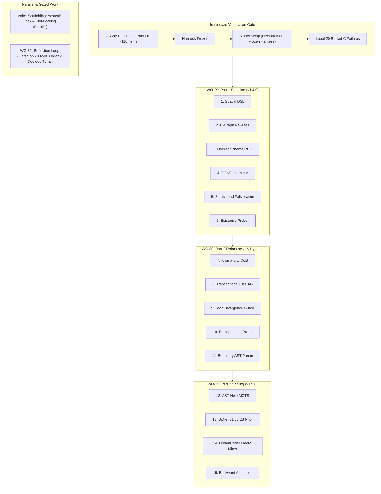

# Work Order 29: Neuro-Symbolic Program Synthesis & The 15-Module Cognitive Ladder

**Date:** 2026-10-03  
**Target Release:** Project Lucca v1.4.0 Baseline (Part 1) $\to$ v1.5.0 Autonomous Cognitive Engine (Part 3)  
**Status:** Ratified Roadmap & Architecture Plan (Gated on Verification Protocol)  
**Audience:** Incoming AI Agents, Core Systems Engineers, and Evaluation Harness Operators  

---

## 1. Architectural Foundation & Overview

**Project Lucca** is uniquely primed for this 15-module neuro-symbolic program synthesis expansion. Rather than starting from scratch, these modules directly extend and mature architectural foundations already operating within the codebase:

- **MicroScheme Symbolic Core:** AST parser, lexer, validator, and primitives in [`src/lucca/reasoning/scheme/`](file:///c:/Projects/ProjectLucca/src/lucca/reasoning/scheme/).
- **Congruence-Closure E-Graphs:** Equivalence graph rewrite engine in [`src/lucca/reasoning/egraph.py`](file:///c:/Projects/ProjectLucca/src/lucca/reasoning/egraph.py).
- **Persistent Docker RPC Transport:** Line-buffered sub-millisecond container execution in [`src/lucca/sandbox/rpc.py`](file:///c:/Projects/ProjectLucca/src/lucca/sandbox/rpc.py).
- **Conformal Intent Valve & Epistemic Belnap Bilattice:** Split-conformal calibration and abstention router in [`src/lucca/router/heuristic.py`](file:///c:/Projects/ProjectLucca/src/lucca/router/heuristic.py) and [`src/lucca/router/conformal.py`](file:///c:/Projects/ProjectLucca/src/lucca/router/conformal.py).
- **Tolerant AST Sanitizer:** Multi-stage extraction and syntax repair pipeline in [`src/lucca/sandbox/ast_sanitizer.py`](file:///c:/Projects/ProjectLucca/src/lucca/sandbox/ast_sanitizer.py).

---

## 2. The 15 Modules: Architectural Mapping to Lucca

| Tier | # | Module Name | Target File | Existing Foundation in Lucca |
| :--- | :---: | :--- | :--- | :--- |
| **Part 1: Core Synthesis** *(v1.4.0 Baseline / WO-29)* | **1** | **Functional Scheme Spatial DSL** | `src/lucca/reasoning/spatial_primitives.scm` | Plugs directly into MicroScheme AST parser & primitives in [`src/lucca/reasoning/scheme/`](file:///c:/Projects/ProjectLucca/src/lucca/reasoning/scheme/) |
| | **2** | **Equality Saturation Rewrite Rules** | `src/lucca/reasoning/egraph.py` | Extends the existing Congruence-Closure E-Graph in [`egraph.py`](file:///c:/Projects/ProjectLucca/src/lucca/reasoning/egraph.py#L37-L60) |
| | **3** | **Persistent Docker Scheme RPC** | `src/lucca/sandbox/rpc.py` | Extends line-buffered `DockerRPCTransport` in [`rpc.py`](file:///c:/Projects/ProjectLucca/src/lucca/sandbox/rpc.py) |
| | **4** | **GBNF S-Expression Grammar** | `config/grammars/scheme_sketch.gbnf` | Native GBNF logit constraint in `llama-server.exe` |
| | **5** | **Scratchpad Falsification Loop** | `src/lucca/core/scratchpad.py` | Integrates into `SubTurnScratchpadBuffer` & Docker preflight |
| | **6** | **Non-Destructive Epistemic Prober** | `src/lucca/router/heuristic.py` | Extends the Conformal Intent Valve to halt on ambiguity ($\bot$) |
| **Part 2: Robustness & Hygiene** *(WO-30)* | **7** | **Idiomaticity Cost Extractor** | `src/lucca/reasoning/cost.py` | Plugs into AST extraction in [`egraph.py`](file:///c:/Projects/ProjectLucca/src/lucca/reasoning/egraph.py) |
| | **8** | **Transactional Git Staging DAG** | `src/lucca/sandbox/staging.py` | Context-manager worktree isolation inside WSL2 |
| | **9** | **Traceback Divergence Guard** | `src/lucca/core/convergence.py` | Extends turn convergence checks to abort hallucination loops |
| | **10** | **Belnap Latent Investigator** | `src/lucca/memory/latent_probe.py` | Uses Belnap 4-valued logic ($\top, \bot, T, F$) to isolate env state drift |
| | **11** | **Boundary Topology Parser** | `src/lucca/reasoning/topology.py` | Builds on AST extraction in [`ast_sanitizer.py`](file:///c:/Projects/ProjectLucca/src/lucca/sandbox/ast_sanitizer.py) to protect API contracts |
| **Part 3: Autonomous Search** *(v1.5.0 Cognitive Engine / WO-31)* | **12** | **AST-Hole MCTS Engine** | `src/lucca/reasoning/mcts.py` | Multi-threaded CPU tree search over S-expression holes |
| | **13** | **BitNet b1.58 2B Policy Prior** | `src/lucca/reasoning/bitnet_policy.py` | Host CPU integer SIMD execution (~1.2 GB RAM, 0 MB VRAM) |
| | **14** | **DreamCoder Macro Miner** | `src/lucca/reasoning/compression.py` | Extends anti-unification in [`egraph.py`](file:///c:/Projects/ProjectLucca/src/lucca/reasoning/egraph.py) for sleep-phase library learning |
| | **15** | **Backward Abduction Solver** | `src/lucca/reasoning/abduction.py` | Works backwards from target invariant assertions using e-graph unification |

---

## 3. Architectural & Hardware Integrity

This design strictly respects Lucca's non-negotiable workstation hardware budget:
- **0 MB VRAM Delta:** Every single one of these 15 modules executes exclusively in **host CPU threads (Intel Core Ultra 9 275HX, 24T), host DDR5 RAM, or the WSL2 Docker sandbox**.
- **Uncompromised Neural & Voice Engines:** The **RTX 5080 Laptop GPU (16 GB GDDR7)** remains 100% dedicated to serving the primary LLM (`gemma-4-12b-heretic-Q6_K.gguf` / `nemotron-30b`), while the **Intel NPU** runs Kokoro TTS and Silero VAD without contention.
- **Strict Invariant Adherence:**
  - **ADR-006**: No raw ungrounded narration into memory; commits must be cryptographically signed by authorized domain signers.
  - **ADR-013**: Direct host fallback disabled; untrusted code runs inside isolated Docker containers in WSL2.

---

## 4. Phased Execution Roadmap

To prevent conflation and maintain clean empirical verification, implementation proceeds across sequential work orders:

---

## 5. Sequential Execution Work Orders

### WO-29: Part 1 Core Synthesis Baseline (Target: v1.4.0)
Focuses on establishing the closed-loop neural-symbolic synthesis channel:
1. `src/lucca/reasoning/spatial_primitives.scm`: Define domain-specific spatial and algebraic primitives in MicroScheme.
2. `src/lucca/reasoning/egraph.py`: Implement equality saturation rewrite rules for canonical simplification.
3. `src/lucca/sandbox/rpc.py`: Persistent line-buffered MicroScheme RPC inside the Docker sandbox.
4. `config/grammars/scheme_sketch.gbnf`: GBNF logit constraint enforcing valid S-expression sketches from `llama-server`.
5. `src/lucca/core/scratchpad.py`: Sub-turn scratchpad falsification loop validating intermediate sketches against preflight assertions.
6. `src/lucca/router/heuristic.py`: Non-destructive epistemic prober extending conformal intent gating to halt and seek clarification on ambiguous ($\bot$) queries.

### WO-30: Part 2 Robustness & Hygiene
Focuses on invariant safety, rollback stability, and semantic state protection:
7. `src/lucca/reasoning/cost.py`: AST extraction cost function prioritizing idiomatic, minimal-depth expressions.
8. `src/lucca/sandbox/staging.py`: Transactional Git staging DAG with context-manager worktree isolation inside WSL2.
9. `src/lucca/core/convergence.py`: Traceback divergence guard tracking error entropy to abort degenerate hallucination loops.
10. `src/lucca/memory/latent_probe.py`: Belnap 4-valued logic investigator detecting environment and state drift.
11. `src/lucca/reasoning/topology.py`: Boundary topology parser protecting external API contracts and typed accessors.

### WO-31: Part 3 Scaling to Autonomous Search (Target: v1.5.0)
Focuses on test-time compute scaling and autonomous library learning:
12. `src/lucca/reasoning/mcts.py`: Multi-threaded CPU MCTS engine over typed S-expression holes.
13. `src/lucca/reasoning/bitnet_policy.py`: 1-bit / 1.58-bit BitNet 2B policy prior running via CPU AVX-512/AMX integer SIMD (~1.2 GB host RAM, 0 MB VRAM).
14. `src/lucca/reasoning/compression.py`: DreamCoder-style macro miner discovering reusable symbolic abstractions during background consolidation.
15. `src/lucca/reasoning/abduction.py`: Backward abduction solver deriving preconditions from target assertions via e-graph unification.

### Orthogonal Tracks
- **Voice Scaffolding (Parallel)**: Acoustic Lock & Slot-Locking ensuring seamless barge-in and audio turn discipline.
- **WO-32 Reflection Loop (Gated)**: Unprompted proactive reflection loop, strictly gated on accumulating 200–500 organic dogfood companion conversation turns.

---

## 6. Immediate Verification Gate: Protocol & Action Plan

Before executing WO-29 code modifications:
1. **Three-Way Re-Prompt Comparison Brief**:
   - Run the isolated three-way re-prompt comparison across the ~110 feedback items.
   - Re-score and evaluate prompt variants under the frozen CAS grader.
2. **Lock Harness Configuration**:
   - Freeze the winning prompt, decoding parameters, and retry budget.
3. **Model Swap Verification**:
   - Evaluate model candidate (Nemotron 30B / Gemma 4 12B) on the frozen harness.
4. **Bucket C Failure Labeling**:
   - Label and audit 20 representative Bucket C failures to establish the pre-WO-29 baseline.
5. **Clear Gate for WO-29**:
   - Begin Phase 1 baseline implementation of Modules 1–6.
