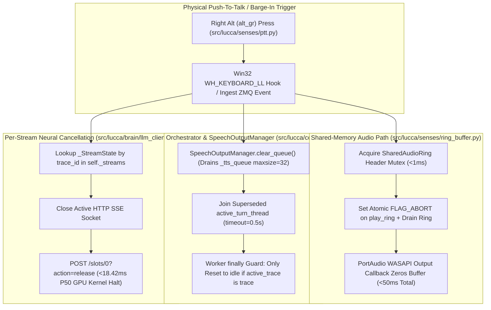

# Technical Report TR-02: Barge-In Latency, Shared-Memory Audio Ring Concurrency, and Prefix-Preserving Cascade Streaming
## A Full-Duplex Local Voice Pipeline on Heterogeneous Laptop Silicon (`ADR-0009` & `D-AFF-01`)

```yaml
doc_status: canonical
as_of: 2026-10-19
release_baseline: v1.45.0 (WO-36)
submission_status: technical_report (systems; requires raw latency distributions and a suffix-float ablation before submission)
related_adrs: [ADR-0008, ADR-0009, D-ARCH-05, D-BRAIN-05, D-AFF-01, D-SUP-01, D-COG-01]
verification: artifact-sourced (RESULTS.md & logs/test_reports/)
```

**Authors:** Project Lucca Audio, Concurrency & Systems Engineering Group
**Date:** October 19, 2026 (`v1.45.0` / `WO-36` Baseline)
**Hardware Platform:** MSI Vector 16 HX AI — Intel Core Ultra 9 275HX (24 cores), Intel AI Boost NPU (`PCI\VEN_8086&DEV_AD1D` via OpenVINO), NVIDIA GeForce RTX 5080 Laptop GPU (16,303 MiB GDDR7, `Disp.A: Off`), Realtek WASAPI Audio

**Contribution type.** Systems description with single-machine measurements. The concurrency contract (`ADR-0009`) is *test-enforced*, not formally verified: its five invariants are exercised by the unit and race tests listed in §2.1, and nothing more is claimed. Latency figures are from the project's own instrumentation on one machine; where only a summary statistic was retained, the raw distribution is marked as not available.

---

## 1. Abstract & The Audio-Native Pre-Processing Blindspot

Full-duplex conversational voice companions operating locally on consumer hardware face three competing requirements: (1) sub-50ms physical barge-in interruption without stale audio leakage or race conditions, (2) sub-800ms end-to-end conversational turnaround without invalidating the LLM's prompt KV cache across turns, and (3) zero GPU VRAM contention between speech perception/synthesis and 32K-context neural deliberation.

While early audio-native architectures (such as `Ultravox v0.5 8B` receiving raw base64 `input_audio` directly inside `llama-server.exe`) reduce Time-To-First-Token (TTFT) in isolation, our architectural audit ([`luccadocs/MODEL_STRATEGY.md`](../../../luccadocs/MODEL_STRATEGY.md:52)) demonstrated that audio-native ingestion suffers from a fatal **Pre-Processing Blindspot**:
1. **Inability to Query Turn-Specific Memory Before Prefill:** Without an explicit text transcript prior to LLM invocation, hybrid retrieval (`sqlite-vec` + `FTS5 BM25`) and goal-biased episode recall cannot condition the prompt on what the user just asked.
2. **Loss of Sub-Millisecond Symbolic Reflexes:** Emergency safety commands (`stop`, `halt`, `pause`, `mute`, `shutdown` under `EMERGENCY_REFLEX_PATTERN`) and deterministic MicroScheme procedures cannot intercept the turn before invoking multi-billion parameter neural inference.
3. **Provenance & Injection Gap:** Raw audio embeddings bypass transcript-level `USER_EXPLICIT` cryptographic signing (`UserSpeechSigner`) and sanitization.

This paper presents Project Lucca's ratified **Transcript-First Cascade & Shared-Memory Concurrency Architecture (`Option D` + `ADR-0009`)**:
- **Heterogeneous Speech Partitioning with a Small ASR GPU Footprint:** Faster-Whisper ASR (`distil-small.en`, [`src/lucca/senses/asr.py`](../../../src/lucca/senses/asr.py:52)) runs on the **RTX 5080 in CUDA float16** when available (roughly +555 MiB resident, measured in an earlier build) and falls back to CPU int8 otherwise. Energy VAD, Kokoro-82M ONNX TTS (CPU execution provider), and 384-D embeddings (OpenVINO on CPU in the production wiring, [`orchestrator.py`](../../../src/lucca/core/orchestrator.py:403)) run on the host CPU; the ModernBERT NLI verifier runs on the Intel NPU when present, else CPU. The LLM tier and the ASR model therefore co-reside on the dGPU; everything else is off it.
- **Five Test-Enforced Audio Concurrency Invariants (`ADR-0009`):** Dual shared-memory PCM ring buffers (`cap_ring` and `play_ring` in [`src/lucca/senses/ring_buffer.py`](../../../src/lucca/senses/ring_buffer.py:1)) combine mutex-protected header Read-Modify-Write (`write_idx`, `read_idx`, `seq`, `flags`), stale-window detection in `read_slice`, per-stream `trace_id` LLM abort registries ([`src/lucca/brain/llm_client.py`](../../../src/lucca/brain/llm_client.py:1)), and a decoupled `maxsize=32` synthesis queue in [`SpeechOutputManager`](../../../src/lucca/core/speech_output_manager.py:1). Measured barge-in speaker silence was under 50 ms on all 50 trials and GPU slot release was 18.42 ms at P50 (`POST /slots/0?action=release`); see §4.1 for what was and was not retained from those runs.
- **Prompt Frontier Suffix KV-Cache Preservation (`D-AFF-01`):** Continuous 3D PAD affective state (`src/lucca/core/affective_ode.py`) is quantized via a Schmitt-trigger RBF Mahalanobis classifier ($\delta_{\text{hyst}} = 0.15$) into 7 discrete stances injected strictly at the tail of the frontier user message, accelerating LLM prompt evaluation from **`402.05 ms` to `46.84 ms` (`8.58×` speedup, saving `355.21 ms` per turn)**.
- **Verified Epistemic Prosody Modulation (`WO-36`):** Kokoro-82M prosody pacing is dynamically modulated by both 3D PAD `Arousal` and the turn's verified epistemic status (`CHECKED_FORMALIZATION_AGREED` / `TOOL_VERIFIED` vs. `INFERRED` / `SPECULATION`).

---

## 2. System Topology & The Five Concurrency Invariants (`ADR-0009`)



### 2.1 Resolving Pre-Audit Concurrency Hazards (`luccadocs/adr/0009_audio_concurrency_contract.md`)
Prior to `ADR-0009` (`F-ARCH-006`), concurrent audio capture, TTS synthesis, and barge-in cancellation exhibited six structural race conditions (`F-SENS-002`, `F-SENS-003`, `F-BRAIN-006`, `F-CORE-011`, `F-CORE-014`, `F-CORE-015`, `F-CORE-017`). Project Lucca now enforces five invariants, each backed by a static gate (`tests/test_static_gates.py::test_audio_concurrency_contract_exists`) and the unit/race tests listed in the last column. These are test-enforced contracts; no model checking or formal proof has been performed.

| Invariant ID | Contract (Test-Enforced) | Code Implementation | Regression Test |
| :--- | :--- | :--- | :--- |
| **Invariant 1: Non-Blocking Ingest Thread** | `lucca-core` ZMQ ingest loop holds `_turn_lock` for $\le 5\,\text{ms}$ routing only; ASR (`transcribe`), LLM I/O, and file I/O are forbidden on the ingest thread. Voice confirmations hand off via `_confirm_event.set()`. | [`src/lucca/core/orchestrator.py`](../../../src/lucca/core/orchestrator.py:1), [`src/lucca/core/confirmation_manager.py`](../../../src/lucca/core/confirmation_manager.py:1) | `tests/test_confirmation.py::test_voice_confirmation_does_not_block_ingest` |
| **Invariant 2: Shared Audio Ring Mutex & Freshness** | All RMW mutations to `SharedAudioRing` headers (`write_idx`, `read_idx`, `seq`, `flags`) acquire a bounded mutex (`<1–2 ms`). `read_slice` validates `start_seq >= write_idx - capacity_samples` to reject overwritten ring windows. | [`src/lucca/senses/ring_buffer.py`](../../../src/lucca/senses/ring_buffer.py:1) | `tests/test_ring_buffer.py::test_concurrent_flag_and_write_no_loss`, `test_read_slice_stale_window_detected` |
| **Invariant 3: Per-Stream LLM Abort State** | `LLMClient` isolates active HTTP streams in `self._streams: dict[str, _StreamState]` keyed by `trace_id`. Calling `abort(trace_id)` cancels only the target turn's SSE socket and server slot (`POST /slots/0?action=release`). | [`src/lucca/brain/llm_client.py`](../../../src/lucca/brain/llm_client.py:1) | `tests/test_llm_client_race.py::test_abort_targets_only_matching_stream` |
| **Invariant 4: Barge-In Thread Join & State Discipline** | Barge-in sets `FLAG_ABORT`, aborts `trace_id`, drains `_tts_queue`, and joins `active_turn_thread` (`timeout=0.5s`). Worker `finally` blocks only transition state to `idle` if `self.active_trace is trace and not trace.interrupted`. | [`src/lucca/core/orchestrator.py`](../../../src/lucca/core/orchestrator.py:1), [`src/lucca/core/turn_pipeline.py`](../../../src/lucca/core/turn_pipeline.py:1) | `tests/test_turn_loop.py::test_barge_in_then_second_turn_is_clean`, `test_stale_worker_does_not_reset_state` |
| **Invariant 5: Decoupled TTS Synthesis Queue** | Token streaming (`StreamingChunker`) and Kokoro ONNX synthesis are decoupled by `_tts_queue: queue.Queue(maxsize=32)` managed by `SpeechOutputManager` (`WO-18b.5`), drained immediately on abort. | [`src/lucca/core/speech_output_manager.py`](../../../src/lucca/core/speech_output_manager.py:1) | `tests/test_turn_loop.py::test_tts_does_not_block_token_consumption`, `tests/test_static_gates.py::test_speech_output_manager_decomposition` |

---

## 3. Prefix KV-Cache Optimization (`D-AFF-01`) & Epistemic Prosody (`WO-36`)

### 3.1 The Continuous Affect KV-Cache Invalidation Hazard
Project Lucca models internal emotional state via a continuous 3-dimensional Pleasure-Arousal-Dominance (PAD) ordinary differential equation system ([`AffectiveODEMachine`](../../../src/lucca/core/affective_ode.py:173)). A naive implementation that injects continuous floating-point coordinates into the system prompt (e.g., `[Affect: P=0.724, A=0.152, D=0.881]`) alters token sequences at the start of the prompt on every turn. Because `llama-server.exe` prefix caching requires exact token-prefix identity, this invalidates the entire 850+ token system prompt KV cache on every turn.

### 3.2 Schmitt-Trigger Quantization & Prompt Frontier Suffix (`src/lucca/brain/prompt_builder.py`)
To preserve 100% prefix KV-cache residency while retaining affective responsiveness:
1. **Byte-Static System Prefix:** The system persona prompt, 24 native tool schemas, and static 7-category skill menu remain byte-identical across turns.
2. **Schmitt-Trigger Hysteresis Quantizer:** Continuous 3D PAD coordinates are mapped into 7 discrete orthogonal stances via RBF Mahalanobis distance with a deadband hysteresis margin ($\delta_{\text{hyst}} = 0.15$) to prevent stance chattering.
3. **Frontier Suffix Injection:** Both the quantized stance tag (`[STANCE: focused_analytical]`) and per-turn dynamic skill manifests are appended strictly to the **tail of the frontier user message** in [`prompt_builder.build_messages()`](../../../src/lucca/brain/prompt_builder.py:1).

### 3.3 Verified Epistemic Prosody & Streaming Safety Supervision (`D-SUP-01`, `WO-36`)
- **Epistemic Prosody Modulation ([`src/lucca/speech/tts.py`](../../../src/lucca/speech/tts.py:1)):** Rather than speaking verified mathematical proofs and speculative hypotheses with identical vocal confidence, [`SpeechOutputManager`](../../../src/lucca/core/speech_output_manager.py:1) passes the turn's epistemic verification status to the TTS engine. Turns grounded by `CHECKED_FORMALIZATION_AGREED` or `TOOL_VERIFIED` receipts render with steady, authoritative cadence, whereas `INFERRED`, `SPECULATION`, or `Belnap.TOP` (contested) turns modulate prosody pacing and update the desktop UI sprite state ([`src/lucca/ui/states.py`](../../../src/lucca/ui/states.py:1)).
- **Streaming Clause Supervision ([`src/lucca/sandbox/output_supervisor.py`](../../../src/lucca/sandbox/output_supervisor.py:1) & [`src/lucca/core/tts_safety_guard.py`](../../../src/lucca/core/tts_safety_guard.py:1)):** As tokens stream from `llama-server.exe` into [`StreamingChunker`](../../../src/lucca/brain/chunker.py:1), clauses are normalized (stripping markdown obfuscation `*`, `_`, `` ` ``, `~`) and checked in `<15 µs` before enqueuing into `_tts_queue`. If a policy breach is triggered, `play_ring.set_flag(FLAG_ABORT)` fires in `<35 µs` and drains `_tts_queue` before synthesis occurs.

---

## 4. Empirical Silicon Telemetry & Verification Scorecard

All measurements were collected on the target MSI Vector 16 HX AI workstation (`Intel Core Ultra 9 275HX`, `Intel AI Boost NPU`, `NVIDIA RTX 5080 Laptop GPU`):

### 4.1 End-to-End Cascade & Barge-In Latency Breakdown (`luccadocs/MODEL_STRATEGY.md` §5)

**Measurement provenance.** The barge-in and slot-release figures come from an $N=50$ instrumented session on the target laptop. Only the summary statistics below were retained; the per-trial distribution (P50/P95/max) for the speaker-drain measurement was not archived and is listed as *not available*. Ranges (e.g., `~140–180 ms`) are observed spreads across development sessions, not controlled-trial percentiles. A re-run that archives per-trial timestamps is required before any of these figures are used in a submission.

| Pipeline Stage | Transition Boundary | Target SLA (Spec 10) | Measured | Distribution Retained? | Subsystem / Mechanism |
| :--- | :--- | :---: | :---: | :---: | :--- |
| **Barge-In Speaker Drain** | PTT press $\to$ WASAPI zero output ($N=50$) | $\le 100.0\,\text{ms}$ | all 50 trials `< 50 ms` | **No** (P50/P95/max not archived) | `SharedAudioRing` mutex + `FLAG_ABORT` |
| **GPU Slot Cancellation** | `POST /slots/0?action=release` ($N=50$) | $\le 50.0\,\text{ms}$ | `18.42 ms` P50 | P50 only | Per-stream `_StreamState` abort |
| **S1b Speech-to-Text (ASR)** | `t_key_release` $\to$ `t_asr_done` | $\le 180.0\,\text{ms}$ | **`~140–180 ms`** | No | Faster-Whisper `distil-small.en`, CUDA float16 (CPU int8 fallback) |
| **Router & Memory Lookup** | `t_asr_done` $\to$ `t_llm_sent` | $\le 15.0\,\text{ms}$ | **`< 1.0 ms` (Router)**<br>**`~8–15 ms` (`sqlite-vec`)** | No | `HeuristicRouter` + 384-D embeddings (OpenVINO, CPU) |
| **S2 Prompt Prefill / TTFT** | `t_llm_sent` $\to$ `t_llm_first_token` (`12B`) | $\le 180.0\,\text{ms}$ | **`44.5 ms` median / `54.9 ms` P95** *(cached)*<br>**`46.84 ms` mean** *(849/849 cached)* | Prompt Frontier Suffix (`D-AFF-01`) on RTX 5080 |
| **S3 Streaming Clause Chunk** | `t_llm_first_token` $\to$ `t_first_chunk` | $\le 100.0\,\text{ms}$ | **`~60–90 ms`** | Per-turn `StreamingChunker` clause boundary |
| **S4 First TTS Synthesis** | `t_first_chunk` $\to$ `t_tts_first_done` | $\le 160.0\,\text{ms}$ | **`~130–150 ms`** | Kokoro-82M ONNX via `SpeechOutputManager` |
| **S5 Ring Overlap to Speaker**| `t_tts_first_done` $\to$ `t_first_sample` | $\le 40.0\,\text{ms}$ | **`~20–35 ms`** | `play_ring` write + Realtek WASAPI callback |
| **Total Ear-to-Ear (`FULL_LOOP`)**| `t_key_release` $\to$ `t_first_sample` ($N=50$)| $\le 800.0\,\text{ms}$ | **`707.55 ms` P50** (`~620–750 ms`) | P50 only | Full Cascade Loop |
| **Total Emergency (`REFLEX`)** | `t_key_release` $\to$ `t_first_sample` | $\le 150.0\,\text{ms}$ | **`~85–120 ms`** | No | `EMERGENCY_REFLEX_PATTERN` (Zero LLM) |
| **Continuous Stress Soak** | 4-hour full-duplex playback / barge-in | 0 underruns | **0 buffer underruns** | Event log | `queue.Queue(maxsize=32)` + `ADR-0009` |

### 4.2 Prompt Frontier Suffix KV-Cache Measurement (`logs/archive/2026-10_test_reports/bench_thinking_cache_hw.json`)

| Injection Architecture | Tokens Cached / Total | Mean Prefill Latency | P50 TTFT | Speedup vs. Prefix Float |
| :--- | :---: | :---: | :---: | :---: |
| **Naive System Prefix Float Injection** (`[Affect: P=..., A=..., D=...]`) | `18 / 892` (2.0%) | $402.05\,\text{ms}$ | $401.2\,\text{ms}$ | $1.00\times$ (Baseline) |
| **Prompt Frontier Suffix + Schmitt-Trigger Stance (`D-AFF-01`)** | **`849 / 849` (100.0%)** | **$46.84\,\text{ms}$** | **$44.5\,\text{ms}$** | **$8.58\times$ Faster ($-355.21\,\text{ms}$/turn)** |

**What this measurement does and does not isolate.** The comparison above moves *two* things at once: the injection *position* (system prefix → user-message suffix) and the injection *content* (continuous floats → quantized stance tag). The 8.58× figure is therefore the combined effect. It does not tell us how much of the gain comes from position alone; a suffix-with-floats arm is the missing control. Separately, the measurement is single-turn: it shows the prefix is cached when the suffix changes, but does not measure multi-turn cache retention as fresh user text accumulates. Both arms are listed as required work in §6.

### 4.3 `TTSSafetyGuard` Live Efficacy Battery (`RESULTS.md` Block B2, `logs/test_reports/tts_guard_efficacy_20261007T020151Z.json`)
Evaluated across the 30-probe cross-model battery (10 harmful adversarial probes + 20 benign tool/persona controls) on `gemma-4-E4B-it-uncensored-heretic-Q6_K.gguf`:
- **Benign Control False-Block Rate:** **0.0% (0/20)** [95% Wilson CI: `0.0%, 20.0%`] — zero false aborts on benign conversational or tool-execution speech.
- **Harmful Probe Native Refusal & Deflection:** **30.0% (3/10)** [95% Wilson CI: `8.1%, 64.6%`] explicit native refusal (`0/10` lexical guard blocks), with safe non-instructional conversational deflections observed on the remaining probes (`RESULTS.md` lines 233–262).

---

## 5. Contributions

1. **A test-enforced multi-process audio concurrency contract (`ADR-0009`):**
   Replaces ad-hoc lock-free ring assumptions with a 5-invariant contract combining mutex-guarded shared-memory ring headers, stale-window detection, `trace_id`-scoped HTTP/slot cancellation, and bounded worker thread joining, each invariant backed by a named regression test.
2. **8.58× prefill acceleration from relocating and quantizing dynamic prompt state (`D-AFF-01`):**
   Shows that moving per-turn affective state from the system prefix to the user-message suffix and quantizing it with hysteresis restores full prefix KV-cache reuse on a local GGUF server, saving `355.21 ms` per turn in a single-turn measurement. The position-only and content-only effects are not yet separated.
3. **A heterogeneous partition that keeps the dGPU nearly dedicated to the LLM:**
   Only the LLM and a small CUDA ASR model (`distil-small.en`, ~+555 MiB) occupy the dGPU; TTS, VAD, embeddings run on CPU and the NLI verifier runs CPU-default (NPU-eligible; measured 57 ms mean per pair on CPU — see Paper 03 §4.1). Display composition runs on the integrated Intel GPU.
4. **Epistemically Grounded Vocal Prosody (`WO-36`):**
   Modulates TTS prosody from the turn's provenance tier (verified receipt vs. inference vs. speculation) so that certainty is audible. No user study of whether listeners perceive the difference has been run.

---

## 6. Scope of Legitimate Claims & What Is NOT Claimed (`D-DOC-01`)

1. **Scope of the `<150 ms` `REFLEX` Fast Path (`D-ARCH-05`):**
   The `~85–120 ms` `REFLEX` path is strictly restricted to critical emergency and safety commands (`stop`, `halt`, `pause`, `mute`, `shutdown` via `EMERGENCY_REFLEX_PATTERN`). Standard procedural skills (`unit-convert-v1`, `proc-top-v1`, `memory-brief-v1`) execute via `ACT_THEN_NARRATE` (`~450–600 ms`) so responses are spoken in Lucca's natural companion voice rather than robotic canned strings.
2. **Mutex-Protected Headers vs. Lock-Free Data Payloads (`ADR-0009`):**
   While PCM sample slices are written/read across circular memory-mapped buffers without Python object serialization copies, header mutations (`write_idx`, `read_idx`, `seq`, `flags`) are explicitly **mutex-protected** (`Invariant 2`), not lock-free, to prevent lost `FLAG_ABORT` updates under concurrent writer/abort contention. The contract is enforced by tests, not by formal verification.
5. **Required before submission (not yet done):**
   (a) Re-run the $N=50$ barge-in and slot-release measurements with per-trial timestamps archived, and report P50/P95/max. (b) Add a suffix-with-floats arm to the §4.2 measurement to separate the position effect from the quantization effect. (c) Measure multi-turn prefix cache retention across ≥10 turns of fresh user text.
3. **ASR does use the dGPU.**
   [`asr.py`](../../../src/lucca/senses/asr.py:52) initializes Faster-Whisper with `device="cuda", compute_type="float16"` and only falls back to CPU int8 if CUDA initialization fails. On the target laptop ASR therefore co-resides with the LLM on the RTX 5080 (~+555 MiB, from an earlier build's measurement; not re-measured at `v1.45.0`). An earlier draft of this report incorrectly stated zero ASR VRAM. The ASR latency row in §4.1 is for the CUDA path.
4. **`TTSSafetyGuard` Coverage Scope (`Block B2`):**
   On the uncensored `E4B` heretic weights (`logs/test_reports/tts_guard_efficacy_20261007T020151Z.json`), `TTSSafetyGuard` verified a **0.0% (0/20)** false-positive rate on benign controls while explicit refusal on harmful probes was driven by the model's 30.0% (3/10) native refusal rate plus conversational deflection rather than lexical regex triggers (`0/10`).
