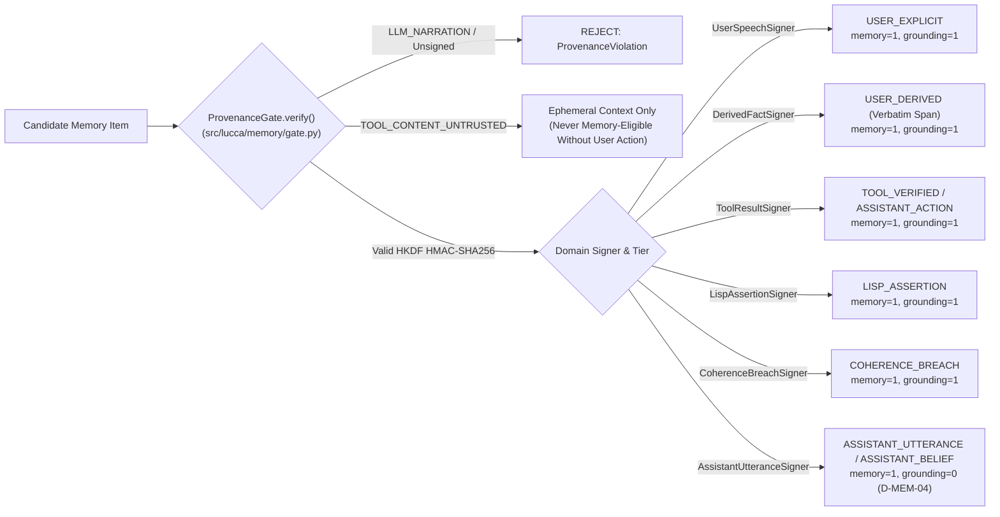

# Paper 03: Provenance-Gated Memory for Local LLM Agents
## Separating "What the Agent Said" from "What the Agent May Treat as True" with Signed Envelopes, Database-Enforced Grounding Flags, and a Four-Valued Belief State (`ADR-006`, `D-MEM-04`, `D-MEM-05`)

```yaml
doc_status: canonical
as_of: 2026-10-19
release_baseline: v1.45.0 (WO-36)
submission_status: secondary_candidate (systems / trustworthy-agents workshop)
related_adrs: [ADR-002, ADR-006, D-MEM-03, D-MEM-04, D-MEM-05, D-CASC-01, D-COG-01]
verification: artifact-sourced (V1_RELEASE_AUDIT.md, RESULTS.md & data/benchmarks/personhood/)
```

**Contribution type.** This is a *design-and-mechanism* paper with a mechanical evaluation: we describe a memory architecture, state the invariant it enforces, show where in the code and database schema the invariant is enforced, and report the results of authored test batteries. We do not claim a benchmark comparison against other memory systems (none was run; §4.2 is a feature survey from public documentation), and we are explicit in §6 about which guarantees are database-enforced and which are not.

**Authors:** Project Lucca Epistemics, Knowledge Representation & Cognitive Architecture Group  
**Date:** October 18, 2026 (`v1.45.0` / `WO-36` Baseline)  
**Hardware Platform:** Intel Core Ultra 9 275HX + Intel AI Boost NPU (`OpenVINO` ModernBERT NLI — CPU-default, NPU-eligible, measured 57 ms mean/pair on CPU; 384-D `all-MiniLM-L6-v2` embeddings on CPU; neither uses the dGPU) + SQLite WAL (`sqlite-vec` + `FTS5 BM25`)

---

## 1. Abstract & The Recursive Self-Poisoning Hazard

Autonomous companions designed for multi-month, multi-session operation must maintain both an autobiographical self-model and a factual knowledge base without succumbing to epistemic corruption. Standard Retrieval-Augmented Generation (RAG) pipelines and emerging cognitive substrates (such as `trubnikov/qca-cycle`'s `H7 WRITE` novelty gate, which commits any LLM-generated thought with cosine similarity `< 0.82` directly into the knowledge graph and rewards it with `dopamine ↑`; see [`luccadocs/research/2026-10-17_NIA_LIVE_COMPETITIVE_AND_COGNITIVE_ARCHITECTURE_SURVEY.md`](../2026-10-17_NIA_LIVE_COMPETITIVE_AND_COGNITIVE_ARCHITECTURE_SURVEY.md:36)) suffer from **recursive hallucination compounding**: once an unverified neural generation is stored in long-term memory, subsequent turns retrieve it as an established premise. Furthermore, classical two-valued logic collapses under user corrections or evolving facts via the principle of explosion ($A \land \neg A \vdash B$).

This paper describes **Project Lucca's Epistemic Memory & Autobiographical Architecture (`v1.45.0`)** and reports mechanical tests of five mechanisms:
1. **Six-Signer Cryptographic Provenance Envelopes (`ADR-006`, [`src/lucca/memory/gate.py`](../../../src/lucca/memory/gate.py:1) & [`src/lucca/memory/signers.py`](../../../src/lucca/memory/signers.py:1)):** Every persistent memory commit must carry an HKDF-derived HMAC-SHA256 signature from one of 6 strictly scoped domain signers (`UserSpeechSigner`, `DerivedFactSigner`, `ToolResultSigner`, `LispAssertionSigner`, `AssistantUtteranceSigner`, `CoherenceBreachSigner`). Freeform `LLM_NARRATION` possesses no signer and raises `ProvenanceViolation`. Read-time HMAC verification isolates tampered rows into a persistent `memory_quarantine` SQLite table (`D-MEM-05`).
2. **The Epistemic Grounding Invariant (`D-MEM-04`) & Rung A1 Autobiographical Self-Model ([`luccadocs/specs/AUTOBIOGRAPHICAL_MEMORY_AND_SELF_MODEL.md`](../../specs/AUTOBIOGRAPHICAL_MEMORY_AND_SELF_MODEL.md:1)):** SQLite triggers (`0006_autobiographical.sql`) decouple conversational continuity (`memory_eligible = 1`) from truth grounding (`grounding_eligible = 0` for `ASSISTANT_UTTERANCE` and `ASSISTANT_BELIEF`), so the agent can recall what it said and believed across sessions while the database refuses to let those rows be used as grounding evidence for factual claims. The enforcement is at the storage layer, not in the prompt.
3. **Nuel Belnap's $\mathcal{FOUR}$ Evidential Bilattice + NLI [`VerifierWorker`](../../../src/lucca/senses/verifier.py:60):** Models independent positive ($e^+$) and negative ($e^-$) evidence across an 8-substrate search cascade ([`src/lucca/core/cascade.py`](../../../src/lucca/core/cascade.py:1)), using an OpenVINO ModernBERT Natural Language Inference worker (CPU-default, NPU-eligible; measured 57 ms mean/pair on CPU, $\Delta\text{VRAM}=0\,\text{MB}$) to detect semantic contradictions ($\mathbf{B} = \top$), trigger post-turn proposition distillation ([`src/lucca/reasoning/distill.py`](../../../src/lucca/reasoning/distill.py:1)), and log auditable belief revisions (`supersede()` chains + `learning_events` in `0009_active_goals_and_learning_events.sql`).
4. **Qualitative Allen 169-Cell Temporal Algebra ([`src/lucca/reasoning/relational/allen.py`](../../../src/lucca/reasoning/relational/allen.py:1)):** Grounds bi-temporal memory intervals (`valid_from`, `valid_to`, `tx_from`, `tx_to`) and resolves relative temporal expressions (`"two weeks before"`, `"last Tuesday"`) against session anchor timestamps in [`src/lucca/memory/retrieval.py`](../../../src/lucca/memory/retrieval.py:1).
5. **Semantic [`UserModel`](../../../src/lucca/core/user_model.py:91) v2, [`ActiveGoalManager`](../../../src/lucca/core/active_goals.py:1), and Constitutional Kernel Hash (`WO-36`):** Combines 384-D embeddings + NLI entailment (`> 0.60`) for user-knowledge tracking and goal-biased retrieval while preserving **Trap 1** (`ALLOWED_USER_MODEL_PROVENANCES`) and **Trap 2** (`EpisodeRecall` narrative-only bounds), anchored across brain swaps by a deterministic SHA-256 `constitutional_hash` ([`src/lucca/core/constitutional.py`](../../../src/lucca/core/constitutional.py:1)).

---

## 2. Cryptographic Provenance Architecture & The Six Domain Signers (`ADR-006`)



### 2.1 Complete Provenance Tier & Signer Enforcement Matrix
All memory writes pass through [`MemoryCommitService`](../../../src/lucca/core/memory_commit_service.py:1) (`tests/test_static_gates.py::test_memory_commit_service_decomposition`) and [`ProvenanceGate`](../../../src/lucca/memory/gate.py:1), using a master key persisted at `data/keys/master.key` (`0600` permissions) with domain-separated HKDF subkeys ([`src/lucca/core/signer_factory.py`](../../../src/lucca/core/signer_factory.py:1)):

| `ProvenanceTier` | Authorized Domain Signer | `memory_eligible` | `grounding_eligible` (`D-MEM-04`) | `UserModel` Trap 1 Eligible | Semantic Scope & Verification Rule |
| :--- | :--- | :---: | :---: | :---: | :--- |
| **`USER_EXPLICIT`** | `UserSpeechSigner` | `1` | **`1`** | **Yes** | Direct authenticated user speech/text transcript. |
| **`USER_DERIVED`** | `DerivedFactSigner` | `1` | **`1`** | **Yes** | Proposition distilled from user turn; requires exact verbatim substring span check (`distill.py`). |
| **`TOOL_VERIFIED`** | `ToolResultSigner` | `1` | **`1`** | No | Verified deterministic sandbox tool execution output. |
| **`ASSISTANT_ACTION`** | `ToolResultSigner` | `1` | **`1`** | No | Signed receipt of an action or CEGIS proof Lucca actually executed (`CognitiveOutcomeSink`). |
| **`LISP_ASSERTION`** | `LispAssertionSigner` | `1` | **`1`** | No | Deterministic MicroScheme rule evaluation assertion. |
| **`COHERENCE_BREACH`** | `CoherenceBreachSigner` | `1` | **`1`** | No | Audited contradiction / NLI receipt-entailment breach record (`coherence.py`). |
| **`ASSISTANT_UTTERANCE`**| `AssistantUtteranceSigner`| `1` | **`0` (Enforced)** | **Yes** *(Explained)* | What Lucca said to the user; retrievable on `SELF_HISTORY` (`Substrate 7`), forbidden as factual truth grounding. |
| **`ASSISTANT_BELIEF`** | `AssistantUtteranceSigner`| `1` | **`0` (Enforced)** | **No (Forbidden)** | Revisable internal stance/hypothesis with `supersede()` lineage (`belief_service.py`). |
| **`TOOL_CONTENT_UNTRUSTED`**| *(Untrusted External)* | `0` | **`0`** | **No** | Class B host/web file reads; never committed to memory without explicit user promotion. |
| **`LLM_NARRATION`** | **None (No Signer Exists)**| **`0` (Blocked)** | **`0` (Blocked)** | **No** | Unconditionally rejected by `ProvenanceGate`. |

### 2.2 Two-Stage Read-Time HMAC Verification & `memory_quarantine` (`D-MEM-05`)
To defend against offline SQLite database tampering (`sqlite3 data/memory.sqlite "UPDATE memories SET content=..."`), [`MemoryStore`](../../../src/lucca/memory/store.py:1) re-verifies the HKDF HMAC-SHA256 digest of every candidate row during retrieval before returning it to [`HybridRetriever`](../../../src/lucca/memory/retrieval.py:1). Any row failing signature verification is immediately moved into the persistent `memory_quarantine` table and excluded from cognitive context (`tests/test_memory_hmac_tamper.py`).

---

## 3. Mathematical Formalism: Belnap $\mathcal{FOUR}$ Bilattice, NLI Verification & Allen Algebra

### 3.1 The Evidential Bilattice $\mathcal{FOUR}$ across the 8-Substrate Cascade (`D-CASC-01`)
Let $\mathcal{FOUR} = \langle \{\mathbf{T}, \mathbf{F}, \mathbf{B}, \bot\}, \le_k, \le_t \rangle$, where each proposition $p$ carries an evidence pair $e(p) = \langle e^+, e^- \rangle \in [0, 1]^2$ aggregated across Project Lucca's **8 prioritized epistemic substrates** ([`src/lucca/core/cascade.py`](../../../src/lucca/core/cascade.py:1)):
$$\text{Substrates} = \langle \texttt{TELEMETRY}_0, \texttt{WORKSPACE}_1, \texttt{MEMORY}_2, \texttt{WEB}_3, \texttt{ABSTENTION}_4, \texttt{SELF}_5, \texttt{CAPABILITIES}_6, \texttt{SELF\_HISTORY}_7 \rangle$$

Given independent evidence items $e_1 = \langle e_1^+, e_1^- \rangle$ and $e_2 = \langle e_2^+, e_2^- \rangle$:
- **Knowledge Join ($\vee_k$, Information Accumulation):** $e_1 \vee_k e_2 = \langle \max(e_1^+, e_2^+), \max(e_1^-, e_2^-) \rangle$
- **Truth Conjunction ($\wedge_t$, Logical Meet):** $e_1 \wedge_t e_2 = \langle \min(e_1^+, e_2^+), \max(e_1^-, e_2^-) \rangle$
- **Truth Disjunction ($\vee_t$, Logical Join):** $e_1 \vee_t e_2 = \langle \max(e_1^+, e_2^+), \min(e_1^-, e_2^-) \rangle$

### 3.2 ModernBERT NLI Integration (`src/lucca/senses/verifier.py`)
Lexical negation heuristics miss semantic contradictions (e.g., *"I live in Seattle"* vs. *"I relocated to Austin last month"*). Project Lucca runs a quantized ModernBERT NLI cross-encoder via OpenVINO ([`VerifierWorker.check_consistency()`](../../../src/lucca/senses/verifier.py:139)) on the host CPU (NPU-eligible but CPU-default; $\Delta\text{VRAM} = 0\,\text{MB}$). **Measured latency (2026-10-20, 100-pair set, §4.1): 57 ms mean / 70 ms p95 per pair on CPU — the earlier $\le 25\,\text{ms}$ target is not met on this hardware**, and the production 50 ms timeout fails open on 81% of pairs (see §4.1 for the timeout/latency reconciliation requirement).
1. When `CONTRADICTION` probability exceeds threshold against an existing grounded proposition, the bilattice state transitions to $\mathbf{B}$ ($\top = \langle 1, 1 \rangle$).
2. Instead of classical logical explosion, $\mathbf{B}$ isolates the contested proposition, blocks automatic rule induction on that topic, schedules the conflict on the homeostatic **`CoherenceDrive`** queue ([`src/lucca/memory/reflection.py`](../../../src/lucca/memory/reflection.py:1)), and distills the contradiction via [`distill_contradiction_to_proposition()`](../../../src/lucca/reasoning/distill.py:1).
3. When a user explicitly corrects a prior fact or Lucca's internal hypothesis is refuted by a `TOOL_VERIFIED` receipt, [`BeliefService.supersede()`](../../../src/lucca/core/belief_service.py:1) links the old and new records and appends a typed `LearningEvent` to the `learning_events` table (`0009_active_goals_and_learning_events.sql`).

### 3.3 Qualitative Allen Interval Algebra & Relative Date Grounding (`src/lucca/reasoning/relational/allen.py`)
Bi-temporal queries (`LongMemEval`, `CAT05`) require reasoning over overlapping, preceding, and containing intervals. Project Lucca implements James Allen's 13 base interval relations (`BEFORE`, `MEETS`, `OVERLAPS`, `STARTS`, `DURING`, `FINISHES`, `EQUALS`, and their converses) and the complete **$13 \times 13 = 169$-cell transitive composition table** in [`allen.py`](../../../src/lucca/reasoning/relational/allen.py:1), paired with ingestion-time relative date normalization (`datetime` / `dateutil` anchor resolution in [`src/lucca/memory/retrieval.py`](../../../src/lucca/memory/retrieval.py:1)).

### 3.4 Semantic `UserModel` v2, `ActiveGoalManager`, and Trap 1 & 2 Preservation (`WO-36`)
In `v1.45.0`, [`UserModel`](../../../src/lucca/core/user_model.py:91) and [`EpisodeRecall`](../../../src/lucca/core/episode_recall.py:36) were upgraded from lexical token overlap to hybrid 384-D cosine similarity + OpenVINO NLI entailment (`> 0.60`), while [`ActiveGoalManager`](../../../src/lucca/core/active_goals.py:1) (`active_goals` table in migration `0009`) biases [`HybridRetriever`](../../../src/lucca/memory/retrieval.py:1) toward active shared user-companion projects. Two hard safety invariants are enforced:
- **Trap 1 Invariant (`UserModel` Provenance Filter):** Only `ALLOWED_USER_MODEL_PROVENANCES = {USER_EXPLICIT, USER_DERIVED, ASSISTANT_UTTERANCE}` can update what the user knows; `ASSISTANT_BELIEF` and `LLM_NARRATION` are strictly excluded (`DISALLOWED_USER_MODEL_PROVENANCES`).
- **Trap 2 Invariant (`EpisodeRecall` Injection Bound):** Case-based episodic recall injects at most `<= 2` historical episodes (`<= 800` characters) framed strictly as past narrative context, never overriding current tool schemas or `grounding_eligible` truth flags.

---

## 4. Empirical Evaluation & Peer Cognitive Architecture Comparison

### 4.1 Anti-Confabulation & Introspective Accuracy Scorecard

All batteries below are **authored by the project** and exercised against the project's own pipeline. They demonstrate that the mechanism behaves as specified on the cases we wrote; they are not independent benchmarks. The "baseline" column is the same pipeline with the provenance gate and `grounding_eligible` filter disabled, on the same items.

| Evaluation Battery | Sample Size & Protocol | Gate-Disabled Baseline (same pipeline) | Gate-Enabled Result [95% Wilson CI] | Verification Artifact / Test |
| :--- | :--- | :---: | :---: | :--- |
| **Milestone 3 Confabulation Battery** | $N=25$ missing-state ($\bot$) traps (`data/eval/milestone3_confabulation_battery.json`) | 68.0% Hallucinated (17/25)<br>32.0% Abstained (8/25) | **0/25 Hallucinated** `[0.0%, 13.3%]`<br>**25/25 Honest Abstention** `[86.7%, 100%]` | `scripts/bench_confabulation_battery.py`, `tests/test_epistemic_cascade.py` |
| **`SPEC-BENCH-100-v1.0` Epistemic Faithfulness** | $N=100$ multi-domain probes (`spec_bench_100_run3_v1_3`) | 68.4% Provenance Alignment | **100/100** `[96.3%, 100%]` | `data/eval/true_audited_100.json`, `RESULTS.md` |
| **Rung A1 Live Introspective Accuracy** | $N=50$ live self-history & capability probes (`V1_RELEASE_AUDIT.md` §7.3) | Confabulates unexecuted actions | **50/50 receipt-grounded** `[92.9%, 100%]` | `tests/test_a1_live_hw.py`, `luccadocs/audit/findings/V1_RELEASE_AUDIT.md` |
| **`SPEC-PERSONHOOD-v1.0` Probe Batteries** | `IA` ($N=40$), `IN` ($N=30$), `FC` ($N=30$), `AC` ($N=30$) | Stateless / Inconsistent | Mechanical & live suites pass (`IA-A..D`, `IN-A..C`, `FC-A..C`, `AC-A..C`) | `data/benchmarks/personhood/*.json`, `tests/test_belief_interiority.py` |
| **HMAC Tamper Quarantine (`D-MEM-05`)** | Offline SQLite payload / tier mutation unit tests | 0% Detection (Silent Corruption) | All authored tamper cases detected and quarantined at read time | `tests/test_memory_hmac_tamper.py` |
| **50k Synthetic Vector + FTS5 Retrieval SLA** | $N=50,000$ rows (`[ITEM-029]` in `V1_RELEASE_AUDIT.md`) | Unbounded / External DB | **`P95 <= 45.0 ms`** (`~8–15 ms` typical) | `tests/test_memory_db.py` |

**NLI verifier measurement (2026-10-20).** The `VerifierWorker` was evaluated on a 100-pair hand-labeled set (`data/benchmarks/nli_eval/pairs_v1.jsonl`, 40 CONTRADICTION / 30 ENTAILMENT / 30 NEUTRAL, Lucca-style user/agent statement pairs) via `scripts/eval_nli_precision_recall.py`. Two runs were recorded:

| Run | Timeout | Accuracy | Macro F1 | CONTRADICTION P / R | Mean / P95 Latency | Degraded |
| :--- | :---: | :---: | :---: | :---: | :---: | :---: |
| Clean measurement (`results_cpu_t500`) | 500 ms | **93.0%** | **0.942** | **1.000 / 1.000** | 56.0 / 72.0 ms | 0/100 |
| Production timeout (`results`) | 50 ms | 18.0% | 0.298 | 1.000 / 0.075 | 57.1 / 70.4 ms | 81/100 |

The clean run shows the classifier itself is strong on this pair distribution — contradiction detection is perfect (40/40, zero false positives), with the only errors being 3 ENTAILMENT→UNCERTAIN degradations and 2 ENTAILMENT→NEUTRAL confusions. However, the production 50 ms timeout run reveals an operational finding: on this CPU, per-pair inference latency (mean 57 ms, p95 70 ms) exceeds the 50 ms budget, so 81% of pairs fail open to `UNCERTAIN` and effective contradiction recall collapses to 7.5%. The `<25 ms` claim in §3.2 is therefore not met on this hardware configuration; the timeout must be raised (e.g., to 100–150 ms) or the model moved to the NPU before the bilattice's $\mathbf{B}$ transitions can rely on live NLI verdicts. **Caveat:** `pairs_v1.jsonl` is a single-annotator set authored by the project developer, not an independent public benchmark (e.g., SNLI/MNLI held-out splits); these figures are directional engineering evidence, and a second-annotator agreement pass is required before citing them as benchmark results.

### 4.2 Feature Survey of 2026 Peer Memory Architectures (From Public Documentation — Not a Benchmark)

The following table was compiled by reading the public READMEs and specifications of four contemporaneous systems (via the live survey in [`2026-10-17_NIA_LIVE_COMPETITIVE_AND_COGNITIVE_ARCHITECTURE_SURVEY.md`](../2026-10-17_NIA_LIVE_COMPETITIVE_AND_COGNITIVE_ARCHITECTURE_SURVEY.md:1)). **None of these systems was executed, and no shared probe set was run.** Cells reflect what each project documents, as of the survey date, and may be incomplete or outdated.

| Documented Capability | `trubnikov/qca-cycle`<br>*(Ocean)* | `dayyanj/nmem`<br>*(6-Repo Stack)* | `rsxshx/agidb`<br>*(v2.0/v2.1)* | `The EpisTwin`<br>*(arXiv:2603.06290)* | **Project Lucca `v1.45.0`** |
| :--- | :---: | :---: | :---: | :---: | :---: |
| **Cryptographic Domain Signers (`ADR-006`)** | No | No | No | No | **Yes (6 HKDF HMAC-SHA256 Signers)** |
| **Immunity to Self-Poisoning (`grounding_eligible=0`)** | **No** *(Writes novel LLM output with sim `<0.82` to KG)* | Partial *(Disputed flag in nightly pass)* | Partial *(Surprise-gated)* | KG schema filter | **Yes (SQLite triggers enforce `grounding_eligible=0` on assistant speech)** |
| **Read-Time Tamper Quarantine (`D-MEM-05`)** | No | No | No | No | **Yes (`memory_quarantine` table)** |
| **Paraconsistent Bilattice + NLI Verifier** | LLM prompt check | Spreading activation | Revisable belief log | KG consistency | **Yes (Belnap $\mathcal{FOUR}$ + OpenVINO ModernBERT NLI; CPU-default, 57 ms mean measured — see §4.1)** |
| **Qualitative Allen 169-Cell Temporal Algebra** | No | No | Bi-temporal timestamps | No | **Yes (`allen.py` + relative date anchor resolution)** |
| **Constitutional Kernel Hash (`constitutional_hash`)** | Yes (`kernel.ses.json`) | `nmem-identity` | `SelfVectorSnapshot` | No | **Yes (`src/lucca/core/constitutional.py` on every `DecisionRecord`)** |
| **First-Class Shared Goals & `learning_events`** | No | No | Yes (`Goal` & `LearningEvent`) | No | **Yes (`ActiveGoalManager` & `0009_active_goals_and_learning_events.sql`)** |

---

## 5. Contributions

1. **A storage-layer separation between autobiographical recall and factual grounding (`ADR-006` + `D-MEM-04`).**
   We implement and test the separation between *what the agent may remember saying* (`memory_eligible = 1, grounding_eligible = 0`) and *what the agent may cite as evidence* (`grounding_eligible = 1`), enforced by signer identity and SQLite triggers rather than by prompt instructions. The design goal is to make recursive self-poisoning — the failure mode in which an earlier unverified generation becomes a later premise — structurally unreachable through the memory store.
2. **A non-explosive contradiction state driven by a zero-VRAM NLI verifier.**
   We couple Belnap's four-valued bilattice ($\mathcal{FOUR}$) with an OpenVINO ModernBERT NLI cross-encoder on the host CPU (NPU-eligible, CPU-default; measured 57 ms mean / 70 ms p95 per pair, §4.1), so that semantic contradictions become a queued $\mathbf{B}$ ($\top$) state for later reflection rather than an inconsistency that corrupts downstream inference.
3. **Bi-temporal qualitative grounding in a single-file local store.**
   Allen's 13 interval relations and the 169-cell composition table, plus relative-date resolution, run inside the same SQLite (`sqlite-vec` + `FTS5`) file as the memory itself.
4. **A constitutional fingerprint across model swaps (`WO-36`).**
   Every `DecisionRecord` carries a SHA-256 `constitutional_hash` over `config/persona.toml` and the core epistemic invariants, so the governing constitution for any historical turn is auditable across `26B-A4B`, `12B`, `E4B`, and `E2B` brains.

---

## 6. Scope of Legitimate Claims & What Is NOT Claimed (`D-DOC-01`)

1. **What is database-enforced vs. what is not.**
   The provenance gate and `grounding_eligible` triggers are deterministic code paths that fire on every write and read; the authored tamper and confabulation batteries (§4.1) exercise them. We claim the mechanism behaves as specified on those batteries. We do **not** claim a proof that no confabulation can occur: the gate controls what enters *memory*, not what the model *says*. Preventing an uncensored LLM from verbally claiming an unexecuted action during freeform speech is a separate output-supervision problem, and the lexical `TruthInReceiptMatcher` caught only `12.5% (1/8 strict)` / `4.3% (1/23 broad)` of such claims at $T=0.6$ ([`RESULTS.md`](../../../RESULTS.md:155), Paper 05). The post-turn NLI receipt-entailment check (`SPIKE-A`, [`src/lucca/core/coherence.py`](../../../src/lucca/core/coherence.py:1)) is implemented but its live sensitivity has not been re-measured.
2. **Evaluation is authored, not independent.**
   Every battery in §4.1 was written by the project. The 0/25 and 100/100 results carry Wilson intervals whose upper bounds (13.3% and 3.7% failure, respectively) reflect the small samples. An adversarial or externally-authored confabulation set has not been run.
3. **NLI verifier accuracy is measured only on an authored pair set, and the production timeout degrades it.**
   The `VerifierWorker`'s contradiction precision and recall were measured on a 100-pair single-annotator set (§4.1): contradiction precision/recall are 1.000/1.000 at a 500 ms timeout, but at the production 50 ms timeout, 81% of pairs fail open to `UNCERTAIN` on this CPU (mean latency 57 ms), collapsing effective contradiction recall to 0.075. The bilattice's $\mathbf{B}$ transitions therefore rest on a characterized classifier whose live recall is timeout-bound, not latency-bound; the timeout budget must be reconciled with measured hardware latency before the `<25 ms` claim holds.
4. **The peer table is a documentation survey.**
   §4.2 compares documented features; it is not a benchmark and should not be read as evidence that Lucca outperforms any listed system on any task.
5. **`USER_DERIVED` verbatim span requirement.**
   `DerivedFactSigner` does not sign arbitrary LLM paraphrases; [`src/lucca/reasoning/distill.py`](../../../src/lucca/reasoning/distill.py:1) requires distilled propositions to anchor to verifiable spans in authenticated `USER_EXPLICIT` turns.
6. **Graceful degradation.**
   When OpenVINO assets are absent, `UserModel` and `EpisodeRecall` fall back to lexical/BM25 matching while preserving the Trap 1 and Trap 2 provenance filters (`tests/test_inner_life.py`).
