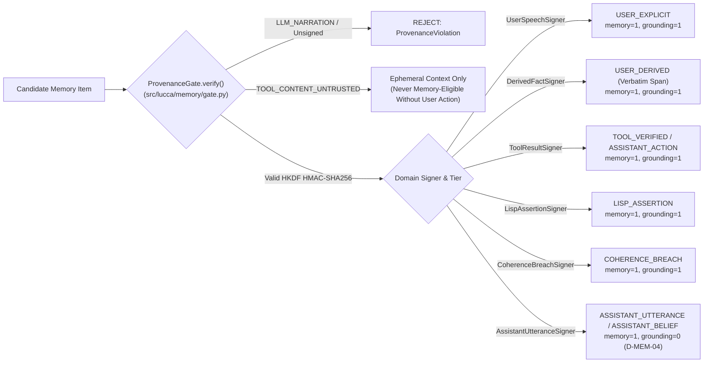

# Paper 03: Provenance-Gated Memory for Local LLM Agents
## Separating "What the Agent Said" from "What the Agent May Treat as True" with Signed Envelopes, Database-Enforced Grounding Flags, and a Four-Valued Belief State (`ADR-006`, `D-MEM-04`, `D-MEM-05`)

```yaml
doc_status: canonical
as_of: 2026-11-03
release_baseline: v1.47.0 (WO-39)
submission_status: secondary_candidate (systems / trustworthy-agents workshop)
related_adrs: [ADR-002, ADR-006, D-MEM-03, D-MEM-04, D-MEM-05, D-CASC-01, D-COG-01]
verification: artifact-sourced (V1_RELEASE_AUDIT.md, RESULTS.md & data/benchmarks/personhood/)
```

**Contribution type.** This is a *design-and-mechanism* paper with a mechanical evaluation: we describe a memory architecture, state the invariant it enforces, show where in the code and database schema the invariant is enforced, and report the results of authored test batteries. We do not claim a benchmark comparison against other memory systems (none was run; §4.2 is a feature survey from public documentation), and we are explicit in §6 about which guarantees are database-enforced and which are not.

**Authors:** Project Lucca Epistemics, Knowledge Representation & Cognitive Architecture Group  
**Date:** November 3, 2026 (`v1.47.0` / `WO-39` Baseline)  
**Hardware Platform:** Intel Core Ultra 9 275HX + Intel AI Boost NPU (`OpenVINO` MiniLM-L6 NLI `models/verifier_minilm` — CPU-default, NPU-eligible, author-measured 12.23 ms mean / 14.40 ms p95 per pair on CPU with 0/100 timeouts under the 50 ms budget; superseded ModernBERT baseline measured 57.1 ms mean / 70.4 ms p95, 81/100 timeouts; 384-D `all-MiniLM-L6-v2` embeddings on CPU; neither uses the dGPU) + SQLite WAL (`sqlite-vec` + `FTS5 BM25`)

---

## 1. Abstract & The Recursive Self-Poisoning Hazard

Autonomous companions designed for multi-month, multi-session operation must maintain both an autobiographical self-model and a factual knowledge base without succumbing to epistemic corruption. Standard Retrieval-Augmented Generation (RAG) pipelines and emerging cognitive substrates (such as `trubnikov/qca-cycle`'s `H7 WRITE` novelty gate, which commits any LLM-generated thought with cosine similarity `< 0.82` directly into the knowledge graph and rewards it with `dopamine ↑`; see [`luccadocs/research/2026-10-17_NIA_LIVE_COMPETITIVE_AND_COGNITIVE_ARCHITECTURE_SURVEY.md`](../2026-10-17_NIA_LIVE_COMPETITIVE_AND_COGNITIVE_ARCHITECTURE_SURVEY.md:36)) suffer from **recursive hallucination compounding**: once an unverified neural generation is stored in long-term memory, subsequent turns retrieve it as an established premise. Furthermore, classical two-valued logic collapses under user corrections or evolving facts via the principle of explosion ($A \land \neg A \vdash B$).

This paper describes **Project Lucca's Epistemic Memory & Autobiographical Architecture (`v1.47.0` / `WO-39`)** and reports mechanical tests of five mechanisms:
1. **Six-Signer Cryptographic Provenance Envelopes & Fail-Closed Corroboration (`ADR-006`, [`src/lucca/memory/gate.py`](../../../src/lucca/memory/gate.py:1) & [`src/lucca/memory/signers.py`](../../../src/lucca/memory/signers.py:1)):** Every persistent memory commit must carry an HKDF-derived HMAC-SHA256 signature from one of 6 strictly scoped domain signers (`UserSpeechSigner`, `DerivedFactSigner`, `ToolResultSigner`, `LispAssertionSigner`, `AssistantUtteranceSigner`, `CoherenceBreachSigner`). Freeform `LLM_NARRATION` possesses no signer and raises `ProvenanceViolation`. Read-time HMAC verification isolates tampered rows into a persistent `memory_quarantine` SQLite table (`D-MEM-05`). In `WO-39`, `ProvenanceGate` enforces fail-closed corroboration (`is_content_corroborated(None, ...) -> False`), removes the `"<source> asserts <claim>"` regex bypass, and verifies rule premises via semantic, triple, and NLI corroboration (`verify_rule_premises`).
2. **The Epistemic Grounding Invariant (`D-MEM-04`), Rung A1 Autobiographical Self-Model & Study 1 Prompt Partitioning (`WO-39` Milestone 1.2):** SQLite triggers (`0006_autobiographical.sql`) decouple conversational continuity (`memory_eligible = 1`) from truth grounding (`grounding_eligible = 0` for `ASSISTANT_UTTERANCE` and `ASSISTANT_BELIEF`), so the agent can recall what it said and believed across sessions while the database refuses to let those rows be used as grounding evidence for factual claims. Furthermore, [`prompt_builder.py`](../../../src/lucca/brain/prompt_builder.py:1) (`_render_partitioned_memories`) renders retrieved memories in two separated blocks: `[Persistent Memory Context — Verified Grounded Memory]` (`grounding_eligible = 1`) vs. `[Autobiographical Recollections — Unverified Past Speech: For conversational continuity only; do NOT cite as factual truth without independent tool or user verification]` (`grounding_eligible = 0`).
3. **Nuel Belnap's $\mathcal{FOUR}$ Evidential Bilattice Unified with OpenNARS / Beta$(w^+, w^-)$ + NLI [`VerifierWorker`](../../../src/lucca/senses/verifier.py:60) (`WO-39` Organ 1):** Models independent positive ($e^+$) and negative ($e^-$) evidence alongside OpenNARS evidence counts (`positive_evidence` $w^+$, `negative_evidence` $w^-$, `nars_frequency` $f = \frac{w^+}{w^+ + w^-}$, and `nars_confidence` $c = \frac{w^+ + w^-}{w^+ + w^- + k}$) across an 8-substrate search cascade ([`src/lucca/core/cascade.py`](../../../src/lucca/core/cascade.py:1)), using an OpenVINO MiniLM-L6 Natural Language Inference worker (`models/verifier_minilm`, CPU-default, NPU-eligible; author-measured 12.23 ms mean / 14.40 ms p95 per pair on CPU with 0/100 timeouts under the 50 ms budget, $\Delta\text{VRAM}=0\,\text{MB}$) to detect semantic contradictions ($\mathbf{B} = \top$), trigger post-turn proposition distillation ([`src/lucca/reasoning/distill.py`](../../../src/lucca/reasoning/distill.py:1)), and log auditable belief revisions (`supersede()` chains + `learning_events` in `0009_active_goals_and_learning_events.sql`).
4. **Qualitative Allen 169-Cell Temporal Algebra ([`src/lucca/reasoning/relational/allen.py`](../../../src/lucca/reasoning/relational/allen.py:1)):** Grounds bi-temporal memory intervals (`valid_from`, `valid_to`, `tx_from`, `tx_to`) and resolves relative temporal expressions (`"two weeks before"`, `"last Tuesday"`) against session anchor timestamps in [`src/lucca/memory/retrieval.py`](../../../src/lucca/memory/retrieval.py:1).
5. **Semantic [`UserModel`](../../../src/lucca/core/user_model.py:91) v2, [`ActiveGoalManager`](../../../src/lucca/core/active_goals.py:1), and Constitutional Kernel Hash (`WO-36`):** Combines 384-D embeddings + NLI entailment (`> 0.60`) for user-knowledge tracking and goal-biased retrieval while preserving **Trap 1** (`ALLOWED_USER_MODEL_PROVENANCES`) and **Trap 2** (`EpisodeRecall` narrative-only bounds), anchored across brain swaps by a deterministic SHA-256 `constitutional_hash` ([`src/lucca/core/constitutional.py`](../../../src/lucca/core/constitutional.py:1)).

---

## 2. Cryptographic Provenance Architecture & The Six Domain Signers (`ADR-006`)



### 2.1 Complete Provenance Tier & Signer Enforcement Matrix
All memory writes pass through [`MemoryCommitService`](../../../src/lucca/core/memory_commit_service.py:1) (`tests/test_static_gates.py::test_memory_commit_service_decomposition`) and [`ProvenanceGate`](../../../src/lucca/memory/gate.py:1), using a master key persisted at `data/keys/master.key` (`0600` permissions) with domain-separated HKDF subkeys ([`src/lucca/core/signer_factory.py`](../../../src/lucca/core/signer_factory.py:1)):

| `ProvenanceTier` | Authorized Domain Signer | `memory_eligible` | `grounding_eligible` (`D-MEM-04`) | `UserModel` Trap 1 Eligible | Semantic Scope & Verification Rule |
| :--- | :--- | :---: | :---: | :---: | :--- |
| **`USER_EXPLICIT`** | `UserSpeechSigner` | `1` | **`1`** | **Yes** | Direct authenticated user speech/text transcript. |
| **`USER_DERIVED`** | `DerivedFactSigner` | `1` | **`1`** | **Yes** | Proposition distilled from user turn; requires exact verbatim substring span check (`distill.py`). |
| **`TOOL_VERIFIED`** | `ToolResultSigner` | `1` | **`1`** | No | Verified deterministic sandbox tool execution output. |
| **`ASSISTANT_ACTION`** | `ToolResultSigner` | `1` | **`1`** | No | Signed receipt of an action or CEGIS proof Lucca actually executed (`CognitiveOutcomeSink`). |
| **`LISP_ASSERTION`** | `LispAssertionSigner` | `1` | **`1`** | No | Deterministic MicroScheme rule evaluation assertion. |
| **`COHERENCE_BREACH`** | `CoherenceBreachSigner` | `1` | **`1`** | No | Audited contradiction / NLI receipt-entailment breach record (`coherence.py`). |
| **`ASSISTANT_UTTERANCE`**| `AssistantUtteranceSigner`| `1` | **`0` (Enforced)** | **Yes** *(Explained)* | What Lucca said to the user; retrievable on `SELF_HISTORY` (`Substrate 7`), forbidden as factual truth grounding. |
| **`ASSISTANT_BELIEF`** | `AssistantUtteranceSigner`| `1` | **`0` (Enforced)** | **No (Forbidden)** | Revisable internal stance/hypothesis with `supersede()` lineage (`belief_service.py`). |
| **`TOOL_CONTENT_UNTRUSTED`**| *(Untrusted External)* | `0` | **`0`** | **No** | Class B host/web file reads; never committed to memory without explicit user promotion. |
| **`LLM_NARRATION`** | **None (No Signer Exists)**| **`0` (Blocked)** | **`0` (Blocked)** | **No** | Unconditionally rejected by `ProvenanceGate`. |

### 2.2 Two-Stage Read-Time HMAC Verification & `memory_quarantine` (`D-MEM-05`)
To defend against offline SQLite database tampering (`sqlite3 data/memory.sqlite "UPDATE memories SET content=..."`), [`MemoryStore`](../../../src/lucca/memory/store.py:1) re-verifies the HKDF HMAC-SHA256 digest of every candidate row during retrieval before returning it to [`HybridRetriever`](../../../src/lucca/memory/retrieval.py:1). Any row failing signature verification is immediately moved into the persistent `memory_quarantine` table and excluded from cognitive context (`tests/test_memory_hmac_tamper.py`).

### 2.3 `WO-39` Fail-Closed `ProvenanceGate` & Study 1 Autobiographical Partitioning
In `WO-39` (2026-11-03), three epistemic corroboration and prompt-injection defenses were hardened:
1. **Fail-Closed `is_content_corroborated(None, ...) -> False`:** In [`src/lucca/memory/gate.py`](../../../src/lucca/memory/gate.py:1), passing `store=None` to `is_content_corroborated` now fails closed (`False`) instead of bypassing corroboration checks when no store handle is provided.
2. **Removal of Attributed-Speech Regex Bypass (`verify_rule_premises`):** Removed the `"<source> asserts <claim>"` regex bypass from `verify_rule_premises` in `gate.py`. Every rule premise must be corroborated against `grounding_eligible = 1` memory records via exact `(s, p, o)` triple match, semantic vector similarity, or OpenVINO NLI entailment.
3. **Study 1 Prompt Partitioning (`_render_partitioned_memories` in `prompt_builder.py`):** Grounded memories (`grounding_eligible = 1`) are injected under `[Persistent Memory Context — Verified Grounded Memory]`, whereas autobiographical speech/belief records (`grounding_eligible = 0`) are isolated under `[Autobiographical Recollections — Unverified Past Speech: For conversational continuity only; do NOT cite as factual truth without independent tool or user verification]`.

---

## 3. Mathematical Formalism: Belnap $\mathcal{FOUR}$ Bilattice, OpenNARS Beta$(w^+, w^-)$, NLI Verification & Allen Algebra

### 3.1 The Evidential Bilattice $\mathcal{FOUR}$ Unified with OpenNARS $(w^+, w^-)$ (`D-CASC-01` & `WO-39` Organ 1)
Let $\mathcal{FOUR} = \langle \{\mathbf{T}, \mathbf{F}, \mathbf{B}, \bot\}, \le_k, \le_t \rangle$, where each proposition $p$ carries an evidence pair $e(p) = \langle e^+, e^- \rangle \in [0, 1]^2$ alongside OpenNARS / Beta$(w^+, w^-)$ evidence counts (`positive_evidence` $w^+$, `negative_evidence` $w^-$) aggregated across Project Lucca's **8 prioritized epistemic substrates** ([`src/lucca/core/cascade.py`](../../../src/lucca/core/cascade.py:1)):
$$\text{Substrates} = \langle \texttt{TELEMETRY}_0, \texttt{WORKSPACE}_1, \texttt{MEMORY}_2, \texttt{WEB}_3, \texttt{ABSTENTION}_4, \texttt{SELF}_5, \texttt{CAPABILITIES}_6, \texttt{SELF\_HISTORY}_7 \rangle$$

Given independent evidence items $e_1 = \langle e_1^+, e_1^- \rangle$ and $e_2 = \langle e_2^+, e_2^- \rangle$:
- **Knowledge Join ($\vee_k$, Information Accumulation):** $e_1 \vee_k e_2 = \langle \max(e_1^+, e_2^+), \max(e_1^-, e_2^-) \rangle$ and additive OpenNARS evidence pooling $(w_1^+ + w_2^+, w_1^- + w_2^-)$.
- **Truth Conjunction ($\wedge_t$, Logical Meet):** $e_1 \wedge_t e_2 = \langle \min(e_1^+, e_2^+), \max(e_1^-, e_2^-) \rangle$
- **Truth Disjunction ($\vee_t$, Logical Join):** $e_1 \vee_t e_2 = \langle \max(e_1^+, e_2^+), \min(e_1^-, e_2^-) \rangle$
- **OpenNARS Frequency & Confidence (`cascade.py`):** From accumulated $(w^+, w^-)$, `CascadeResult` exposes `nars_frequency` $f = \frac{w^+}{w^+ + w^-}$ and `nars_confidence` $c = \frac{w^+ + w^-}{w^+ + w^- + k}$ ($k = 1.0$), mapping discrete Belnap polarity ($\mathbf{T}, \mathbf{F}, \mathbf{B}, \bot$) onto calibrated continuous uncertainty.

### 3.2 OpenVINO NLI Integration (`src/lucca/senses/verifier.py`)
Lexical negation heuristics miss semantic contradictions (e.g., *"I live in Seattle"* vs. *"I relocated to Austin last month"*). Project Lucca runs a quantized OpenVINO NLI cross-encoder ([`VerifierWorker.check_consistency()`](../../../src/lucca/senses/verifier.py:139)) on the host CPU (NPU-eligible but CPU-default; $\Delta\text{VRAM} = 0\,\text{MB}$). **Measured latency and WO-37 Phase 2 model swap (§4.1):** The initial 149M ModernBERT artifact (`models/verifier`) measured 57.1 ms mean / 70.4 ms p95 per pair on CPU, causing the production 50 ms timeout to fail open on 81/100 pairs. In WO-37 Phase 2 (2026-10-26, commit `224bc06`), the deployed model was replaced with the 22M 6-layer MiniLM-L6 cross-encoder (`models/verifier_minilm`, `cross-encoder/nli-MiniLM2-L6-H768`), reducing CPU latency to **12.23 ms mean / 14.40 ms p95 per pair with 0/100 timeouts** under the 50 ms budget (`data/benchmarks/nli_eval/results_minilm/summary.json`).
1. When `CONTRADICTION` probability exceeds threshold against an existing grounded proposition, the bilattice state transitions to $\mathbf{B}$ ($\top = \langle 1, 1 \rangle$).
2. Instead of classical logical explosion, $\mathbf{B}$ isolates the contested proposition, blocks automatic rule induction on that topic, schedules the conflict on the homeostatic **`CoherenceDrive`** queue ([`src/lucca/memory/reflection.py`](../../../src/lucca/memory/reflection.py:1)), and distills the contradiction via [`distill_contradiction_to_proposition()`](../../../src/lucca/reasoning/distill.py:1).
3. When a user explicitly corrects a prior fact or Lucca's internal hypothesis is refuted by a `TOOL_VERIFIED` receipt, [`BeliefService.supersede()`](../../../src/lucca/core/belief_service.py:1) links the old and new records and appends a typed `LearningEvent` to the `learning_events` table (`0009_active_goals_and_learning_events.sql`).

### 3.3 Qualitative Allen Interval Algebra & Relative Date Grounding (`src/lucca/reasoning/relational/allen.py`)
Bi-temporal queries (`LongMemEval`, `CAT05`) require reasoning over overlapping, preceding, and containing intervals. Project Lucca implements James Allen's 13 base interval relations (`BEFORE`, `MEETS`, `OVERLAPS`, `STARTS`, `DURING`, `FINISHES`, `EQUALS`, and their converses) and the complete **$13 \times 13 = 169$-cell transitive composition table** in [`allen.py`](../../../src/lucca/reasoning/relational/allen.py:1), paired with ingestion-time relative date normalization (`datetime` / `dateutil` anchor resolution in [`src/lucca/memory/retrieval.py`](../../../src/lucca/memory/retrieval.py:1)).

### 3.4 Semantic `UserModel` v2, `ActiveGoalManager`, and Trap 1 & 2 Preservation (`WO-36`)
In `v1.45.0`+, [`UserModel`](../../../src/lucca/core/user_model.py:91) and [`EpisodeRecall`](../../../src/lucca/core/episode_recall.py:36) were upgraded from lexical token overlap to hybrid 384-D cosine similarity + OpenVINO NLI entailment (`> 0.60`), while [`ActiveGoalManager`](../../../src/lucca/core/active_goals.py:1) (`active_goals` table in migration `0009`) biases [`HybridRetriever`](../../../src/lucca/memory/retrieval.py:1) toward active shared user-companion projects. Two hard safety invariants are enforced:
- **Trap 1 Invariant (`UserModel` Provenance Filter):** Only `ALLOWED_USER_MODEL_PROVENANCES = {USER_EXPLICIT, USER_DERIVED, ASSISTANT_UTTERANCE}` can update what the user knows; `ASSISTANT_BELIEF` and `LLM_NARRATION` are strictly excluded (`DISALLOWED_USER_MODEL_PROVENANCES`).
- **Trap 2 Invariant (`EpisodeRecall` Injection Bound):** Case-based episodic recall injects at most `<= 2` historical episodes (`<= 800` characters) framed strictly as past narrative context, never overriding current tool schemas or `grounding_eligible` truth flags.

---

## 4. Empirical Evaluation & Peer Cognitive Architecture Comparison

### 4.1 Anti-Confabulation & Introspective Accuracy Scorecard

All batteries below are **authored by the project** and exercised against the project's own pipeline. They demonstrate that the mechanism behaves as specified on the cases we wrote; they are not independent benchmarks. The "baseline" column is the same pipeline with the provenance gate and `grounding_eligible` filter disabled, on the same items.

| Evaluation Battery | Sample Size & Protocol | Gate-Disabled Baseline (same pipeline) | Gate-Enabled Result [95% Wilson CI] | Verification Artifact / Test |
| :--- | :--- | :---: | :---: | :--- |
| **Milestone 3 Confabulation Battery** | $N=25$ missing-state ($\bot$) traps (`data/eval/milestone3_confabulation_battery.json`) | 68.0% Hallucinated (17/25)<br>32.0% Abstained (8/25) | **0/25 Hallucinated** `[0.0%, 13.3%]`<br>**25/25 Honest Abstention** `[86.7%, 100%]` | `scripts/bench_confabulation_battery.py`, `tests/test_epistemic_cascade.py` |
| **`SPEC-BENCH-100-v1.0` Epistemic Faithfulness** | $N=100$ multi-domain probes (`spec_bench_100_run3_v1_3`) | 68.4% Provenance Alignment | **100/100** `[96.3%, 100%]` | `data/eval/true_audited_100.json`, `RESULTS.md` |
| **Rung A1 Live Introspective Accuracy** | $N=50$ live self-history & capability probes (`V1_RELEASE_AUDIT.md` §7.3) | Confabulates unexecuted actions | **50/50 receipt-grounded** `[92.9%, 100%]` | `tests/test_a1_live_hw.py`, `luccadocs/audit/findings/V1_RELEASE_AUDIT.md` |
| **`SPEC-PERSONHOOD-v1.0` Probe Batteries** | `IA` ($N=40$), `IN` ($N=30$), `FC` ($N=30$), `AC` ($N=30$) | Stateless / Inconsistent | Mechanical & live suites pass (`IA-A..D`, `IN-A..C`, `FC-A..C`, `AC-A..C`) | `data/benchmarks/personhood/*.json`, `tests/test_belief_interiority.py` |
| **HMAC Tamper Quarantine (`D-MEM-05`)** | Offline SQLite payload / tier mutation unit tests | 0% Detection (Silent Corruption) | All authored tamper cases detected and quarantined at read time | `tests/test_memory_hmac_tamper.py` |
| **50k Synthetic Vector + FTS5 Retrieval SLA** | $N=50,000$ rows (`[ITEM-029]` in `V1_RELEASE_AUDIT.md`) | Unbounded / External DB | **`P95 <= 45.0 ms`** (`~8–15 ms` typical) | `tests/test_memory_db.py` |
| **`LongMemEval` Pipeline Benchmark (`12B`)** | $N=30$ (`knowledge-update`, `temporal-reasoning`, `multi-session`) | 23.3% (7/30) Truncation Baseline | **70.0% (21/30)** (`0:14` discordant pairs, McNemar $p = 0.0001$, **`8.1 ms` mean retrieval**) | `scripts/run_longmemeval_pipeline_benchmark.py`, `logs/test_reports/longmemeval_pipeline_12B_1791794644.json` |

**NLI verifier measurement (2026-10-20 baseline & 2026-10-26 WO-37 Phase 2 replacement).** The `VerifierWorker` was evaluated on a 100-pair hand-labeled set (`data/benchmarks/nli_eval/pairs_v1.jsonl`, 40 CONTRADICTION / 30 ENTAILMENT / 30 NEUTRAL, Lucca-style user/agent statement pairs) via `scripts/eval_nli_precision_recall.py`. Three author-measured runs are recorded (`results_cpu_t500`, `results`, and `results_minilm`):

| Run | Timeout | Accuracy | Macro F1 | CONTRADICTION P / R | Mean / P95 Latency | Degraded |
| :--- | :---: | :---: | :---: | :---: | :---: | :---: |
| Clean measurement (`results_cpu_t500`) | 500 ms | **93.0%** | **0.942** | **1.000 / 1.000** | 56.0 / 72.0 ms | 0/100 |
| Production timeout (`results`, ModernBERT) | 50 ms | 18.0% | 0.298 | 1.000 / 0.075 | 57.1 / 70.4 ms | 81/100 |
| **MiniLM-L6 prod (`results_minilm`, deployed)** | **50 ms** | **91.0%** | **0.917** | **0.975 / 0.975** | **12.23 / 14.40 ms** | **0/100** |

The initial ModernBERT runs exposed a critical operational bottleneck: although the 149M classifier achieved 40/40 contradiction recall at a 500 ms timeout, its CPU latency (57.1 ms mean, 70.4 ms p95) exceeded the 50 ms in-turn budget, causing 81/100 pairs to fail open to `UNCERTAIN` and collapsing effective contradiction recall to 7.5%. Replacing the artifact in WO-37 Phase 2 with the 22M MiniLM-L6 cross-encoder (`models/verifier_minilm`, `data/benchmarks/nli_eval/results_minilm/summary.json`) reduced mean CPU latency by $4.67\times$ to **12.23 ms (14.40 ms p95)** with **0/100 timeouts** under the 50 ms budget, restoring live contradiction precision/recall to **0.975 / 0.975** (39/40 TP, 1 FP, 1 FN) and entailment precision/recall to **0.960 / 0.800** (24/30 TP, 3 NEUTRAL, 3 UNCERTAIN). **Caveat:** `pairs_v1.jsonl` is a single-annotator set authored by the project developer, not an independent public benchmark (e.g., SNLI/MNLI held-out splits); these figures are author-measured engineering evidence, and a second-annotator agreement pass is required before citing them as external benchmark results.

### 4.2 Feature Survey of 2026 Peer Memory Architectures (From Public Documentation — Not a Benchmark)

The following table was compiled by reading the public READMEs and specifications of four contemporaneous systems (via the live survey in [`2026-10-17_NIA_LIVE_COMPETITIVE_AND_COGNITIVE_ARCHITECTURE_SURVEY.md`](../2026-10-17_NIA_LIVE_COMPETITIVE_AND_COGNITIVE_ARCHITECTURE_SURVEY.md:1)). **None of these systems was executed, and no shared probe set was run.** Cells reflect what each project documents, as of the survey date, and may be incomplete or outdated.

| Documented Capability | `trubnikov/qca-cycle`<br>*(Ocean)* | `dayyanj/nmem`<br>*(6-Repo Stack)* | `rsxshx/agidb`<br>*(v2.0/v2.1)* | `The EpisTwin`<br>*(arXiv:2603.06290)* | **Project Lucca `v1.47.0` (`WO-39`)** |
| :--- | :---: | :---: | :---: | :---: | :---: |
| **Cryptographic Domain Signers (`ADR-006`)** | No | No | No | No | **Yes (6 HKDF HMAC-SHA256 Signers + Fail-Closed `ProvenanceGate`)** |
| **Immunity to Self-Poisoning (`grounding_eligible=0`)** | **No** *(Writes novel LLM output with sim `<0.82` to KG)* | Partial *(Disputed flag in nightly pass)* | Partial *(Surprise-gated)* | KG schema filter | **Yes (SQLite triggers + Study 1 `_render_partitioned_memories` prompt split)** |
| **Read-Time Tamper Quarantine (`D-MEM-05`)** | No | No | No | No | **Yes (`memory_quarantine` table)** |
| **Paraconsistent Bilattice + NARS + NLI Verifier** | LLM prompt check | Spreading activation | Revisable belief log | KG consistency | **Yes (Belnap $\mathcal{FOUR}$ + OpenNARS $(w^+, w^-)$ + OpenVINO MiniLM-L6 NLI; 12.23 ms mean, 0% timeouts)** |
| **Qualitative Allen 169-Cell Temporal Algebra** | No | No | Bi-temporal timestamps | No | **Yes (`allen.py` + relative date anchor resolution)** |
| **Constitutional Kernel Hash (`constitutional_hash`)** | Yes (`kernel.ses.json`) | `nmem-identity` | `SelfVectorSnapshot` | No | **Yes (`src/lucca/core/constitutional.py` on every `DecisionRecord`)** |
| **First-Class Shared Goals & `learning_events`** | No | No | Yes (`Goal` & `LearningEvent`) | No | **Yes (`ActiveGoalManager` & `0009_active_goals_and_learning_events.sql`)** |

---

## 5. Contributions

1. **A storage-layer and prompt-layer separation between autobiographical recall and factual grounding (`ADR-006` + `D-MEM-04` + `WO-39` Study 1).**
   We implement and test the separation between *what the agent may remember saying* (`memory_eligible = 1, grounding_eligible = 0`) and *what the agent may cite as evidence* (`grounding_eligible = 1`), enforced by signer identity, SQLite triggers, and `_render_partitioned_memories` prompt framing. The design goal is to make recursive self-poisoning — the failure mode in which an earlier unverified generation becomes a later premise — structurally unreachable through the memory store.
2. **A non-explosive contradiction state unifying Belnap $\mathcal{FOUR}$ with OpenNARS Beta$(w^+, w^-)$ and a zero-VRAM NLI verifier (`WO-39` Organ 1).**
   We couple Belnap's four-valued bilattice ($\mathcal{FOUR}$) and OpenNARS evidence counts (`positive_evidence`, `negative_evidence`, `nars_frequency`, `nars_confidence`) with an OpenVINO MiniLM-L6 NLI cross-encoder on the host CPU (NPU-eligible, CPU-default; author-measured 12.23 ms mean / 14.40 ms p95 per pair with 0/100 timeouts under the 50 ms budget, §4.1), so that semantic contradictions become a queued $\mathbf{B}$ ($\top$) state for later reflection rather than an inconsistency that corrupts downstream inference.
3. **Bi-temporal qualitative grounding in a single-file local store.**
   Allen's 13 interval relations and the 169-cell composition table, plus relative-date resolution, run inside the same SQLite (`sqlite-vec` + `FTS5`) file as the memory itself.
4. **A constitutional fingerprint across model swaps (`WO-36`).**
   Every `DecisionRecord` carries a SHA-256 `constitutional_hash` over `config/persona.toml` and the core epistemic invariants, so the governing constitution for any historical turn is auditable across `26B-A4B`, `12B`, `E4B`, and `E2B` brains.

---

## 6. Scope of Legitimate Claims & What Is NOT Claimed (`D-DOC-01`)

1. **What is database-enforced vs. what is not.**
   The provenance gate and `grounding_eligible` triggers are deterministic code paths that fire on every write and read; the authored tamper and confabulation batteries (§4.1) exercise them. We claim the mechanism behaves as specified on those batteries. We do **not** claim a proof that no confabulation can occur: the gate controls what enters *memory*, not what the model *says*. Preventing an uncensored LLM from verbally claiming an unexecuted action during freeform speech is a separate output-supervision problem, and the lexical `TruthInReceiptMatcher` caught only `12.5% (1/8 strict)` / `4.3% (1/23 broad)` of such claims at $T=0.6$ ([`RESULTS.md`](../../../RESULTS.md:155), Paper 05). The post-turn NLI receipt-entailment check (`SPIKE-A`, [`src/lucca/core/coherence.py`](../../../src/lucca/core/coherence.py:1)) is implemented but its live sensitivity has not been re-measured.
2. **Evaluation is authored, not independent.**
   Every battery in §4.1 was written by the project. The 0/25 and 100/100 results carry Wilson intervals whose upper bounds (13.3% and 3.7% failure, respectively) reflect the small samples. An adversarial or externally-authored confabulation set has not been run.
3. **NLI verifier accuracy is measured on an authored 100-pair set (`pairs_v1.jsonl`).**
   The `VerifierWorker`'s precision and recall were evaluated on a 100-pair single-annotator set (§4.1). While the initial 149M ModernBERT artifact suffered 81/100 timeouts under the 50 ms production budget (57.1 ms mean CPU latency, collapsing live contradiction recall to 0.075), the WO-37 Phase 2 switch to the 22M MiniLM-L6 cross-encoder (`models/verifier_minilm`, `data/benchmarks/nli_eval/results_minilm/summary.json`) reduced CPU latency to 12.23 ms mean / 14.40 ms p95 with 0/100 timeouts, achieving 0.975/0.975 contradiction P/R and 0.960/0.800 entailment P/R (91.0% overall accuracy). Remaining caveats are single-annotator labeling and the 6/30 missed entailments (3 classified as `NEUTRAL`, 3 below confidence threshold as `UNCERTAIN`).
4. **The peer table is a documentation survey.**
   §4.2 compares documented features; it is not a benchmark and should not be read as evidence that Lucca outperforms any listed system on any task.
5. **`USER_DERIVED` verbatim span & `verify_rule_premises` corroboration requirement.**
   `DerivedFactSigner` does not sign arbitrary LLM paraphrases; [`src/lucca/reasoning/distill.py`](../../../src/lucca/reasoning/distill.py:1) requires distilled propositions to anchor to verifiable spans in authenticated `USER_EXPLICIT` turns, and `ProvenanceGate.verify_rule_premises` (`WO-39`) requires semantic, triple, or NLI corroboration against grounded records without regex attribution bypasses.
6. **Graceful degradation.**
   When OpenVINO assets are absent, `UserModel` and `EpisodeRecall` fall back to lexical/BM25 matching while preserving the Trap 1 and Trap 2 provenance filters (`tests/test_inner_life.py`).
