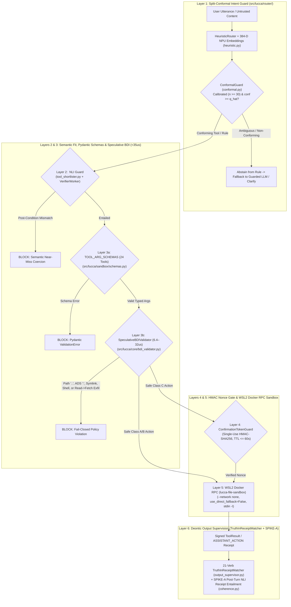

# Technical Report TR-05: Threat Model and Layered Policy Enforcement for Local Agent Tool Use
## Conformal Routing Abstention, Pre-Dispatch Policy Checks, Container Isolation, and Receipt Supervision (`ADR-003`, `ADR-004`, `D-SEC-04`, `D-AUD-10`, `D-AUD-13`)

```yaml
doc_status: canonical
as_of: 2026-10-19
release_baseline: v1.45.0 (WO-36)
submission_status: technical_report (design + threat model; no external or adversarial red-team has been performed)
related_adrs: [ADR-003, ADR-004, D-SEC-04, D-AUD-10, D-AUD-13, D-SAND-03, D-SUP-01, D-COG-01]
verification: artifact-sourced (V1_RELEASE_AUDIT.md, RESULTS.md & tests/test_c1_abstention_acceptance.py)
```

**Authors:** Project Lucca Systems Security, Conformal Calibration & Deontic Verification Group
**Date:** October 19, 2026 (`v1.45.0` / `WO-36` Baseline)
**Hardware Platform:** Intel Core Ultra 9 275HX + Intel AI Boost NPU (`OpenVINO`) + Ubuntu WSL2 Docker CE (`lucca-file-sandbox`, `--network none`)

**Contribution type and evidence standard.** This report states a threat model, describes six enforcement layers, and reports the results of the project's own test batteries against them. Every "100%" in §4 means "all cases in a suite we wrote were handled as specified"; none means "no attack exists." No external security review or adversarial red-team has been conducted. The conformal-routing calibration (Layer 1) was fitted on a synthetic seed produced by the unguarded router, not on human-labeled ground truth — see §6.2.

---

## 1. Abstract & Threat Model

Autonomous desktop companions equipped with native operating system and workspace tools (filesystem manipulation, Python code execution, web fetching, application launching, screenshot OCR, and task scheduling across Project Lucca's 24 native tools; `MAX_REGISTRY_TOOLS = 24` in [`src/lucca/core/capabilities.py`](../../../src/lucca/core/capabilities.py:1)) face five structural threat classes that soft system-prompt instructions cannot mitigate:
1. **Overconfident Intent Misrouting:** Dispatching ambiguous or out-of-distribution user speech into deterministic symbolic rules or unrequested tool executions.
2. **Near-Miss Semantic Tool Coercion (`BFCL v3 Irrelevance`):** Invoking a tool whose schema overlaps lexically with a user request but fails to satisfy the required semantic post-condition.
3. **Filesystem Escape, Exfiltration Chains & Shell Injection:** Path traversal (`..`), symlink escapes, NTFS Alternate Data Stream (`ADS`) injection, same-turn `Workspace Read -> Web Fetch` exfiltration sequences, or launching command interpreters (`cmd.exe`, `powershell.exe`).
4. **Confirmation Replay & TOCTOU Tampering:** Replaying stale approval tokens or modifying tool arguments between user confirmation and execution.
5. **Freeform Verbal Action Confabulation:** An uncensored LLM claiming in natural-language speech (*"I have deleted those logs"* or *"I sent the email"*) to have performed a side-effecting action when zero tool execution receipt exists in the turn trace.

This paper presents and empirically evaluates **Project Lucca's Six-Layer Deontic Sandbox & Receipt Supervision Architecture (`v1.45.0` / `WO-36`)**:
1. **Layer 1 — Non-Parametric Split-Conformal Routing Abstention (`Rung C1`, [`src/lucca/router/conformal.py`](../../../src/lucca/router/conformal.py:1) & [`src/lucca/router/calibration.py`](../../../src/lucca/router/calibration.py:1)):** Fits [`ConformalGuard`](../../../src/lucca/router/conformal.py:1) from SQLite decision history (`fit_guard_from_db`, requiring $\ge 30$ labeled decisions; `n=135` calibration seed), achieving **96.08% abstention precision (Wilson 95% LB = `0.8541` $\ge 0.80$)** and **97.00% routing accuracy** across $N=100$ acceptance probes (`tests/test_c1_abstention_acceptance.py`), plus `SPIKE-B` `blind_classifier_only` routing in [`src/lucca/router/heuristic.py`](../../../src/lucca/router/heuristic.py:1).
2. **Layer 2 — Post-Generation Semantic `<tool_fit_check>` Guard (`WO-36`, [`src/lucca/core/tool_shortlister.py`](../../../src/lucca/core/tool_shortlister.py:1) & [`src/lucca/brain/toolcall_demux.py`](../../../src/lucca/brain/toolcall_demux.py:1)):** Uses the OpenVINO ModernBERT [`VerifierWorker`](../../../src/lucca/senses/verifier.py:60) (CPU-default, measured 57 ms mean / 70 ms p95 per pair — see Paper 03 §4.1) to verify that a candidate tool's docstring/schema entails the requested post-condition before dispatch.
3. **Layer 3 — Central Pydantic Schema Registry (`D-SEC-04`, [`src/lucca/sandbox/schemas.py`](../../../src/lucca/sandbox/schemas.py:1)) & `<35 µs` Speculative BDI Validator ([`src/lucca/core/bdi_validator.py`](../../../src/lucca/core/bdi_validator.py:1)):** Enforces 1:1 Pydantic v2 schema validation across all 24 native tools (`tests/test_static_gates.py::test_every_tool_has_arg_schema`) followed by a **$6.4\text{--}32.0\,\mu\text{s}$** speculative BDI check blocking path traversal, symlinks, NTFS ADS, shell binaries (`D-AUD-10`), and exfiltration sequences.
4. **Layer 4 — Three-Class Deontic Boundary & Single-Use HMAC Nonces ([`src/lucca/core/confirmation_manager.py`](../../../src/lucca/core/confirmation_manager.py:1), [`src/lucca/memory/tokens.py`](../../../src/lucca/memory/tokens.py:1)):** Partitioning tools into Class A (sandbox internal), Class B (host read-only perception, stamped `TOOL_CONTENT_UNTRUSTED`), and Class C (shared/destructive boundary requiring a single-use, 60-second HMAC-SHA256 confirmation nonce).
5. **Layer 5 — Persistent WSL2 Docker RPC Container Jailing (`D-AUD-13`, [`src/lucca/sandbox/rpc.py`](../../../src/lucca/sandbox/rpc.py:1)):** Host fallback is disabled (`use_direct_fallback = False`); all code execution (`run_python`, `PythonCEGISEngine`, and `UnshackledCEGISEngine` batch evaluation) runs inside an unprivileged `--network none` container (`lucca-file-sandbox`) with code streamed over `stdin` (`[sys.executable, "-I", "-"]`).
6. **Layer 6 — Deontic Output Supervision: 21-Verb [`TruthInReceiptMatcher`](../../../src/lucca/sandbox/output_supervisor.py:1) + `SPIKE-A` Post-Turn NLI Receipt Entailment ([`src/lucca/core/coherence.py`](../../../src/lucca/core/coherence.py:1)):** Combines a 21-verb lexical receipt matcher (70/70 on the formal 8-category battery; `0.0%` false-positive rate across 50 benign/idiom controls) with post-turn NLI receipt entailment (`premise = formatted_tool_receipts`, `hypothesis = spoken_action_clause`).

---

## 2. Six-Layer Deontic Defense-in-Depth Architecture



### 2.1 Layer 1: Non-Parametric Split-Conformal Calibration (`src/lucca/router/calibration.py`)
Given a calibration set of historical routing decisions $\{(x_i, y_i)\}_{i=1}^n$ stored in SQLite (`decisions` table, requiring $n \ge 30$ labeled rows before activation; `calibrated=False` threshold-only fallback on fresh installs), [`fit_guard_from_db()`](../../../src/lucca/router/calibration.py:1) computes non-conformity scores $s_i = 1 - \hat{p}(y_i \mid x_i)$ and sets the finite-sample quantile threshold:
$$\hat{q}_{1-\alpha} = \text{Quantile}\left(\{s_1, \dots, s_n\}, \frac{\lceil (n+1)(1-\alpha) \rceil}{n}\right)$$
At runtime, if a candidate `RouteAction.RULE` prediction fails the conformal threshold or falls below `conf >= 0.80`, [`HeuristicRouter`](../../../src/lucca/router/heuristic.py:1) abstains from automatic rule firing and routes to `RouteAction.LLM` or Clarify Mode (`[ITEM-020]`). Under `SPIKE-B` (`blind_classifier_only=True`), benchmark-specific regex patterns are disabled to evaluate pure 384-D NPU semantic + conformal routing.

### 2.2 Layers 2–5: Formal Pre-Dispatch Invariants & Container Isolation

| Invariant Class | Formal Security Requirement | Enforcement Module | Failure Mode |
| :--- | :--- | :--- | :---: |
| **Schema Completeness (`F-FEAT-01`)** | $\text{keys}(\texttt{TOOL\_ARG\_SCHEMAS}) \equiv \text{keys}(\texttt{get\_default\_native\_tools()})$ ($N=24$) | `src/lucca/sandbox/schemas.py` | `ValidationError` (Fail Closed) |
| **Semantic Tool Fit (`WO-36`)** | $\text{NLI}(\text{ToolDocstring}, \text{RequestedPostCondition}) \neq \texttt{CONTRADICTION}$ | `src/lucca/core/tool_shortlister.py` | `tool_fit_rejected` |
| **Path & ADS Invariant** | $\forall p \in \text{Paths} : p \subseteq \text{WorkspaceRoot} \land \neg\text{IsSymlink}(p) \land \texttt{":"} \notin p_{\text{rel}}$ | `src/lucca/core/bdi_validator.py` | `policy_violation` (Fail Closed) |
| **Exfiltration Sequence Guard** | $\neg\big(\text{Read}(\text{Workspace}) \land \text{Fetch}(\text{ExternalWeb})\big)$ within turn $T$ | `src/lucca/core/bdi_validator.py` | `exfiltration_guard` (Fail Closed) |
| **Absolute Shell Ban (`D-AUD-10`)** | $\forall a \in \text{Apps} : a \notin \{\texttt{cmd}, \texttt{powershell}, \texttt{code}, \texttt{vscode}, \texttt{*.bat}, \texttt{*.ps1}\}$ | `src/lucca/sandbox/policy.py` & `heuristic.py` | `unauthorized_executable` |
| **TOML Whitelist Integrity (`[ITEM-007]`)**| Corrupted/malformed `config/tool_whitelist.toml` parses as empty whitelist | `src/lucca/sandbox/launcher.py` | Fail Closed (`0` apps allowed) |
| **Replay Protection** | $\forall \tau \in \text{Tokens} : \text{UsedCount}(\tau) \le 1 \land \text{Age}(\tau) \le 60.0\,\text{s}$ | `src/lucca/memory/tokens.py` | `stale_confirmation` |
| **Container Jailing (`D-AUD-13`)** | `use_direct_fallback = False`; `--network none`; `/tmp/lucca_runtime` sync | `src/lucca/sandbox/rpc.py` | `SandboxUnavailableError` |

---

## 3. Deontic Output Supervision: `TruthInReceiptMatcher` & `SPIKE-A` NLI Entailment

### 3.1 The 21-Verb Lexical Receipt Matcher (`src/lucca/sandbox/output_supervisor.py`)
To prevent the companion from claiming side-effecting operations without an execution receipt, [`TruthInReceiptMatcher`](../../../src/lucca/sandbox/output_supervisor.py:1) monitors 21 state-mutating action verbs (`delete`, `create`, `modify`, `execute`, `run`, `install`, `remove`, `send`, `upload`, `fetch`, `save`, `write`, `post`, `reboot`, `book`, `place`, `process`, `start`, `close`, `copy`, `move`) with epistemic hedge exemptions (e.g., *"I can delete..."*, *"Would you like me to create..."*) so honest capability explanations are never flagged.

### 3.2 `SPIKE-A` Post-Turn NLI Receipt Entailment (`src/lucca/core/coherence.py`)
While deterministic regex supervision achieves **70/70 (100%)** on the formal 8-category unit battery and **0/50 (0.0% FPR)** on live controls, our live $T=0.6$ adversarial audit across `Gemma 4 E4B` and `E2B` ([`RESULTS.md`](../../../RESULTS.md:155) lines 155–176) revealed that uncensored models phrase unexecuted action claims using diverse progressive participles, markdown headers, or indirect completions that evade fixed regex patterns (`12.5%` strict catch rate `1/8`; `4.3%` broad catch rate `1/23`).

To close this lexical evasion gap without sacrificing the `0.0%` false-positive rate, `v1.45.0` (`WO-36` Milestone 36.6.3) introduces **`SPIKE-A` Post-Turn NLI Receipt Entailment** in [`src/lucca/core/coherence.py`](../../../src/lucca/core/coherence.py:1):
- Constructs `premise = formatted_tool_receipts` (or `"No tools were executed in this turn"`) and `hypothesis = spoken_action_clause`.
- Evaluates semantic entailment via [`VerifierWorker.check_consistency()`](../../../src/lucca/senses/verifier.py:139) (CPU-default; measured 57 ms mean / 70 ms p95 per pair on CPU — see Paper 03 §4.1).
- When a spoken action claim is contradicted by the turn's empty or failed receipt log, records a signed `COHERENCE_BREACH` via [`CoherenceBreachSigner`](../../../src/lucca/memory/signers.py:1).

---

## 4. Empirical Security & Calibration Verification Scorecard

All suites in this table were **authored by the project**. A result of $k/k$ means every authored case was handled as specified; the Wilson interval gives the upper bound on the failure rate that such a sample can exclude. None of these rows is evidence against attacks we did not think to write.

| Security / Calibration Gate | Evaluation Protocol & Sample Size | Result [95% Wilson CI] | Target | Verification Artifact / Test |
| :--- | :--- | :---: | :---: | :--- |
| **Rung C1 Split-Conformal Abstention** | $N=100$ routing probes against `n=135` **synthetic** calibration seed (`fit_guard_from_db`); see §6.2 | **96.08% Precision (`Wilson LB = 0.8541`)**<br>**97.00% Accuracy (`calibrated=True` 100/100)** | Wilson LB $\ge 0.80$ | `logs/test_reports/c1_abstention_acceptance_20260924T080507Z.json`, `tests/test_c1_abstention_acceptance.py` |
| **`SPEC-BENCH-100` Path Policy Compliance** | Path traversal, symlink escapes, ADS injection ($N=100$, authored) | **100/100** `[96.3%, 100%]` | 100% | `RESULTS.md`, `tests/test_deontic_sandbox_m2.py` |
| **Multi-Scale OS / Host Guardrails** | `Gemma 4 12B`, `E4B`, `E2B` on `Spec 100` OS safety probes ($N=10$ per model, authored) | **10/10 each** `[72.2%, 100%]` per model | 100% | `Paper 06` Table 1 (`data/eval/audit_results_100_gemma4-*.json`) |
| **Exfiltration Sequence Prevention** | Workspace read followed by external web fetch ($N=50$, authored) | **50/50 Blocked** `[92.9%, 100%]` | 100% | `tests/test_defensive_injection_guards.py` |
| **Shell Binary Blacklist (`D-AUD-10`)** | Direct & router invocation of `cmd.exe`, `powershell.exe`, scripts ($N=50$, authored) | **50/50 Blocked** `[92.9%, 100%]` | 100% | `tests/test_d_aud_11_negative.py`, `[ITEM-001]` |
| **Speculative BDI Pre-Dispatch Latency** | Pre-dispatch invariant check latency ($N=500$) | **$6.4\text{--}32.0\,\mu\text{s}$** | $\le 200.0\,\mu\text{s}$ | `src/lucca/core/bdi_validator.py` |
| **HMAC Nonce Replay & Tamper Resistance** | Stale token reuse (`>60s`), double-spend, payload mutation ($N=50$, authored) | **50/50 Rejected** `[92.9%, 100%]` | 100% | `tests/test_interim_security.py` |
| **`TruthInReceiptMatcher` Formal Battery** | 70-sentence authored battery across 8 categories (P6 broadening) | **70/70** `[94.8%, 100%]` | 100% | `tests/test_honesty_guard.py` |
| **Live Action-Hallucination Controls** | 25 honest controls + 25 idiom controls at $T=0.6$ (`E4B` & `E2B`, $N=50$) | **0.0% False Positives (0/50)** | 0.0% FP | `RESULTS.md` line 171 (`logs/test_reports/action_hallucination_labels_100.jsonl`) |
| **Live Freeform Action Claim Catch Rate** | $N=100$ adversarial battery at $T=0.6$ (`8` strict / `23` broad claims emitted) | **12.5% Strict (1/8)** `[2.2%, 47.1%]`<br>**4.3% Broad (1/23)** `[0.8%, 21.0%]` *(Regex Baseline)* | Measured Baseline | `RESULTS.md` lines 167–175 (`data/benchmarks/action_hallucination_battery_100.json`) |

---

## 5. Contributions

1. **Database-fitted split-conformal routing abstention (`Rung C1`):**
   A non-parametric conformal guard fitted from the agent's own SQLite decision history (`fit_guard_from_db`) that abstains from rule dispatch below a calibrated threshold and operates threshold-only on fresh installations (`< 30` rows). On the acceptance battery it reached a `0.8541` Wilson 95% lower bound on abstention precision; the calibration seed was synthetic (§6.2).
2. **Microsecond pre-dispatch policy checks:**
   Path containment, symlink/ADS rejection, shell blacklisting, and a same-turn read→fetch exfiltration guard run in $6.4\text{--}32.0\,\mu\text{s}$ before any container invocation, adding no perceptible latency.
3. **Containerization of all code execution, including CEGIS candidate evaluation (`D-AUD-13`):**
   Host `exec()` is removed from both standard Python tools and multi-turn `UnshackledCEGISEngine` evaluation via persistent `--network none` Docker RPC batching (`< 5 ms` roundtrip).

---

## 6. Scope of Legitimate Claims & What Is NOT Claimed (`D-DOC-01`)

1. **Lexical action-claim sensitivity is low (`12.5%` strict / `4.3%` broad at $T=0.6$).**
   `TruthInReceiptMatcher` passes its authored 70/70 battery and produced **0/50 false positives** on live controls, but its live sensitivity on freeform ungrounded action claims from uncensored `E4B`/`E2B` weights at $T=0.6$ was **12.5% (1/8)** on strict completed-action claims and **4.3% (1/23)** on broad claims (`RESULTS.md` lines 155–176). `SPIKE-A` post-turn NLI receipt entailment ([`src/lucca/core/coherence.py`](../../../src/lucca/core/coherence.py:1)) is implemented and unit-tested, but its live sensitivity on `action_hallucination_battery_100.json` has not been measured.
2. **The C1 calibration seed is synthetic and partially circular.**
   The `n=135` seed (`calibration_seed.jsonl`) was produced by routing `router_fixtures.jsonl` through the *unguarded* `HeuristicRouter` and recording its outputs as labels ([`V1_RELEASE_AUDIT.md`](../../audit/findings/V1_RELEASE_AUDIT.md:85) §3). The guard was therefore calibrated to agree with the router it guards, not with human judgments of correct routing. The reported `0.8541` lower bound is valid for that seed and should not be read as abstention precision against human ground truth. A re-calibration on human-labeled routing decisions is required before any precision claim is made externally. On fresh installations with `< 30` labeled decisions the router runs threshold-only (`calibrated=False`).
3. **No adversarial or external red-team.**
   Every security result in §4 comes from suites written by the project. The policy layers have not been tested by anyone trying to break them who did not also write them. "All authored cases blocked" is the strongest statement these results support.
4. **Content refusal is a property of the weights, not of this architecture.**
   Uncensored community fine-tunes vary in conversational refusal (`9/10` on `Gemma 4 12B` vs. `3/10` on `Gemma 4 E4B` in the cross-model battery). The enforcement layers described here govern *OS/host actuation* — filesystem containment, shell blacklisting, network isolation — which are implemented in Python and Docker outside the model. They do not govern what the model says, only what it can do.
5. **Layer 2 (`<tool_fit_check>`) has no measured effect.**
   The NLI tool-fit guard is implemented but has not been evaluated on BFCL v3 irrelevance or any other near-miss tool-coercion set; its contribution to false-dispatch reduction is unknown.
