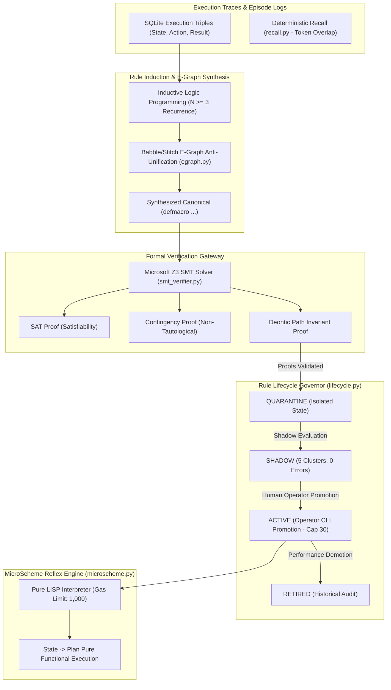
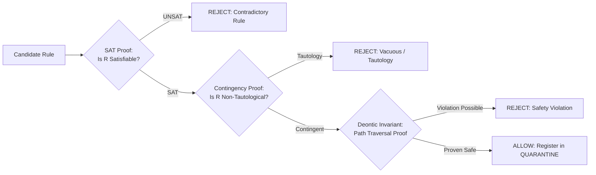
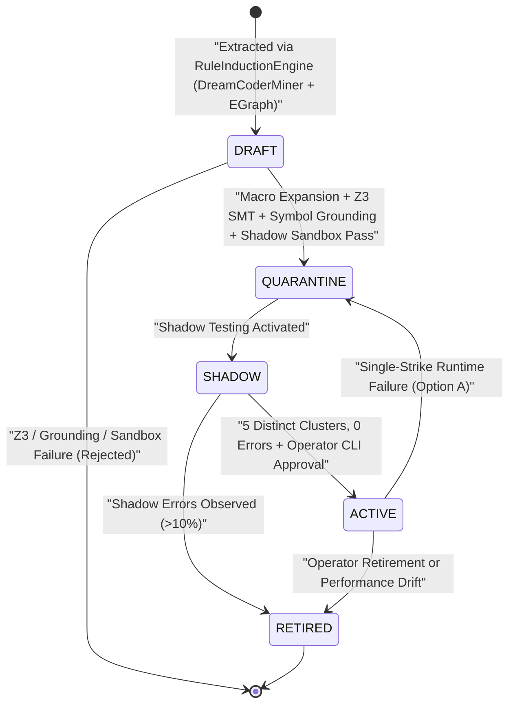

# Subsystem Reference Manual: 03 — Symbolic Reasoning & Formal Verification

**Subsystem:** `src/lucca/reasoning/`  
**Version:** 1.50.0 (`WO-42`)  
**Architectural Tier:** System 1 Symbolic Engine, Neurosymbolic Program Synthesis & SMT Formal Prover  
**Hardware Placement:** Intel Core Ultra 9 275HX (Host CPU), Microsoft Z3 C++ DLL (`libz3.dll`)  

---

## 1. Subsystem Architecture Overview

The `reasoning` subsystem implements System 1 compiled reflexes, formal theorem proving, e-graph macro synthesis, and safe rule induction. It guarantees that deterministic procedures execute in microseconds without consuming GPU memory or neural tokens, and ensures that no learned rule can execute on the operating system without a mathematical proof of deontic compliance.

---

## 2. MicroScheme LISP Reflex Engine (`microscheme.py`)

MicroScheme is a pure, minimal LISP interpreter engineered for sub-millisecond procedural execution:

| Property | Value | Architectural Purpose |
| :--- | :--- | :--- |
| **Purity Invariant** | Pure `State → Plan` | Zero global state mutation; cannot alter host environment directly. |
| **Gas Metering** | `1,000` execution gas units | Halts execution if recursion or loops exceed budget; prevents CPU lockups. |
| **Execution Latency** | $< 150\,\mu\text{s}$ P50 on Intel Ultra 9 | Delivers instantaneous reflexes without LLM neural deliberation. |
| **Macro Limits** | `MAX_MACRO_DEPTH = 8`, `MAX_STEPS = 64` | Guarantees compile-time termination of macro expansions (`D-REAS-05`). |
| **Typed Accessors** | `entity-str`, `entity-int`, `entity-num` | Enforces Pydantic schema validation at extraction time (`D-SEC-04`). |

---

## 3. Microsoft Z3 SMT Formal Verification (`smt_verifier.py`)

Before any candidate MicroScheme rule or macro is registered into quarantine, it must pass formal satisfiability and safety proofs verified by Microsoft Z3 (`libz3.dll`):

$$\text{Candidate Rule } R \implies \text{Z3 Verification Pipeline } \mathcal{V}(R)$$

### 3.1 Verification Invariants (`WO-39` Organ 4 Hardening)
1. **Satisfiability Check (`check_sat`):** Confirms that there exists at least one realistic world state where the rule's preconditions hold.
2. **Contingency Check (`check_contingent`):** Ensures that the rule does not evaluate to `True` under all possible inputs (rejecting trivial tautologies like `(or x (not x))`).
3. **Deontic Path Proof (`verify_path_safety`):** Encodes workspace path boundaries into first-order logic formulas. Proves that for all string inputs $p$, the resulting path expression cannot escape `C:\ProjectLucca\workspace` or `notes\`. If any unmodeled predicate is detected, the prover **fails closed** (`UNMODELED_PREDICATE`).
4. **Arithmetic & Division Safety (`SMTVerifier` in `WO-39`):** Encodes arithmetic expressions and divisor constraints in Z3, proving that candidate rules and macros cannot trigger division-by-zero or modulo-by-zero traps (`divisor != 0`) across reachable state domains.
5. **Macro Expansion Before Z3 Verification (`DreamCoderMiner`):** In `compression.py`, `DreamCoderMiner` expands synthesized `(defmacro ...)` forms prior to invoking `SMTVerifier`, ensuring Z3 proves the safety and satisfiability of the fully expanded underlying AST rather than treating macro call sites as opaque symbols.
6. **Performance SLA:** Complete Z3 formal verification executes in **$\le 25\,\text{ms}$** on host silicon (budget: $\le 500\,\text{ms}$).

---

## 4. Babble/Stitch E-Graph Macro Synthesis (`egraph.py`, `compression.py` & `induction.py`)

When a user repeatedly performs equivalent sequences of actions ($N \ge 3$) or the agent resolves multi-turn impasses, the inductive logic programming engine (`RuleInductionEngine` in `induction.py`, wired directly to `DreamCoderMiner` and `EGraph` in `WO-39`) translates conscious reasoning into compiled reflexes:

1. **Real Trace & Impasse Extraction (`DreamRetrospective`):** During sleep-phase reflection (`src/lucca/memory/reflection.py`), `DreamRetrospective` extracts real execution traces from SQLite `execution_triples` and unresolved waking impasses from `Orchestrator.impasse_backlog` (replacing the legacy `:code "print(1)"` stub placeholder).
2. **E-Graph Equality Saturation & `cost_fn` Extraction (`egraph.py`):** Ingests AST expressions into an equivalence graph (`EGraph`), applying rewrite rules to saturate equivalences. `EGraph.extract_best` selects the minimal-cost canonical program from each e-class using the structural description length objective `cost_fn` (`src/lucca/reasoning/cost.py`).
3. **First-Order Syntactic Anti-Unification:** Extracts least general generalizations (LGG), replacing variant constants with typed parameters:
   $$\text{AntiUnify}(\text{expr}_1, \text{expr}_2) \to \text{LGG}(\text{expr})$$
4. **Macro Synthesis:** `DreamCoderMiner` emits canonical `(defmacro ...)` definitions that compile multiple tool calls into a single atomic MicroScheme reflex and expands them before Z3 verification.
5. **NLI Entailment Phrasing Clustering (`RuleInducer.cluster_phrasings` in `WO-42`):** `DreamRetrospective.retrospective` (`src/lucca/memory/reflection.py:373`) passes the OpenVINO `MiniLM-L6` `SemanticVerifierPort` (`verifier`) into `RuleInducer.mine_patterns` (`src/lucca/reasoning/induction.py:402-465`) so `cluster_phrasings` groups lexically distinct but semantically equivalent user phrasings via bidirectional NLI entailment in addition to token-stem Jaccard overlap.

---

## 5. Safe Rule Lifecycle & ACT-R / NARS Skill Library (`lifecycle.py` & `skills.py`)

No induced rule is ever granted execution rights automatically. The system enforces strict graduated verification:

### 5.1 The Active Rule Limit Invariant (`ACTIVE_SKILL_LIMIT = 30`)
To prevent rule proliferation and cognitive bloat, the active rule pool is hard-capped at **30 active rules**. If a new rule is promoted when 30 rules are active, the operator must explicitly retire an existing rule, maintaining high precision and zero rule collisions.

### 5.2 Organ 3: `SkillLibrary` Verification, NARS Scoring & ACT-R Activation (`src/lucca/reasoning/skills.py`)
In `WO-39`, `SkillLibrary` enforces four cognitive and safety mechanisms before and during skill retrieval:
1. **AST Symbol Grounding (`_check_ast_symbol_grounding`):** Inspects every candidate skill AST to verify that all referenced functions, primitives, and variables resolve to grounded symbols in the allowed execution environment, rejecting hallucinated or ungrounded identifiers.
2. **Shadow Sandbox Verification (`verify_in_shadow_sandbox`):** Executes candidate skills against historical/synthetic I/O test cases in an isolated shadow sandbox before registration, rejecting any skill that raises an exception, times out, or fails output assertions.
3. **OpenNARS $(w^+, w^-)$ Evidential Scoring:** Tracks positive ($w^+$) and negative ($w^-$) execution evidence for every skill, computing NARS truth frequency $f = \frac{w^+}{w^+ + w^-}$ and confidence $c = \frac{w^+ + w^-}{w^+ + w^- + 1.0}$.
4. **ACT-R Base-Level + Spreading Activation:** Ranks skills during retrieval using John Anderson's ACT-R activation equation:
   $$A_i = \ln \left( \sum_{j=1}^{n} t_j^{-d} \right) + \sum_{k \in \text{Context}} W_k S_{ki}$$
   combining power-law temporal decay over historical usages ($d = 0.5$) with contextual spreading activation from the active goal and query tokens.

---

## 6. Organ 4: Neurosymbolic Program Synthesis (`mcts.py` & `abduction.py`)

1. **MCTS + Koza GP Subtree Crossover (`ASTHoleMCTSEngine` in `src/lucca/reasoning/mcts.py`):**
   - Decontaminated in `WO-39` to restrict candidate numeric literals strictly to `UNIVERSAL_NUMERIC_CONSTANTS = [0, 1, 2, 3, -1]` (removing problem-specific magic constants).
   - Combines UCT tree search over typed AST holes `(?hole <name> [type])` with **Koza-style Genetic Programming (GP) subtree crossover and point mutation** evaluated directly against multi-example `test_cases`.
2. **Thread-Safe Z3 Abductive Hole Solving (`BackwardAbductionSolver.solve_holes_z3` in `src/lucca/reasoning/abduction.py`):**
   - Synthesizes missing hole constants and linear expressions by encoding all I/O `test_cases` simultaneously into a thread-isolated Z3 `Context()` and `Solver()`, extracting exact satisfying assignments that generalize across every provided example.

---

## 7. Organ 5: General Spatial & Mereotopological Reasoning (`spatial_dsl.py` & `spatial_scheme.py`)

In `WO-39`, the spatial reasoning subsystem was completely decontaminated and generalized:
1. **Removal of Hardcoded ARC Solvers (`src/lucca/reasoning/spatial_dsl.py`):** All 8 hardcoded task-specific ARC solver functions (`solve_arc_task_1` through `solve_arc_task_8`) were deleted. In their place, `spatial_dsl.py` provides general, parameterized geometric and mereotopological primitives:
   - `rotate_grid(grid, k)`: $90^\circ \times k$ dihedral rotation.
   - `reflect_grid(grid, axis)`: Horizontal, vertical, and diagonal reflections.
   - `translate_grid(grid, dr, dc, fill)`: Bounded 2D translation with background fill.
   - `crop_grid(grid, r0, c0, h, w)`: Subgrid bounding-box extraction.
   - `overlay_grid(base, top, r0, c0, transparent)`: Compositional object layering.
2. **Metamorphic Invariance Gate (`check_metamorphic_invariance` in `src/lucca/reasoning/spatial_scheme.py`):**
   - Enforces that synthesized spatial programs satisfy algebraic equivariance under $D_4$ dihedral spatial transformations ($f(T(x)) = T(f(x))$) and color-permutation invariance before a candidate spatial rule is accepted as a general law.
