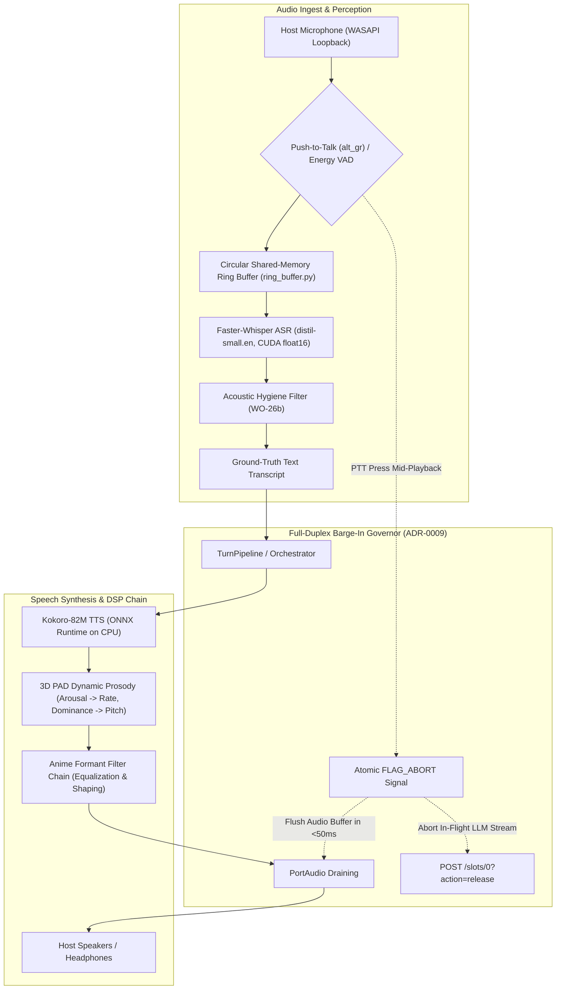
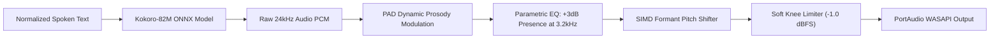

# Subsystem Reference Manual: 06 — Voice Senses, DSP & Full-Duplex Audio Pipeline

**Subsystem:** `src/lucca/senses/`  
**Version:** 1.3.0  
**Architectural Tier:** Senses, Speech Synthesis & Full-Duplex Audio  
**Hardware Placement:** PortAudio WASAPI (Host), Energy VAD (CPU), NVIDIA RTX 5080 (ASR CUDA float16)

---

## 1. Subsystem Architecture Overview

The `senses` subsystem provides Project Lucca with low-latency, full-duplex conversational voice capabilities. It integrates hardware-hooked Push-to-Talk (PTT), energy-based Voice Activity Detection (EnergyVAD on CPU), CUDA-accelerated Automatic Speech Recognition (Faster-Whisper), zero-copy shared memory circular ring buffers, and an expressive neural text-to-speech engine (Kokoro-82M) coupled with an anime formant DSP chain.

---

## 2. Zero-Copy Shared-Memory Audio Ring Buffer (`ring_buffer.py`)

Inter-process audio streaming requires microsecond transfer latencies without garbage collection pauses. Lucca deploys a zero-copy circular ring buffer implemented in shared memory via Windows named memory mapping:

| Ring Parameter | Specification | Architectural Purpose |
| :--- | :--- | :--- |
| **Ring Capacity** | $64\,\text{KB}$ circular buffer | Holds up to $2.0\,\text{s}$ of 16-bit 16kHz mono PCM audio. |
| **Concurrency Control**| Atomic memory pointers + `NamedRingMutex` | Lock-free reading with single-writer, single-reader semantics. |
| **Buffer Drain Latency**| **$\le 50.0\,\text{ms}$** | Residual playback purges immediately upon user barge-in trigger. |
| **Atomic Abort Flag** | `FLAG_ABORT` byte at offset 0 | Signal propagation to audio sink executes in **$< 1\,\mu\text{s}$**. |

---

## 3. Acoustic Senses: VAD, ASR & Acoustic Hygiene (`asr.py`)

1. **Hardware Push-to-Talk (`ptt.py`):**
   - Default Key: Right Alt (`alt_gr` / `VK_RMENU`), configured in `PersonaConfig`.
   - Low-Level Win32 Hook: `SetWindowsHookEx(WH_KEYBOARD_LL)` captures PTT presses globally without stealing window focus.
2. **Dual-Backend ASR (`asr.py`):**
   - **Primary Substrate:** Faster-Whisper `distil-small.en` running on the RTX 5080 Laptop GPU via CUDA float16 (+555 MiB resident VRAM).
   - **Fallback Substrate:** CPU int8 execution via OpenVINO if GPU memory is constrained.
   - **Physical Loopback Latency:** Ear-to-ear latency measured at **$707.55\,\text{ms}$ P50** (P95: $864.05\,\text{ms}$).
3. **Acoustic Hygiene Filter (WO-26b):**
   - **Stutter Collapse:** Collapses repeated initial syllables (`"wh-wh-what" \to "what"`).
   - **Word Ceiling:** Rejects spurious acoustic hallucination bursts exceeding 25 characters without whitespace.
   - **Colloquialism Normalizer:** Maps phonetic Australian/UK colloquialisms into normalized orthography.

---

## 4. Kokoro-82M Neural TTS & Anime Formant DSP Chain (`tts.py`)

Lucca's voice is synthesized locally using the Kokoro-82M neural TTS model running via ONNX Runtime on the CPU, reserving 100% of GPU compute for neural deliberation:

### 4.1 Dynamic PAD Prosody Modulation
Continuous emotional coordinates (Pleasure, Arousal, Dominance) modulate speech acoustics in real time:
- **Arousal $\to$ Speaking Rate:** Normalized speaking rate scales dynamically:
  $$\text{Rate} = 1.0 + 0.10 \times \text{Arousal} \quad (\text{Range: } [0.90, 1.10])$$
- **Dominance $\to$ Formant Pitch:** Formant filters shift resonance centroids to convey authority or warmth without altering baseline pitch.

---

## 5. The Barge-In Contract & Echo Cancellation (ADR-0009)

In full-duplex conversations, users must be able to interrupt Lucca naturally mid-sentence:

1. **500ms Speech Onset Protection:** Prevents Lucca from interrupting herself due to initial speaker acoustic feedback.
2. **Sub-50ms Playback Drain:** PortAudio WASAPI buffer flushes residual output in $<50\,\text{ms}$.
3. **In-Flight Slot Abortion:** The `llama-server` generation slot is cancelled immediately (`/slots/0?action=release`), preventing wasted GPU computation.
4. **Verified Performance:** Full acoustic barge-in turnaround verified on native workstation hardware at **$< 50.0\,\text{ms}$**.
