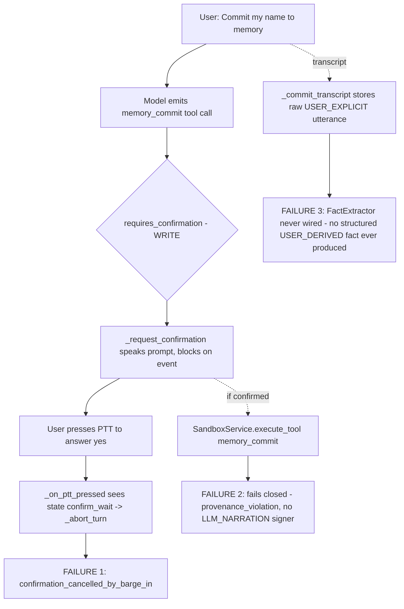

# Plan: Reasoning-Loop Remediation + Cognitive Systems Audit

**Date:** 2026-09-22
**Origin:** Live session log (Sean / `memory_commit` deadlock), Louvre FULL_LOOP failure, WO-8 findings F-WO8-26, reasoning-architecture discussion.
**Goal:** (Phase A) fix the known defects that make Lucca fail at things she *says* she can do; (Phase B) systematically map how the cognitive loop is *supposed* to work vs. how it *actually* works, and produce a ranked findings register of limitations blocking intelligence.

---

## 0. The governing invariant

> **Answers and actions are earned, not generated.** Every action Lucca proposes either executes with a receipt, or is honestly narrated as not-executed. Every fact she states is either retrieved with provenance, or honestly abstained.

Every defect below is a place where the system lets the model *say* something the substrate cannot back.

---

## 1. Diagnosis of the live log (three stacked failures)

| # | Failure | Location | Severity |
|---|---------|----------|----------|
| F1 | PTT press during `confirm_wait` is treated as barge-in and cancels the pending confirmation before the release can deliver the voice answer. Typed input has the same flaw via `_on_user_text` aborting the blocked worker. | [`orchestrator.py:622-625`](../src/lucca/core/orchestrator.py:622), [`orchestrator.py:731-733`](../src/lucca/core/orchestrator.py:731) | **P0** — every confirmation-gated tool is unusable by voice *and* text |
| F2 | `memory_commit` is advertised to the model as a tool but the dispatcher fails closed by doctrine (ADR-006). The model is handed a tool that can never succeed, so it repeatedly promises to use it. | [`service.py:346-392`](../src/lucca/sandbox/service.py:346), tool schema registration in `capabilities.py` | **P0** — advertised capability that is structurally impossible |
| F3 | `FactExtractor` (the only legitimate `USER_DERIVED` commit path) exists but is not called from any turn path. User facts survive only as raw transcript rows. | [`extraction.py:96`](../src/lucca/memory/extraction.py:96); zero references in `orchestrator.py` | **P1** — memory substrate has no structured-fact ingestion |
| F4 | Model narrates future-tense action ("I'll go ahead and commit your name right now!") with no tool call in flight and no receipt; coherence gate only catches past-tense ungrounded claims. Anti-stalling only fires on rhetorical questions. | [`coherence.py:181`](../src/lucca/core/coherence.py:181), [`orchestrator.py:1637-1662`](../src/lucca/core/orchestrator.py:1637) | **P1** — "promise without action" is unguarded |
| F5 | Fixed `max_rounds=3` with tools stripped on the final round (`round_tools = tools if round_num < max_rounds else []`) — 2 tool rounds + forced synthesis regardless of task complexity. | [`orchestrator.py:1339`](../src/lucca/core/orchestrator.py:1339), [`orchestrator.py:1435`](../src/lucca/core/orchestrator.py:1435) | **P1** — Louvre-class multi-step tasks cannot converge |
| F6 | Gemma `<\|tool_call\|>` demux: first-24-char detection window, malformed args (`query:<\|"\|>…<\|"\|>`) leak as speech, unresolved tags spoken (F-WO8-26). | [`toolcall_demux.py:64-221`](../src/lucca/brain/toolcall_demux.py:64) | **P1** |
| F7 | Coherence verb families lack `invoke_skill` / `memory_search` / `memory_commit` — LISP invocations and memory operations are ungroundable even with receipts. | [`coherence.py:32-79`](../src/lucca/core/coherence.py:32) | **P2** |
| F8 | `ASSISTANT_ACTION` provenance is defined, signed, `MEMORY_ELIGIBLE`, and queried by `SELF_HISTORY` — but **nothing commits it**. `_record_tool_receipt` appends to a RAM list reset every turn. LLM-initiated tool attempts (success, failure, cancel, timeout) leave no autobiographical trace, so "did you actually do X?" has nothing to retrieve and the model confabulates. | [`orchestrator.py:1087-1111`](../src/lucca/core/orchestrator.py:1087), [`orchestrator.py:1776`](../src/lucca/core/orchestrator.py:1776) | **P1** — autobiographical hole exactly where honesty needs it |

### Autobiographical memory — current coverage

| Track | Provenance | Committed by | Status |
|---|---|---|---|
| What she said | `ASSISTANT_UTTERANCE` | `_commit_assistant_utterance` | live |
| First-person stances | `ASSISTANT_BELIEF` | `_maybe_form_belief` → `ReflectionEngine` | live |
| Self-contradictions / ungrounded claims | `COHERENCE_BREACH` | `_commit_coherence_breach` | live |
| Rule-engine actions | `execution_triples` | `emit_execution_triple` | live (ACT_THEN_NARRATE + `invoke_skill` only) |
| LLM-initiated tool actions | `ASSISTANT_ACTION` | — | **missing (F8)** |
| Facts about the user | `USER_DERIVED` | — | **missing (F3)** |

---

## Phase A — Fix known defects (ordered by dependency)

### A1. Confirmation deadlock (F1)
- In [`_on_ptt_pressed()`](../src/lucca/core/orchestrator.py:622): when `_pending_confirmation_active`, do **not** call `_abort_turn()`; transition to `listening` only, so `_on_ptt_released()`'s F-CORE-015 path can stash the audio.
- In [`_on_user_text()`](../src/lucca/core/orchestrator.py:731): when `_pending_confirmation_active`, run `parse_confirmation_response(text)` → `confirm_action(accepted, via="click")` instead of aborting.
- Preserve genuine barge-in: a *second* PTT press while ASR of the confirmation answer is running, or an explicit "stop/cancel" REFLEX, still cancels.
- Regression tests in [`tests/test_confirmation.py`](../tests/test_confirmation.py): (a) press→release "yes" during confirm_wait executes tool; (b) press→release "no" cancels with `via=voice`; (c) typed "yes" during confirm_wait executes; (d) `stop` reflex during confirm_wait cancels.

### A2. `memory_commit` — grounded explicit commit (F2) — **DECISION: do both (A2 + A3)**
Rationale: passive extraction (A3) gives baseline recall without user effort; explicit `memory_commit` gives an *intentional* save with spoken confirmation and a receipt (which is what lets the coherence gate ground "I saved that") and a natural "no, don't save that" path. Both share one provenance path: `check_fact_grounding` verbatim-quote check → `DerivedFactSigner` → `USER_DERIVED`.

- New ADR (`ADR-010: Grounded memory_commit`): the dispatcher **never stores the model's `content`**. The model's `{s,p,o}` is a *candidate*; the dispatcher locates the current-turn `USER_EXPLICIT` transcript payload and calls `FactExtractor.extract_and_sign(transcript_payload, [candidate])`. If grounding fails → `ToolResult(ok=False, stderr="not grounded in your words")`; the model must narrate that honestly.
- `MemoryCommitArgs` schema gains `s`, `p` (closed `PREDICATES` list), `o`, `quote` fields.
- `_describe_tool_action("memory_commit")` returns a fact read-back: "save that your name is Sean".
- Confirmation rejection ("no") is itself a signal: record `ASSISTANT_ACTION` receipt with `cancelled_by_user` (see A9) so she can later say "you told me not to save that".
- Tests: model-authored content not grounded in transcript → refused; grounded candidate → `USER_DERIVED` with `source_entry_ids=[transcript.entry_id]`; fact retrievable next turn via `_search_memories`; rejection produces a persisted cancel receipt.

### A3. Wire passive fact extraction (F3)
- `FactExtractor.extract_and_sign()` is a **validator**, not a generator — it needs `s/p/o/quote` candidates. Candidate generator decision: **start with rule-engine entity slots** (`rule_state.entities` → closed `PREDICATES` map, e.g. `name`→`name_is`, `city`→`lives_in`). Deterministic, zero latency, testable. LLM-JSON candidate generation is a later, gated enhancement (must run off the speech path, ≤1 extra inference/turn, still verbatim-grounded).
- Call site: `_finalize_turn` after `_commit_transcript` returns the transcript `entry_id`; run off the TTS path; ≤5 facts/turn.
- Hypothetical / interrogative guard: reuse `_INTERROGATIVE_PATTERN` and add conditional markers ("if I told you", "suppose", "what if") → skip extraction. The A1 fixture "If I told you my name was Sean" must produce **no** fact.
- Tests: "My name is Sean" → `USER_DERIVED name_is Sean`; hypothetical → none; question → none; duplicate fact next turn → supersession not duplication (`FUNCTIONAL_PREDICATES` path in `store.commit`).

### A9. Persist `ASSISTANT_ACTION` receipts (F8)
- In `_record_tool_receipt` (or in `_finalize_turn` over `current_turn_receipts`): commit each receipt as an `ASSISTANT_ACTION` memory — content `"{tool}({summary args}) → ok|failed|cancelled|timeout: {error}"`, `structured` carrying `call_id`, `tool`, `ok`, `error`, `trace_id`. Use the existing assistant signer; `kind="action"`.
- Include **non-executions**: confirmation cancelled, confirmation timeout, BDI rejection, provenance refusal. These are the records honesty depends on.
- Importance low (0.2) so they don't crowd the 2,048-token memory block; `SELF_HISTORY` already reads this class with recency ordering.
- Tests: FULL_LOOP tool call → `ASSISTANT_ACTION` row; cancelled confirmation → row with `cancelled_by_user`; "did you actually commit my name?" → `SELF_HISTORY` returns the cancel record and the answer is grounded.

### A4. Promise-without-action guard (F4)
- Extend [`detect_ungrounded_action_claims`](../src/lucca/core/coherence.py:181) with a future/present-progressive family ("I'll", "I am going to", "let me", "doing it right now", "one second while I") → classify as `PROMISED_ACTION`.
- In `_stream_llm_speech`: if a round ends with `PROMISED_ACTION` claims, tools were available, and no tool was called → inject a directive tool_message ("You stated you would perform X but issued no tool call. Either call the tool now or state plainly that you did not.") and continue one more round. Reuse the existing anti-stalling injection slot at [`orchestrator.py:1649`](../src/lucca/core/orchestrator.py:1649).
- If the cap is hit with the promise still unfulfilled → speak the honest fallback, commit `COHERENCE_BREACH`.
- Add corpus cases to [`tests/fixtures/coherence/narration_corpus.jsonl`](../tests/fixtures/coherence/narration_corpus.jsonl) from the live log verbatim.

### A5. Convergence-based tool loop (F5)
- Replace fixed `max_rounds=3` semantics: loop terminates when the model produces a round with **no tool calls** (natural convergence). Tools remain available every round.
- Hard safety cap (config, default 8) as runaway guard only. On cap hit: forced synthesis round with explicit directive to summarise *what was found and what was not*, never to fabricate.
- Loop protection: `SequenceGuard`-style detection of identical `(tool, args)` repeated ≥2× → inject "that call already returned; use its result or try a different approach" directive.
- Per-round budget telemetry into `TurnTrace` (rounds used, tools per round, cap hit flag) so tests can assert convergence.
- Tests: Louvre-class synthetic (`FakeLLM` scripted for 4 tool rounds then synthesis) converges in 5 rounds; runaway `FakeLLM` hits cap and produces honest summary; repeated identical call triggers guard.

### A6. Demux hardening (F6 / F-WO8-26)
- Mid-stream `<|tool_call|>` detection (not first-24-chars).
- Lenient Gemma args parser: strip `<|"|>` sentinels, accept `key:value` and `key=value`, fallback to JSON.
- Invariant: **no unresolved tool markup is ever emitted as `TokenDelta`**; buffer until resolved or flushed as a parse-error tool message.
- Extend [`tests/test_chunker.py`](../tests/test_chunker.py) T-CHK-12/13 with the exact Louvre and Sean payloads.

### A7. Coherence verb families (F7)
- Add `invoke_skill`, `memory_search`, `memory_commit`, `note_write` to [`get_tool_family_map()`](../src/lucca/core/coherence.py:32) with natural-language synonyms ("checked my memory", "ran the pathway", "saved a note").

### A8. Gates + live re-verification
- `ruff`, `tests/test_static_gates.py`, T0–T2 tiers, targeted `@hw` re-run of A1 introspective battery.
- Live smoke script replicating the Sean transcript end-to-end (voice-confirm → fact committed → "What is my name?" answered from `USER_DERIVED` record) — record in `logs/test_reports/`.
- Append F-WO8-26..34 to [`docs/audit/findings/WO8_WP5-5_findings_2026-09-22.md`](../docs/audit/findings/WO8_WP5-5_findings_2026-09-22.md).

### Items added by the Phase B audit (see docs/audit/findings/COGNITIVE_AUDIT_2026-09.md)

### A10. Memory-tab live refresh (F17)
- Publish `mem.commit` / `mem.reject` on the bus from the orchestrator commit wrappers (event types already defined in `events.py`, never emitted).
- UI: subscribe and debounce-refresh the memory tab; also refresh on tab switch in `_on_tab_changed`.
- Tests: bus event emitted on transcript commit; UI refresh handler updates table (Qt test or signal spy).

### A11. Router session_id fix (F10)
- Pass `self.session_id` (not `trace.trace_id`) to `router.route` in `_run_turn` and `_run_text_turn`.
- Tests: two turns in one session share `session_id` in the `decisions` table; `session_turns` increments.

### A12. Belief formation on action turns (F9)
- Remove the `not self.current_turn_tool_calls` gate so stance claims are captured on tool turns too; keep the FULL_LOOP tier gate and the interrogative filter.
- Tests: stance claim spoken during a tool turn produces an `ASSISTANT_BELIEF`; interrogatives still excluded.

### A13. Tool-surface truthfulness (F14/F15/F16)
- Advertise `launch_app` in the native registry (confirmation-gated, whitelist-bound, shell ban intact) **or** narrow the `query_capabilities` spoken fallback. Recommendation: advertise — the user-facing claim already exists.
- Add a Docker-availability precondition note to the prompt contract for workspace tools (one line in `ARCHITECTURAL_SELF_AWARENESS` capabilities bullet).
- Defer advertising async-task tools until a task-start tool exists (note in register).

### A14. `self_history_search` tool (F18) — after A9
- New READ tool exposing the SELF_HISTORY query path (execution_triples ∪ ASSISTANT_ACTION ∪ ASSISTANT_UTTERANCE ∪ COHERENCE_BREACH ∪ ASSISTANT_BELIEF) with `query`, `since`, `provenance_filter` args; receipt-style rows.
- ADR draft in the audit register; depends on A9 for content.
- Tests: after a cancelled `memory_commit`, "did you actually save it?" answered from the persisted cancel receipt.

### Deferred minor findings
F11 (last-tool-only narration), F12 (raw vs normalized transcript to router), F13 (CLARIFY no-op), F19 (write-only telemetry) — recorded in the register; fix opportunistically during A-phase file touches or defer to WO-9.

---

## Phase B — Cognitive systems audit (research → findings register)

Purpose: stop finding these one log at a time. Trace each pathway end-to-end, document *intended* vs *actual* behaviour, and rank gaps.

### B1. Turn lifecycle & routing map
- Trace `_on_ptt_released` / `_on_user_text` → `_run_turn` / `_run_text_turn` → router → tier dispatch → `_finalize_turn`. Document every early-return and every state transition.
- Audit `Router` tier selection: what actually forces REFLEX vs ACT_THEN_NARRATE vs FULL_LOOP; how `is_follow_up` heuristics and `TOOLLESS_INTENTS` gate tools (hard-coded keyword lists at [`orchestrator.py:2398-2441`](../src/lucca/core/orchestrator.py:2398) are a smell — assess).
- Deliverable: `docs/audit/COGNITIVE_LOOP_MAP.md` with a sequence diagram per tier.

### B2. Tool surface truthfulness audit
- For every tool in `capabilities.py` and every skill in `config/skills/`: does the dispatcher exist, does it require confirmation, can it succeed under default config (Docker present/absent, `use_direct_fallback=False`)? Flag every "advertised but impossible" case (F2 is the first).
- Check `_describe_tool_action` covers every confirmation-gated tool with a human-readable summary.
- Deliverable: tool truth-table in the findings register.

### B3. Memory ingestion & retrieval flow
- Map every commit path (`_commit_transcript`, `_commit_assistant_utterance`, `_maybe_form_belief`, `_commit_coherence_breach`, `_record_tool_receipt`, `MemoryManager.add_memory`, `FactExtractor`) → provenance → `MEMORY_ELIGIBLE` / `GROUNDING_ELIGIBLE` → retrieval visibility (`HybridRetriever`, `format_memory_context`, `memory_search` tool via `list_memories`).
- Verify the **memory tab** question: does `MemoryManager.list_memories` (own DB connection, lazy init at [`settings_dialog.py:413`](../src/lucca/ui/settings_dialog.py:413)) surface raw transcripts and `ASSISTANT_*` classes, or filter them out? Does it read committed WAL data while `lucca-core` holds the writer? Does the tab need a refresh timer / bus subscription to `memory.committed`?
- Deliverable: provenance-class × pathway matrix; UI freshness finding.

### B4. Self-knowledge & reflection capability
- `SELF_HISTORY` substrate ([`cascade.py:947`](../src/lucca/core/cascade.py:947)) reads `execution_triples` + `ASSISTANT_ACTION/UTTERANCE/BELIEF/COHERENCE_BREACH` with token-overlap scoring, gated by a keyword classifier. Assess: (a) is it reachable in FULL_LOOP as a tool, or only via epistemic-context injection? (b) does `memory_search` include assistant provenance classes? (c) are `DecisionRecord`s (`decisions.jsonl`) and `TurnTrace`s retrievable at all?
- Evaluate `ReflectionEngine` wiring: `detect_and_handle_contradiction` trigger conditions, `pending_spoken_updates` delivery, `rollup_nightly` scheduling — is any of it actually firing in live sessions?
- Define what "Lucca reflects on her own thinking" should mean operationally: a `self_history_search` tool with provenance receipts, a per-turn "what I did / what I could not do" record, and a spoken-update channel. Propose ADR.
- Deliverable: gap list + ADR draft.

### B5. Honesty gate coverage map
- Enumerate all gates (`OutputSupervisorSession` matchers, `detect_ungrounded_action_claims`, `_check_contradictions`, BDI validator, ProvenanceGate) and the claim types each covers (past action, future action, citation, capitulation, deontic, belief). Produce a coverage matrix and identify uncovered claim types (F4 found one).
- Deliverable: matrix in findings register.

### B6. Prompt & self-model audit
- Review `ARCHITECTURAL_SELF_AWARENESS`, `STATIC_CATEGORY_MENU`, tool descriptions, `build_narration_messages`, memory block instructions: does anything tell the model it can do something the substrate refuses? Does anything instruct behaviour the loop then penalises (e.g. "AUTONOMOUSLY EXECUTE" while confirmation blocks)?
- Deliverable: prompt-contract diffs.

### B7. Ranked findings register + roadmap
- Consolidate B1–B6 into `docs/audit/findings/COGNITIVE_AUDIT_2026-09.md` using the finding template, severity-ranked, each with a repro and a proposed fix.
- Propose follow-on work orders (WO-9 candidates).

---

## Out of scope for this plan
- Brain swap / Bonsai re-evaluation (closed negative under rung C1b).
- Router model retraining.
- UI redesign beyond memory-tab freshness.
