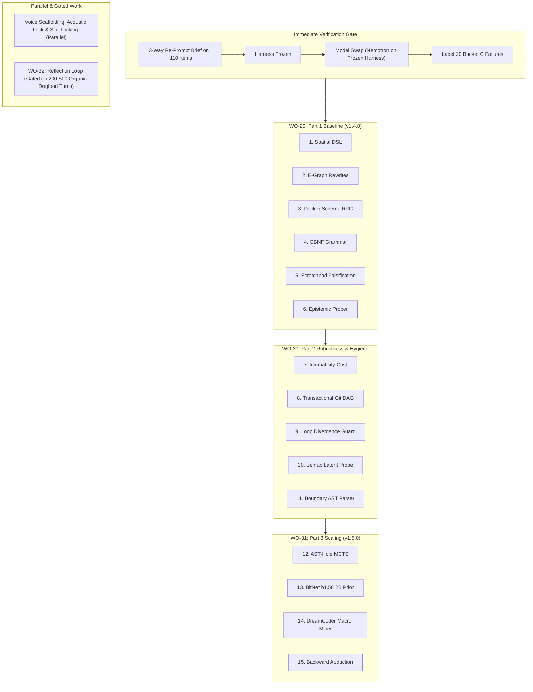

# WO-29 — Version 1.4.0: Neuro-Symbolic Program Synthesis & The 15-Module Cognitive Ladder

**Date:** 2026-10-03  
**Target Release:** Project Lucca Version 1.4.0 Baseline (Part 1) $\to$ Version 1.5.0 Autonomous Cognitive Engine (Part 3)  
**Lifecycle Bridge:** Successor to `v1.35` Evidence Campaign; initiates after v1.35 Step 5 Held-Out Evaluation and the 3-Way Re-Prompt Harness Gate.  
**Audience:** Implementing engineers and autonomous coding agents. Every tier specifies exact files, architectural mappings, hardware budgets, and explicit gating criteria.  

---

## 0. Architectural Context & Lifecycle Sequence

Project Lucca's progression follows a disciplined, evidence-based sequence:
1. **v1.35 Evidence & Rigor Campaign (`handover/HANDOVER.md`):** Resolves non-determinism, fixes SymPy timeouts and dict indexing bugs on the dev-400 set, and concludes with **Step 5: Held-Out Test Set Evaluation** (100 problems, indices 1–100) to freeze the `v1.35` evaluation anchor.
2. **Immediate Verification Gate:** A 3-way re-prompt comparison across ~110 items to freeze the decoding/prompt harness, followed by the Nemotron 30B model swap evaluation and labeling 20 Bucket C failures.
3. **WO-29 (Part 1 Core Synthesis):** Implements Modules 1–6 on host CPU and Docker sandbox, laying the foundational neuro-symbolic program synthesis channel for v1.4.0.
4. **WO-30 (Part 2 Robustness & Hygiene):** Implements Modules 7–11 for invariant defense, Git worktree staging, and divergence prevention.
5. **WO-31 (Part 3 Autonomous Search):** Implements Modules 12–15 for CPU MCTS, BitNet b1.58 2B policy prior, and DreamCoder macro mining (v1.5.0).
6. **Orthogonal Tracks:** Acoustic Lock & Slot-Locking for voice companion fluency; WO-32 proactive reflection loop (gated on 200–500 organic dogfood turns).

---

## 1. Architectural Foundations in Lucca

Lucca’s codebase is uniquely primed for these 15 modules. Several modules build directly upon mature subsystems:
- **MicroScheme Symbolic Core:** AST parser, lexer, validator, and primitives in [`src/lucca/reasoning/scheme/`](file:///c:/Projects/ProjectLucca/src/lucca/reasoning/scheme/).
- **Congruence-Closure E-Graphs:** Equivalence graph rewrite engine in [`src/lucca/reasoning/egraph.py`](file:///c:/Projects/ProjectLucca/src/lucca/reasoning/egraph.py).
- **Persistent Docker RPC Transport:** Line-buffered sub-millisecond container execution in [`src/lucca/sandbox/rpc.py`](file:///c:/Projects/ProjectLucca/src/lucca/sandbox/rpc.py).
- **Conformal Intent Valve & Epistemic Belnap Bilattice:** Split-conformal calibration and abstention router in [`src/lucca/router/heuristic.py`](file:///c:/Projects/ProjectLucca/src/lucca/router/heuristic.py) and [`src/lucca/router/conformal.py`](file:///c:/Projects/ProjectLucca/src/lucca/router/conformal.py).
- **Tolerant AST Sanitizer:** Multi-stage extraction and syntax repair pipeline in [`src/lucca/sandbox/ast_sanitizer.py`](file:///c:/Projects/ProjectLucca/src/lucca/sandbox/ast_sanitizer.py).

---

## 2. The 15 Modules: Architectural Mapping

| Tier | # | Module Name | Target File | Existing Foundation in Lucca |
| :--- | :---: | :--- | :--- | :--- |
| **Part 1: Core Synthesis** *(v1.4.0 Baseline / WO-29)* | **1** | **Functional Scheme Spatial DSL** | `src/lucca/reasoning/spatial_primitives.scm` | Plugs directly into MicroScheme AST parser & primitives in [`src/lucca/reasoning/scheme/`](file:///c:/Projects/ProjectLucca/src/lucca/reasoning/scheme/) |
| | **2** | **Equality Saturation Rewrite Rules** | `src/lucca/reasoning/egraph.py` | Extends the existing Congruence-Closure E-Graph in [`egraph.py`](file:///c:/Projects/ProjectLucca/src/lucca/reasoning/egraph.py#L37-L60) |
| | **3** | **Persistent Docker Scheme RPC** | `src/lucca/sandbox/rpc.py` | Extends line-buffered `DockerRPCTransport` in [`rpc.py`](file:///c:/Projects/ProjectLucca/src/lucca/sandbox/rpc.py) |
| | **4** | **GBNF S-Expression Grammar** | `config/grammars/scheme_sketch.gbnf` | Native GBNF logit constraint in `llama-server.exe` |
| | **5** | **Scratchpad Falsification Loop** | `src/lucca/core/scratchpad.py` | Integrates into `SubTurnScratchpadBuffer` & Docker preflight |
| | **6** | **Non-Destructive Epistemic Prober** | `src/lucca/router/heuristic.py` | Extends the Conformal Intent Valve to halt on ambiguity ($\bot$) |
| **Part 2: Robustness & Hygiene** *(WO-30)* | **7** | **Idiomaticity Cost Extractor** | `src/lucca/reasoning/cost.py` | Plugs into AST extraction in [`egraph.py`](file:///c:/Projects/ProjectLucca/src/lucca/reasoning/egraph.py) |
| | **8** | **Transactional Git Staging DAG** | `src/lucca/sandbox/staging.py` | Context-manager worktree isolation inside WSL2 |
| | **9** | **Traceback Divergence Guard** | `src/lucca/core/convergence.py` | Extends turn convergence checks to abort hallucination loops |
| | **10** | **Belnap Latent Investigator** | `src/lucca/memory/latent_probe.py` | Uses Belnap 4-valued logic ($\top, \bot, T, F$) to isolate env state drift |
| | **11** | **Boundary Topology Parser** | `src/lucca/reasoning/topology.py` | Builds on AST extraction in [`ast_sanitizer.py`](file:///c:/Projects/ProjectLucca/src/lucca/sandbox/ast_sanitizer.py) to protect API contracts |
| **Part 3: Autonomous Search** *(v1.5.0 Cognitive Engine / WO-31)* | **12** | **AST-Hole MCTS Engine** | `src/lucca/reasoning/mcts.py` | Multi-threaded CPU tree search over S-expression holes |
| | **13** | **BitNet b1.58 2B Policy Prior** | `src/lucca/reasoning/bitnet_policy.py` | Host CPU integer SIMD execution (~1.2 GB RAM, 0 MB VRAM) |
| | **14** | **DreamCoder Macro Miner** | `src/lucca/reasoning/compression.py` | Extends anti-unification in [`egraph.py`](file:///c:/Projects/ProjectLucca/src/lucca/reasoning/egraph.py) for sleep-phase library learning |
| | **15** | **Backward Abduction Solver** | `src/lucca/reasoning/abduction.py` | Works backwards from target invariant assertions using e-graph unification |

---

## 3. Strict Hardware Budget & Invariant Discipline

The entire 15-module neuro-symbolic program synthesis stack satisfies Lucca's workstation hardware budget:
- **0 MB VRAM Delta:** Executed exclusively in host CPU threads (Intel Core Ultra 9 275HX, 24 cores / 24 threads), host DDR5 RAM, or the WSL2 Docker sandbox.
- **Dedicated GPU & NPU Allocation:**
  - RTX 5080 Laptop GPU (16 GB GDDR7) remains 100% dedicated to LLM neural deliberation (`gemma-4-12b` / `nemotron-30b`).
  - Intel NPU remains 100% dedicated to Kokoro TTS and Silero VAD.
- **Hard Architectural Invariants:**
  - **ADR-006:** Never promote freeform LLM narration into memory. All commits require authentic cryptographic envelopes signed by authorized domain signers.
  - **ADR-013:** Direct host fallback is disabled (`use_direct_fallback = False`). Tool execution runs in isolated Docker containers inside Ubuntu WSL2.

---

## 4. Phased Execution Roadmap

---

## 5. Detailed Breakdown of WO-29 (Part 1 Baseline)

### Module 1: Functional Scheme Spatial DSL
- **File:** `src/lucca/reasoning/spatial_primitives.scm`
- **Purpose:** Extend MicroScheme with declarative geometric and spatial operators (`translate`, `rotate`, `intersect`, `contains?`, `bounding-box`).
- **Integration:** Registered into MicroScheme environment via `src/lucca/reasoning/scheme/prims.py`.

### Module 2: Equality Saturation Rewrite Rules
- **File:** `src/lucca/reasoning/egraph.py`
- **Purpose:** Implement term-rewriting equality saturation rules over MicroScheme ASTs. Enables finding minimum-cost canonical forms without syntactic order sensitivity.
- **Integration:** Extends congruence-closure e-classes in `egraph.py`.

### Module 3: Persistent Docker Scheme RPC
- **File:** `src/lucca/sandbox/rpc.py`
- **Purpose:** Provide low-latency, persistent line-buffered stdio transport for executing MicroScheme programs inside the WSL2 Docker sandbox.
- **Integration:** Parallel to Python `lucca-toolsrv` worker; target execution latency $<10\text{ms}$.

### Module 4: GBNF S-Expression Grammar
- **File:** `config/grammars/scheme_sketch.gbnf`
- **Purpose:** Grammar-constrained logit sampling in `llama-server.exe` ensuring the model emits strictly valid S-expression sketches.
- **Integration:** Loaded via `grammar` parameter in `src/lucca/brain/llm_client.py`.

### Module 5: Scratchpad Falsification Loop
- **File:** `src/lucca/core/scratchpad.py`
- **Purpose:** Fast-path assertion checker that runs during intermediate sub-turn scratchpad generation to falsify non-viable candidate plans prior to full tool dispatch.
- **Integration:** Plugs into `SubTurnScratchpadBuffer` and preflight validation.

### Module 6: Non-Destructive Epistemic Prober
- **File:** `src/lucca/router/heuristic.py`
- **Purpose:** Extends the conformal intent classifier to issue clarifying epistemic probes when query intent lands in the Belnap ambiguity region ($\bot$).
- **Integration:** Intercepts before tool execution; emits grounded conversational clarification requests.

---

## 6. Immediate Gate Protocol Prior to Implementation

1. **Step 5 Evaluation (v1.35 Held-Out Test 100):** Run `scripts/run_modern_2024_benchmarks.py --benchmark math500 --offset 0 --samples 100 --config-label v1.35-final-test-100 --disable-prompt-cache --resume` and reconcile scores.
2. **Three-Way Re-Prompt Brief:** Run isolated evaluation on ~110 items to lock optimal prompt and decoding parameters.
3. **Freeze Harness:** Tag frozen harness configuration.
4. **Model Swap Verification:** Benchmark Nemotron 30B on the frozen harness; label 20 representative Bucket C failures.
5. **Begin WO-29 Phase 1:** Author unit tests and scaffold Modules 1–6.
