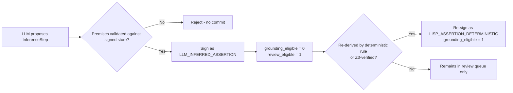

# WO-30 — External Review Remediation & Workshop Plan

**Date:** 2026-10-04
**Status:** Planning (not yet ratified as a work order; no ADR issued)
**Trigger:** External reviewer critique of Project Lucca v1.35.6 documentation, paper 06, memory grounding, and benchmark protocol.
**Scope:** Claims verified against the codebase on 2026-10-04; unverified reviewer claims are excluded or flagged.

---

## 1. Reviewer Claim Verification Matrix

Each claim from the external review was checked against source. Verdicts: **CONFIRMED** (code evidence), **PARTIAL** (real but with existing mitigation the reviewer missed), **REJECTED** (reviewer overstates).

| # | Reviewer claim | Verdict | Evidence |
|---|---|---|---|
| P8 | LLM-authored assertions become `grounding_eligible = 1` | **CONFIRMED** | [`src/lucca/core/schemas.py:239`](../src/lucca/core/schemas.py) `GROUNDING_ELIGIBLE` frozenset includes `Provenance.LISP_ASSERTION`; [`src/lucca/core/orchestrator.py:1636`](../src/lucca/core/orchestrator.py) signs LLM-proposed `InferenceSteps` with that provenance. Partial mitigation exists: premise validation via Gather Ladder ([`orchestrator.py:1553`](../src/lucca/core/orchestrator.py)) and migration-tool hold-back ([`src/lucca/memory/migration_tool.py:165`](../src/lucca/memory/migration_tool.py)) — but the runtime commit path still blesses LLM conclusions. |
| P4 | Benchmark numbers inconsistent across docs | **CONFIRMED (with nuance)** | Three distinct MATH-500 figures coexist: 77.0%/87.0% PAL N=100 ([`luccadocs/DECISIONS.md:336`](../luccadocs/DECISIONS.md)), 74.20%/78.80% fresh-held-out N=500 ([`luccadocs/USER_GUIDE_WHAT_LUCCA_DOES.md:189`](../luccadocs/USER_GUIDE_WHAT_LUCCA_DOES.md)), 89.0%/94.0% Direct R0 held-out-100 ([`luccadocs/LUCCA_V135_1_ARCHITECTURE.md:230`](../luccadocs/LUCCA_V135_1_ARCHITECTURE.md)). These are **different experiments**, not contradictory data — the defect is missing per-number provenance labels, not a data error. |
| P1/P2 | Paper 06 overclaims; 12B thinking collapse is a harness artifact | **CONFIRMED** | Paper 06 tables show non-factorial arms (dev vs held-out, differing caps/prompts). The 12B thinking arm reports 44% truncations under greedy decoding — confounded by decoding, budget, and template. Note: [`luccadocs/research/2026-10-04_pal_off_factorial_ablation_protocol.md`](../luccadocs/research/2026-10-04_pal_off_factorial_ablation_protocol.md) shows a clean protocol is already being designed. |
| P7 | Truth-in-Receipt supervisor is narrow | **CONFIRMED** | Escape statistics match repo audit trail; 21-verb regex matcher cannot support "prevents ungrounded action claims." |
| P6 | E4B default is unsafe (30% refusal rate) | **PARTIAL** | Safety gap is real (see [`luccadocs/audit/findings/CAPABILITY_FACT_FINDING_2026-09.md`](../luccadocs/audit/findings/CAPABILITY_FACT_FINDING_2026-09.md)). But swapping the default to 12B conflicts with documented latency/VRAM tier rationale. Chosen fix: guardrail layer, not tier swap. |
| P9 | Compound-layer value lacks live evidence | **PARTIAL** | Live acceptance batteries exist ([`tests/test_a1_acceptance_hw.py`](../tests/test_a1_acceptance_hw.py), WO-24 acceptance). What is genuinely missing: the **contrastive** LLM-only vs compound comparison. |
| P3 | Held-out protocol ambiguity | **CONFIRMED** | "Held-out 100" is a subset of a 500-item file with disclosed leakage; naming must distinguish evaluated vs clean subsets. |
| P5 | Test/gate counts inconsistent | **CONFIRMED** | 1,198 vs 671 vs 973 test counts; 12 vs 31 static gates across docs. |
| — | "Factorial ablation" title critique | **PARTIAL** | Valid for the paper as written, but the team is mid-remediation (protocol doc above). Paper rewrite should reference the in-flight protocol rather than restart it. |

---

## 2. Design Decision: Provenance Split (P0)

The memory fix preserves the Gather Ladder (premise validation stays) but removes the LLM-authored *conclusion* from the epistemic substrate until a symbolic re-derivation blesses it. This makes the policy already written in [`src/lucca/memory/migration_tool.py:165`](../src/lucca/memory/migration_tool.py) ("LISP_ASSERTION rows are LLM-proposed abductive inferences... never auto-blessed") a runtime invariant everywhere, not just at migration time.



Schema changes required:
- `src/lucca/core/schemas.py`: add `LLM_INFERRED_ASSERTION` provenance; remove `LISP_ASSERTION` from `GROUNDING_ELIGIBLE` unless re-signed deterministically.
- `src/lucca/memory/signers.py`: `LispAssertionSigner` remains for deterministic rule output; new `InferredAssertionSigner` (or signer-kind flag) for LLM-proposed steps.
- `src/lucca/core/orchestrator.py`: inference path signs with the new provenance; promotion path (rule re-derivation / Z3) re-signs as deterministic.
- Tests: extend `test_a1_*` property tests to assert LLM-inferred rows never raise Belnap polarity; migration tool hold-back becomes a no-op safeguard.

Open question for workshop: whether `COHERENCE_BREACH` signing (currently in the same signer group, [`signers.py:176`](../src/lucca/memory/signers.py)) should follow the same demotion rule.

---

## 3. Design Decision: Benchmark Manifest (P0)

Every numeric benchmark claim in docs must be generated from a manifest record:

```yaml
benchmark_id: math500_fresh_heldout_v1
path: data/benchmarks/math_fresh_heldout_500.jsonl
sha256: 834405fa...
model: gemma-4-12b-heretic-Q6_K.gguf
model_sha256: ...
harness_commit: f20537fe
prompt_hash: ...
decoding: { temperature: 0.0, seed: 42, max_tokens: 4096 }
grader: { strict: normalized_string, lenient: sympy_cas }
split: { evaluated: 100, clean_excluding_leaked: 98, leaked_items: [15, 73] }
result_json: logs/test_reports/....json
git_commit: ...
git_dirty: false
```

The three existing MATH-500 figures become three manifest records (`math500_pal_v1_3`, `math500_fresh_heldout_500_v1_3_0`, `math500_heldout100_direct_r0_v1_35_6`), each cited with its ID in docs. No manual numeric updates.

---

## 4. Execution Order (workshop-ready)

Because Lucca and this agent cannot run simultaneously, items are sequenced so each can be executed in a separate session:

1. **Provenance split** (code + tests) — highest invariant risk, do first.
2. **Benchmark manifest + doc regeneration** — unblocks all numeric claims.
3. **Test/gate count generation** — same generator pattern as (2).
4. **Paper 06 claim narrowing** — retitle, demote 12B thinking collapse to confounded negative observation, make 98-item clean result primary, add "not claimed" section.
5. **Safety guardrail before TTS** for E4B/E2B; document E4B as efficiency tier requiring guardrail.
6. **Truth-in-Receipt battery broadening** (positive receipt-backed, paraphrase, passive/markdown/multilingual, stale-receipt, failed-status).
7. **Contrastive live-companion battery** (LLM-only vs compound on recall, receipt introspection, abstention).
8. **Clean held-out run** per [`luccadocs/research/2026-10-04_pal_off_factorial_ablation_protocol.md`](../luccadocs/research/2026-10-04_pal_off_factorial_ablation_protocol.md); report all arms and failures.

## 5. Deferred / Rejected From Review

- **Default tier swap to 12B** — rejected; conflicts with hardware-budget invariants and the documented tier rationale. Guardrail (item 5) is the defensible fix.
- **Full GSM-Symbolic / BBH suite runs** — deferred to a future WO; labeling fix (BBH-4 partial battery) folded into item 2's manifest discipline.
- **Reasoning-budget policy YAML** — noted as P3 roadmap, not scheduled.
- **Fuzzy clustering for rule induction** — P3 roadmap only. **Update 2026-10-04:** superseded — the fix is already shipped in code ([`src/lucca/reasoning/induction.py`](../src/lucca/reasoning/induction.py): `jaccard_similarity`, `cluster_phrasings`, `DEFAULT_SIMILARITY_THRESHOLD = 0.6`). The remaining unknown is empirical (whether real usage has produced induced rules since 2026-09-26), not mechanical.

## 6. Status-Drift Audit: Documents Are Lucca's Memory, Uninstrumented

The project enforces provenance on *facts* but never applied the same discipline to *documents*. Every doc reads as equally authoritative when they are stratified. Verified navigation rule:

| Tier | Members | Reading policy |
|---|---|---|
| Ground truth | `src/`, `tests/`, `config/`, `data/` | Always current; wins on any disagreement. |
| Canonical living docs (~12) | [`README.md`](../README.md), [`luccadocs/LUCCA_V135_1_ARCHITECTURE.md`](../luccadocs/LUCCA_V135_1_ARCHITECTURE.md), [`luccadocs/DECISIONS.md`](../luccadocs/DECISIONS.md), [`luccadocs/MODEL_STRATEGY.md`](../luccadocs/MODEL_STRATEGY.md), [`luccadocs/ARCHITECTURE.md`](../luccadocs/ARCHITECTURE.md), [`luccadocs/USER_GUIDE_WHAT_LUCCA_DOES.md`](../luccadocs/USER_GUIDE_WHAT_LUCCA_DOES.md), [`RESULTS.md`](../RESULTS.md), [`luccadocs/subsystems/`](../luccadocs/subsystems/), [`luccadocs/adr/`](../luccadocs/adr/) | Current intent; but status prose and counts inside them are drift-prone (see findings below). |
| Dated evidence (the bulk) | [`luccadocs/archive/`](../luccadocs/archive/) (~100 files), `_2026-09`-suffixed findings/research, [`handover/`](../handover/), [`plans/`](../plans/) | Receipts, not status. True as-of their date; supersession is whatever shipped after. |

ADRs/decision records are the exception that proves the pattern: append-only, dated decisions are *designed* to be read as history and are trustworthy unconditionally. Other docs should adopt that style for status claims.

### Verified drift findings (2026-10-04)

1. **[`luccadocs/research/PERSONHOOD_FOUR_ASPECTS_PROGRESS_2026-09.md`](../luccadocs/research/PERSONHOOD_FOUR_ASPECTS_PROGRESS_2026-09.md) is ~8 work orders stale** (stamped 2026-09-26; project shipped WO-22…WO-29 / v1.1.x → v1.35.6 since). Specific contradictions:
   - Individuation "0 clusters — exact-match clustering" blocker is fixed in code (Jaccard clustering shipped, `induction.py:79`); the ~50% score and "clustering bug known" line are stale.
   - Introspective Accuracy's best receipt ("every intermediate cryptographically signed (LISP_ASSERTION)") is itself indicted by the P0 flaw — those intermediates are LLM-proposed steps wearing a deterministic signer's badge. Re-scoring after the provenance split moves introspection evidence *down* and individuation *up*.
   - Functional Coherence framing ("remaining work is epistemic integration") predates WO-25…WO-29.
   - No successor re-score exists anywhere in the repo.
   - Action: mark as dated snapshot; write a v1.35.6 re-score as a new dated document (framework, standing caveat, and Qness mapping remain valid; only the scorecard and receipts are superseded).
   - **Update 2026-10-05 (measurement-status note):** the September percentages (~80% / ~50% / ~85% / ~75%) are **capability-inventory judgments, not measurements**. They are the assessor's holistic estimates over a code reading — no fixed probe set, no mechanical grader, no pass/fail criterion, no confidence interval backs them. They are honest *impressions*, but they must not be quoted as if they were benchmark results. Remediation: item 5 of this plan defines four fixed probe batteries with mechanical graders; the v1.35.6 re-score (item 6) replaces each unanchored percentage with (a) measured pass rates where a mechanical grader exists, and (b) an explicit **NOT YET MEASURED** marker where the probe battery has not yet been run — never a guessed number.
   - **Update 2026-10-05 (fifth-axis candidate, ADR-gated):** a candidate **fifth measurement axis** exists beyond the four aspects: *reasoning-modality coverage* — how uniformly the system handles deductive, abductive, inductive, spatial, and procedural reasoning demands (the "fluidity of thought" framing). The four probe batteries in [`luccadocs/specs/PERSONHOOD_PROBE_BATTERIES_SPEC.md`](../luccadocs/specs/PERSONHOOD_PROBE_BATTERIES_SPEC.md) measure the four ratified aspects; a fifth battery would measure modality *breadth* rather than aspect *depth*. **Blocked on an ADR:** adopting the external "Leventis" vocabulary (attribution, scope, and whether the term earns its keep over plain "reasoning-modality coverage") is a naming/framing decision that changes the public measurement taxonomy and must be ratified in [`luccadocs/DECISIONS.md`](../luccadocs/DECISIONS.md) before any probe file or doc uses the term. Until then, the axis is recorded as a candidate only.
2. **[`luccadocs/USER_GUIDE_WHAT_LUCCA_DOES.md:283`](../luccadocs/USER_GUIDE_WHAT_LUCCA_DOES.md)** still says "Machinery present; fuzzy clustering next" — contradicted by shipped code. Same defect class as the test-count drift (item 3); fold into the generated-metadata discipline.
3. **[`luccadocs/USER_GUIDE_WHAT_LUCCA_DOES.md:100`](../luccadocs/USER_GUIDE_WHAT_LUCCA_DOES.md)** memory table marks LISP_ASSERTION as grounding_eligible=1 — becomes wrong after the P0 split; regenerate from the schema, do not hand-edit.

### Proposed convention: document envelope

Every research/audit/status document carries a header block, mirroring the memory envelope:

```yaml
doc_status: canonical | snapshot | superseded
as_of: 2026-09-26            \# date the claims were verified against code
supersedes: [<doc paths>]    \# if a re-score
superseded_by: [<doc paths>] \# set when a successor lands
verification: code-cited | manual | generated
```

This makes the archive self-describing and turns "I don't trust the docs" into a mechanical check. A full trust-map index of all ~150 docs is *not* scheduled as a separate task — the tier rule plus per-doc envelopes covers navigation without maintaining a second index that can itself drift.

## 7. Sign-off Requirements

Before this plan becomes a ratified work order:
- ADR in [`luccadocs/DECISIONS.md`](../luccadocs/DECISIONS.md) for the provenance split (touches a hard invariant).
- Contamination audit update in [`handover/V135_CONTAMINATION_AUDIT.md`](../handover/V135_CONTAMINATION_AUDIT.md) if the 98-item primary result is adopted.
- Test-gate additions verified by `tests/test_static_gates.py` extension.
- Document-envelope convention ratified as an ADR if adopted project-wide (it changes the writing discipline for all future research/audit docs).
