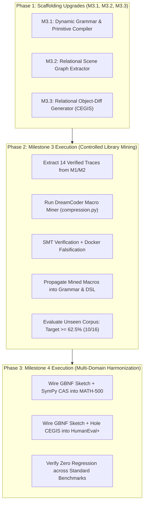

# Work Order 33: Controlled Library Extension & Multi-Domain Harmonization

```yaml
doc_status: canonical
as_of: 2026-10-11
target_release: v1.5.0 / WO-33
supersedes: []
superseded_by: []
verification: code-cited
```

**Target Release:** Project Lucca v1.5.0 Cognitive Engine Baseline  
**Prerequisites Satisfied:** WO-32 ConceptARC Neurosymbolic Synthesis complete (8/16 Unseen Corpus, 50.0%; 13/16 Minimal, 81.2%; sealed report `concept_arc_gbnf_minimal_1791667185.json`).  
**Hardware Budget Constraint:** $\Delta\text{VRAM} = 0\,\text{MB}$ strictly enforced on host; local `llama-server` on RTX 5080 Laptop GPU (16 GB VRAM) executing `gemma-4-12b-heretic-Q6_K.gguf` / `gemma-4-E4B-it-uncensored-heretic-Q6_K.gguf` with `--parallel 4`.  
**Model Spread Target:** Parity lift for `Gemma4-E4B` (from 18.8% toward 31.2%+) and `Gemma4-12B` (from 50.0% to $\ge 62.5\%$, 10/16).

---

## 1. Executive Summary & Purpose

Work Order 32 validated that pairing neural models with a discrete spatial DSL and preflight verification lifts ConceptARC performance while guaranteeing zero regressions ($Arm\ B \ge Arm\ A$). However, our post-WO-32 analysis established three critical findings:

1. **Top-Down Synthesis Bottleneck:** Even with $K=8$ parallel beam search, requiring a model to synthesize complete 15–25 line multi-step Python functions zero-shot creates a brittle combinatorial search space.
2. **The 4B Perceptual Penalty:** Dense 4B models (such as `Gemma4-E4B`) lack the latent capacity to simulate 2D coordinate spaces from flattened raw matrices, plateauing at 18.8% without upstream symbolic perception.
3. **Domain Fragmentation:** Spatial reasoning (ConceptARC), formal competition mathematics (MATH-500), and Python code generation (HumanEval+) currently use fragmented execution pathways (freeform thinking, PAL scripts, or raw generation) rather than a unified neurosymbolic grammar.

Per **Decision 3 of the Locked Architectural Plan**, Work Order 33 executes **Milestone 3 (Controlled Library Extension)** and **Milestone 4 (Multi-Domain Harmonization)**, augmented with the four essential scaffolding upgrades required for small-model (~4B) parity.

---

## 2. Decision 3 Architecture: The Locked Core Milestones

```
                     [Verified Traces across M1 & M2 (14 Solutions)]
                                           │
                                           ▼
            ┌─────────────────────────────────────────────────────────────┐
            │          MILESTONE 3: CONTROLLED LIBRARY EXTENSION          │
            │  • Sub-AST extraction (depth 2 <= d <= 5)                   │
            │  • First-order anti-unification (compression.py / egraph.py)│
            │  • Strict admission gates: >= 2 traces, >= 2 AST savings    │
            │  • D-REAS-05/06/07: SMT verified, quarantined in SQLite     │
            │  • Target: Lift Unseen Corpus from 50.0% to >= 62.5% (10/16)│
            └──────────────────────────────┬──────────────────────────────┘
                                           │
                                           ▼
            ┌─────────────────────────────────────────────────────────────┐
            │         MILESTONE 4: MULTI-DOMAIN HARMONIZATION             │
            │  • Unify GBNF Sketch Generation + Fast Hole Binding across: │
            │    1. ConceptARC Spatial Reasoning (MicroScheme/Python)     │
            │    2. MATH-500 Competition Math (SymPy CAS Hole Solver)    │
            │    3. HumanEval+ Code Synthesis (Unit Assertion CEGIS)      │
            └─────────────────────────────────────────────────────────────┘
```

### 2.1 Milestone 3: Controlled Library Extension (DreamCoder Anti-Unification)

* **Objective:** Mine recurring multi-step programmatic patterns from the 14 verified traces produced in M1 (Minimal, 9 code wins) and M2 (Unseen Corpus, 5 code wins) using first-order anti-unification in [`src/lucca/reasoning/compression.py`](file:///c:/Projects/ProjectLucca/src/lucca/reasoning/compression.py).
* **Admission Gates (Non-Negotiable Anti-Test-Tuning Invariants):**
  1. **Frequency Admission Gate:** A pattern must appear in $\ge 2$ distinct verified problem traces (`MIN_INSTANCES_FOR_MINING = 2`). One-off hacks are rejected.
  2. **MDL Cost Floor:** Must yield positive Minimum Description Length (MDL) compression savings, saving $\ge 2$ AST nodes (`compute_compression_savings() \ge 2.0`).
  3. **Complexity Bounding (`D-REAS-05`):** Macro depth $\le 8$, expansion steps $\le 64$.
  4. **Scratchpad Falsification:** Evaluated on $\ge 3$ synthetic test cases in isolated Docker via [`ScratchpadFalsifier`](file:///c:/Projects/ProjectLucca/src/lucca/core/scratchpad.py).
  5. **Formal SMT Verification (`D-REAS-07`):** Formally proved safe by Microsoft Z3 via [`SMTVerifier`](file:///c:/Projects/ProjectLucca/src/lucca/reasoning/smt_verifier.py).
  6. **Quarantine Invariant (`D-REAS-06`):** Admitted macros are registered strictly into `QUARANTINE` mode via [`RuleLifecycleManager`](file:///c:/Projects/ProjectLucca/src/lucca/reasoning/lifecycle.py). Zero automatic elevation to active companion rules without operator approval.
* **Target Metric:** Lift Unseen Corpus from **50.0% (8/16)** to **$\ge 62.5\%$ (10/16)** on Gemma 4 12B.

### 2.2 Milestone 4: Multi-Domain Harmonization (Math & Code)

* **Objective:** Port the GBNF Sketch Generation and Hole Parameter Binding architecture to MATH-500 and HumanEval+:
  1. **MATH-500 Harmonization:**
     * *Problem:* Greedy thinking scratchpads degrade 12B (dropping from 90.0% direct to 58.0% thinking, $p=4.66 \times 10^{-10}$), while E4B/E2B suffer from manual algebraic calculation errors.
     * *Solution:* Constrain output via GBNF to declarative mathematical sketches (e.g. `(solve-system :equations [...] :target x)`). Deterministic SymPy CAS in [`src/lucca/reasoning/scheme/math_primitives.py`](file:///c:/Projects/ProjectLucca/src/lucca/reasoning/scheme/math_primitives.py) binds the variables and computes the exact closed-form solution.
  2. **HumanEval+ Harmonization:**
     * *Problem:* Small models frequently identify the correct algorithmic topology (loops, dynamic programming tables, recursive branches) but fail on off-by-one boundary conditions.
     * *Solution:* Emit an algorithmic skeleton with typed parameter holes (`?hole_init`, `?hole_bound`, `?hole_step`). Evaluate candidates in $<5\text{ms}$ against docstring unit tests, performing local parameter binding before sandbox preflight.

---

## 3. Essential Scaffolding Remediations (The 4 Missing Pillars)

To guarantee that Milestone 3 and Milestone 4 generalize to edge models (~4B / `Gemma4-E4B`) and avoid the DreamCoder "learning in a vacuum" trap, the following four components must be implemented alongside M3/M4:

### 3.1 Milestone 3.1: Dynamic Library Propagation & Grammar Re-compilation
* **The Defect:** Currently, [`config/grammars/scheme_sketch.gbnf`](file:///c:/Projects/ProjectLucca/config/grammars/scheme_sketch.gbnf) and [`scripts/run_concept_arc.py`](file:///c:/Projects/ProjectLucca/scripts/run_concept_arc.py#L605-L610) hardcode 6 static primitives. If `compression.py` mines a macro, the model cannot call it because the grammar rejects the token.
* **Remediation:** Implement `compile_dynamic_sketch_grammar()` in [`src/lucca/reasoning/spatial_scheme.py`](file:///c:/Projects/ProjectLucca/src/lucca/reasoning/spatial_scheme.py):
  1. Ingest admitted macros from `compression.py` / `MacroRegistry`.
  2. Dynamically append their parameter signatures into `scheme_sketch.gbnf`.
  3. Register their documentation in `PRIMITIVE_REGISTRY` so prompts automatically expose newly mined primitives.

### 3.2 Milestone 3.2: Symbolic Scene Graph Extraction (Upstream Offloading)
* **The Defect:** In [`scripts/run_concept_arc.py`](file:///c:/Projects/ProjectLucca/scripts/run_concept_arc.py#L395-L402), the LLM receives raw 2D numerical grids (`[[0, 0, 1], ...]`) alongside visual PNGs, forcing E4B to simulate 2D coordinate vision in autoregressive attention.
* **Remediation:** Build `extract_scene_graph()` in [`src/lucca/reasoning/spatial_dsl.py`](file:///c:/Projects/ProjectLucca/src/lucca/reasoning/spatial_dsl.py):
  1. Extract connected components via 8-way flood fill, bounding boxes, pixel areas, color histograms, and hollowness.
  2. Compute topological relationships: `contains(A, B)`, `adjacent(A, B, dir)`, `aligned_x(A, B)`, `aligned_y(A, B)`.
  3. Format into a structured Scene Manifest (YAML/JSON) passed to the model, abstracting pixel coordinates into named spatial entities (`obj_1`, `obj_2`).

### 3.3 Milestone 3.3: Relational Error Diffs in CEGIS (Repair Loop)
* **The Defect:** [`generate_visual_diff()`](file:///c:/Projects/ProjectLucca/scripts/run_concept_arc.py#L253-L277) outputs raw coordinate errors (`row 2, col 4: expected 3, got 0`) and dumps full matrices. E4B cannot translate coordinate mismatches into AST repairs.
* **Remediation:** Implement `generate_relational_diff(pred_grid, expected_grid)`:
  1. Compare the scene graphs of `pred_grid` and `expected_grid`.
  2. Emit high-level transformation deltas:
     * `Diff: Object [color=2] position mismatch: translated to (r=3, c=5), expected (r=2, c=4). Delta: dr=+1, dc=+1.`
     * `Diff: Missing component: expected hollow frame of color 3, got solid block.`
  3. Turn the repair prompt into a 1-parameter surgical adjustment rather than an open-ended rewrite.

### 3.4 Milestone 4.1: State-Dependent Semantic Masking
* **The Defect:** Static GBNF enforces syntax but permits semantically absurd choices (e.g. referencing colors not present in the input grid, or selecting directions blocked by boundaries).
* **Remediation:** At generation time:
  1. Prune the GBNF grammar or logit mask to the active palette of the input grid ($C_{\text{active}} \subset \{0..9\}$).
  2. In MATH-500, restrict variable token choices to variables defined in the prompt text.
  3. Collapse the effective branching factor from $B \approx 40 \to B \le 5$.

---

## 4. Work Breakdown & Implementation Sequence



### Detailed Phase Tasks

#### Phase 1: Upstream Scaffolding (Zero Neural Dependency)
1. **Dynamic Grammar Compiler (`src/lucca/reasoning/spatial_scheme.py`):**
   - Add `compile_sketch_grammar(active_primitives: list[str]) -> str`.
   - Update `PRIMITIVE_REGISTRY` in `spatial_dsl.py` with typed domain annotations.
2. **Relational Scene Graph (`src/lucca/reasoning/spatial_dsl.py`):**
   - Add `build_scene_graph(grid: list[list[int]]) -> dict[str, Any]` capturing object IDs, bounding boxes, shapes, centroids, and containment.
   - Format `format_scene_graph_prompt(scene: dict[str, Any]) -> str`.
3. **Relational Diff Engine (`scripts/run_concept_arc.py`):**
   - Upgrade `generate_visual_diff()` to call `generate_relational_diff()`.
   - Add unit tests in `tests/test_spatial_dsl.py`.

#### Phase 2: Milestone 3 Execution
1. **Trace Ingestion:** Load verified programs from `logs/test_reports/concept_arc_gbnf_minimal_1791607195.json` and `concept_arc_gbnf_minimal_1791667185.json`.
2. **Macro Mining:** Run `mine_new_primitives(solved_traces, min_traces=2, min_cost_savings=2.0)` from `compression.py`.
3. **Register Mined Macros:** Emit into SQLite `QUARANTINE` table, compile into `scheme_sketch.gbnf`.
4. **Empirical Benchmark Run:**
   - Execute `python scripts/run_concept_arc.py --mode corpus`.
   - Verify: 12B $\ge 10/16$ (62.5%) and E4B $\ge 5/16$ (31.2%).
   - Preserve invariant: Zero regressions ($Arm\ B \ge Arm\ A$).

#### Phase 3: Milestone 4 Multi-Domain Harmonization
1. **MATH-500 Integration (`scripts/run_modern_2024_benchmarks.py`):**
   - Wire GBNF mathematical sketch grammar.
   - Bind parameter holes using `src/lucca/reasoning/scheme/math_primitives.py` SymPy solver.
   - Benchmark on fresh held-out 100 split.
2. **HumanEval+ Integration:**
   - Wire algorithmic skeleton synthesis with parameter holes.
   - Execute test-case assertion CEGIS hole binding loop.

---

## 5. Verification & Acceptance Gates

| Gate ID | Target Component | Acceptance Metric | Verification Command |
| :--- | :--- | :--- | :--- |
| **G-WO33-01** | Static Gates & Types | 0 `Any` violations (`D-AUD-01`), 0 unhandled broad excepts | `uv run pytest tests/test_static_gates.py` |
| **G-WO33-02** | Unit Test Suite | 100% passing across spatial DSL & Scheme tests | `uv run pytest tests/test_spatial_dsl.py tests/test_scheme_geometry.py tests/test_scheme_math.py` |
| **G-WO33-03** | M3 Admission Gates | $\ge 2$ trace instances, $\ge 2.0$ MDL savings, depth $\le 8$, steps $\le 64$ | `test_mine_new_primitives_anti_test_tuning_gate` |
| **G-WO33-04** | Unseen Corpus Lift (12B) | **$\ge 62.5\%$ (10/16)** passing (Wilson 95% CI lower bound $\ge 38\%$) | `python scripts/run_concept_arc.py --mode corpus` |
| **G-WO33-05** | Unseen Corpus Lift (E4B) | **$\ge 31.2\%$ (5/16)** passing (Matching 12B control baseline) | `python scripts/run_concept_arc.py --mode corpus` (with E4B server) |
| **G-WO33-06** | Zero Regression | $Arm\ B \ge Arm\ A$ on 100% of tasks at all scales | Sealed JSON report inspection |
| **G-WO33-07** | MATH-500 Parity | Strict CAS accuracy $\ge 88.0\%$ without circular thinking degradation | `python scripts/run_modern_2024_benchmarks.py --benchmark math500` |

---

## 6. Safety, Rollback & Hardware Invariants

1. **Hardware Freeze:** Local `llama-server.exe` remains strictly bounded to RTX 5080 Laptop GPU with $\Delta\text{VRAM} = 0\,\text{MB}$. All anti-unification, Z3 SMT proofs, and hole parameter enumerations execute on host CPU threads.
2. **Quarantine Protection (`D-REAS-06`):** Any macro mined from traces is marked `quarantined = True` in SQLite. No mined macro can promote itself to active status without operator confirmation.
3. **Zero-Regression Internal Fallback:** If sketch generation or verified code synthesis fails or raises on any task, the engine replays Arm A's raw grid prediction verbatim, mathematically guaranteeing $Arm\ B \ge Arm\ A$.
